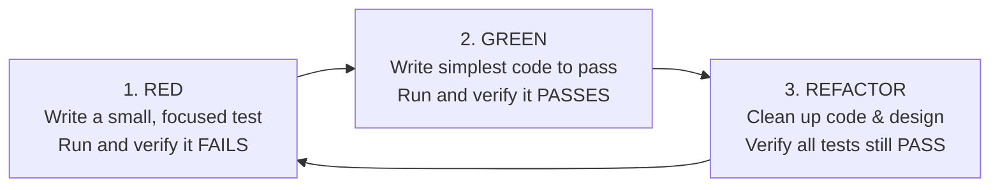

# Test-First & TDD Discipline Skill

This skill enforces strict Test-Driven Development (TDD) for the **Market Management System (MMS)** project, adapted from the `obra/superpowers` methodology.

---

## 1. Ironclad Rule: No Code Without a Failing Test

You must **NEVER** write implementation code for any business rule, calculation, or state mutation without first writing a test that fails for the expected reason.

### The 3 Laws of TDD:
1. You may not write any production code until you have written a failing unit test.
2. You may not write more of a unit test than is sufficient to fail; not compiling is considered failing.
3. You may not write more production code than is sufficient to pass the one currently failing unit test.

---

## 2. Red-Green-Refactor Lifecycle

### Step 1: RED (Failing Test)
- Author a test in `test/unit/` or `test/data/` that expresses the requirement (e.g., "Bread quick button adds 1 bread at current snapshot price").
- Execute `flutter test test/path/to/test.dart`.
- Verify the test fails specifically due to the missing functionality, not a syntax error.

### Step 2: GREEN (Simplest Working Code)
- Implement only the minimal logic required to make the test pass.
- Run `flutter test test/path/to/test.dart`.
- Verify all tests pass.

### Step 3: REFACTOR (Clean Code & Immutability)
- Eliminate duplication, improve naming, ensure Clean Architecture boundaries.
- Re-run all tests to guarantee zero regression.

---

## 3. High-Risk MMS Test Scenarios (Mandatory Coverage)

Always apply TDD to these critical domains:
1. **Monetary Precision:** Currency addition, change calculation (`cash_received - total`), rounding checks (must never produce off-by-one cent errors).
2. **Rational Unit Conversion:** Converting bulk/case packages ($1/24$) to atomic stock units without floating-point division drift.
3. **Negative Stock Permissibility:** Verifying that selling beyond available stock succeeds without database check constraint failure (`current_stock < 0`).
4. **Idempotency & Deduplication:** Submitting the same `idempotency_key` twice must return the existing transaction without deducting stock twice.
5. **Partial Refund Limits:** Ensuring that cumulative refunds cannot exceed original sale quantities (`refunded_quantity <= quantity`).

