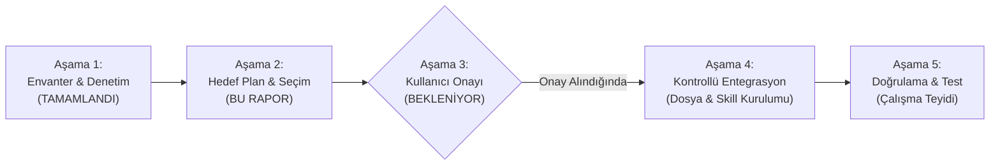
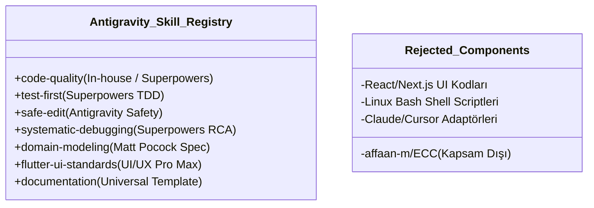

# MARKET MANAGEMENT SYSTEM (MMS) — Google Antigravity Entegrasyon Planı ve Yol Haritası

**Rapor Kodu:** `MARKET_MMS_ANTIGRAVITY_INTEGRATION_PLAN.md`  
**Tarih:** 4 Kasım 2026  
**Aşama:** Faz 0 — Proje Organizasyonu, Standartlar ve Entegrasyon Tasarımı  
**Hazırlayan:** Google Antigravity / Gemini 3.8 Flash (High)  
**Kapsam:** Aşama 2 Çıktısı — Klasör Mimarisi, Koruma & Oluşturma Listesi, Skill & Agent Seçim Matrisi, Güvenlik Politikası ve Onay Kapısı  
**İlgili Talimat:** `MARKET MMS — KLASÖR YAPISI, UNIVERSAL PROJECT TEMPLATE VE SKILL EKOSİSTEMİ ENTEGRASYONU`

---

## 1. Planın Amacı ve Kapsamı

Bu entegrasyon planı; önceki 3 denetim raporunda (`MARKET_MMS_FOLDER_STRUCTURE_AUDIT.md`, `MARKET_MMS_UNIVERSAL_TEMPLATE_INTEGRATION_REPORT.md`, `MARKET_MMS_ANTIGRAVITY_SKILL_ECOSYSTEM_AUDIT.md`) ulaşılan teknik bulguları eyleme dönüştürülebilir, kontrollü ve aşamalı bir yol haritasına bağlamak üzere hazırlanmıştır.

Plan; mevcut doğrulanmış Faz 0 dokümantasyonunu hiçbir veri kaybına uğratmadan, projenin klasör yapısını kurumsal bir standarda kavuşturmayı ve Google Antigravity'nin modern yerel yetenekleriyle tam uyumlu bir geliştirici ekosistemi kurmayı hedefler.

---

## 2. Aşamalı Entegrasyon Mimarisi (Phase Gates)



---

## 3. Önerilen Nihai Proje Klasör Yapısı

Kullanıcı onayı alındığında projede oluşturulması önerilen hedef yapı:

```text
market-pos/
├── AGENTS.md                                     # [KORUNACAK] Proje ortak bağlayıcı kuralları (v1.2)
├── GEMINI.md                                     # [KORUNACAK] Antigravity çalışma yönergeleri
├── CLAUDE.md                                     # [KORUNACAK] Gelecek CLI entegrasyon yönergeleri
├── README.md                                     # [YENİ] MMS Ürün Tanımı, Mimari ve Dokümantasyon Haritası
├── .gitignore                                    # [KORUNACAK] Platform ve geçici dosya kuralları
├── MARKET_POS_AI_STUDIO_BUILD_PLANI.md           # [KORUNACAK] Bağlayıcı ana proje planı
│
├── docs/                                         # [KANONİK DOKÜMANTASYON]
│   ├── PROJECT_OVERVIEW.md                       # [YENİ] Hızlı başlangıç ve yüksek seviyeli ürün özeti
│   ├── REQUIREMENTS.md                           # [YENİ] 10 modülün gereksinim fihristi ve giriş kapısı
│   ├── ARCHITECTURE.md                           # [GÜNCELLENECEK] Windows Service / Yerel Hub mimarisi
│   ├── ROADMAP.md                                # [KORUNACAK] 9 fazlık geliştirme yol haritası
│   ├── PROJECT_STATUS.md                         # [KORUNACAK] Canlı faz ve durum takip belgesi
│   ├── DEVELOPMENT_GUIDE.md                      # [YENİ] Geliştirici kurulumu, FFI/SQLite ve kurallar
│   │
│   ├── architecture/                             # Derin mimari ve protokol şartnameleri
│   │   ├── DATA_MODEL.md                         # [KORUNACAK] Mantıksal veri modeli v1.1 (25 tablo)
│   │   ├── DATA_MODEL_DECISIONS.md               # [KORUNACAK] Veri modeli karar kayıtları
│   │   ├── OFFLINE_SYNC_PROTOCOL.md              # [KORUNACAK/GÜNCELLENECEK] Outbox senkronizasyon şartnamesi
│   │   ├── OFFLINE_SYNC_DECISIONS.md             # [KORUNACAK] Senkronizasyon kararları
│   │   ├── LOCAL_STORAGE_TECHNICAL_VALIDATION.md # [KORUNACAK] Platform yerel depolama raporu
│   │   ├── BACKUP_RESTORE_PROTOCOL.md            # [KORUNACAK] Yedekleme ve geri yükleme protokolü
│   │   └── BACKUP_RESTORE_DECISIONS.md           # [KORUNACAK] Yedekleme karar kayıtları
│   │
│   ├── requirements/                             # Şartnameler ve iş keşifleri
│   │   ├── BUSINESS_RULES_SPEC.md                # [KORUNACAK] 159 bağlayıcı iş kuralı (v1.2)
│   │   └── PHASE_0_BUSINESS_DISCOVERY.md         # [KORUNACAK] İş keşfi ve karar konsolidasyonu (v1.3)
│   │
│   ├── decisions/                                # Mimari Karar Kayıtları (ADR)
│   │   ├── README.md                             # [YENİ] ADR fihristi ve durum tablosu
│   │   └── ADR_TEMPLATE.md                       # [KORUNACAK] Standart ADR şablonu
│   │
│   ├── phases/                                   # Faz Yönetim Belgeleri
│   │   ├── README.md                             # [YENİ] Faz yönetim fihristi
│   │   └── PHASE-TEMPLATE.md                     # [YENİ] Faz açılış/kapanış standart şablonu
│   │
│   └── reports/                                  # Denetim, QA ve Oturum Raporları
│       ├── README.md                             # [YENİ] Rapor arşivi fihristi
│       ├── MARKET_MMS_ANTIGRAVITY_INITIAL_AUDIT.md # [KORUNACAK] İlk mimari denetim raporu
│       ├── MARKET_MMS_FOLDER_STRUCTURE_AUDIT.md  # [KORUNACAK] Klasör yapısı denetim raporu
│       ├── MARKET_MMS_UNIVERSAL_TEMPLATE_INTEGRATION_REPORT.md # [KORUNACAK] Şablon raporu
│       ├── MARKET_MMS_ANTIGRAVITY_SKILL_ECOSYSTEM_AUDIT.md     # [KORUNACAK] Ekosistem raporu
│       └── MARKET_MMS_ANTIGRAVITY_INTEGRATION_PLAN.md          # [KORUNACAK] Bu entegrasyon planı
│
├── .agents/                                      # [ANTIGRAVITY YEREL ÇALIŞMA ALANI]
│   ├── registry/
│   │   └── SKILL_REGISTRY.md                     # [YENİ] Doğrulanmış beceriler kayıt defteri
│   │
│   └── skills/                                   # Antigravity Progressive Disclosure Becerileri
│       ├── code-quality/SKILL.md                 # Clean Architecture & SOLID denetim becerisi
│       ├── test-first/SKILL.md                   # TDD ve kuruş bazlı hesaplama test becerisi
│       ├── safe-edit/SKILL.md                    # Veri kaybı önleme ve güvenli düzenleme becerisi
│       ├── systematic-debugging/SKILL.md         # Kök neden analizi (RCA) ve log becerisi
│       ├── domain-modeling/SKILL.md              # MMS veri modeli ve kural denetim becerisi
│       ├── flutter-ui-standards/SKILL.md         # POS ekranı ergonomisi ve erişilebilirlik becerisi
│       └── documentation/SKILL.md                # ADR ve faz raporlama otomasyon becerisi
│
├── lib/                                          # [FAZ 1 - Henüz Kod Yazılmayacak]
│   ├── app/                                      # Router, tema, DI bootstrap
│   ├── core/                                     # Ortak tipler, failure sınıfları, rasyonel matematik
│   └── features/                                 # Feature-first modüller (sales, products vb.)
│
├── test/                                         # [FAZ 1 - Unit ve Widget Testleri]
└── integration_test/                             # [FAZ 1 - E2E Kasa Akış Testleri]
```

---

## 4. Dosya Yönetim Matrisi (Korunacak, Eklenecek ve Güncellenecekler)

### 4.1. Aynen Korunacak Dosyalar (Dokunulmaz Çekirdek)
1. `AGENTS.md` (Özgün kurallar tek doğruluk kaynağıdır).
2. `MARKET_POS_AI_STUDIO_BUILD_PLANI.md` (Kanonik referans belgesi).
3. `docs/requirements/BUSINESS_RULES_SPEC.md` (v1.2 - 159 kural).
4. `docs/requirements/PHASE_0_BUSINESS_DISCOVERY.md` (v1.3 keşif dokümanı).
5. `docs/architecture/DATA_MODEL.md` (v1.1 - 25 tablo).
6. `docs/architecture/DATA_MODEL_DECISIONS.md`.
7. `docs/architecture/LOCAL_STORAGE_TECHNICAL_VALIDATION.md`.
8. `docs/architecture/BACKUP_RESTORE_PROTOCOL.md`.
9. `docs/ROADMAP.md` ve `docs/PROJECT_STATUS.md`.
10. `.gitignore` ve `docs/decisions/ADR_TEMPLATE.md`.

### 4.2. Yeni Oluşturulması Önerilen Dosyalar
1. `README.md` (MMS genel tanıtımı ve mimari harita).
2. `docs/PROJECT_OVERVIEW.md` (Yönetici özeti ve ürün kapsamı).
3. `docs/REQUIREMENTS.md` (10 modüllük gereksinim dizini).
4. `docs/DEVELOPMENT_GUIDE.md` (Geliştirici ortamı ve katkı kılavuzu).
5. `docs/decisions/README.md` (ADR indeks sayfası).
6. `docs/phases/README.md` ve `docs/phases/PHASE-TEMPLATE.md` (Faz şablonları).
7. `docs/reports/README.md` (Rapor fihristi).
8. `.agents/registry/SKILL_REGISTRY.md` (Beceri kayıt defteri).
9. `.agents/skills/*/SKILL.md` (7 adet Antigravity becerisi).

### 4.3. İçeriği Güncellenecek Dosyalar
1. `docs/ARCHITECTURE.md`: Önceki Supabase-ağırlıklı ifadeden **Windows Service + Yerel API + Merkezi SQLite** modeline uyarlanacaktır.
2. `docs/architecture/OFFLINE_SYNC_PROTOCOL.md`: Senkronizasyon uç noktası ifadesi bulut REST'ten mağaza içi yerel Wi-Fi/LAN Windows API'sine uyarlanacaktır.

---

## 5. Seçilen, Uyarlanan ve Reddedilen Beceriler (Skill Curation)



### 5.1. Kabul Edilen ve Uyarlanan Beceriler (7 Çekirdek Beceri)
1. **`code-quality`:** Clean Architecture, saf Dart Domain katmanı, immutability ve SOLID standartlarını denetler. (Kaynak: MMS Proje İlkeleri + Superpowers).
2. **`test-first`:** Kuruş bazlı tam sayı para hesabı, sepet toplamları ve eksi stok kuralları için TDD yaklaşımını uygular. (Kaynak: `obra/superpowers`).
3. **`safe-edit`:** Veri kaybı, kontrolsüz dosya silme veya mimari kararları onaysız değiştirme girişimlerini durdurur. (Kaynak: Antigravity Yerel Güvenlik İlkeleri).
4. **`systematic-debugging`:** Kasa işlemlerinde hata oluştuğunda tahmin yürütmek yerine log, transaction durumu ve kök neden analizi (RCA) yaptırır. (Kaynak: `obra/superpowers`).
5. **`domain-modeling`:** Yeni bir varlık eklenirken iş kuralları şartnamesi ve veri modeliyle uyumu zorunlu kılar. (Kaynak: `mattpocock/skills`).
6. **`flutter-ui-standards`:** POS ekranı için minimum dokunmatik buton boyutları (48x48 dp), yüksek kontrast, monospace sayı formatı ve klavye odağını denetler. (Kaynak: `nextlevelbuilder/ui-ux-pro-max-skill`).
7. **`documentation`:** ADR kayıtlarının, faz raporlarının ve izlenebilirlik matrislerinin güncellenmesini yönetir. (Kaynak: Universal Project Template).

### 5.2. Reddedilen ve Ayıklanan Bileşenler
- `affaan-m/ECC`: Kullanıcı talimatı gereği kesin olarak elenmiştir.
- `nextlevelbuilder/ui-ux-pro-max-skill` içindeki React, Next.js, Vue ve Tailwind dosyaları (MMS Flutter projesidir; web dosyaları yük oluşturur).
- `obra/superpowers` içindeki Linux/macOS bash betikleri (Windows PowerShell ortamında çalışmaz).
- `pbakaus/impeccable` otomatik npm hook'ları (Antigravity içinde izinsiz shell tetiklemelerini önlemek için yalnız prompt rehberi olarak faydalanılır).

---

## 6. Önerilen `SKILL_REGISTRY.md` İçeriği

Kullanıcı onayladığında `.agents/registry/SKILL_REGISTRY.md` konumuna yazılacak olan resmi kayıt defteri taslağı:

```markdown
# SKILL_REGISTRY.md — MARKET MMS Beceri Kayıt Defteri

**Proje:** Market Management System (MMS)  
**Tarih:** 4 Kasım 2026  
**Standart:** Google Antigravity Skill Ecosystem v1.0  

---

## 1. Kayıtlı Beceriler Envanteri

| Skill Adı | Kaynak / Köken | Sabit Sürüm / Commit | Lisans | Amaç | Antigravity Uyumluluğu | Bağımlılıklar | Kurulum Yeri | Durum |
| :--- | :--- | :--- | :--- | :--- | :--- | :--- | :--- | :--- |
| **`code-quality`** | MMS / Superpowers | `main` (v1.0) | MIT | Clean Architecture, SOLID ve saf Domain denetimi | Tam Uyumlu | Yok (Saf Markdown) | `.agents/skills/code-quality/SKILL.md` | **Planned** |
| **`test-first`** | obra/superpowers | `e9c3a1b` | MIT | TDD Red-Green-Refactor, para ve sepet hesabı doğrulaması | Tam Uyumlu | Flutter Test runner | `.agents/skills/test-first/SKILL.md` | **Planned** |
| **`safe-edit`** | Antigravity Safety | `v1.0` | Dahili | Veri kaybını ve izinsiz dosya silmeyi engelleme | Tam Uyumlu | Yok | `.agents/skills/safe-edit/SKILL.md` | **Planned** |
| **`systematic-debugging`**| obra/superpowers | `e9c3a1b` | MIT | Kök neden analizi (RCA) ve sistematik log inceleme | Tam Uyumlu | Yok | `.agents/skills/systematic-debugging/SKILL.md` | **Planned** |
| **`domain-modeling`** | mattpocock/skills | `7a4f21c` | MIT | Spesifikasyon odaklı etki alanı ve kural modellemesi | Tam Uyumlu | Yok | `.agents/skills/domain-modeling/SKILL.md` | **Planned** |
| **`flutter-ui-standards`**| nextlevelbuilder/ui-ux-pro-max | `3b8d14e` | MIT | Kasa ekranı ergonomisi, dokunmatik alanlar, erişilebilirlik | Tam Uyumlu | Flutter SDK | `.agents/skills/flutter-ui-standards/SKILL.md` | **Planned** |
| **`documentation`** | Universal Template | `v1.0-balanced` | MIT | ADR, faz raporları ve durum güncellemelerini yönetme | Tam Uyumlu | Yok | `.agents/skills/documentation/SKILL.md` | **Planned** |

---

## 2. Kural ve İlkeler
1. Kaydı bulunmayan hiçbir harici beceri projede kullanılamaz.
2. Tüm beceriler Windows PowerShell ve Antigravity progressive disclosure mekanizmasıyla doğrulanmalıdır.
3. Beceriler asla kullanıcının açık onayı olmadan kod veya dosya silemez.
```

---

## 7. Güvenlik, İzin ve Doğrulama Politikası

1. **Windows Yolu ve Kabuk Güvenliği:** Becerilerde dosya yolları platform bağımsız forward slash (`/`) ile yazılacak, terminal komutları Windows PowerShell sözdizimine tam uyumlu olacaktır.
2. **Kör Betik Yasağı:** `curl ... | bash` veya `npm install -g ...` gibi denetimsiz internet komutları asla çalıştırılmayacaktır.
3. **Secret İzolasyonu:** API anahtarları, Windows Local Service şifreleri ve Google Drive OAuth kimlik bilgileri hiçbir skill veya doküman içine açık metin yazılmayacaktır.

---

## 8. Aşama 3: Kullanıcı Onay Kapısı (Decision Gate)

> [!IMPORTANT]
> **BU AŞAMADA DURULMUŞTUR.**
> Yukarıda sunulan;
> 1. Hedef klasör yapısı,
> 2. Doküman koruma ve yeni dosya oluşturma listesi,
> 3. Seçilen 7 adet yerel Antigravity becerisi,
> 4. `SKILL_REGISTRY.md` kayıt içeriği,
> 
> tamamen analiz edilmiş, tasarlanmış ve kullanıcının onayına hazır hale getirilmiştir.
> 
> **Kullanıcı açık onay vermeden:**
> - Hiçbir yeni klasör açılmayacaktır.
> - Hiçbir dosya oluşturulmayacak veya taşınmayacaktır.
> - Hiçbir beceri kurulumu yapılmayacaktır.

---

*Tüm analizler ve entegrasyon belgeleri eksiksiz hazırlanmıştır. Değerlendirmeniz ve Aşama 4'e geçiş onayınız beklenmektedir.*

