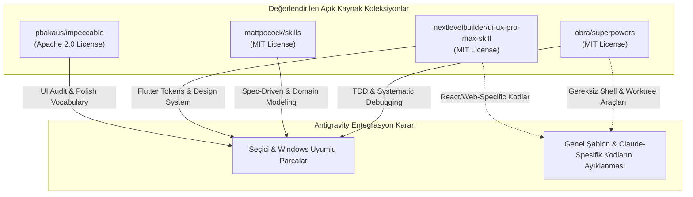

# MARKET MANAGEMENT SYSTEM (MMS) — Google Antigravity Beceri (Skill) ve Araç Ekosistemi Denetim Raporu

**Rapor Kodu:** `MARKET_MMS_ANTIGRAVITY_SKILL_ECOSYSTEM_AUDIT.md`  
**Tarih:** 4 Kasım 2026  
**Aşama:** Faz 0 — Geliştirme Ortamı, Beceriler ve Araç Ekosistemi  
**Hazırlayan:** Google Antigravity / Gemini 3.8 Flash (High)  
**Kapsam:** Antigravity Yerel Yetenekleri Doğrulaması, Açık Kaynak Skill Koleksiyonları Analizi (Superpowers, Matt Pocock, UI/UX Pro Max, Impeccable), Agent Rolleri ve Güvenlik Uyumluluğu  
**İlgili Talimat:** `MARKET MMS — KLASÖR YAPISI, UNIVERSAL PROJECT TEMPLATE VE SKILL EKOSİSTEMİ ENTEGRASYONU`

---

## 1. Giriş ve Amaç

Bu rapor; MARKET MMS projesinin ana geliştirme ortamı olan **Google Antigravity**'nin gerçek, doğrulanmış yerel yeteneklerini (`agy-customizations`, `antigravity-guide`) incelemek; piyasada yaygın olan açık kaynak AI beceri koleksiyonlarını bağımsız bir teknik süzgeçten geçirmek; Claude/Cursor gibi araçlara özgü varsayımları ayıklayarak yalnızca Antigravity üzerinde **gerçekten çalışan, güvenli ve Windows uyumlu** bir beceri ekosistemi tasarlamak amacıyla hazırlanmıştır.

---

## 2. Google Antigravity Yerel Yeteneklerinin Doğrulanması (10 Alan Analizi)

Antigravity ortamında çalışan yerel customisation kılavuzları taranarak 10 temel yetenek alanı incelenmiştir:

### 2.1. Proje Düzeyinde Kurallar (Project-Level Rules)
- **Destek Durumu:** **TAM DESTEKLENİYOR (Yerel).**
- **Beklenen Konum:** Kök dizinde `AGENTS.md`, `GEMINI.md` veya `.agents/rules/*.md`.
- **Kapsam:** Çalışma dizininden Git köküne kadar yukarı doğru taranır; geçerli dizin ve tüm alt dizinler için bağlama otomatik enjekte edilir.
- **Biçim:** Standart Markdown. Dosya başına 24 KB ve toplam 20.000 token kural bütçesi uygulanır.
- **Etkinleştirme & Test:** Herhangi bir dosya açıldığında veya konuşma başladığında Antigravity kuralları `<RULE[...]>` etiketiyle bağlama ekler.

### 2.2. Global Kurallar (Global Rules)
- **Destek Durumu:** **TAM DESTEKLENİYOR (Yerel).**
- **Beklenen Konum:** `~/.gemini/config/rules/` veya global eklenti kuralları.
- **Kapsam:** Kullanıcının makinesindeki tüm Antigravity oturumlarına evrensel olarak uygulanır.

### 2.3. Beceriler (Skills)
- **Destek Durumu:** **TAM DESTEKLENİYOR (Birinci Sınıf / Modern Standart).**
- **Beklenen Konum:** `.agents/skills/<skill_name>/SKILL.md` (veya `~/.gemini/config/skills/`).
- **Biçim:** YAML frontmatter (`name`, `description`) ve Markdown gövdesi. İsteğe bağlı `scripts/`, `examples/`, `references/` alt klasörleri.
- **Çalışma Prensibi (Progressive Disclosure):** Model başlangıçta tüm beceri metinlerini yüklemez; yalnızca isim ve açıklamalarını (description) bağlamda tutar. İlgili bir görev geldiğinde veya kullanıcı `/<skill_name>` yazdığında becerinin tam içeriğini okur. Bu durum bağlam (token) israfını önler.
- **Slash Command:** Bir skill tanımlandığı anda kullanıcı chat kutusuna `/<skill_name>` yazdığında doğrudan tetiklenebilir.

### 2.4. İş Akışları (Workflows) — [ÖNEMLİ TESPİT]
- **Destek Durumu:** **ESKİ / KULLANIMDAN KALDIRILMIŞTIR (DEPRECATED).**
- **Teknik Gerçek:** Antigravity'nin resmi `migrate-workflows` belgesinde açıkça belirtildiği üzere: `.agents/workflows/*.md` formatı modern Antigravity'de yerini bütünüyle **Skills** (`.agents/skills/<name>/SKILL.md`) mimarisine bırakmıştır.
- **Eylem Kuralı:** Projede bağımsız bir `workflows/` klasörü açıp içine dosya koymak eski bir kalıptır. Tüm iş akışları **Skill formatında** tanımlanmalıdır.

### 2.5. Özel Ajanlar ve Alt Ajanlar (Custom Agents & Subagents)
- **Destek Durumu:** **DESTEKLENİYOR (Subagent Modeli).**
- **Çalışma Modeli:** Antigravity'de bir ajanın çalıştırılabilmesi için `define_subagent` ve `invoke_subagent` araçları kullanılır.
- **Önemli Kısıt:** Markdown dosyasında bir ajan rolü yazmak (`agents/architect.md`), Antigravity'nin onu otomatik olarak ayrı bir süreçte çalıştırmasını **sağlamaz**. Ajan rolleri projemizde:
  1. Ya modelin bizzat uygulayacağı uzmanlık yönergesi (Persona / Guideline),
  2. Ya da `define_subagent` çağrısı için sistem prompt şablonu olarak kurgulanmalıdır.

### 2.6. Ajan Orkestrasyonu (Agent Orchestration)
- **Destek Durumu:** **DESTEKLENİYOR.**
- Ana ajan `invoke_subagent` ile arka planda çalışan izole alt ajanlar başlatabilir ve `send_message` ile haberleşebilir. İş bittiğinde reaktif uyandırma (no-polling wakeup) devreye girer.

### 2.7. Model Context Protocol (MCP) Entegrasyonları
- **Destek Durumu:** **TAM DESTEKLENİYOR (Yerel ve Eklenti Tabanlı).**
- **Konum:** `<appDataDir>\mcp\<serverName>` ve `mcp_config.json`.
- **Erişim:** Eager (doğrudan araç) veya Lazy (`call_mcp_tool`) olarak araçlar çağrılabilir.

### 2.8. Yaşam Döngüsü Kancaları (Lifecycle Hooks)
- **Destek Durumu:** **DESTEKLENİYOR.**
- **Konum:** `hooks.json`.
- **Olaylar:** `SessionStart`, `PreToolCall`, `PostToolCall`. Güvenlik veya ortam hazırlığı için otomatik betik tetikleyebilir.

### 2.9. Terminal ve Komut Çalıştırma İzinleri
- **Destek Durumu:** **DENETİMLİ DESTEK (`run_command`).**
- **Güvenlik Sınırı:** Windows PowerShell oturumunda çalışır. `accidental-data-loss-prevention` kuralları uyarınca geri dönüşü olmayan veri silme veya imha komutları için açık kullanıcı onayı zorunludur.

### 2.10. Proje Bağlamı ve Dosya İnceleme
- **Destek Durumu:** **TAM DESTEKLENİYOR.**
- `read_file`, `edit_file`, `write_file` araçlarıyla proje kökünden itibaren güvenli okuma/yazma yapılır.

---

## 3. Açık Kaynak Skill Koleksiyonlarının Teknik İncelemesi

Kullanıcı talimatında belirtilen açık kaynak koleksiyonlar güncel repository verileri ve lisansları doğrultusunda incelenmiştir:

---

### 3.1. Superpowers (`obra/superpowers`)
- **Yazar:** Jesse Vincent (`obra`) | **Lisans:** **MIT License** (Doğrulandı).
- **Temel Konsept:** AI modelinin körlemesine kod yazmasını engelleyen disiplinli yazılım mühendisliği metodolojisi.
- **Değerlendirilen Yetenekler:**
  - **TDD (Test-Driven Development):** Red-Green-Refactor döngüsü. Fiyat hesabı ve sepet toplamlarında test yazılmadan koda geçilmesini engeller.
  - **Systematic Debugging:** Hata anında rastgele kod değiştirmek yerine kök neden analizi (RCA) yapmayı zorunlu kılar.
  - **Implementation Planning:** Büyük görevleri küçük, atomik ve doğrulanabilir adımlara böler.
- **Antigravity Uyumluluğu:** Mantıksal kuralları Markdown tabanlı olduğu için Antigravity ile **%100 uyumludur**. Ancak repo içindeki bazı shell betikleri Linux/macOS bash varsayımına sahip olduğundan Windows PowerShell için saf prompt/kural formatına uyarlanmalıdır.

---

### 3.2. Matt Pocock Skills (`mattpocock/skills`)
- **Yazar:** Matt Pocock | **Lisans:** **MIT License** (Doğrulandı).
- **Temel Konsept:** "Skills for Real Engineers" — Fikirden üretime mühendislik omurgası.
- **Değerlendirilen Yetenekler:**
  - **Domain Modeling:** Karmaşık iş gereksinimlerinin etki alanına (domain) uygun modellenmesi.
  - **Documentation-Driven Development:** Önce spesifikasyon ve kabul kriteri, sonra kodlama.
  - **Codebase Design & Review:** Kod karmaşıklığını ve aşırı mühendisliği (over-engineering) denetleme.
- **Antigravity Uyumluluğu:** Yüksek. Antigravity'nin Clean Architecture ilkeleriyle mükemmel örtüşür. Çoğu becerisi doğrudan `SKILL.md` olarak taşınabilir.

---

### 3.3. UI UX Pro Max (`nextlevelbuilder/ui-ux-pro-max-skill`)
- **Yazar:** NextLevelBuilder | **Lisans:** **MIT License** (Doğrulandı).
- **Temel Konsept:** AI kodlama ajanları için kapsamlı tasarım zekâsı, UI stilleri ve UX rehberi.
- **Değerlendirilen Yetenekler:**
  - **Flutter UI Rehberliği:** Dokunmatik ekranlar için hedef boyutları (min 48x48 dp), kasa ekranında yüksek kontrast, POS ekranı klavye/barkod odak optimizasyonu.
  - **Tasarım Tokenları & Tipografi:** Kasa ekranlarında sayısal veriler için tabular/monospace rakam kullanımı (rakamların alt alta hizalanması).
  - **Accessibility (a11y):** Renk körlüğü ve düşük ışıklı market ortamları için okunabilirlik kuralları.
- **Antigravity Uyumluluğu:** Repoda yer alan React/Next.js/Tailwind dosyaları elenmeli; yalnızca **Flutter, Mobile, Desktop ve Design System** ilkeleri damıtılarak `skills/flutter-ui-standards/SKILL.md` altında toplanmalıdır.

---

### 3.4. Impeccable (`pbakaus/impeccable`)
- **Yazar:** Paul Bakaus | **Lisans:** **Apache License 2.0** (Doğrulandı).
- **Temel Konsept:** Yapay zekânın "generic / AI-slop" (sıradan, mor gradyanlı, özensiz) arayüzler üretmesini engelleyen profesyonel tasarım sözlüğü.
- **Değerlendirilen Yetenekler:**
  - `/critique`: Hiyerarşi, okunabilirlik ve netlik incelemesi.
  - `/audit`: Erişilebilirlik, performans ve taşma (overflow) denetimi.
  - `/polish`: Edge-case durumları (uzun ürün isimleri, kuruş taşmaları) için arayüzü sertleştirme.
- **Antigravity Uyumluluğu:** Antigravity slash-command altyapısıyla tam uyumludur. Flutter bileşenlerinin estetik ve ergonomik denetiminde bir kalite filtresi olarak kullanılabilir.

---

### 3.5. Kapsam Dışı Bırakılanlar
- **`affaan-m/ECC`:** Kullanıcı talimatı doğrultusunda kesin olarak kapsam dışı bırakılmıştır; incelenmemiş ve depoya dahil edilmemiştir.

---

## 4. Dört Temel Agent Rolünün Fizibilite Analizi

Talimatta belirtilen 4 uzman rolün Antigravity mimarisindeki karşılıkları incelenmiştir:

| Ajan Rolü | Sorumluluk ve Kapsam | İzin Sınırları & Kullanabileceği Araçlar | Onay Gerektiren İşlemler | Antigravity Gerçekleşme Biçimi |
| :--- | :--- | :--- | :--- | :--- |
| **Architect** | Sistem mimarisi, Clean Architecture katman sınırları, veri modeli tutarlılığı ve ADR üretimi. | `read_file`, `search_web`, mimari doküman yazma. | Mimari kararların değiştirilmesi, tablo şeması revizyonu. | Birinci sınıf planlama rehberi veya `invoke_subagent` uzmanı. |
| **Code Reviewer** | PR/Commit öncesi Clean Code, SOLID, immutability, kuruş hesabı ve dokümantasyon bütünlüğü denetimi. | Yalnızca Salt-Okunur (`read_file`, kod analiz araçları). Kod değiştirme yetkisi yoktur. | Yok (Yalnızca PASS/FAIL raporu üretir). | Kodlama tamamlandığında tetiklenen denetim becerisi. |
| **Test Engineer** | TDD akışı, unit/widget/integration test senaryoları, edge-case matrisleri ve test çalıştırma. | `read_file`, `write_file` (yalnızca `test/` dizinine), `run_command` (`flutter test`). | Canlı veritabanı veya üretim kodunu doğrudan değiştirme yetkisi yoktur. | Test yazımı ve doğrulamasında aktif çalışan uzman beceri. |
| **Security Auditor** | Güvenlik açıkları, API anahtarları, Windows Local API yetkilendirmesi, SQLite şifreleme ve DPAPI. | Salt-Okunur inceleme (`read_file`, güvenlik tarayıcıları). | Güvenlik protokolü veya şifreleme anahtarı değiştirme. | Bağımsız güvenlik ve gizlilik denetim rehberi. |

---

## 5. Güvenlik, Platform ve Windows Uyumluluğu

1. **İşletim Sistemi İzolasyonu:** Proje Windows üzerinde geliştirilmektedir. Becerilerin içine Linux'a özgü `bash`, `sed`, `awk` veya `/tmp` yolları yazılmamalı; platformdan bağımsız standart Markdown ve gerekirse Windows PowerShell komutları kullanılmalıdır.
2. **Kör Komut Çalıştırmama (No Blind Execution):** Hiçbir beceri, kullanıcının izni olmadan arka planda veritabanı silen, Git geçmişini ezen veya dosya taşıyan yıkıcı betikler çalıştıramaz.
3. **Secret Koruması:** Antigravity ortamında API anahtarları, Google Drive OAuth tokenları veya Windows Service parolaları asla `SKILL.md` veya `.agents/` dosyaları içine yazılmayacaktır.

---

## 6. Sonuç ve Özet Karar

Google Antigravity; hiyerarşik kurallar (`AGENTS.md`, `GEMINI.md`), progressive disclosure destekli beceriler (`.agents/skills/<name>/SKILL.md`) ve alt ajan orkestrasyonu (`invoke_subagent`) ile son derece güçlü ve modern bir altyapıya sahiptir. 

Açık kaynak dünyasındaki en değerli parçalar (Superpowers TDD + Matt Pocock Spec-First + UI/UX Pro Max Flutter Standartları + Impeccable Audit), Antigravity'nin yerel skill formatına dönüştürülerek projeye **sıfır yabancı bağımlılık ve sıfır dosya kirliliğiyle** entegre edilebilir.

