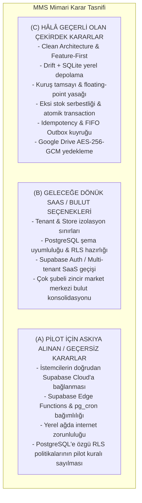
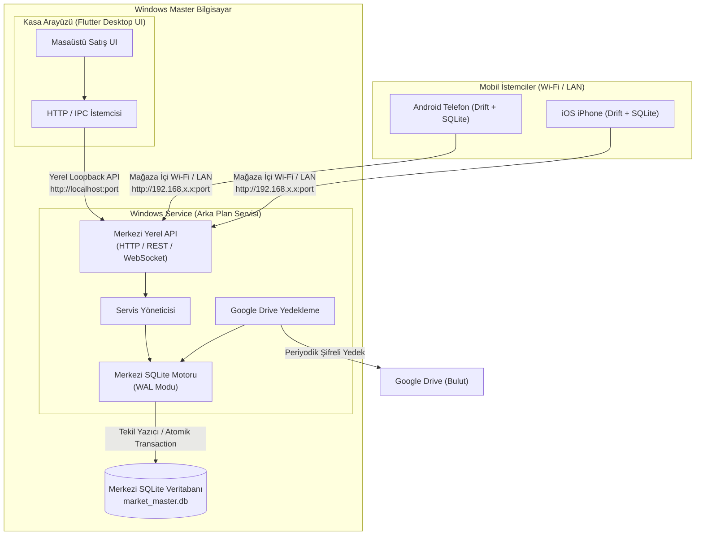

# MARKET MANAGEMENT SYSTEM (MMS) — Mimari Uyum ve Dönüşüm Denetimi (Architecture Alignment Review)

**Rapor Kodu:** `MARKET_MMS_ARCHITECTURE_ALIGNMENT_REVIEW.md`  
**Tarih:** 4 Kasım 2026  
**Aşama:** Faz 0 — Mimari Uyum ve Teknik Karar Netleştirme  
**Hazırlayan:** Google Antigravity / Gemini 3.8 Flash (High)  
**Kapsam:** Supabase PostgreSQL Bulut Mimarisi ile Windows Local Master Hub Mimarisinin Karşılaştırılması, Karar Sınıflandırması ve Belge Bazlı Revizyon Stratejisi  
**İncelenen Belgeler:**  
- `docs/ARCHITECTURE.md`  
- `MARKET_POS_AI_STUDIO_BUILD_PLANI.md`  
- `docs/architecture/DATA_MODEL.md`  
- `docs/architecture/OFFLINE_SYNC_PROTOCOL.md`  
- `docs/architecture/LOCAL_STORAGE_TECHNICAL_VALIDATION.md`  
- `docs/architecture/BACKUP_RESTORE_PROTOCOL.md`

---

## 1. Giriş ve Amaç

MARKET MANAGEMENT SYSTEM (MMS) projesinin önceki oturumlarında üretilen teknik belgeler, merkezi veritabanı olarak **Supabase PostgreSQL Bulut Altyapısı**nı, kimlik doğrulamada **Supabase Auth**'u ve istemcilerin doğrudan internet üzerinden bulut sunucuya bağlandığı "Cloud-Centric SaaS" modelini temel almıştır.

Ancak projenin birincil hedefi, **gerçek bir fiziksel markette pilot kullanım gerçekleştirmektir**. Bir marketin günlük operasyonunda internet bağlantısı kopsa veya günlerce gelmese dahi, mağaza içindeki Windows ana bilgisayar ile mobil telefonların (Android ve iOS) kesintisiz birbiriyle konuşması, stokları görmesi ve fiş kesmesi şarttır.

Bu gerçek doğrultusunda kabul edilen **Windows Local Master Hub Mimarisi**:
1. Mağazadaki Windows PC'yi **merkezi yerel sunucu (Master Node)** yapar.
2. Windows üzerinde Flutter masaüstü arayüzünden bağımsız, arka planda daima çalışan bir **Windows Service**, bir **Merkezi Yerel API** ve **Merkezi SQLite Veritabanı** konumlandırır.
3. Mobil istemciler (Android/iOS) ve Windows arayüzü, internet olmasa dahi **yerel Wi-Fi / LAN** üzerinden bu yerel Windows API ile senkronize olur.
4. Windows PC kapalıyken mobil kasalar yerel Drift + SQLite veritabanlarında satış yapmaya devam eder; Windows açıldığında bekleyen Outbox işlemlerini yerel API'ye aktarır.
5. Google Drive, canlı senkronizasyon aracı değil; bağımsız, şifreli harici yedekleme aracıdır.
6. Gelecekte SaaS'a ve buluta geçişi kolaylaştırmak amacıyla `tenant_id` ve `store_id` veri modeli sınırları tavizsiz korunur.

Bu denetim raporu; eski mimari kararlarını gelişigüzel silmeden, pilot için geçersiz olanları, geleceğe dönük SaaS seçeneklerini ve hâlâ geçerli olan çekirdek kuralları sınıflandırmakta ve ilgili 6 belgenin uyumsuzluk matrisini sunmaktadır.

---

## 2. Mimari Kararların 3 Kademeli Sınıflandırılması

Önceki belgelerdeki kararlar hurdaya çıkarılmamış; 3 rasyonel sepete ayrılmıştır:

### (A) Pilot Aşamasında Askıya Alınan / Geçersiz Kılınan Kararlar
1. **Bulut Veritabanı Bağımlılığı:** Kasa cihazlarının satış, senkronizasyon ve ürün sorgulamak için doğrudan `https://xyz.supabase.co` bulut adresine gitmesi pilot için iptal edilmiştir. İstemciler mağaza içi Windows Yerel API'sine (`http://<windows-lan-ip>:<port>`) bağlanacaktır.
2. **Supabase Auth & JWT Doğrulaması:** Mobil cihazların her işlemde bulut Supabase Auth oturumuna muhtaç olması kaldırılmıştır. Eşleştirme yerel API üzerinden QR kod / cihaz kimliği ve yerel API tokenı ile yapılacaktır.
3. **Supabase Edge Functions & pg_cron:** Senkronizasyon worker'ı ve zamanlanmış görevler bulut Edge Function yerine Windows Service içinde yerel arka plan görevleri olarak icra edilecektir.
4. **PostgreSQL RLS Politikaları:** Pilot aşamasında merkezi veritabanı SQLite olacağından, PostgreSQL RLS kuralları pilotta işletilmeyecektir; yetki ve veri izolasyonu Windows Service API katmanında sağlanacaktır.

### (B) Geleceğe Dönük SaaS / Bulut Seçenekleri Olarak Saklanan Kararlar
1. **Tenant ve Store İzolasyon Modeli:** Veri modelindeki `tenant_id` ve `store_id` alanları kesinlikle korunacaktır. Pilot aşamasında tek bir market ve tek bir mağaza olsa dahi şema çoklu kiracıya hazır tutulacaktır.
2. **PostgreSQL Uyumluluk Katmanı:** Mantıksal veri modeli SQL tipleri (`BIGINT`, `TEXT`, `INTEGER`, `BOOLEAN`), ileride SQLite'tan PostgreSQL'e taşınabilirliği garanti edecek biçimde tasarlanmıştır.
3. **Bulut Konsolidasyonu (Faz 8):** Market zincire dönüştüğünde veya SaaS müşterilerine açıldığında, Windows Service'lerin kendi yerel veritabanlarını merkezi bir bulut PostgreSQL/Supabase kümesine aktarabileceği hibrit model saklı tutulmaktadır.

### (C) Hâlâ Geçerli Olan ve Tavizsiz Korunan Çekirdek Kararlar
1. **Temel Teknoloji Yığını:** Flutter (Dart), Drift + SQLite (mobil ve masaüstünde), Riverpod (durum yönetimi), go_router (navigasyon).
2. **Yazılım Mimarisi:** Clean Architecture (`presentation` $\to$ `domain` $\leftarrow$ `data`), Feature-first modülerlik, saf Dart Domain katmanı.
3. **Finansal Hassasiyet:** Kuruş bazlı tamsayı para hesabı (`BIGINT` / `int`), floating-point kesin yasağı, pay/payda rasyonel birim dönüşümü.
4. **Offline-First Bütünlüğü:** `sales`, `sale_items`, `stock_movements` ve `sync_operations` kuyruğunun atomik yerel transaction içinde yazılması.
5. **Geçmişin Korunması ve Eksi Stok:** Eksi stok serbestliği (`allow`), satış kayıtlarının çakışma durumunda asla silinmemesi, fiyat ve maliyet snapshot'ı.
6. **Deterministik Senkronizasyon:** `idempotency_key`, tek cihazda artan `client_sequence_number`, nedensel FIFO sıralaması.
7. **Bağımsız Yedekleme:** Canlı kopyalamada `VACUUM INTO`, istemci taraflı `AES-256-GCM` zarf şifreleme ve Google Drive (`drive.file`) harici yedekleme hedefi.

---

## 3. Belge Bazlı Uyumsuzluk Matrisi (Incompatibility Matrix)

Mevcut 6 teknik belgenin taranması sonucunda tespit edilen somut uyumsuzluklar ve çözüm önerileri:

| Belge | Mevcut Metindeki Eski Karar (Supabase/Bulut) | Yeni Kabul Edilen Karar (Windows Master Hub) | Çözüm ve Revizyon Önerisi |
| :--- | :--- | :--- | :--- |
| **`MARKET_POS_AI_STUDIO_BUILD_PLANI.md`** | Merkezi veritabanı = Supabase PostgreSQL, Kimlik doğrulama = Supabase Auth, Cihazlar internetle buluta bağlanır. | Windows Service + Merkezi API + Merkezi SQLite. Mobil cihazlar LAN/Wi-Fi üzerinden haberleşir. | Belge v1.3'e yükseltilmeli; Bölüm 3 ve 5'teki teknoloji tablosuna Windows Service ve Yerel API eklenmeli; Supabase "Gelecek SaaS Aşaması" olarak revize edilmelidir. |
| **`docs/ARCHITECTURE.md`** | Bölüm 2: Merkezi DB: Supabase PostgreSQL, Auth: Supabase Auth. Katman yapısında `infrastructure/supabase_client`. | Windows Service, Merkezi SQLite, LAN REST/WebSocket API. Altyapı katmanında `local_api_client`. | Mimari diyagram güncellenmeli; Windows Service bağımsız process olarak çizilmeli; LAN iletişimi ve offline Windows davranışı eklenmelidir. |
| **`docs/architecture/DATA_MODEL.md`** | Bölüm 1 & 3: Merkezi veritabanı PostgreSQL kabul edilerek RLS politikaları, PostgreSQL syntax'ı ve pg_cron referansları verilmiş. | Merkezi veritabanı Windows üzerinde çalışan Merkezi SQLite'tır. RLS yerine API seviyesinde izolasyon vardır. | Veri modelinin 25 tablosu korunmalı; PostgreSQL'e özgü `CREATE POLICY` ve RLS notları "Geleceğe Dönük SaaS / Bulut Şartnamesi" başlığı altına taşınmalı; SQLite DDL kısıtları öne çıkarılmalıdır. |
| **`docs/architecture/OFFLINE_SYNC_PROTOCOL.md`** | Bölüm 1.2 & 4: Cihaz senkronizasyonu internet üzerinden `Supabase REST / Edge Function` uç noktasına bağlanır. | Mobil cihazlar mağaza içi Wi-Fi / LAN üzerinden `Windows Service Merkezi API` uç noktasına bağlanır. İnternet gerekmez. | Protokoldeki FIFO, atomik kiralama ve idempotency kuralları tamamen korunmalı; bağlantı denetimi "İnternet Kontrolü" yerine "Windows LAN API Ping/Health Kontrolü" olarak güncellenmelidir. |
| **`docs/architecture/LOCAL_STORAGE_TECHNICAL_VALIDATION.md`** | Windows masaüstü yalnızca tekil bir Drift/SQLite istemcisi olarak ele alınmış. | Windows hem Flutter UI istemcisi hem de arka planda bağımsız Merkezi SQLite yöneten Windows Service ana makinesidir. | Windows başlığı altına "Windows Service ve Çoklu Süreç (Multi-Process) SQLite Eşzamanlılığı" bölümü eklenmelidir (UI ve Service aynı DB'yi mi paylaşacak, yoksa UI servise API ile mi bağlanacak netleştirilmelidir). |
| **`docs/architecture/BACKUP_RESTORE_PROTOCOL.md`** | Bölüm 3: "Supabase PITR ve Supabase pg_cron tenant export". | Merkezi veritabanı Windows üzerinde Merkezi SQLite olduğundan, merkezi yedekleme de Windows üzerinde `VACUUM INTO` + AES-256-GCM ile Google Drive'a yüklenecektir. | Merkezi yedekleme bölümü Supabase'den Windows Service yedekleme görevine dönüştürülmeli; Google Drive yükleme akışı korunmalıdır. |

---

## 4. Çoklu Süreç ve SQLite Eşzamanlılık Mimarisi (Kritik Teknik Tasarım)

Yeni mimaride en kritik teknik soru şudur:  
**Windows bilgisayardaki Flutter Masaüstü Arayüzü ile arka plandaki Windows Service, yerel SQLite veritabanına nasıl erişecek?**

### Tasarım Kararı: "Single-Writer Through Local API" Prensibi
İki bağımsız Windows sürecinin (Flutter GUI process'i ve Windows Service process'i) doğrudan aynı `market_master.db` dosyasına eşzamanlı yazmaya çalışması, SQLite WAL modunda dahi zaman zaman `SQLITE_BUSY` veya dosya kilitlenme (file locking) riskleri yaratabilir.

**Kabul Edilen Güvenli Tasarım:**
1. Merkezi SQLite veritabanı (`market_master.db`) **yalnızca ve yalnızca Windows Service** tarafından açılır ve yönetilir.
2. Flutter Windows Masaüstü Arayüzü de tıpkı mobil cihazlar gibi yerel loopback API (`http://127.0.0.1:<port>`) üzerinden haberleşir (veya gerekiyorsa yerel önbellek için kendi hafif Drift SQLite kopyasını tutar).
3. Bu sayede tüm satışlar, stok düşümleri ve Outbox mutabakatları Windows Service içindeki **tek bir transaction yöneticisi** tarafından kuyruğa sokulur; sıfır dosya kilitlenmesi ve deterministik veri bütünlüğü sağlanır.

---

## 5. Önerilen Doküman Revizyon Yol Haritası

Mevcut belgeler kullanıcı onayından sonra şu sıralama ile revize edilecektir:

1. **Adım 1:** `MARKET_POS_AI_STUDIO_BUILD_PLANI.md` belgesinin v1.3 olarak güncellenmesi (Windows Service + Local API eklenmesi, Supabase'in SaaS fazına ötelenmesi).
2. **Adım 2:** `docs/ARCHITECTURE.md` belgesinin güncellenmesi (Sistem mimarisi diyagramının yeni Windows Master Hub modeline göre yenilenmesi).
3. **Adım 3:** `docs/architecture/DATA_MODEL.md` metninin revizesi (Merkezi SQLite ve Mobil SQLite ayrımının yansıtılması).
4. **Adım 4:** `docs/architecture/OFFLINE_SYNC_PROTOCOL.md` metninin revizesi (Senkronizasyonun yerel LAN API'sine göre uyarlanması).
5. **Adım 5:** `docs/architecture/BACKUP_RESTORE_PROTOCOL.md` metninin revizesi (Merkezi yedeğin Windows Service tarafından alınması).

*Bu analiz, yeni mimari yönelim ile projenin önceki kazanımlarının tam bir uyum içinde birleştirilebileceğini ve hiçbir değerli gereksinimin kaybolmayacağını teknik olarak kanıtlamaktadır.*

