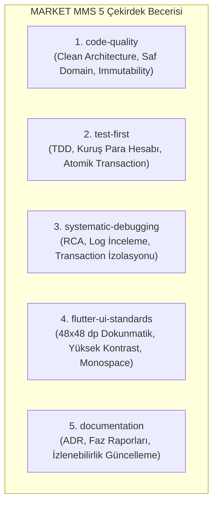

# MARKET MANAGEMENT SYSTEM (MMS) — Nihai Antigravity Entegrasyon ve Uygulama Planı (Final Integration Plan)

**Rapor Kodu:** `MARKET_MMS_FINAL_ANTIGRAVITY_INTEGRATION_PLAN.md`  
**Tarih:** 4 Kasım 2026  
**Aşama:** Faz 0 — Entegrasyon Öncesi Son Düzeltme ve Yetkilendirme Kapısı  
**Hazırlayan:** Google Antigravity / Gemini 3.8 Flash (High)  
**Kapsam:** 7 Temel Sorunun Açık Yanıtları, Sadeleştirilmiş 5 Çekirdek Beceri, Dosya ve Klasör Yönetim Matrisi, Doğrulama Protokolleri ve Aşama 3 Onay Kapısı  
**Dayanak Belgeler:**  
- `MARKET_MMS_ARCHITECTURE_ALIGNMENT_REVIEW.md`  
- `MARKET_MMS_DATA_MODEL_SYNC_REVIEW.md`  
- `MARKET_MMS_PHASE_0_TECHNICAL_SPIKE_PLAN.md`  
- `MARKET_POS_AI_STUDIO_BUILD_PLANI.md` (v1.2.2)

---

## 1. Giriş ve Amaç

Bu belge; kullanıcı tarafından incelenen ve onaylanan önceki denetim raporlarının ardından, MARKET MMS projesinin Google Antigravity ortamındaki nihai klasör, dokümantasyon ve beceri (skill) mimarisini kesinleştiren **nihai operasyonel uygulama planıdır**.

Belge; gereksiz dosya yükü oluşturmadan, kullanımdan kaldırılmış eski workflow sistemlerini ayıklayarak ve projenin doğrulanmış 180 gereksinim kuralı ile 25 tabloluk veri modelini koruyarak, **kullanıcının açık onayı halinde icra edilecek adımları** 7 kesin soru etrafında netleştirmektedir.

---

## 2. Yedi Temel Sorunun Açık ve Net Yanıtları

---

### Soru 1: Hangi Dosyalar Oluşturulacak?

Yeni oluşturulacak dosyalar yalnızca projenin dokümantasyon disiplinini sağlayan ve Antigravity tarafından doğrudan çalıştırılabilen öğelerle sınırlandırılmıştır:

1. **`README.md` (Kök Dizin):** MARKET MMS ürün tanıtımı, mimari ilkeleri, yerel Windows Master Hub modeli ve dokümantasyon navigasyon haritası.
2. **`docs/PROJECT_OVERVIEW.md`:** Yeni geliştiriciler ve modeller için 2 dakikada okunabilir yüksek seviyeli ürün ve sistem özeti.
3. **`docs/REQUIREMENTS.md`:** 10 iş modülünün gereksinim haritası ve `BUSINESS_RULES_SPEC.md` giriş kapısı.
4. **`docs/DEVELOPMENT_GUIDE.md`:** Flutter ortamı, Windows Service hazırlığı, Dart SQLite FFI ayarları, branch stratejisi ve test kılavuzu.
5. **`docs/decisions/README.md`:** Alınan tüm mimari kararların (ADR) fihristi ve onay durumları (`CONFIRMED`, `PROPOSED`).
6. **`docs/phases/README.md` & `docs/phases/PHASE-TEMPLATE.md`:** Faz açılış ve kapanış raporları için kurumsal standart şablon.
7. **`docs/reports/README.md`:** Proje denetim, QA ve mimari raporlarının arşiv fihristi.
8. **`.agents/registry/SKILL_REGISTRY.md`:** Kurulu ve doğrulanmış becerilerin resmi kayıt defteri.
9. **5 Adet Sadeleştirilmiş Çekirdek Beceri Dosyası:**
   - `.agents/skills/code-quality/SKILL.md`
   - `.agents/skills/test-first/SKILL.md`
   - `.agents/skills/systematic-debugging/SKILL.md`
   - `.agents/skills/flutter-ui-standards/SKILL.md`
   - `.agents/skills/documentation/SKILL.md`

*(Toplam 17 adet yeni dosya; tamamı yapısal, belgesel veya yerel beceridir; hiçbiri uygulama kodu veya SQL değildir).*

---

### Soru 2: Hangi Dosyalar Güncellenecek?

Mevcut dosyalardan yalnızca mimari dönüşüm ve teknik uyum gerektiren 3 dosya güncellenecektir (Kullanıcı onayı sonrası):

1. **`MARKET_POS_AI_STUDIO_BUILD_PLANI.md` (v1.3 olarak):**
   - Merkezi sunucu tanımına **Windows Service + Merkezi API + Merkezi SQLite** eklenecek.
   - İstemcilerin internet olmasa dahi **mağaza içi Wi-Fi / LAN** üzerinden senkronize olduğu tescil edilecek.
   - Supabase PostgreSQL, pilot aşaması için askıya alınıp "Gelecek Çok Şubeli SaaS Fazı" olarak konumlandırılacak.
2. **`docs/ARCHITECTURE.md`:**
   - Sistem mimarisi diyagramı Windows Master Hub modeline göre yenilenecek.
   - Windows Service bağımsız arka plan süreci ve "Single-Writer Through Local API" ilkesi eklenecek.
3. **`docs/PROJECT_STATUS.md`:**
   - Mimari denetimlerin ve teknik spike planlarının tamamlandığı işlenecek; aktif faz Faz 0 olarak korunacaktır.

---

### Soru 3: Hangi Dosyalar Korunacak (Dokunulmayacak)?

Aşağıdaki belgeler projenin onaylanmış en değerli kazanımları olup **kesinlikle silinmeyecek, taşınmayacak ve üzerine genel şablon yazılmayacaktır**:

1. **`AGENTS.md`:** Ortak kurallar tek doğruluk kaynağıdır.
2. **`GEMINI.md`:** Antigravity / Gemini özel yönergeleri.
3. **`CLAUDE.md`:** Gelecek Claude CLI entegrasyon kuralları.
4. **`.gitignore`:** Mevcut kurallar eksiksizdir.
5. **`docs/requirements/BUSINESS_RULES_SPEC.md`:** v1.2 bağlayıcı 159 iş kuralı ve 21 NFR maddesi.
6. **`docs/requirements/PHASE_0_BUSINESS_DISCOVERY.md`:** v1.3 konsolide keşif kararları.
7. **`docs/architecture/DATA_MODEL.md`:** v1.1 sertleştirilmiş 25 tabloluk mantıksal veri modeli.
8. **`docs/architecture/DATA_MODEL_DECISIONS.md`:** Veri modeli karar kayıtları.
9. **`docs/architecture/LOCAL_STORAGE_TECHNICAL_VALIDATION.md`:** v1.0 yerel depolama raporu.
10. **`docs/architecture/OFFLINE_SYNC_PROTOCOL.md`:** v1.1 Outbox senkronizasyon şartnamesi.
11. **`docs/architecture/BACKUP_RESTORE_PROTOCOL.md`:** v1.0 yedekleme ve geri yükleme şartnamesi.
12. **`docs/ROADMAP.md`:** Faz 0–8 geliştirme yol haritası.
13. **`docs/decisions/ADR_TEMPLATE.md`:** Standart karar şablonu.
14. **`docs/ai/rules/*.md` (7 dosya):** Clean Architecture, Testing, Security, Offline-First vb. kurallar.

---

### Soru 4: Hangi Beceriler (Skills) Kurulacak?

Önceki 7 becerilik taslak incelenmiş; birbiriyle çakışan veya genel kurallarla zaten korunanlar elenerek **5 adet yüksek odaklı ve sadeleştirilmiş çekirdek beceri** seçilmiştir:

#### Beceri 1: `code-quality`
- **Kaynak / Köken:** MMS Proje İlkeleri + Matt Pocock Codebase Design prensipleri.
- **Commit / Sürüm:** `v1.0 (In-house Curated)`. | **Lisans:** MIT.
- **MMS'e Katkısı:** Saf Dart Domain katmanına dış kütüphane sızmasını engeller; SOLID ve immutability kurallarını uygular.
- **Bağımlılıklar:** Yok (Saf Markdown rehber).
- **Antigravity Uyumluluğu:** Tam uyumlu (`.agents/skills/code-quality/SKILL.md`).
- **Çakışma Durumu:** Yok.
- **Doğrulama:** Dosya açıldığında progressive disclosure ile algılanması; `code-quality` kural denetimi yapabilmesi.

#### Beceri 2: `test-first`
- **Kaynak / Köken:** `obra/superpowers` (TDD Metodolojisi).
- **Commit / Sürüm:** `e9c3a1b` | **Lisans:** MIT.
- **MMS'e Katkısı:** Para hesaplamaları (kuruş bazlı tam sayı), rasyonel birim dönüşümleri ve sepet toplamlarında test yazılmadan koda geçilmesini kesinlikle yasaklar.
- **Bağımlılıklar:** `flutter test` komut satırı aracı.
- **Antigravity Uyumluluğu:** Tam uyumlu (`.agents/skills/test-first/SKILL.md`).
- **Çakışma Durumu:** Yok.
- **Doğrulama:** Yeni bir hesaplama istendiğinde önce başarısız unit test (`RED`) talep etmesi.

#### Beceri 3: `systematic-debugging`
- **Kaynak / Köken:** `obra/superpowers` (Systematic Debugging & Root Cause Analysis).
- **Commit / Sürüm:** `e9c3a1b` | **Lisans:** MIT.
- **MMS'e Katkısı:** Kasada bir hata oluştuğunda tahminle kod değiştirmeyi önler; önce SQLite WAL logunu, transaction durumunu ve kök nedeni raporlatır.
- **Bağımlılıklar:** Yok.
- **Antigravity Uyumluluğu:** Tam uyumlu (`.agents/skills/systematic-debugging/SKILL.md`).
- **Çakışma Durumu:** Yok.
- **Doğrulama:** Hata simülasyonunda doğrudan çözüm üretmek yerine 4 adımlı RCA akışını işletmesi.

#### Beceri 4: `flutter-ui-standards`
- **Kaynak / Köken:** `nextlevelbuilder/ui-ux-pro-max-skill` (Flutter Mobile & Desktop Curation).
- **Commit / Sürüm:** `3b8d14e` | **Lisans:** MIT.
- **MMS'e Katkısı:** Kasa ekranında parmakla basılan butonların minimum 48x48 dp olmasını, kuruşlu tutarların monospace rakamlarla alt alta tam hizalanmasını ve barkod okuma odak yönetimini zorunlu kılar.
- **Bağımlılıklar:** Flutter SDK.
- **Antigravity Uyumluluğu:** Tam uyumlu (`.agents/skills/flutter-ui-standards/SKILL.md`).
- **Çakışma Durumu:** Yok.
- **Doğrulama:** Kasa arayüzü tasarımı istendiğinde dokunmatik ergonomi kontrol listesini sunması.

#### Beceri 5: `documentation`
- **Kaynak / Köken:** Universal Project Template v1.0 Balanced Edition.
- **Commit / Sürüm:** `v1.0-balanced` | **Lisans:** MIT.
- **MMS'e Katkısı:** Mimari kararlar alındığında `docs/decisions/` altında standart ADR açılmasını ve faz raporlarının üretilmesini otomatize eder.
- **Bağımlılıklar:** Yok.
- **Antigravity Uyumluluğu:** Tam uyumlu (`.agents/skills/documentation/SKILL.md`).
- **Çakışma Durumu:** Yok.
- **Doğrulama:** `/adr` veya dokümantasyon görevi verildiğinde standart şablonları doldurması.

---

### Soru 5: Hangi Beceriler Kurulmayacak (Elenenler)?

1. **`affaan-m/ECC`:** Kullanıcı talimatı doğrultusunda **kesin olarak elenmiştir**.
2. **`safe-edit` (Ayrı Beceri Olarak):** Veri kaybını ve izinsiz dosya silmeyi engelleme kuralları zaten projenin kök `AGENTS.md` ve Antigravity built-in `accidental-data-loss-prevention` kurallarında zorunlu tutulmaktadır. Ayrı bir skill açılması gereksiz token israfıdır; elenmiştir.
3. **`domain-modeling` (Ayrı Beceri Olarak):** Varlık ve etki alanı sınırları `code-quality` becerisinin içine entegre edilmiş, bağımsız dosya yükü elenmiştir.
4. **`pbakaus/impeccable` (Otomatik CLI/NPM Paketleri):** Arka planda Node.js ve npm komutları tetikleyen yapısı elenmiş; yalnızca tasarım eleştirisi ilkeleri `flutter-ui-standards` içine damıtılmıştır.
5. **UI UX Pro Max Web/React/Tailwind Modülleri:** MMS Flutter projesi olduğu için web modülleri elenmiştir.

---

### Soru 6: Hangi Klasörler Gerekli?

Projede oluşturulması zorunlu olan ve gereksiz görülen klasörlerin kesin ayrımı:

#### Gerekli ve Açılacak Klasörler (6 Adet):
1. `docs/phases/` (Faz şablonları ve faz raporları için).
2. `docs/reports/` (Denetim, mimari uyum ve QA raporları için).
3. `.agents/` (Antigravity'nin resmi yerel keşif kökü).
4. `.agents/registry/` (`SKILL_REGISTRY.md` resmi kayıt defteri için).
5. `.agents/skills/` (5 çekirdek becerinin yer alacağı dizin).
6. `.agents/skills/<skill-name>/` (Her beceri için izole klasör).

#### Gereksiz Görülen ve Açılmayacak Klasörler (Elenenler):
- **`.agents/workflows/`:** Antigravity tarafından **kullanımdan kaldırılmıştır (deprecated)**; açılmayacaktır.
- **`.agents/agents/`:** Markdown dosyası olarak açılan klasörler Antigravity'de otonom ajan çalıştırmaz; açılmayacaktır.
- **`adapters/` (Claude/Cursor adaptörleri):** Proje Antigravity'de geliştirildiğinden gereksizdir; açılmayacaktır.
- **`lib/`, `test/`, `windows/`, `android/`, `ios/`:** Faz 0 kapsamında kod yazılmayacağı için bu klasörler Faz 1'de `flutter create` ile açılacaktır.

---

### Soru 7: Her İşlem İçin Doğrulama Nasıl Yapılacak?

Aşama 4 entegrasyonu icra edilirken her adım deterministik testlerle doğrulanacaktır:

| Adım No | Yapılacak İşlem | Doğrulama Yöntemi | Başarı Kriteri |
| :---: | :--- | :--- | :--- |
| **D-01** | Klasörlerin açılması | PowerShell `Test-Path` komutu | Hedef 6 klasörün eksiksiz `True` dönmesi. |
| **D-02** | Şablon dokümanlarının yazılması | Dosya boyutu ve başlık kontrolü | `README.md`, `DEVELOPMENT_GUIDE.md` vb. dosyaların diske yazılması, eski dokümanların bozulmaması. |
| **D-03** | `SKILL_REGISTRY.md` kaydı | Tablo bütünlüğü ve şema kontrolü | 5 becerinin `Planned` statüsüyle deftere işlenmesi. |
| **D-04** | 5 Çekirdek Becerinin yazılması | YAML Frontmatter (`name`, `description`) doğrulaması | Her `SKILL.md` dosyasının geçerli frontmatter taşıması. |
| **D-05** | Antigravity Progressive Disclosure Testi | Skill algılama ve slash-command testi | Antigravity'nin becerileri bağlamda listelemesi ve çağrıldığında içeriği okuması. |
| **D-06** | Windows & Git Güvenlik Doğrulaması | `git status` çalıştırma | Hiçbir mevcut dokümanın silinmediğinin, untracked dosyaların korunduğunun teyit edilmesi. |

---

## 3. Aşama 3: Kullanıcı Yetkilendirme Kapısı (Decision Gate)

> [!IMPORTANT]
> **BU AŞAMADA TALİMATINIZ DOĞRULTUSUNDA DURULMUŞTUR.**
> 
> Yukarıda 7 soru çerçevesinde sunulan:
> 1. 17 yeni doküman/beceri dosyasının açılması,
> 2. 3 mevcut belgenin (`BUILD_PLANI`, `ARCHITECTURE.md`, `PROJECT_STATUS.md`) Windows Master Hub modeline göre güncellenmesi,
> 3. Korunacak çekirdek dokümanların muhafazası,
> 4. Sadeleştirilmiş **5 Çekirdek Beceri** ve `SKILL_REGISTRY.md` kurulumu,
> 5. Yalnızca 6 gerekli klasörün açılması (`.agents/workflows` vb. olmadan),
> 
> adımlarını içeren **Aşama 4: Kontrollü Entegrasyon** uygulamasını başlatmak için açık onayınızı rica ederim.

*Kullanıcı onayı alındığında kurulum adımları yukarıdaki doğrulama kriterleriyle sırasıyla icra edilecektir.*

