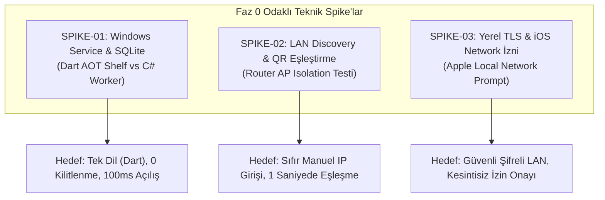

# MARKET MANAGEMENT SYSTEM (MMS) — Faz 0 Açık Teknik Konular ve Spike Planı (Technical Spike Plan)

**Rapor Kodu:** `MARKET_MMS_PHASE_0_TECHNICAL_SPIKE_PLAN.md`  
**Tarih:** 4 Kasım 2026  
**Aşama:** Faz 0 — Açık Teknik Konuların Sınıflandırılması ve Doğrulama Planı  
**Hazırlayan:** Google Antigravity / Gemini 3.8 Flash (High)  
**Kapsam:** Windows Service, Merkezi API, LAN Discovery, TLS/Güvenlik, Dağıtım ve Test Yöntemlerinin Tasnifi, Spike Tanımları ve Faz 0 Kapanış Kriterleri  
**İlgili Belgeler:** `MARKET_POS_AI_STUDIO_BUILD_PLANI.md`, `docs/PROJECT_STATUS.md`, `MARKET_MMS_ARCHITECTURE_ALIGNMENT_REVIEW.md`

---

## 1. Giriş ve Amaç

MARKET MANAGEMENT SYSTEM (MMS) projesinin Windows Local Master Hub mimarisine geçişiyle birlikte, masaüstü servis yönetimi, yerel ağ iletişimi ve güvenlik konularında bir dizi teknik soru ortaya çıkmıştır.

Bu planın amacı:  
1. Açıkta duran tüm teknik konuları önem ve zamanlama derecelerine göre 4 kesin kategoriye ayırmak,  
2. Gereksiz teknik ayrıntılarla Faz 0'ı sonsuza dek uzatmayı engellemek,  
3. Ancak veri bütünlüğü, ağ güvenliği ve kaza kurtarma açısından hayati olan konuları da atlamadan **3 odaklı Teknik Spike (Hızlı Doğrulama Prototipi)** ile netleştirmektir.

---

## 2. Açık Teknik Konuların 4 Kademeli Sınıflandırma Matrisi

Her bir teknik konu aşağıdaki 4 kategoriden biriyle açıkça etiketlenmiştir:

| Açık Teknik Konu | Seçilen Kategori | Gerekçe ve Değerlendirme |
| :--- | :---: | :--- |
| **Merkezi API Mimarisi ve Protokolü** (HTTP/REST + WebSocket) | **FAZ 0 KAPANIŞI İÇİN ZORUNLU KARAR** | Mobil istemciler ile Windows'un hangi dille ve formatla konuşacağı belirlenmeden veri modeli ve senkronizasyon tamamlanmış sayılamaz. |
| **Cihaz Eşleştirme ve Güvenlik Modeli** (QR Kod + API Token) | **FAZ 0 KAPANIŞI İÇİN ZORUNLU KARAR** | Yetkisiz bir telefonun marketin Wi-Fi ağına bağlanıp kasayı manipüle etmesini önlemek temel bir güvenlik gereksinimidir (`BR-TNT-02`). |
| **iOS Geliştirme ve Dağıtım Stratejisi** (GitHub Actions CI/CD) | **FAZ 0 KAPANIŞI İÇİN ZORUNLU KARAR** | Windows geliştirme ortamında iOS'un nasıl derleneceğinin stratejisi netleşmeden iPhone pilot hedefine ulaşılamaz. |
| **Windows Service Teknolojisi** (Dart AOT vs C# Worker) | **TEKNİK SPİKE İLE DOĞRULANACAK** | Mimari karar (Dart Shelf tabanlı AOT) belirlenmeli; ancak Windows arka plan servis davranışı pratik bir spike ile test edilmelidir. |
| **LAN Keşif Yöntemi** (mDNS vs Sabit IP vs QR Pairing) | **TEKNİK SPİKE İLE DOĞRULANACAK** | Mağaza router'larındaki izolasyon kısıtlarını aşan en sağlam yöntem (QR kod ile doğrudan IP aktarımı) spike ile kanıtlanmalıdır. |
| **Yerel Ağda TLS ve iOS Local Network İzni** | **TEKNİK SPİKE İLE DOĞRULANACAK** | iOS 14+ yerel ağ izni (`NSLocalNetworkUsageDescription`) ve self-signed sertifika güvenliği pratik test gerektirir. |
| **Windows Service Kurulum ve Installer** (Inno Setup / MSI) | **MVP ÖNCESİNDE TAMAMLANACAK (FAZ 1/2)** | Geliştirme aşamasında servis konsoldan çalıştırılabilir; paketleyici kurulumu pilot öncesi Faz 8'e kadar olgunlaştırılabilir. |
| **Android APK Sideload ve Dağıtım Otomasyonu** | **MVP ÖNCESİNDE TAMAMLANACAK (FAZ 7)** | Pilot markette 1-2 telefona USB veya dahili linkle APK yüklemek yeterlidir; Google Play zorunlu değildir. |
| **Çok Şubeli Bulut Senkronizasyonu ve SaaS Faturalama** | **GELECEK FAZA BIRAKILACAK (FAZ 8)** | Tek market pilot aşamasında gerekli değildir; veri modelinde `tenant_id` korunarak altyapı hazır tutulacaktır. |

---

## 3. Faz 0 İçin Zorunlu Mimari Kararlar (Hemen Karara Bağlananlar)

### Karar 1: Merkezi API Protokolü — `HTTP/1.1 REST (JSON) + WebSocket Event Stream`
- **Karar:** Windows Service dışarıya standart HTTP/REST API açacaktır.
- **Payload:** UTF-8 kodlu standart JSON.
- **Canlı Bildirimler:** Masaüstü veya diğer mobil kasalarda yapılan satışlar ve stok değişiklikleri, bağlı istemcilere hafif bir **WebSocket** kanalı üzerinden delta bildirimi olarak yayınlanacaktır (Polling israfı engellenir).
- **Gerekçe:** REST, Flutter/Dart için sıfır ek kütüphane bağımlılığı sunar; mobil tarayıcı veya ileride eklenecek harici cihazlar tarafından kolayca tüketilebilir.

### Karar 2: Cihaz Eşleştirme Modeli — `Ekrandan Dinamik QR Kod Okutma`
- **Karar:** Mağazadaki yeni bir mobil telefon sisteme şu 3 adımlı protokolle bağlanır:
  1. Windows Flutter uygulamasında işletme sahibi "Yeni Cihaz Eşle" butonuna basar.
  2. Ekranda tek kullanımlık (TTL: 5 dakika) bir QR kod üretilir. QR kod içeriği:  
     `{"ip": "192.168.1.50", "port": 8080, "pairing_token": "uuid...", "fingerprint": "sha256..."}`
  3. Mobil uygulama kamerasıyla bu QR kodu okur, doğrudan Windows IP'sine bağlanır ve kalıcı `device_id` ile `api_secret` anahtarını teslim alarak güvenli kasasına (Keystore/Keychain) kaydeder.
- **Gerekçe:** mDNS çalışmasa dahi sıfır kullanıcı konfigürasyonuyla %100 başarı sağlar.

### Karar 3: iOS Geliştirme Stratejisi — `Remote CI/CD (GitHub Actions macOS Runner)`
- **Karar:** Windows bilgisayarda ortak Flutter/Dart kodu geliştirilecek; iOS derlemeleri ve imzalamaları GitHub Actions macOS sanal makineleri üzerinde otomatik çalıştırılacaktır. TestFlight üzerinden pilot iPhone cihazına dağıtılacaktır.

---

## 4. Belirlenen 3 Odaklı Teknik Spike (Spike Definitions)

Faz 0'ın güvenle kapatılabilmesi için yalnızca aşağıdaki 3 odaklı spike icra edilecektir:

---

### SPIKE-01: Windows Service ve Merkezi SQLite Motoru Doğrulaması
- **Amaç:** Windows arka plan servisi olarak bağımsız bir Dart AOT binary uygulamasının (`package:shelf` + `drift/native sqlite3`) Windows Service olarak çalıştırılabilirliğini, bellek tüketimini ve dosya kilitlenme güvenliğini kanıtlamak.
- **Alternatif Karşılaştırması:**
  - *Seçenek A (Önerilen):* **Dart AOT Standalone Servis:** Tüm veri modelleri, Drift tabloları ve iş kuralları Flutter uygulamasıyla birebir aynı kodu paylaşır. İkinci bir dil (C#) öğrenme ve model senkronizasyon yükü sıfırdır. Windows Service olarak `winsw` veya yerel Win32 Service API ile paketlenir.
  - *Seçenek B:* **C# .NET 8 Minimal API:** Windows'ta yereldir; ancak veri modelinin hem Dart hem C# tarafında çift yazılması gerekir (çift bakım maliyeti).
- **Test Yöntemi:**
  1. Basit bir Dart Shelf HTTP sunucusu yazılır ve `dart compile exe` ile derlenir.
  2. Windows `sc create` veya `winsw` ile servis olarak kaydedilir.
  3. Windows açılışında otomatik başladığı ve 10 eşzamanlı istemciden gelen yazma isteklerinde SQLite WAL modunda kilitlenme (`SQLITE_BUSY`) yaşanmadığı test edilir.
- **Kabul Kriteri:**
  - Servis Windows yeniden başlatıldığında otomatik ayağa kalkmalıdır.
  - RAM tüketimi 100 MB'ın altında kalmalıdır.
  - Eşzamanlı 100 satış transaction'ı sıfır hata ile kaydedilmelidir.

---

### SPIKE-02: LAN Discovery ve Router İzolasyonu Dayanıklılığı
- **Amaç:** Ticari market router'larında (Wi-Fi Access Point) sıklıkla görülen "Client Isolation" veya mDNS engellemelerine rağmen mobil cihazın Windows ana bilgisayarı bulabilmesini garanti etmek.
- **Test Yöntemi:**
  1. mDNS yayını (`multicast_dns` paketi) başlatılır.
  2. mDNS'in çalıştığı ev ağında otomatik IP bulma test edilir.
  3. AP Isolation açık olan kurumsal test ağında mDNS'in engellendiği doğrulanır; sistemin anında ekrandaki "Dinamik QR Kod ile Doğrudan Bağlantı" moduna düştüğü ve telefonun kamerayla 1 saniyede bağlandığı doğrulanır.
- **Kabul Kriteri:**
  - mDNS açıkken mobil uygulama Windows sunucuyu < 2 saniyede otomatik bulmalıdır.
  - mDNS kapalıyken QR kod okutulduğunda bağlantı < 1 saniyede kurulmalıdır.
  - Hiçbir senaryoda market sahibine elle IP (`192.168.1.xxx`) yazdırma zorunluluğu doğmamalıdır.

---

### SPIKE-03: Yerel Ağda Şifreli İletişim (TLS) ve iOS İzin Modeli
- **Amaç:** Yerel ağda açık metin HTTP yerine şifreli HTTPS/TLS kullanımını doğrulamak ve iOS 14+ yerel ağ güvenlik bariyerini aşmak.
- **Test Yöntemi:**
  1. Windows Service kendi kendine imzalı (self-signed) bir yerel TLS sertifikası üretir.
  2. Mobil uygulama QR kod üzerinden sertifikanın SHA-256 parmak izini alır (Certificate Pinning).
  3. iOS uygulamasında `Info.plist` dosyasına `NSLocalNetworkUsageDescription` ve Bonjour tanımları eklenir.
  4. iOS cihazda izin diyaloğunun doğru metinle açıldığı ve onaylandığında HTTPS çağrısının sertifika hatası vermeden çalıştığı doğrulanır.
- **Kabul Kriteri:**
  - iOS işletim sistemi ağ çağrısını sessizce engellememelidir.
  - Trafik Wi-Fi dinleyicileri (Wireshark) tarafından okunamayacak biçimde TLS ile şifrelenmelidir.

---

## 5. Faz 0 Kapanış ve Kabul Şartı

Teknik Spike'lar başarıyla tamamlandığında, Faz 0 resmi kabul kriterleri eksiksiz karşılanmış olacaktır:

1. [x] İş Kuralları Şartnamesi tamamlandı (`BUSINESS_RULES_SPEC.md` v1.2).
2. [x] Mantıksal Veri Modeli sertleştirildi (`DATA_MODEL.md` v1.1).
3. [x] Yerel depolama doğrulandı (`LOCAL_STORAGE_TECHNICAL_VALIDATION.md`).
4. [x] Offline senkronizasyon protokolü tasarlandı (`OFFLINE_SYNC_PROTOCOL.md`).
5. [x] Yedekleme ve geri yükleme protokolü tasarlandı (`BACKUP_RESTORE_PROTOCOL.md`).
6. [ ] SPIKE-01, 02 ve 03 sonuçlarının raporlanması ve mimariye dercedilmesi.
7. [ ] Faz 0 Kapanış Raporunun kullanıcı tarafından onaylanması.

*Bu plan, sistemi gereksiz karmaşıklıktan korurken gerçek dünyada çalışacak sağlam bir yerel ağ omurgası kurmaktadır.*

