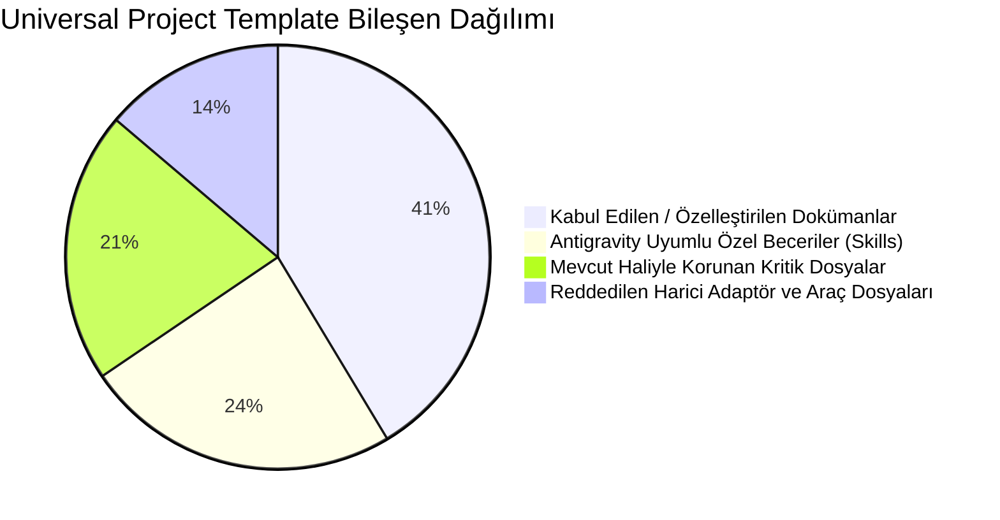

# MARKET MANAGEMENT SYSTEM (MMS) — Universal Project Template v1.0 Entegrasyon Raporu

**Rapor Kodu:** `MARKET_MMS_UNIVERSAL_TEMPLATE_INTEGRATION_REPORT.md`  
**Tarih:** 4 Kasım 2026  
**Aşama:** Faz 0 — Proje Organizasyonu ve Geliştirme Standartları  
**Hazırlayan:** Google Antigravity / Gemini 3.8 Flash (High)  
**Değerlendirilen Şablon:** Universal Project Template v1.0 Balanced Edition (29 Dosyalık Referans Seti)  
**İlgili Talimat:** `MARKET MMS — KLASÖR YAPISI, UNIVERSAL PROJECT TEMPLATE VE SKILL EKOSİSTEMİ ENTEGRASYONU`

---

## 1. Yönetici Özeti ve Temel İlke

Universal Project Template v1.0 Balanced Edition, modern yapay zekâ destekli yazılım geliştirme projeleri için standartlaştırılmış, disiplinli bir başlangıç iskeleti sunar. Ancak bu şablon **MARKET MMS için doğrudan "kopyala-yapıştır" yapılacak hazır bir kurulum paketi değildir**. 

MMS projesi, hali hazırda 180 iş ve sistem gereksinimi (`BUSINESS_RULES_SPEC.md` v1.2), 25 tabloluk sertleştirilmiş mantıksal veri modeli (`DATA_MODEL.md` v1.1), çevrimdışı Outbox senkronizasyon şartnamesi ve yerel SQLite depolama doğrulamasına sahip son derece olgun bir Faz 0 dokümantasyon tabanına sahiptir.

Bu entegrasyon çalışmasının temel ilkesi:  
**"Mevcut doğrulanmış ürün ve mimari kararlarını korumak; genel şablon metinleriyle projenin özgün değerlerini ezmemek; yalnızca disiplin, şablonlaşma ve Antigravity uyumluluğu açısından projeye somut katma değer sağlayan bölümleri kontrollü olarak seçmektir."**

---

## 2. Şablonun 29 Dosyalık İçeriğinin Madde Madde Değerlendirilmesi

Universal Project Template v1.0 Balanced Edition seti genel olarak 5 ana kümede toplanan 29 dosyadan oluşmaktadır. Aşağıdaki tabloda her bir öğe MARKET MMS gereksinimleri ve Antigravity yetenekleri ışığında analiz edilmiştir:

### Küme A: Kök Dizin ve Temel İlkeler (3 Dosya)

| Şablon Dosyası | Mevcut Durum | Entegrasyon Kararı | Gerekçe ve Uyarlama Kuralı |
| :--- | :--- | :--- | :--- |
| `AGENTS.md` | Mevcut (v1.2, 80 satır) | **ADAPTE EDİLECEK (MEVCUT KORUNARAK)** | Mevcut `AGENTS.md` markete özgü Clean Architecture, kuruş tamsayı, offline-first ve çoklu cihaz kurallarını taşır. Şablondaki genel roller veya kurallar ancak ek madde olarak eklenebilir; mevcut kurallar asla ezilmeyecektir. |
| `README.md` | Mevcut Değil | **KABUL EDİLECEK (ÖZGÜN İÇERİKLE)** | Şablonun `README.md` yapısı (ürün vizyonu, mimari özet, teknoloji yığını, hızlı başlangıç) alınacak; ancak içeriği genel şablon metni değil, MARKET MMS'e özgü yazılacaktır. |
| `.gitignore` | Mevcut (2.6 KB) | **KORUNACAK (BİRLEŞTİRİLECEK)** | Mevcut `.gitignore` Flutter, Dart, Windows, Android, iOS ve SQLite için eksiksizdir. Şablonda Antigravity veya geçici agent dosyalarına dair ek kurallar varsa ilave edilecektir. |

---

### Küme B: Temel Proje Dokümantasyonu (6 Dosya)

| Şablon Dosyası | Mevcut Durum | Entegrasyon Kararı | Gerekçe ve Uyarlama Kuralı |
| :--- | :--- | :--- | :--- |
| `docs/PROJECT_OVERVIEW.md` | Mevcut Değil (`MARKET_POS_AI_STUDIO_BUILD_PLANI.md` var) | **KABUL EDİLECEK (ÖZET GÖRÜNÜM)** | Şablonun `PROJECT_OVERVIEW.md` standardı, yeni bir geliştiricinin veya modelin projeyi 2 dakikada anlaması için idealdir. Ana plan belgesinden damıtılmış bir özet olarak oluşturulacaktır. |
| `docs/REQUIREMENTS.md` | `docs/requirements/` altında derin dosyalar var | **KABUL EDİLECEK (İNDEKS KAPISI)** | `BUSINESS_RULES_SPEC.md` (54 KB) ve `PHASE_0_BUSINESS_DISCOVERY.md` (31 KB) belgelerine giriş sağlayan, 10 modülün yüksek seviyeli gereksinim özetini sunan bir kapı belgesi olarak kurgulanacaktır. |
| `docs/ARCHITECTURE.md` | Mevcut (4.9 KB) | **ADAPTE EDİLECEK** | Mevcut dosya korunacak, şablondaki C4 modellemesi ve katman diyagramları eklenerek Windows Service / Yerel Hub mimarisine göre güncellenecektir. |
| `docs/ROADMAP.md` | Mevcut (3.7 KB) | **KORUNACAK** | Faz 0–8 aşamalarını içeren mevcut yol haritası korunacaktır. |
| `docs/PROJECT_STATUS.md` | Mevcut (7.1 KB) | **KORUNACAK** | Her oturumda canlı güncellenen mevcut durum takip belgesi korunacaktır. |
| `docs/DEVELOPMENT_GUIDE.md`| Mevcut Değil | **KABUL EDİLECEK (YENİ)** | Flutter kurulumu, Windows Service derleme, FFI SQLite yapılandırması ve kodlama standartlarını tanımlamak için projeye büyük değer katacaktır. |

---

### Küme C: Standart Şablonlar ve İndeksler (5 Dosya)

| Şablon Dosyası | Mevcut Durum | Entegrasyon Kararı | Gerekçe ve Uyarlama Kuralı |
| :--- | :--- | :--- | :--- |
| `docs/decisions/README.md` | Mevcut Değil | **KABUL EDİLECEK (YENİ)** | Alınan mimari kararların listesini ve durumunu (`CONFIRMED`, `PROPOSED`) gösteren dizin belgesi olarak eklenecektir. |
| `docs/decisions/ADR-TEMPLATE.md`| `ADR_TEMPLATE.md` var | **KORUNACAK (BİÇİM STANDARDI)** | Mevcut şablon korunacaktır. |
| `docs/phases/PHASE-TEMPLATE.md` | Mevcut Değil | **KABUL EDİLECEK (YENİ)** | Faz 0'dan Faz 8'e geçişlerde her fazın açılış ve kapanış raporlarının aynı standartta yazılmasını sağlayacaktır. |
| `docs/reports/README.md` | Mevcut Değil | **KABUL EDİLECEK (YENİ)** | Oturum denetim raporları (`MARKET_MMS_ANTIGRAVITY_INITIAL_AUDIT.md` vb.) ve test raporları bu dizinde organize edilecektir. |
| `docs/phases/README.md` | Mevcut Değil | **KABUL EDİLECEK (YENİ)** | Fazların yürütme durumunu izleyen indeks. |

---

### Küme D: Antigravity Becerileri ve Kayıt Defteri (8 Dosya)

| Şablon Dosyası / Becerisi | Kategori | Entegrasyon Kararı | Gerekçe ve Uyarlama Kuralı |
| :--- | :--- | :--- | :--- |
| `.agents/registry/SKILL_REGISTRY.md` | Registry | **KABUL EDİLECEK (ZORUNLU)** | Tüm becerilerin kaynağını, lisansını, sürümünü ve test durumunu kayıt altına alacak merkezi envanter. |
| `skills/code-quality/SKILL.md` | Engineering | **KABUL EDİLECEK (ÖZEL)** | Flutter Clean Architecture, SOLID, saf Domain ve immutability standartlarını denetleyen yerel beceri. |
| `skills/test-first/SKILL.md` | Testing | **KABUL EDİLECEK (ÖZEL)** | Kuruş bazlı para hesabı, atomik transaction ve sepet hesaplamalarında TDD disiplinini uygulayan beceri. |
| `skills/safe-edit/SKILL.md` | Safety | **KABUL EDİLECEK (ÖZEL)** | Veri kaybını, istem dışı dosya silmeyi ve onaylanmamış mimari değişiklikleri engelleyen güvenlik becerisi. |
| `skills/systematic-debugging/SKILL.md` | Debugging | **KABUL EDİLECEK (ÖZEL)** | Rastgele kod değiştirmeyi önleyen, kök neden analizi (RCA) ve log tabanlı hata ayıklama becerisi. |
| `skills/documentation/SKILL.md` | Docs | **KABUL EDİLECEK (ÖZEL)** | Karar kayıtları (ADR), faz raporları ve izlenebilirlik güncellemelerini otomatikleştiren beceri. |
| `skills/domain-modeling/SKILL.md`| Architecture | **KABUL EDİLECEK (ÖZEL)** | MMS veri modeli ve iş kuralları ile Clean Architecture Entity/Value Object eşleşmesini denetleyen beceri. |
| `skills/flutter-ui-standards/SKILL.md`| UI/UX | **KABUL EDİLECEK (ÖZEL)** | Responsive kasa ekranı, dokunmatik buton boyutları ve klavye/barkod odağı için UI becerisi. |

---

### Küme E: Agent Rolleri ve Adaptör Örnekleri (7 Dosya)

| Şablon Dosyası / Bileşeni | Tür | Entegrasyon Kararı | Gerekçe ve Uyarlama Kuralı |
| :--- | :--- | :--- | :--- |
| `agents/architect.md` | Agent Rolü | **REHBER OLARAK UYARLANACAK** | Antigravity'de bağımsız bir dosya tek başına otonom agent çalıştırmaz. Bu rol, modelin sistem mimarı perspektifini yönlendiren bir yönerge veya `define_subagent` şablonu olarak kurgulanacaktır. |
| `agents/code-reviewer.md` | Agent Rolü | **REHBER OLARAK UYARLANACAK** | PR / Commit öncesi Clean Code ve kural denetimi yönergesi. |
| `agents/test-engineer.md` | Agent Rolü | **REHBER OLARAK UYARLANACAK** | Test senaryoları ve edge-case doğrulama yönergesi. |
| `agents/security-auditor.md`| Agent Rolü | **REHBER OLARAK UYARLANACAK** | Local API token, DPAPI/Keystore şifreleme ve yetki denetimi yönergesi. |
| `adapters/claude-code/*` | Araç Adaptörü | **REDDEDİLDİ / İZOLE EDİLDİ** | Claude Code yerel makinede kurulu değildir; Antigravity çalışma alanına gereksiz dosya yükü oluşturmamalıdır (`CLAUDE.md` rehber olarak yeterlidir). |
| `adapters/cursor/*` | Araç Adaptörü | **REDDEDİLDİ** | Projenin ana ortamı Google Antigravity'dir. Desteklenmeyen IDE konfigürasyonları eklenmeyecektir. |
| `adapters/codex/*` | Araç Adaptörü | **REDDEDİLDİ** | Kapsam dışı. |

---

## 3. Kabul Edilen vs. Reddedilen Şablon Bileşenleri Özeti

1. **Kabul Edilenler (19 Öğe):**
   - Eksik dokümantasyon omurgası (`README.md`, `DEVELOPMENT_GUIDE.md`, şablonlar, indeksler).
   - Antigravity standardında yapılandırılmış 7 adet yüksek disiplinli yerel beceri (`SKILL.md`).
   - `.agents/registry/SKILL_REGISTRY.md` merkezi kayıt sistemi.
2. **Doğrudan Korunanlar (6 Öğe):**
   - `AGENTS.md`, `MARKET_POS_AI_STUDIO_BUILD_PLANI.md`, `BUSINESS_RULES_SPEC.md`, `DATA_MODEL.md`, `OFFLINE_SYNC_PROTOCOL.md`, `.gitignore`.
3. **Reddedilenler (4 Öğe):**
   - Antigravity dışı araç adaptörleri (`adapters/cursor`, `adapters/codex`, gereksiz shell hook'ları).

---

## 4. Statik Dokümantasyon ile Çalıştırılabilir Yapılandırmaların Ayrımı

Şablon entegrasyonunda en sık yapılan hata; okunabilir bir kılavuz dokümanı ile IDE tarafından otomatik yürütülen araçları birbirine karıştırmaktır. MMS mimarisinde bu ayrım tavizsiz uygulanacaktır:

| Katman | Konum | İşlevi | Yürütme Şekli |
| :--- | :--- | :--- | :--- |
| **Kanonik Dokümantasyon** | `docs/` | İnsan geliştiriciler ve yapay zekâ için ürün, iş kuralı ve mimari doğruluk kaynağı. | Statik Markdown (Okuma/Referans). |
| **Bağlayıcı Kurallar** | `AGENTS.md`, `GEMINI.md`, `.agents/rules/` | Her konuşma veya dosya açılışında bağlama otomatik enjekte edilen kurallar. | Antigravity Hiyerarşik Kural Motoru. |
| **Çalıştırılabilir Beceriler** | `.agents/skills/<name>/SKILL.md` | Modele adım adım operasyonel akışları öğreten ve slash-command (`/<name>`) başlatan birimler. | Antigravity Progressive Disclosure ve Slash Engine. |
| **Kayıt ve Envanter** | `.agents/registry/` | Kullanılan araç ve becerilerin lisans, commit ve test doğrulamaları. | Denetim Defteri. |

---

## 5. Sonuç ve Öneri

Universal Project Template v1.0 Balanced Edition, MARKET MMS projesine "körlemesine kopyalanmak" yerine, yukarıdaki analiz doğrultusunda **seçici ve kontrollü bir iyileştirme kiti** olarak entegre edilmelidir. 

Bu yaklaşım sayesinde projenin mevcut devasa bilgi birikimi tek bir satır dahi zarar görmeyecek, projenin kurumsal mühendislik standartları en üst seviyeye taşınacaktır.

