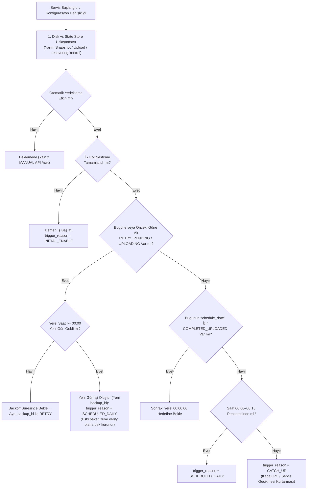
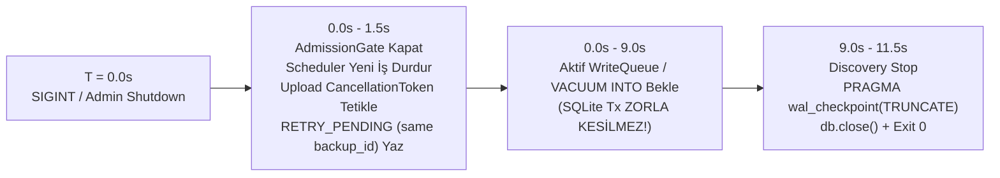

# Automated Backup Scheduling Specification v1.1 — MARKET MMS

**Doküman Kodu:** `AUTOMATED_BACKUP_SCHEDULING_SPEC_V1_1.md`  
**Belge Sürümü:** v1.1 (Kanonik Uygulama Şartnamesi)  
**Tarih:** 22 Kasım 2026  
**Durum:** **CONFIRMED (v1.1)** — Owner **B1.8–B1.11** ve **`OV-01…OV-05`** kararlarıyla donduruldu  
**Ana Karar Kaydı:** [`ADR-023 — Hub-Centric Google Drive Backup & Restore`](../decisions/023-hub-centric-google-drive-backup-restore.md)  
**Eşlik Eden Belgeler:**  
- [`GOOGLE_DRIVE_BACKUP_ARCHITECTURE_V1_1.md`](./GOOGLE_DRIVE_BACKUP_ARCHITECTURE_V1_1.md)  
- [`BACKUP_RESTORE_ACCEPTANCE_TESTS_V1_1.md`](../testing/BACKUP_RESTORE_ACCEPTANCE_TESTS_V1_1.md)

---

## 1. Amaç ve Kapsam

Bu şartname, **Windows Master Hub (`MarketMMSService` / `mms_backend.exe`)** üzerinde çalışan katılımsız (*unattended*) otomatik Google Drive yedekleme zamanlayıcısının tetikleme kurallarını, yerel `00.00` hedefleme ve *catch-up* davranışını, üssel geri çekilme (*backoff*) ve hata sınıflandırmasını, gün değişiminde `SUPERSEDED` korumasını, aşamalı *crash recovery* mekanizmasını, 4 MB resumable upload devamlılığını ve **15 saniyelik Windows Service kapanış timeout'u ile 2 dakikalık HTTP timeout çelişkisinin kesin teknik çözümünü** belirler.

---

## 2. Terimler ve Tanımlar

| Terim | Tanım |
|---|---|
| **`trigger_reason`** | Yedek işinin tetiklenme nedeni: `INITIAL_ENABLE`, `SCHEDULED_DAILY`, `CATCH_UP`, `RETRY`, `MANUAL`. |
| **`schedule_date`** | İşin ait olduğu mağaza yerel takvim günü (`YYYY-MM-DD`, mağaza/sistem yerel saat dilimi, Türkiye için `Europe/Istanbul`). |
| **`backoff_step`** | Aynı takvim günü içindeki ardışık geçici hata tekrar deneme indeksi (`1..6+` → `5, 10, 20, 40, 80, 160` dk). |
| **`superseded_by_backup_id`** | Önceki günden sarkan tamamlanmamış işin yerine yeni günün Drive'da doğrulanmış yedeğinin geçtiğini gösteren referans kimliği. |
| **`shutdown_budget`** | WinSW `<stoptimeout>15 sec</stoptimeout>` sınırını aşmamak için toplam `12 saniye` olarak tahsis edilen kontrollü servis kapanış zaman bütçesi. |
| **`CancellationToken` (Cooperative Abort)** | Servis kapanışı başladığında aktif Drive HTTP chunk I/O çağrısını 1–1.5 sn içinde kontrollü kesen, ancak SQLite transaction veya `VACUUM INTO` yazımını asla zorla öldürmeyen iptal sinyali. |
| **`BackupOperationLock`** | Eşzamanlı yedekleme, geri yükleme ve saklama temizliğini birbirinden dışlayan single-flight kilit (`ERR_BACKUP_OPERATION_BUSY`). |

---

## 3. Gereksinimler

### 3.1. Zamanlama ve Yaşam Döngüsü Kuralları
1. **İlk Etkinleştirme (`B1.9`):** Otomatik yedekleme ilk kez etkinleştirildiğinde **derhal** `trigger_reason = INITIAL_ENABLE` kaydıyla başlangıç yedeği başlatılır (00.00 beklenmez). Başarılı ilk `COMPLETED_UPLOADED` sonrası takip eden otomatik yedek bir sonraki yerel `00.00` (`SCHEDULED_DAILY`) olarak planlanır.
2. **Yerel `00.00` Hedefi ve OS Toleransı (`B1.10`, `B1.11`):** Günlük yedekler yerel saat `00:00:00` hedefiyle planlanır. `00.00` kesin milisaniye garantisi değildir; Windows görev/timer sapması (`00:00`–`00:15` tolerans penceresi) normal kabul edilir.
3. **Catch-Up Davranışı:** Servis veya Hub PC `00.00` anında kapalıysa (veya uyku/elektrik kesintisindeyse), servis açılışında o `schedule_date` için `COMPLETED_UPLOADED` bir iş yoksa sistem tek seferlik `trigger_reason = CATCH_UP` işi başlatır.
4. **Üssel Backoff ve Gün Sonu Sınırı:** Geçici hatalarda tekrar deneme gecikmeleri **`5 → 10 → 20 → 40 → 80 → 160` dakika** olarak uygulanır; 6. denemeden sonra yerel gün sonuna (`23:59:59`) kadar **`160 dakika`** sabit aralıkla devam eder.
5. **Kota vs Yetki Ayrımı:** Google Drive `HTTP 403 storageQuotaExceeded` hatası authentication hatası değildir; OAuth token'ını silmez ve `ERR_DRIVE_QUOTA_EXCEEDED` olarak raporlanır. Kalıcı hatalar (`401`/`403` yetki iptali, bozuk recovery password vb.) otomatik retry döngüsünü durdurur ve kullanıcı müdahalesi gerektirir.
6. **Gün Değişimi (`00.00` Rollover) & `SUPERSEDED` Koruması:** Yeni günün yedeği mutlaka yeni `backup_id` ve yeni SQLite snapshot ile oluşturulur. Önceki günün tamamlanmamış şifreli paketi ve kısmi upload oturumu, yeni günün yedeği Google Drive'da `VERIFYING` → `COMPLETED_UPLOADED` olana kadar **ASLA silinmez**.
7. **Aşamalı Crash Recovery & Temizlik:** `SNAPSHOT_CREATED`, `ENCRYPTED`, `UPLOADING` ve `VERIFYING` aşamaları kalıcı state store'a atomik yazılır. Geçerli şifreli `.mmsbak` mevcutsa PBKDF2/şifreleme tekrarlanmaz ve aynı `backup_id` ile kalınan offset'ten devam edilir. Açılışta disk-vs-state uzlaştırması yapılır; şifresiz geçici `.snap.db` yalnızca sahiplik doğrulandıktan sonra temizlenir.
8. **Servis Kapanışı (15 sn vs 2 dk Çözümü):** Kapanış başladığında yeni iş başlatılmaz; güvenli snapshot/SQLite yazım sınırları korunur; aktif Drive upload kooperatif biçimde iptal edilir; durum kalıcı olarak `RETRY_PENDING` yazılır ve açılışta **aynı `backup_id`** ile devam edilir.

### 3.2. Mevcut Kod Tabanı Uyumsuzluk Kanıtları
- `BackupSchedulePolicy` (`packages/mms_client_storage/lib/src/backup/scheduled_backup.dart:28-81`): Yalnızca kayan `interval` (son başarı + 24s) ve sabit `30 dk` `failureRetryDelay` destekler; yerel `00:00` hedefi, `INITIAL_ENABLE`/`CATCH_UP`/`RETRY` ayrımı ve gün sınırı yoktur.
- `ScheduledBackupRunner._run` (`scheduled_backup.dart:377-391`): Upload `afterSuccess` içinde çalışır ve hata alsa bile `success: true` yazar.
- `DatabaseBackupEngine.createBackup` (`packages/mms_client_storage/lib/src/backup/database_backup_engine.dart:72-171`): Snapshot alma ve PBKDF2 şifrelemeyi tek blokta birleştirir; çökme sonrası ara `ENCRYPTED` aşamadan devam edemez ve geçici dosyayı `Directory.systemTemp` içinde açar (`satır 91-92`).
- `MarketMMSService.xml:37` (`<stoptimeout>15 sec</stoptimeout>`), `LifecycleManager.drainTimeout` (`test_spikes/spike_01_backend/lib/service/lifecycle_manager.dart:24`: `12s`), `GoogleDriveBackupUploader.requestTimeout` (`google_drive_backup.dart:343`: `2 min`) ve `BackupScheduler.stop()` (`scheduled_backup.dart:448-459`: iptal token'ı olmadan `await active`) birbiriyle çelişmektedir. Ayrıca `bin/server.dart:4536-4539` ve `lifecycle_manager.dart:38-45, 150-152` `SIGINT` durumunda `server.stop()`'u çağırmadan `exit()` etmektedir.

---

## 4. Mimari / Teknik Tasarım

### 4.1. İlk Etkinleştirme, `00.00` Yerel Zamanlama ve `CATCH_UP` Mantığı

- **Saat Geri Alınması ve DST Koruması:** `schedule_date` değeri yerel saat dilimine göre hesaplanırken, `monotonic_elapsed` ve iş zaman damgaları mutlaka UTC (`created_at_utc`, `next_retry_at_utc`) olarak saklanır. Sistem saati geri alınsa dahi aynı `schedule_date` içinde zaten `COMPLETED_UPLOADED` kaydı varsa ikinci bir `SCHEDULED_DAILY` üretilmez.

### 4.2. Retry / Backoff Politikası ve Hata Sınıflandırması

| Deneme Numarası (`attempt_no`) | Önceki Hata Sonrası Bekleme | `trigger_reason` |
|---|---|---|
| İlk deneme başarısız → Deneme 1 | **5 dakika** | `RETRY` (`backoff_step = 1`) |
| Deneme 1 başarısız → Deneme 2 | **10 dakika** | `RETRY` (`backoff_step = 2`) |
| Deneme 2 başarısız → Deneme 3 | **20 dakika** | `RETRY` (`backoff_step = 3`) |
| Deneme 3 başarısız → Deneme 4 | **40 dakika** | `RETRY` (`backoff_step = 4`) |
| Deneme 4 başarısız → Deneme 5 | **80 dakika** | `RETRY` (`backoff_step = 5`) |
| Deneme 5 başarısız → Deneme 6 | **160 dakika** | `RETRY` (`backoff_step = 6`) |
| Deneme 6+ başarısız → Yerel `23:59:59`'a kadar | **160 dakika (sabit)** | `RETRY` (`backoff_step >= 6`) |

- **Sınıf A — Geçici / Tekrar Denenebilir Hatalar (`RETRY_PENDING`):**
  - Ağ zaman aşımı, `SocketException`, TLS geçici kopması.
  - HTTP `429 Too Many Requests` (`Retry-After` üst sınırı ile uyumlu, minimum backoff'un altına inmez), `500`, `502`, `503`, `504`.
  - Servis kontrollü kapanışı (`ERR_SHUTDOWN_ABORTED` — backoff sayacını cezalandırmadan açılışta hemen sürdürür).
  - HTTP `403` alt kodu **`storageQuotaExceeded`** / **`quotaExceeded`** → Auth hatası değildir; `ERR_DRIVE_QUOTA_EXCEEDED` koduyla kaydedilir ve Owner'a Drive kotası dolu uyarısı gösterilir (`rateLimitExceeded` / `userRateLimitExceeded` aynı geçici sınıfta işlenir).
- **Sınıf B — Yetkilendirme Hatası (`LOCAL_ONLY_PENDING_UPLOAD` + Reauth Gerekli):**
  - OAuth token yenileme `400/401 invalid_grant` veya Drive `401` (force refresh başarısız) ya da `403 insufficientPermissions` / `accessNotConfigured`.
  - Otomatik retry durdurulur; mevcut şifreli `.mmsbak` dosyası yerelde korunur.
- **Sınıf C — Kalıcı Hatalar (`FAILED` — Kullanıcı Müdahalesi Zorunlu):**
  - Recovery password eksik veya çözülemiyor (`ERR_RECOVERY_SECRET_MISSING`).
  - Disk dolu (`ERR_DISK_FULL`) durumunda yer açılana dek (Owner uyarısıyla; istenirse backoff içinde tekrar kontrol edilir ancak sessizce `COMPLETED` sayılmaz).
  - Lokal `.mmsbak` SHA-256 doğrulama bozulması (`ERR_PACKAGE_CORRUPT`) → bozuk paket karantinaya alınır ve müdahale istenir.

### 4.3. Gün Değişimi (`00.00`) ve `SUPERSEDED` Koruma Protokolü

1. Önceki güne (`D-1`) ait bir yedek `RETRY_PENDING` veya `LOCAL_ONLY_PENDING_UPLOAD` durumundayken saat yerel `00:00`'ı geçtiğinde, zamanlayıcı yeni gün (`D`) için **yeni bir `backup_id`** üretir ve canlı DB'den **güncel SQLite `VACUUM INTO` snapshot'ı** alır (eski günün bayat snapshot'ı yeni gün olarak yüklenmez).
2. **`D-1` Varlıklarının Korunma Garantisi:** Yeni gün (`D`) yedeği `COMPLETED_UPLOADED` olarak Google Drive'da doğrulanana kadar (`VERIFYING` geçene kadar), `D-1`'e ait şifreli `.mmsbak` paketi, `backup_upload_sessions` kaydı ve (varsa) Drive üzerindeki kısmi session'ı **KESİNLİKLE SİLİNMEZ**.
3. Yeni gün (`D`) yedeği başarısız olursa `D-1`'in doğrulanabilir paketi veya diğer en son geçerli yedek korunmaya devam eder.
4. Yeni gün (`D`) yedeği `COMPLETED_UPLOADED` olduğunda, tek atomik durum güncellemesiyle `D-1` işinin durumu `SUPERSEDED` (`superseded_by_backup_id = backup_id_D`) yapılır ve artık gereksiz `D-1` kısmi session artıkları temizlenir.

### 4.4. Aşamalı Crash Recovery ve Disk–State Uzlaştırması

#### 4 Ayrık Kalıcı Aşama
Her iş kalıcı durum deposunda (`%ProgramData%\MarketMMS\data\backup_jobs_state.json` veya Hub SQLite `backup_jobs` / `backup_upload_sessions` tablosu — atomik yazım) aşağıdaki kontrol noktalarını kaydeder:
1. **`SNAPSHOT_CREATED`:** `temp_snapshot_path`, `snapshot_sha256`, `unencrypted_size_bytes`.
2. **`ENCRYPTED`:** `encrypted_package_path`, `package_sha256`, `package_md5`, `encrypted_size_bytes`, `format_version`, `key_version`. *(Bu noktadan sonra `.snap.db` silinir ve bir daha şifresiz kopya üretilmez.)*
3. **`UPLOADING`:** `drive_folder_id`, `resumable_session_uri`, `uploaded_bytes`, `chunk_size_bytes`.
4. **`VERIFYING` → `COMPLETED_UPLOADED`:** `drive_file_id`, `verified_at_utc`.

#### Çökme Sonrası Açılış Uzlaştırma Algoritması
Servis her başladığında (`SpikeServer.start()` sırasında, scheduler `start()` öncesinde):
1. Durum deposunu atomik okur (yarım `.tmp` dosya varsa siler).
2. Yarıda kalmış `RUNNING` / `SNAPSHOT_CREATED` / `ENCRYPTED` / `UPLOADING` / `VERIFYING` işini tespit eder:
   - **`ENCRYPTED` veya `UPLOADING` durumunda geçerli `.mmsbak` diskte varsa:** Paketin `magic_header` + uzunluk + `package_sha256` kontrolü yapılır. Geçerliyse **600.000 turluk PBKDF2 ve AES şifrelemesi KESİNLİKLE TEKRARLANMAZ**, doğrudan **aynı `backup_id`** ile Drive yükleme/doğrulama aşamasından devam edilir. (Varsa `resumable_session_uri` üzerinden `Content-Range: bytes */<total>` sorgusuyla sunucunun gerçekten aldığı byte offset'i öğrenilerek kalıcı state ile hizalanır.)
   - **`SNAPSHOT_CREATED` aşamasında çökmüşse (henüz `.mmsbak` yok):** Şifresiz `.snap.db` dosyasının `backup_id` ile sahipliği ve bütünlüğü doğrulanır; şifreleme aşaması çalıştırılır ya da güvenli temizlikten sonra snapshot yinelenir.
3. **Sahiplik Doğrulamalı Yetim Snapshot Temizliği:** `%ProgramData%\MarketMMS\backups\tmp\*.snap.db` dizinindeki dosyalar taranır. Yalnızca şu üç şartı **birlikte** sağlayan dosyalar silinir: (a) Aktif `BackupOperationLock` sahibi yok, (b) `backup_jobs` durum kaydı bu `backup_id`'yi `ENCRYPTED` / `COMPLETED_UPLOADED` / `FAILED` / `CANCELLED` / `SUPERSEDED` olarak kapatmış veya kayıt hiç yok, (c) Dosya en az grace penceresinden eski. Başka aktif bir işin `.snap.db` dosyası ASLA silinmez.

### 4.5. Resumable Upload Zamanlama ve `404/410` Kurtarma
- Varsayılan chunk boyutu: **4 MB** (`4.194.304` bayt).
- Her chunk yanıtında Google'dan `HTTP 308` + `Range: bytes=0-<lastByte>` alınır; `uploaded_bytes = lastByte + 1` hemen atomik kaydedilir.
- Eğer parça isteği **`HTTP 404` veya `HTTP 410`** dönerse (Google upload URI süresi dolmuş):
  1. Hub önce `appProperties has { key='mms_backup_id' and value='<backup_id>' } and trashed=false` ile dosyanın Drive'da zaten oluşup oluşmadığını kontrol eder.
  2. Dosya tamamlanmışsa `VERIFYING` aşamasına atlar.
  3. Dosya yoksa kalıcı `resumable_session_uri` silinir, `uploaded_bytes = 0` yapılır ve aynı `backup_id` ile yeni resumable oturumu açılarak devam edilir.

### 4.6. Service Graceful Shutdown & 15 sn vs 2 dk Timeout Çelişkisinin Çözümü

#### Mevcut Çelişki (Repository Kanıtı)
- `MarketMMSService.xml:37`: WinSW kapatma bekleme süresi **`15 sec`**. Bu süre içinde süreç çıkmazsa WinSW süreci **hard-kill (`TerminateProcess`)** eder.
- `LifecycleManager` (`lifecycle_manager.dart:24`): `drainTimeout = 12 seconds`.
- `GoogleDriveBackupUploader` (`google_drive_backup.dart:343`): `requestTimeout = 2 minutes`.
- `BackupScheduler.stop()` (`scheduled_backup.dart:448-459`): Yedek sürüyorsa 2 dakikalık HTTP bitene kadar iptalsiz bekler → WinSW 15. saniyede süreci zorla öldürür!
- `bin/server.dart:4536-4539` & `lifecycle_manager.dart:38-45`: `SIGINT` (WinSW Stop) sinyali geldiğinde doğrudan `lifecycle.shutdown(exitProcess: true)` çağrılır; `server.stop()` (ve `_backupScheduler?.stop()`) hiç çalışmaz!

#### Kesin Çözüm: 12 Saniyelik Kooperatif Kapanış Bütçesi

| Zaman Dilimi | Bileşen | Yapılacak İşlem ve Sınır |
|---|---|---|
| **0.0 – 0.1 sn** | `LifecycleManager` + `SpikeServer` | Hem `SIGINT` hem `/api/v1/admin/shutdown` akışı **tekil kapanış orkestratörünü** (`SpikeServer.stop()`) çağırır; mevcut `server.dart:4536-4539` baypası kaldırılır. |
| **0.0 – 1.5 sn** | Drive Uploader & HTTP Client | Drive uploader için küresel 2 dakikalık tek istek yerine **per-chunk bounded connect/I/O timeout (15 sn)** + `CancellationToken` (`uploadHttpClient.close(force: true)` / socket abort) uygulanır. Kapanış sinyali geldiğinde Drive upload **≤ 1.5 sn** içinde iptal edilir. |
| **0.5 – 2.0 sn** | Backup State Store | O an `UPLOADING` / `VERIFYING` / `SNAPSHOT_CREATED` / `ENCRYPTED` olan aktif iş, kalıcı state store'a **`RETRY_PENDING`** (`reason = 'SHUTDOWN_INTERRUPTED'`, **aynı `backup_id`**, mevcut `uploaded_bytes` & `session_uri`) olarak atomik yazılır. |
| **0.0 – 9.0 sn** | SQLite & `WriteQueue` | Çalışan kısa SQLite transaction'ları ve `VACUUM INTO` **ASLA zorla kesilmez**; `WriteQueue.drain` tamamlanana kadar (kalan bütçe içinde en fazla ~9 sn) beklenir. Eğer 9. saniyede `VACUUM INTO` hâlâ sürüyorsa mevcut `LifecycleManager` kuralıyla `db.close()` ve `wal_checkpoint` atlanıp WAL bütünlüğü korunarak çıkılır (`exitCode 101`, WinSW `TerminateProcess` riski olmadan). |
| **9.0 – 11.5 sn** | `WAL Checkpoint` & DB Kapanışı | `WriteQueue` boşaldıktan sonra `PRAGMA wal_checkpoint(TRUNCATE)` ve `db.close()` tamamlanır; kalan HTTP soketleri kapatılır ve `exit(0)` verilir — tamamı WinSW `15 sec` sınırının altında kalır (`BK-032`). |

### 4.7. Single-Flight Kilidi ve Çakışma Yönetimi (`BackupOperationLock`)
- Hub hem yerel `.mms_backup_operation.lock` dosya kilidini hem de süreç içi zamanlayıcı kilidini (`ScheduledBackupRunner`) paylaşır.
- Zamanlanmış yedek (`00.00` veya `RETRY`) tetiklendiğinde bir **Restore** işlemi kilidi tutuyorsa, zamanlanmış tur çökmeden/yanlış `FAILED` hatası yazmadan bekler veya `RETRY_PENDING` / atlama uygular; paralel bir **Manuel Backup** veya **Restore** isteği ise anında **`409 Conflict` (`ERR_BACKUP_OPERATION_BUSY`)** döndürür (`BK-030`).

---

## 5. Hata Senaryoları

| Senaryo | Beklenen Davranış |
|---|---|
| `00.00`'da PC uyku modunda veya kapalı, `08.30`'da açıldı | Açılışta o güne ait `COMPLETED_UPLOADED` olmadığı için 15 sn içinde `CATCH_UP` tetiklenir. |
| Yedek 3. denemede internetsizlikten kaldı, `00.00` oldu | Yeni gün (`D`) için yeni `backup_id` ve snapshot başlar; `D-1` dosyası yeni yedek Drive'da `COMPLETED_UPLOADED` olana dek silinmez (`SUPERSEDED`). |
| `MMSBAK02` üretildikten sonra upload ortasında servis durduruldu (`Stop-Service`) | Upload ≤ 1.5 sn iptal edilir, `RETRY_PENDING` yazılır, SQLite güvenle kapatılır. Servis yeniden açıldığında PBKDF2 tekrarlanmadan **aynı `backup_id`** ve son 308 offset'inden devam edilir (`BK-032`). |
| `403 storageQuotaExceeded` geldi | `ERR_DRIVE_QUOTA_EXCEEDED` durumuna geçer; OAuth `refresh_token` silinmez; backoff takvimi ve UI uyarısı işletilir. |
| Gün sonuna (`23:59:59`) kadar 6+ denemenin tümü başarısız oldu | Backoff 160 dk sabitlenir; `00.00` dönünce önceki gün `D` yedeği devir adayı kalır ve `D+1` taze snapshot ile devam eder. |

---

## 6. Güvenlik Gereksinimleri

- Durum dosyası (`backup_jobs_state.json` / `backup_upload_sessions`) ve `resumable_session_uri` değerleri yalnızca `%ProgramData%\MarketMMS\security\` veya ACL korumalı `%ProgramData%\MarketMMS\data\` altında tutulur (`Users`/`Everyone` erişimsiz).
- Yedek parolası ve OAuth token'ları backoff/schedule hata loglarına asla yazılmaz (`RedactingLogger`).
- Şifresiz `.snap.db` dosyaları `ENCRYPTED` sonrası diskten kaldırılır; çökme durumunda açılışta sahiplik doğrulaması olmadan körlemesine dosya silinmez.

---

## 7. Veri Tutarlılığı

- `WriteQueue` üzerinden alınan `VACUUM INTO` canlı kasa satışlarını bozmaz ve `-wal` dosyasındaki tüm commit edilmiş veriyi kapsar.
- Durum dosyası her geçişte `.tmp + flush + atomic rename` ile güncellenir; güç kesintisinde dosya yarım kalmaz (bozuk JSON saptanırsa `.corrupt_<ts>` karantinaya alınır ve disk üzerindeki `.mmsbak` dosyalarıyla reconcile edilir).
- `Completed` damgası yalnızca Drive'dan uzak dosya boyutu + MD5 + `mms_backup_id` doğrulandığında yazılır.

---

## 8. Geriye Dönük Uyumluluk

- Mevcut `hub_config.json` içindeki `backup_schedule: { interval_hours, daily_retention_days, monthly_retention_months }` şeması okunmaya devam eder (`test_spikes/spike_01_backend/lib/config/hub_config.dart`):
  - `interval_hours == 0` → `enabled: false` eşlenir.
  - `interval_hours > 0` veya yeni v1.1 `mode: "daily_midnight"` → varsayılan yerel `00:00` zamanlamasına geçirilir (`enabled: true`).
- Android eski `MmsBackgroundBackupJobService` (`JOB_ID = 70201`) yerel Outbox koruma yedekleri kendi izole ayar dosyasında (`backup_schedule_settings.json`) ve AppFiles dizininde Hub zamanlayıcısından bağımsız çalışmaya devam eder (`B1.12`).

---

## 9. Kabul Kriterleri

1. İlk etkinleştirmede `INITIAL_ENABLE` anında başlar ve Drive'da doğrulandıktan sonra sonraki hedef yerel `00:00` olarak görünür.
2. Backoff dizisi `5, 10, 20, 40, 80, 160` dk ve sonrasında gün sonuna dek sabit `160` dk olarak deterministik doğrulanır.
3. Gün değişiminde `D-1` artıkları, `D` yedeği `COMPLETED_UPLOADED` olmadan silinmez.
4. Upload kesintisinde ve servis yeniden başlatmada PBKDF2 tekrarlanmadan aynı `backup_id` ve son 308 byte offset'inden devam edilir.
5. Aktif upload sırasında WinSW `SIGINT` / admin shutdown geldiğinde süreç `< 12 sn` içinde temiz kapanır, SQLite tx kesilmez ve açılışta aynı `backup_id` sürdürülür (`BK-032`).

---

## 10. Test Referansları

Bkz. [`BACKUP_RESTORE_ACCEPTANCE_TESTS_V1_1.md`](../testing/BACKUP_RESTORE_ACCEPTANCE_TESTS_V1_1.md):
- **Otomatik:** `BK-008`..`BK-022`, `BK-030` (Single-flight), `BK-032` (Graceful shutdown + same `backup_id`).
- **Fiziksel:** `BK-PAT-02` (`INITIAL_ENABLE`), `BK-PAT-03` (`00.00` / `CATCH_UP` — sistem saati değiştirilmeden!), `BK-PAT-07`..`BK-PAT-09`, `BK-PAT-18` (Windows Service unattended execution & restart recovery).

---

## 11. Dondurulan Uygulama Kararları (`OV-01…OV-05`) ve Saha Doğrulaması

1. **Tek Günlük `CATCH_UP`:** PC/servis birden fazla gün kapalı kalsa bile canlı `market_master.db` tüm güncel veriyi içerdiğinden açılışta mevcut takvim günü için tek `CATCH_UP` yedeği üretilir.
2. **Durum Deposu (`backup_jobs_state.json`):** 12-durum (`PENDING`, `RUNNING_SNAPSHOT`, `SNAPSHOT_READY`, `RUNNING_ENCRYPT`, `ENCRYPTED_LOCAL_READY`, `UPLOADING`, `VERIFYING`, `COMPLETED_UPLOADED`, `RETRY_PENDING`, `FAILED_AUTH`, `FAILED_QUOTA`, `SUPERSEDED`) ve resumable session URI'leri ayrı atomik `backup_jobs_state.json` dosyasında tutulur; SQLite restore sırasında geri sarılmaz.
3. **12 Karakter Kurtarma Parolası & 7 Günlük Yerel Önbellek (`OV-05`):** Recovery password min `12` karakterdir, düz metin saklanmaz; yerel önbellek `7` gün tutulur ve Drive `30g/12a` arşivinden bağımsızdır.
4. **Saha Doğrulaması (`BLOCKED`):** Gerçek Windows AOT servis durdurma süresi (`<12 sn` içinde `<1.5 sn` HTTP iptali) ve gerçek `LocalService` gece `00:00` çalışması `BK-PAT-01…18` saha testinde doğrulanacaktır.

---

## 12. Owner Kararları

| Konu | Owner Kararı | Durum |
|---|---|---|
| İlk Etkinleştirmede `INITIAL_ENABLE`, Yerel `00.00` ve `CATCH_UP` | **B1.9, B1.10, B1.11** | **`[CONFIRMED]`** |
| Retention: Drive 30g/12a + min 1 yedek vs Yerel 7g önbellek | **B1.8**, **`OV-05`** | **`[CONFIRMED]`** |
| Backoff (`5/10/20/40/80/160` → EOD `160` dk), `FAILED_AUTH`/`FAILED_QUOTA`, `SUPERSEDED` Koruması, 12 sn Shutdown Bütçesi, Ayrı `backup_jobs_state.json` | **Owner Onayı (`ADR-023`)** | **`[CONFIRMED]`** |
