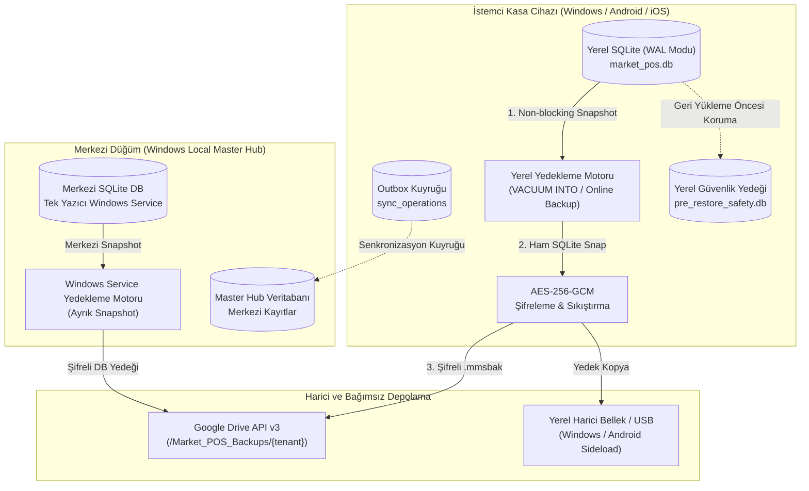
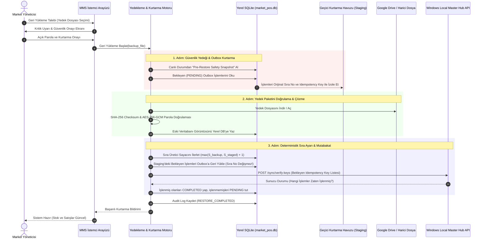

# BACKUP_RESTORE_PROTOCOL.md — Market Management System (MMS) Yedekleme ve Geri Yükleme Protokolü

**Belge Sürümü:** v1.0  
**Tarih:** 31 Ekim 2026  
**Aşama:** Faz 0 — Mimari ve Teknik Protokol Tasarımı  
**Kapsam:** Pilot için Merkezi Windows SQLite ve Mobil Yerel SQLite Ayrık Yedeklemesi, Google Drive Harici Yedekleme Entegrasyonu, Felaketten Kurtarma, Eşzamanlı İşlem Koruma ve Senkronizasyon Mutabakatı (Gelecek SaaS için PostgreSQL/Supabase Yedeklemesi)  
**Ön Koşul Belgeler:**  
- [`MARKET_POS_AI_STUDIO_BUILD_PLANI.md`](../../MARKET_POS_AI_STUDIO_BUILD_PLANI.md)  
- [`docs/requirements/BUSINESS_RULES_SPEC.md`](../requirements/BUSINESS_RULES_SPEC.md) (`BR-BAK-01` .. `BR-BAK-06`)  
- [`docs/architecture/DATA_MODEL.md`](./DATA_MODEL.md) (`backup_logs`, `sync_operations`, `device_sync_sequence`)  
- [`docs/architecture/OFFLINE_SYNC_PROTOCOL.md`](./OFFLINE_SYNC_PROTOCOL.md) (Outbox Değişmezliği, İdempotency, Mutabakat)  
- [`docs/architecture/LOCAL_STORAGE_TECHNICAL_VALIDATION.md`](./LOCAL_STORAGE_TECHNICAL_VALIDATION.md) (SQLite WAL, `VACUUM INTO`, Kaza Kurtarma)

---

## 1. Yönetici Özeti ve Protokolün Temel İlkeleri

Market Management System (MMS), market işletmesinin en kritik varlıkları olan stok, cari, satış, mali hareket ve denetim kayıtlarını sıfır veri kaybı (*Zero Data Loss Target*) ve yüksek iş sürekliliği prensibiyle korur. 

MMS yedekleme mimarisi, klasik "gecelik veritabanı yedeği al ve geç" yaklaşımının ötesinde, hibrit (çevrimdışı/çevrimiçi) ve çok cihazlı yapının getirdiği zorlukları çözmek üzere **6 Çelik Kural (Ironclad Principles)** üzerine inşa edilmiştir:

1. **Bağımsız İzolasyon ve Ayrık Yedekleme:** Merkezi Windows SQLite veritabanı yedeği ile mobil cihazların yerel SQLite veritabanı yedekleri birbirinden ayrıdır; mobil cihaz yedeği merkezi veritabanının üzerine doğrudan kopyalanamaz. MMS, verileri Google Drive harici ortamına taşınabilir ve şifreli formatta yedekler (`BR-BAK-01`). Gelecek SaaS aşamasında merkezi bulut yedekleri ve PITR da bu ilkeyle yönetilir.
2. **Kasa Satışını Kesintisiz Sürdürme (Non-blocking Snapshot):** Yedekleme işlemi sırasında markette satışlar durdurulamaz, geciktirilemez. Yerel SQLite veritabanında WAL modunun getirdiği `VACUUM INTO` veya SQLite Online Backup API teknik seçenekleri değerlendirilir (`BR-BAK-03`). Windows yedekleme ve kurtarma çözümü henüz teknik olarak doğrulanmamış olup Faz 1 kapsamında ele alınacaktır.
3. **Senkronize Edilmemiş Outbox İşlemlerinin Mutlak Dokunulmazlığı (Immutability of Pending Operations):** Geri yükleme (restore) işlemi sırasında veya sonrasında, cihazın Outbox kuyruğunda henüz sunucuya ulaşmamış bekleyen işlemler (`sync_operations`) **asla silinemez, sıra numaraları değiştirilemez (`client_sequence_number` kalıcıdır) ve mükerrer üretilemez** (`OFFLINE_SYNC_PROTOCOL.md` Bölüm 6).
4. **Geri Yükleme Öncesi Güvenlik Yedeği (Pre-Restore Safety Snapshot):** Bir cihaza veya merkezi sunucuya herhangi bir geçmiş yedek yüklenmeden önce sistem, o anki canlı veritabanının atomik bir "güvenlik yedeğini" (Safety Snapshot) otomatik olarak almak zorundadır. Kullanıcı onayı olmaksızın geri dönüşü olmayan işlem yapılamaz (`BR-BAK-05`).
5. **İki Aşamalı Çift Anahtarlı Güvenlik (Client-side Envelope Encryption):** Google Drive veya harici ortama aktarılan tüm yedek dosyaları, cihazdan çıkmadan önce endüstri standardı `AES-256-GCM` ile şifrelenir ve `HMAC-SHA256` ile bütünlük doğrulamasına tabi tutulur. Yetkisiz kişiler Google Drive dosyasına erişse dahi market verilerini okuyamaz (`BR-BAK-06`).
6. **Deterministik Mutabakat (Post-Restore Reconciliation):** Geri yükleme tamamlandıktan sonra cihaz, sunucu gelen kutusunu sorgulayarak (`POST /sync/verify-keys`) bekleyen işlemlerinin hangilerinin sunucuda işlenmiş olduğunu teyit eder; sadece işlenmemiş olanları Outbox üzerinden senkronize eder.

---

## 2. Mimari Genel Bakış ve Akış Şemaları

### 2.1. Hibrit Yedekleme Mimarisi



### 2.2. Geri Yükleme ve Çevrimdışı Kurtarma Akışı



---

## 3. Gelecek SaaS Bulut Yedekleme Protokolü (Tarihsel / Opsiyonel Tasarım)

> [!NOTE]
> Bu bölüm, gelecekteki çok şubeli bulut SaaS aşaması için tasarlanmış merkezi veritabanı yedekleme mimarisini açıklar. Pilot aşamasında merkezi veritabanı Windows Local Master Hub üzerindeki SQLite'tır; pilot yedekleme protokolü Bölüm 4'te tanımlanan yerel Windows ve mobil SQLite motoru üzerinden yürütülür. Windows yedekleme ve kurtarma çözümü henüz teknik olarak doğrulanmamış olup Faz 1 kapsamında ele alınacaktır.

Merkezi veritabanı, marketlerin ortaklaşa çalıştığı çok kiracılı (multi-tenant) PostgreSQL kümesidir. Yedekleme protokolü iki katmanda yürütülür:

### 3.1. Altyapı Katmanı: Supabase Yönetilen Yedekleri
- **PITR (Point-in-Time Recovery):** Veritabanı WAL logları sürekli arşivlenir. Herhangi bir felaket anında son 7 gün (Pro plan) içindeki herhangi bir saniyeye tam geri dönüş sağlanır.
- **Günlük Tam İmaj Yedekleri:** Her gece 03:00 UTC'de tam fiziksel snapshot alınır.
- *Sınırlama:* Altyapı seviyesindeki yedek tüm platformu kapsar; tek bir marketin (tenant) verisini diğer kiracıları etkilemeden geçmişe döndürmek için kullanılamaz. Bu nedenle uygulama seviyesinde tenant-scoped mantıksal yedekleme zorunludur.

### 3.2. Uygulama Katmanı: Kiracı İzolasyonlu Mantıksal Yedekleme (Tenant-Scoped Export)
Her market işletmesi, kendi verilerini merkezi sunucudan bağımsız olarak dışa aktarabilmelidir.
- **Tetikleme:** 
  1. *Zamanlanmış (Scheduled):* Her gün saat 04:00'te çalışan Supabase pg_cron veya Edge Function tetikleyicisi.
  2. *Manuel:* Yönetici panelinden "Merkezi Yedeği Google Drive'a Aktar" butonu.
- **İzolasyon Kuralı:** Dışa aktarma işlemi mutlak surette `tenant_id` filtresi ile sınırlandırılır. Başka bir marketin hiçbir kaydı pakete giremez.
- **MVCC & Snapshot İzolasyonu:** Yedekleme transaction'ı `SET TRANSACTION ISOLATION LEVEL REPEATABLE READ;` seviyesinde açılır. Bu sayede:
  - Yedekleme sürerken diğer cihazlardan gelen yeni satışlar, ödemeler veya senkronizasyon paketleri engellenmez.
  - Yedekleme anındaki veritabanı görüntüsü tamamen tutarlı kalır (Phantom read veya okuma tutarsızlığı yaşanmaz).
- **Yedek Formatı:** 
  - Sıkıştırılmış, JSONL (JSON Lines) veya şema uyumlu mantıksal SQL insert dökümü.
  - Her tablo için satır sayısı, tablo adı ve MD5 hash değerini içeren `manifest.json`.

---

## 4. Yerel SQLite / Drift Yedekleme Protokolü (Windows, Android, iOS)

MMS kasa cihazları internet bağlantısı kopsa dahi günlerce bağımsız çalışabilir. Bu nedenle cihazdaki yerel SQLite veritabanının yedeği hayati önem taşır.

### 4.1. WAL Modunda Canlı Yedekleme Güvenliği
`LOCAL_STORAGE_TECHNICAL_VALIDATION.md` belgesinde kanıtlandığı üzere, SQLite WAL (Write-Ahead Logging) modunda çalışırken canlı `market_pos.db` dosyasını işletim sistemi düzeyinde doğrudan kopyalamak (`File.copy`) **kesinlikle yasaktır**. Zira commit edilmiş en son işlemler `market_pos.db-wal` dosyasındadır; ham dosya kopyası bozuk (*corrupt*) veya eksik veritabanı yaratır.

### 4.2. Yerel Yedekleme Yöntemi: `VACUUM INTO` ve SQLite Online Backup API
1. **Birincil Yöntem (`VACUUM INTO`):**
   - SQLite 3.27+ sürümünde desteklenen `VACUUM INTO '/yol/yedek_dosyasi.db';` komutu veritabanı motoru tarafından atomik olarak çalıştırılır.
   - Aktif okuyucuları ve kasa satışını (yazıcıları) bloke etmez.
   - WAL dosyasındaki tüm bekleyen sayfaları ana veritabanı sayfalarıyla birleştirir; hedef konumda tek parçalı, optimize edilmiş, WAL'a ihtiyaç duymayan tertemiz bir SQLite veritabanı dosyası üretir.
2. **İkincil / C API Yöntemi (SQLite Online Backup API):**
   - Drift / `sqlite3` paketinin `sqlite3_backup_init` arayüzü kullanılarak sayfa sayfa arka planda kopyalama yapılır. Kasa satış transaction'ı araya girdiğinde kopyalama motoru kısa bir adım bekler ve devam eder.

### 4.3. Ön-Kurtarma Güvenlik Yedeği (Pre-Restore Safety Snapshot)
Bir cihaza eski bir yedek yüklenmeden önce aşağıdaki adımlar zorunludur:
```text
1. Canlı SQLite üzerinde VACUUM INTO 'safety_snapshots/snapshot_YYYYMMDD_HHMMSS.db' çalıştırılır.
2. snapshot_*.db dosyasının SHA-256 hash'i alınır ve backup_logs tablosuna type='SAFETY_SNAPSHOT' olarak kaydedilir.
3. Ancak bu güvenlik adımı başarıyla bittikten sonra asıl geri yükleme adımına geçilir.
```

---

## 5. Senkronize Edilmemiş Outbox İşlemlerinin Korunması ve Mutabakatı

Yedekleme ve geri yüklemenin en riskli boyutu, cihazın çevrimdışı gerçekleştirdiği ancak henüz merkeze aktaramadığı satışlardır.

### 5.1. Temel İlke: Outbox Değişmezliği (Immutability)
`OFFLINE_SYNC_PROTOCOL.md` (Bölüm 6.4) uyarınca:
- Bir cihazda üretilmiş bekleyen işlemler (`sync_operations`) yerel veritabanında fiziksel olarak yer alır.
- Geri yüklenen eski bir yedek yüklendiğinde, o yedek dosyasının içinde bu yeni satışlar yoktur!
- **Asla Yapılmayacak Hata:** "Eski yedeği cihazın üstüne yaz ve bekleyen satışları çöpe at" yaklaşımı MMS'te kesinlikle uygulanamaz. Bu durum marketin kasasından para çıkması ama sistemde kaydının yok olması demektir.

### 5.2. Kurtarma Havuzu (Staging) Mekanizması
Geri yükleme başlamadan hemen önce yerel yedekleme motoru şu SQL sorgusunu çalıştırarak bekleyen tüm işlemleri bellek veya geçici bir JSON dosyasına (*Staging Area*) alır:
```sql
SELECT 
    operation_id, tenant_id, store_id, device_id, entity_type, entity_id,
    operation_type, payload, idempotency_key, client_sequence_number, created_at
FROM sync_operations 
WHERE status IN ('PENDING', 'PROCESSING')
ORDER BY client_sequence_number ASC;
```

### 5.3. Sıra Numarası ve Sayacın İlerletilmesi (Advancing the Sequence Generator)
Eski yedek yerel diske geri yüklendikten sonra, yedeğin içindeki en son sıra numarası ($S_{\text{backup\_max}}$) geride kalmış olabilir. Staging'deki işlemlerin sıra numaraları ($S_{\text{staged}}$) **asla değiştirilmez**.
Yerel sıra üreteci tablosu (`device_sync_sequence`) şu formülle güncellenir:

$$S_{\text{next\_generator}} = \max\left(S_{\text{backup\_max}}, \; \max(S_{\text{staged}})\right) + 1$$

> [!WARNING]
> Bu formül tek başına nihai ve her senaryoyu kapsayan kesin bir algoritma olarak kabul edilmemiştir. Cihazın yedeği alındıktan sonra sunucuya başarıyla iletilmiş ve yerelden silinmiş işlemler varsa, yerel sayaç sunucunun en son işlediği numaranın gerisine düşebilir. Bu nedenle restore sonrası sequence mutabakatı ve yedeklenmemiş bekleyen Outbox satışlarının kurtarılması iki ayrı açık problem olarak Faz 0 Aşama 6B-2 kapsamında değerlendirilecektir.

Bu sayede:
1. Staging'deki işlemler orijinal `client_sequence_number` değerleriyle Outbox tablosuna geri eklenir.
2. Restore sonrası yapılacak yepyeni satışlar, staging'deki işlemlerin son numarasından büyük bir numara alarak devam eder. Asla mükerrer sıra numarası üretilmez.

### 5.4. Sunucu Doğrulama ve Mutabakat Protokolü (`POST /sync/verify-keys`)
Yedekten dönen cihaz internete çıktığı anda Outbox'taki bekleyen işlemlerin sunucuda zaten bulunup bulunmadığını kontrol etmek zorundadır (Çünkü cihaz çökmeden önce isteği göndermiş ama yanıtı alamadan çökmüş olabilir).
- Cihaz, bekleyen tüm `idempotency_key` listesini sunucuya gönderir:
  `POST /api/v1/sync/verify-keys` $\to$ `{"keys": ["key-1", "key-2", ...]}`
- Sunucu `sync_inbox` tablosunu tarar ve durumu döner:
  `{"results": {"key-1": "COMMITTED", "key-2": "NOT_FOUND"}}`
- **İşlem:**
  - `COMMITTED` dönen işlemler yerel Outbox'ta doğrudan `status = 'COMPLETED'` yapılır.
  - `NOT_FOUND` dönen işlemler `status = 'PENDING'` olarak normal FIFO kuyruğunda sunucuya basılır. Sıfır mükerrerlik, sıfır kayıp garanti edilir.

---

## 6. Kritik Felaketten Kurtarma Senaryoları (The 7 Critical Scenarios)

### Senaryo 1: Cihaz Çevrimdışıyken 20 Satış Yaptı ve İşletim Sistemi Aniden Çöktü
- **Durum:** Elektrik kesintisi veya işletim sistemi çökmesi yaşandı. 20 satış yerel SQLite'a yazıldı ancak henüz senkronize edilmedi.
- **Kurtarma Protokolü:**
  1. Cihaz yeniden açıldığında SQLite WAL crash recovery mekanizması devreye girer. `market_pos.db-wal` dosyasındaki commit edilmiş tüm sayfalar otomatik olarak veri tabanına işlenir.
  2. MMS başlatıldığında Outbox kuyruğunda 20 işlemin eksiksiz durduğu görülür.
  3. İnternet bağlantısı sağlandığında Outbox Worker bu 20 işlemi FIFO sırasıyla sunucuya aktarır.
- **Sonuç:** Sıfır veri kaybı, manuel müdahale gerekmez.

### Senaryo 2: Yerel SQLite Veritabanı Dosyası Fiziksel Olarak Bozuldu (Disk Hatası)
- **Durum:** Disk bozulması sonucu `market_pos.db` açılamaz hale geldi. En son Google Drive yedeği 24 saat öncesine ait.
- **Kurtarma Protokolü:**
  1. MMS başlatma kontrolünde `PRAGMA integrity_check` hata verir veya dosya açılamaz.
  2. Sistem yöneticiye "Veritabanı Hasarı Tespit Edildi" uyarısı verir.
  3. Disk üzerinde varsa son `safety_snapshot` veya okunabilir WAL sayfaları kurtarma aracına (`sqlite3_recover`) gönderilerek kurtarılabilen son Outbox kayıtları çıkartılır.
  4. Google Drive'dan en son sağlam yedek indirilir ve kurulur.
  5. Cihaz sunucuya bağlanarak sunucudan son 24 saatin verilerini (Download Sync) çeker.
  6. Kurtarılabilen Outbox işlemleri varsa `verify-keys` ile sunucuya doğrulatılarak tamamlanır.
- **Sonuç:** Sunucuya aktarılmış tüm veriler kurtarılır; sunucuya hiç aktarılamamış ve diskten okunamayan işlemler için yöneticiye hasar raporu sunulur.

### Senaryo 3: Windows Ana Makine Donanım Arızası (Pilot) ve Merkezi Bulut Geriye Dönüşü (Gelecek SaaS)

#### 3.A. Pilot Senaryosu: Windows Ana Makine Donanım Arızası
- **Durum:** Mağazadaki ana Windows bilgisayar çöktü veya diski yandı. En son yedek Google Drive'da mevcuttur.
- **Kurtarma Protokolü:**
  1. Yeni veya yedek bir Windows makineye MMS Windows Service ve Master Hub veritabanı yedeği Google Drive'dan indirilerek kurulur.
  2. Mobil cihazlar yerel ağda yeni Windows makineyi tespit eder veya eşleşir.
  3. Mobil cihazlar yerel Outbox'larında bulunan ve henüz aktarılmamış tüm satışları yeni ana makineye FIFO sırasıyla aktarır.
- **Not:** Windows yedekleme ve kurtarma çözümü henüz teknik olarak doğrulanmamış olup Faz 1 kapsamında ele alınacaktır.

#### 3.B. Gelecek SaaS Senaryosu: Merkezi Bulut (Supabase) Geriye Dönüşü
- **Durum:** Bulut sunucu tarafında büyük bir kaza oldu ve Supabase veritabanı 3 gün önceki bir yedekten ayağa kaldırıldı. Kasa cihazları ise son 3 gün boyunca yerel olarak satış yapmaya devam etti.
- **Kurtarma Protokolü:**
  1. Kasa cihazları internete bağlandığında sunucuyla el sıkışır (`handshake`).
  2. Kasa cihazı sunucu gelen kutusunu sorgular (`verify-keys`).
  3. Sunucu 3 gün geriye döndüğü için, cihazların son 3 günde gönderdiği `idempotency_key` kayıtları sunucuda bulunamaz.
  4. Cihaz, yerel Outbox'ında son 3 güne ait olan tüm işlemleri tekrar `PENDING` statüsüne çeker ve orijinal sıra numaralarıyla sunucuya yeniden gönderir.
- **Sonuç:** Dağıtık Outbox mimarisi sayesinde sunucunun geriye dönmesi market verilerini yok etmez; istemciler sunucuyu tekrar günceller.

### Senaryo 4: Kasa Cihazı Çevrimdışıyken Google Drive Yedeği Alındı
- **Durum:** Mağazadaki 1 numaralı kasa açık ve çevrimdışı satış yapıyor. 2 numaralı yönetici kasası ise Google Drive'a bulut yedeği alıyor.
- **Kurtarma Protokolü:**
  1. Google Drive yedeği, o an sunucuda ve yönetici kasasında bulunan verileri içerir.
  2. 1 numaralı kasanın çevrimdışı yaptığı satışlar bu yedeğin içinde yer almaz (bu beklenen bir durumdur).
  3. 1 numaralı kasa internete bağlanıp satışlarını sunucuya gönderdiğinde, bir sonraki otomatik günlük yedek bu yeni satışları da kapsar.
  4. Eğer sistem bu yedeğe geri dönmek zorunda kalırsa, 1 numaralı kasa açıldığında kendi yerel Outbox'ındaki satışları tekrar sunucuya basacağı için hiçbir satış kaybolmaz.
- **Sonuç:** Bütünlük tam korunur.

### Senaryo 5: Aynı Yedek Dosyası Yanlışlıkla veya Kasıtlı Olarak Birden Fazla Kez Geri Yüklendi
- **Durum:** Kullanıcı aynı `mms_backup_20261030.mmsbak` dosyasını art arda iki kez geri yükledi.
- **Kurtarma Protokolü:**
  1. Geri yükleme işlemi idempotenttir. İlk geri yüklemede veritabanı yedeğin durumuna getirilir.
  2. İkinci geri yükleme başlatıldığında sistem tekrar bir "Pre-Restore Safety Snapshot" alır.
  3. Aynı yedek tekrar yazıldığında veritabanı yine aynı duruma gelir.
  4. `sync_operations` tablosundaki işlemler `idempotency_key` taşıdığı için sunucuya ikinci kez gönderilseler dahi sunucu `sync_inbox` tablosunda bu anahtarları görerek mükerrer kayıt açmaz (`BR-SYNC-01`).
- **Sonuç:** Veri çoklanması veya mükerrer stok düşümü yaşanmaz.

### Senaryo 6: İşlem Sunucuya Gönderildi, Sunucu İşledi Ama Yanıt Cihaza Ulaşmadan Kasa Kapandı ve Yedek Yüklendi
- **Durum:** Satış sunucuya iletildi, sunucu veritabanına kaydetti, ancak tam HTTP 200 dönerken cihazın elektriği kesildi. Cihaz yerelde bu işlemi hâlâ `PENDING` sanıyor. Ardından cihaza bir yedek yüklendi.
- **Kurtarma Protokolü:**
  1. Cihaz geri yüklendikten sonra Outbox'taki bekleyen işlem için `POST /sync/verify-keys` çağrısı yapar.
  2. Sunucu cevap verir: `{"idempotency_key-X": "COMMITTED"}`.
  3. Cihaz işlemi tekrar sunucuya göndermez; yerel durumunu doğrudan `COMPLETED` olarak işaretler.
- **Sonuç:** Çift tahsilat veya mükerrer stok hareketi %100 engellenir.

### Senaryo 7: Geri Yükleme Yapılırken Diğer Kasa Cihazları Canlı Satış Yapmaya Devam Ediyor
- **Durum:** Bir markette Kasa-1 arızalandı ve dünkü yedeğe dönülüyor. Bu sırada Kasa-2 kasada kuyruk olan müşterilere satış yapmaya devam ediyor.
- **Kurtarma Protokolü:**
  1. Kasa-1'in geri yüklenmesi yalnızca Kasa-1'in yerel SQLite veritabanını etkiler; merkezi sunucuyu veya Kasa-2'yi etkilemez.
  2. Kasa-1 geri yüklendikten sonra merkezi sunucudan "Download Sync" başlatarak Kasa-2'nin yaptığı en güncel satışları ve stok durumunu indirir.
  3. Kasa-1'in yerel stoğu Kasa-2'nin satışlarıyla senkronize olur.
- **Sonuç:** Çoklu cihaz ortamında tek bir kasanın geri yüklenmesi işletmeyi durdurmaz ve diğer kasaların verisini bozmaz.

---

## 7. Google Drive Entegrasyon Şartnamesi

Google Drive, MMS'in üçüncü taraf bulut sağlayıcılarından bağımsız, kullanıcı mülkiyetindeki birincil harici yedekleme deposudur.

### 7.1. OAuth 2.0 İzin Kapsamı (Scope)
Google güvenlik ve gizlilik standartları gereğince en dar kapsamlı yetki kullanılır:
- **Kullanılacak Kapsam:** `https://www.googleapis.com/auth/drive.file`
- **Gerekçe:** Bu kapsam, uygulamanın yalnızca *kendisi tarafından oluşturulan* dosya ve klasörlere erişmesine izin verir. Uygulama, kullanıcının Google Drive'ındaki diğer kişisel fotoğraflarını, belgelerini veya dosyalarını **asla göremez ve okuyamaz**.
- `drive.readonly` veya geniş `drive` kapsamı kesinlikle talep edilmez.

### 7.2. Token Yönetimi ve Güvenli Saklama
- **OAuth Akışı:** Authorization Code Flow with PKCE (Proof Key for Code Exchange).
- **Depolama:**
  - `access_token` ve `refresh_token` asla düz metin (plain text) saklanmaz.
  - Windows: Windows Credential Manager / DPAPI.
  - Android: EncryptedSharedPreferences (Android Keystore arkasında).
  - iOS: Keychain Services (`kSecAttrAccessibleAfterFirstUnlock`).
  - Web: Web platformunda Google Drive doğrudan dosya yükleme desteklenmez; tarayıcı indirme tetiklenir veya Edge Function üzerinden proxy edilir.

### 7.3. Klasör Hiyerarşisi ve Dosya Adlandırma Standardı
Google Drive üzerinde kök dizinde karmaşa yaratmamak için standart bir yapı kullanılır:
```text
Google Drive Kök Dizini/
└── Market_POS_Backups/
    └── {tenant_uuid}/
        ├── central/
        │   ├── mms_central_backup_20261031_040000.mmsbak
        │   └── mms_central_backup_20261030_040000.mmsbak
        ├── devices/
        │   └── {device_uuid}/
        │       ├── mms_local_DEV01_20261031_220000.mmsbak
        │       └── mms_local_DEV01_safety_20261031_221500.mmsbak
        └── archives/
            └── mms_archive_20261001_000000.mmsbak
```

### 7.4. Büyük Dosyalar İçin Kesintiye Dayanıklı Yükleme (Resumable Upload)
- Yedekleme boyutunun 5 MB'ı aştığı durumlarda standart `multipart upload` yerine Google Drive API `Resumable Upload` protokolü kullanılır.
- Ağ kesintisi yaşandığında yükleme baştan başlamaz; son aktarılan byte offset'inden devam eder.

---

## 8. Adım Adım Felaketten Kurtarma ve Geri Yükleme Prosedürü

Kurtarma işlemi operatör hatasına yer bırakmayacak biçimde aşağıdaki 8 adımlı deterministik protokol ile yürütülür:

```text
[ADIM 1: YETKİLENDİRME VE ONAY]
  - Yalnızca 'TENANT_ADMIN' rolündeki kullanıcı geri yükleme menüsünü açabilir.
  - Kullanıcıya açık uyarı gösterilir: "Geri yükleme işlemi yerel veritabanını seçilen yedeğin tarihine döndürecektir."
  - Kullanıcı hesap şifresini girerek işlemi onaylar.

[ADIM 2: CANLI GÜVENLİK YEDEĞİ (SAFETY SNAPSHOT)]
  - Canlı veritabanından VACUUM INTO ile anlık 'safety_snapshot_*.db' alınır.
  - Alınamazsa geri yükleme derhal iptal edilir (Fail-safe).

[ADIM 3: BEKLEYEN OUTBOX İŞLEMLERİNİN İZOLE EDİLMESİ (STAGING)]
  - Canlı DB'deki 'PENDING' ve 'PROCESSING' durumundaki tüm sync_operations kayıtları bellek/dosya havuzuna (staging) kopyalanır.

[ADIM 4: YEDEK DOSYASININ DOĞRULANMASI VE ÇÖZÜLMESİ]
  - Seçilen .mmsbak dosyasının SHA-256 bütünlük özeti kontrol edilir.
  - Kullanıcıdan alınan şifre çözme anahtarı ile AES-256-GCM çözülür. Hash uyuşmazlığı varsa işlem durdurulur.

[ADIM 5: VERİTABANI DOSYASININ DEĞİŞTİRİLMESİ]
  - Aktif veritabanı bağlantıları kapatılır.
  - Çözülen yedek SQLite veritabanı market_pos.db konumuna yerleştirilir.
  - Bağlantılar yeniden açılır ve 'PRAGMA integrity_check;' çalıştırılır.

[ADIM 6: SIRA NUMARASI SAYACININ İLERLETİLMESİ VE OUTBOX'IN BİRLEŞTİRİLMESİ]
  - Yeni DB'deki en büyük client_sequence_number okunur (S_backup_max).
  - Staging'deki işlemlerin en büyük sequence number'ı okunur (S_staged_max).
  - Sayac tablosu: device_sync_sequence = max(S_backup_max, S_staged_max) + 1 olarak set edilir.
  - Staging'deki kayıtlar, orijinal sequence number'ları korunarak yeni DB'nin sync_operations tablosuna INSERT edilir.

[ADIM 7: SUNUCU MUTABAKATI (VERIFY-KEYS)]
  - Cihaz internete bağlıysa POST /sync/verify-keys çağrısı yapar.
  - Sunucuda işlenmiş olanlar COMPLETED statüsüne alınır; kalanlar PENDING olarak bırakılır.

[ADIM 8: DENETİM İZİ VE TAMAMLAMA]
  - backup_logs tablosuna RESTORE_COMPLETED kaydı atılır.
  - Kullanıcı arayüzü bilgilendirilir ve normal kasa satış ekranı açılır.
```

---

## 9. Saklama Politikası (Retention Policy) ve Depolama Yönetimi

Depolama maliyetlerini optimize etmek ve Google Drive kotasını doldurmamak amacıyla iki aşamalı saklama politikası uygulanır:

1. **Günlük Yedekler (Rolling 30 Days):**
   - Son 30 güne ait günlük yedekler saklanır.
   - 30 günden eski günlük yedekler, sistemin otomatik temizlik görevi (cleanup worker) tarafından Google Drive'dan ve yerel diskten silinir (`BR-BAK-04`).
2. **Aylık Arşiv Yedekleri (Monthly Archives):**
   - Her ayın ilk günü alınan yedek otomatik olarak `ARCHIVE` bayrağı ile işaretlenir ve `archives/` klasörüne taşınır.
   - Bu arşivler mali denetim ve geçmişe dönük yasal raporlama amacıyla 12 ay boyunca saklanır (`[PROPOSED]`, market talebine göre sınırsız `[OPEN]`).
3. **Maksimum Kota Koruma Limiti:**
   - Bir tenant'ın toplam Google Drive yedek alanı için uyarı eşiği 5 GB olarak belirlenmiştir. Kota %85'e ulaştığında yönetici dashboard'unda temizlik uyarısı verilir.

---

## 10. Güvenlik, Bütünlük ve Şifreleme Mimarisi

Yedek dosyaları marketin en hassas ticari sırlarını (ciro, maliyet, müşteri cari bakiyeleri) barındırır. Bu nedenle aktarım ve bekleme anında mutlak güvenlik uygulanır:

1. **Zarf Şifreleme (Envelope Encryption) Mimarisi:**
   - **Data Encryption Key (DEK):** Her yedek dosyası için kriptografik olarak güvenli rastgele bir 256-bit AES anahtarı üretilir.
   - **Key Encryption Key (KEK):** DEK anahtarı, market yöneticisinin belirlediği yedekleme parolası ve PBKDF2 (100.000 iterasyon + rastgele salt) ile türetilen anahtarla şifrelenir.
2. **Kriptografik Algoritmalar:**
   - **Şifreleme:** `AES-256-GCM` (Galois/Counter Mode). Hem gizlilik (confidentiality) hem de kimlik doğrulama/bütünlük (authenticity) tek adımda sağlanır.
   - **Bütünlük Özeti:** Dosya oluşturulduğunda tüm paketin `SHA-256` özeti hesaplanır ve başlık (header) kısmına yazılır.
3. **Paket Yapısı (`.mmsbak`):**
   ```text
   +-------------------------------------------------------+
   | MMS Magic Header ("MMSBAK" - 6 bytes)                 |
   +-------------------------------------------------------+
   | Format Sürümü (Uint16 - 2 bytes, örn: 1)              |
   +-------------------------------------------------------+
   | Salt (16 bytes)                                       |
   +-------------------------------------------------------+
   | GCM Initialization Vector (IV - 12 bytes)             |
   +-------------------------------------------------------+
   | Şifrelenmiş Metadata JSON (Uzunluk + İçerik)          |
   | (Tenant ID, Device ID, Timestamp, SHA-256 Hash)       |
   +-------------------------------------------------------+
   | Şifrelenmiş SQLite DB / Dump Verisi (GZIP + AES-GCM)   |
   +-------------------------------------------------------+
   | GCM Kimlik Doğrulama Etiketi (Auth Tag - 16 bytes)    |
   +-------------------------------------------------------+
   ```

---

## 11. Açık Kararlar ve Öneriler Özeti

| Madde No | Karar Konusu | Mevcut Durum | Öneri / Alternatif |
| :--- | :--- | :--- | :--- |
| **DEC-BAK-01** | Yerel SQLite Anlık Görüntüsü | `VACUUM INTO` | SQLite Online Backup API C-level fallback olarak tutulmalı. |
| **DEC-BAK-02** | Bekleyen Outbox Sıra No | İmmutable (Asla Değişmez) | Sayaç tablosu `max(backup, staged) + 1` formülüyle ilerletilir. |
| **DEC-BAK-03** | Google Drive Kapsamı | `drive.file` | Yalnızca uygulamanın açtığı dosyalara erişim; en dar kapsam. |
| **DEC-BAK-04** | Aylık Arşiv Saklama Süresi | `[PROPOSED]` 12 Ay | Yasal defter saklama süresi gerekçesiyle 5 veya 10 yıla çıkarma opsiyonu `[OPEN]`. |
| **DEC-BAK-05** | Çok Cihazlı Restore Etkisi | Yalnızca Yerel İstemciyi Etkiler | Sunucuyu geriye döndürme yetkisi yalnızca sistem süper-adminine aittir. |

