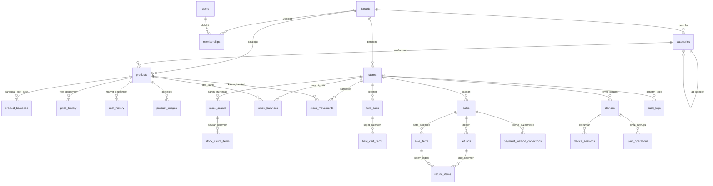

# Market Management System (MMS) — Mantıksal Veri Modeli Tasarımı (Data Model Specification)

**Doküman Kodu:** `DATA_MODEL.md`  
**Sürüm:** 1.1 (Revize ve Sertleştirilmiş Sürüm)  
**Tarih:** 31 Ekim 2026  
**Durum:** Faz 0 — Mantıksal Veri Modeli Tasarımı (Tüm Teknik Bulgular ve Kısıtlar Kapatıldı)  
**Ana Referans Doküman:** `MARKET_POS_AI_STUDIO_BUILD_PLANI.md` (v1.2.2)  
**Girdi Dokümanları:** `docs/requirements/PHASE_0_BUSINESS_DISCOVERY.md` (v1.3), `docs/requirements/BUSINESS_RULES_SPEC.md` (v1.2), `docs/architecture/DATA_MODEL_REVIEW.md` (v1.0), `docs/architecture/DATA_MODEL_V1_1_TECHNICAL_VALIDATION.md` (v1.0)  
**Teknik Proje / Klasör Adı:** `market-pos`  
**Ürün Tanımı:** Market Management System (MMS) — Profesyonel Market Yönetim SaaS Uygulaması  

---

## 1. Giriş ve Temel İlkeler

Bu belge, **Market Management System (MMS)** projesinde Faz 0 kapsamında kararlaştırılan iş kurallarını (`BUSINESS_RULES_SPEC.md` v1.2), teknik denetim raporlarındaki bulguları (`FND-01` .. `FND-05`) ve bağımsız doğrulama kararlarını (`NEW-01` .. `NEW-04`) karşılamak üzere hazırlanan **Mantıksal Veri Modeli Taslağıdır (v1.1)**.

> [!NOTE]
> **Taslak Statüsü ve Doğrulama Şerhi:** Bu belgede yer alan 25 tabloluk şema, veri tipleri, kısıtlar ve ilişkiler **kesinleşmiş nihai kullanıcı kararları değil, operasyonel bir veri modeli taslağıdır**. Tablo sayısı, alan isimleri, spesifik para veri tipi seçimi (`BIGINT` vs alternatif), stok rasyonel dönüşüm modeli ve her tabloda `tenant_id` bulunması zorunluluğu gibi teknik uygulama ayrıntıları Aşama 6B-2 ve Faz 1 kapsamında ayrıca değerlendirilecek ve doğrulanacaktır. Bu aşamada hiçbir SQL, migration veya tablo değişikliği yapılmamıştır.

Pilot aşamasında sistemin veri depolama katmanı: Merkezi yerel veritabanı (**Windows Local Master Hub SQLite**) ve uç cihazlardaki yerel operasyonel veritabanlarıdır (**Drift / SQLite**). Gelecekteki çok şubeli bulut SaaS aşaması için PostgreSQL şema uyumluluğu gözetilir.

### 1.1 Temel Veri Modeli İlkeleri (v1.1 Taslak)

1. **Çoklu Kiracı (Multi-Tenant) İzolasyonu:** Her işletme verisi mantıksal olarak izole edilir. Pilot aşamasında veri izolasyonu merkezi API tarafından iş kuralları seviyesinde sağlanır; gelecek bulut SaaS aşamasında PostgreSQL katmanında Row Level Security (RLS) politikaları uygulanır. Şube tabanlı operasyonel tablolarda şube ilişkisi doğrulanır.
2. **Katalog ve Envanter Ayrımı:** Ürünler, barkodlar ve kategoriler **Tenant** düzeyinde ortaktır; fiziksel stok bakiyeleri, stok hareketleri, satış fişleri ve açık sepetler **Store (Şube)** düzeyinde izole edilir.
3. **Finansal Hassasiyet ve Kuruş Bazlı Tamsayı:** Para tutarları (`total_amount`, `current_sale_price`, `unit_price_snapshot` vb.) floating-point kayıplarını engellemek için **kuruş bazlı tamsayı** (`BIGINT` / `INTEGER`) olarak saklanır (Örnek: 150.50 TL = `15050`).
4. **Ödeme Bütünlüğü ve Koşullu Tablo CHECK Kısıtı:** Nakit ve kart satışlarının veri bütünlüğü tablo düzeyinde deklaratif kısıtla (`chk_sales_payment_consistency`) korunur. Nakitte alınan tutar toplamdan az olamaz ve para üstü kuruşu kuruşuna doğrulanır; kartta ise nakit alanları kesinlikle `NULL` olmak zorundadır (`NEW-01`).
5. **Kesirli Miktar ve Atomik Stok Birimi Prensibi:** Tartılı ve hacimli ürünlerin miktarları için 3 ondalık hane hassasiyetli sayısal tip (`NUMERIC(12, 3)`) kullanılır. Periyodik bölme ($1/24$) kaynaklı yuvarlama sapmalarını önlemek için sistemde depolanan stok birimi daima en küçük atomik birim (ör. adet, gram) kabul edilir; birim dönüşümleri tamsayı pay/payda rasyonel oranıyla çarpılarak kayıpsız hesaplanır (`FND-02`, `NEW-04`).
6. **Eksi Stok Serbestliği:** Stok bakiyesi tablosunda (`stock_balances`) `current_stock >= 0` check constraint **kesinlikle bulunmaz**. Stok negatif değere düşebilir (`BR-STK-02`, `BR-STK-03`).
7. **Barkodsuz Ürün ve Birleşik Barkod Yaşam Döngüsü:** `products` tablosunda doğrudan barkod kolonu bulunmaz. Bir ürünün tüm barkodları (aktif ve pasif) tek bir `product_barcodes` tablosunda tutulur. İlişkili aktif barkod kaydı olmayan ürün "Barkodsuz Ürün" kabul edilir (`BR-PROD-04`). Pasif barkodların mükerrer kullanımını önlemek için tenant genelinde mutlak benzersizlik (`UNIQUE (tenant_id, barcode)`) ve aktif aramalar için kısmi benzersiz indeks (`partial unique index`) uygulanır (`FND-01`).
8. **Farklı Paket Miktarları Ayrı Üründür:** Tekli kutu ve 6'lı paket gibi farklı ticari satış miktarları ayrı `products` kayıtları olarak modellenir (`BR-PROD-02`).
9. **Geçmişin Korunması ve Snapshot:** Satış tamamlandığında ürünün adı, birimi, satış fiyatı ve o anki alış maliyeti `sale_items` satırına snapshot olarak kopyalanır (`BR-PROD-13`). Sonradan yapılan fiyat artışları geçmiş satışları değiştirmez.
10. **Çoklu Kısmi İadelerde Satır Kilitleme, Atomik Güncelleme ve Çakışma Yönetimi:** İade satırlarında `sale_items.refunded_quantity` denetim alanı ve `CHECK (refunded_quantity <= quantity)` kısıtı ile toplam iade miktarının satışı aşması DB seviyesinde engellenir. Eşzamanlı işlemlerde atomik koşullu güncelleme ve offline çakışmalarda `CONFLICT` durum yönetimi esastır (`FND-04`).
11. **Fiziksel Silmeme (Soft Delete & Immutability):** Ürünler, kategoriler, barkodlar ve satışlar fiziksel olarak silinmez; `is_active` veya durum bayraklarıyla yönetilir. Stok hareketleri geçmişi geriye dönük değiştirilemez (append-only ledger).
12. **Deterministik Yerel Senkronizasyon Kuyruğu:** Uç cihazlarda çevrimdışı gerçekleştirilen işlemler `sync_operations` tablosunda cihaz bazında monotonik artan `client_sequence_number` ile sıralı, deterministik ve kalıcı olarak tutulur (`EK-02`, `NEW-02`).

---

## 2. Varlık İlişki Şeması (Entity-Relationship Overview v1.1)



---

## 3. Tablo Tanımları ve Alan Detayları (v1.1 Sertleştirilmiş)

---

### Grup 1: Tenant, Organizasyon ve Kullanıcı Yönetimi

#### 1. `tenants`
- **Amacı:** Sistemi kullanan bağımsız müşteri işletmelerini (SaaS kiracılarını) temsil eder.
- **Alanlar:**
  - `id`: `UUID` | NOT NULL | **PK**
  - `name`: `TEXT` | NOT NULL | İşletme ticarî ünvanı
  - `identifier`: `TEXT` | NOT NULL | Sistem içi benzersiz kısa kod / slug
  - `is_active`: `BOOLEAN` | NOT NULL | DEFAULT `true`
  - `created_at`: `TIMESTAMPTZ` | NOT NULL | DEFAULT `now()`
  - `updated_at`: `TIMESTAMPTZ` | NOT NULL | DEFAULT `now()`
- **Kısıtlar & İndeksler:**
  - UNIQUE: `identifier`
- **Tenant İzolasyonu:** Kök varlıktır; diğer tüm tablolara yabancı anahtar sağlar.
- **İlgili İş Kuralı:** `BR-TNT-01`, `BR-TNT-02`.

#### 2. `stores`
- **Amacı:** Bir tenant'a ait fiziksel satış noktalarını / şubeleri temsil eder. MVP'de her tenant için tek şube aktiftir.
- **Alanlar:**
  - `id`: `UUID` | NOT NULL | **PK**
  - `tenant_id`: `UUID` | NOT NULL | **FK** $\to$ `tenants.id` (ON DELETE RESTRICT)
  - `name`: `TEXT` | NOT NULL | Şube adı (Ör. "Merkez Mağaza")
  - `code`: `TEXT` | NOT NULL | Şube kodu (Ör. "STR-001")
  - `address`: `TEXT` | NULL | Şube açık adresi
  - `phone`: `TEXT` | NULL | Şube iletişim telefonu
  - `is_active`: `BOOLEAN` | NOT NULL | DEFAULT `true`
  - `created_at`: `TIMESTAMPTZ` | NOT NULL | DEFAULT `now()`
  - `updated_at`: `TIMESTAMPTZ` | NOT NULL | DEFAULT `now()`
- **Kısıtlar & İndeksler:**
  - UNIQUE: `(tenant_id, code)`
  - UNIQUE: `(tenant_id, id)` $\to$ Şube tabanlı tablolarda bileşik foreign key `(tenant_id, store_id)` hedefi (`FND-03`).
  - INDEX: `idx_stores_tenant` ON `(tenant_id)`
- **Tenant İzolasyonu:** RLS ile kiracı seviyesinde korunur.
- **İlgili İş Kuralı:** `BR-TNT-01`, `BR-TNT-02`.

#### 3. `users`
- **Amacı:** Sistem kullanıcı profilini temsil eder. Pilot aşamasında tek işletme sahibi (Owner) hesabı yerel olarak yönetilir (teknik yöntem açık konudur). Gelecek SaaS aşamasında Supabase Auth (`auth.users`) altyapısıyla ilişkilendirilecektir.
- **Alanlar:**
  - `id`: `UUID` | NOT NULL | **PK** | Pilot için yerel kullanıcı kimliği (Gelecek SaaS için `auth.users.id` eşleşmesi)
  - `email`: `TEXT` | NOT NULL | Kullanıcı e-posta adresi
  - `full_name`: `TEXT` | NOT NULL | Ad soyad
  - `is_active`: `BOOLEAN` | NOT NULL | DEFAULT `true`
  - `created_at`: `TIMESTAMPTZ` | NOT NULL | DEFAULT `now()`
  - `updated_at`: `TIMESTAMPTZ` | NOT NULL | DEFAULT `now()`
- **Kısıtlar & İndeksler:**
  - UNIQUE: `email`
- **Tenant İzolasyonu:** Pilot aşamasında tek owner hesabı aktiftir; çoklu market SaaS genişlemesinde kullanıcı birden fazla tenant'a üye olabileceğinden bağımsızdır ve ilişki `memberships` üzerinden kurulur.
- **İlgili İş Kuralı:** `BR-SEC-01`, `BR-SEC-02`.

#### 4. `memberships`
- **Amacı:** Kullanıcı ile tenant arasındaki yetki ve rol ilişkisini kurar. Pilot aşamasında yalnızca tek bir rol (`owner`) geçerlidir.
- **Alanlar:**
  - `id`: `UUID` | NOT NULL | **PK**
  - `tenant_id`: `UUID` | NOT NULL | **FK** $\to$ `tenants.id` (ON DELETE CASCADE)
  - `user_id`: `UUID` | NOT NULL | **FK** $\to$ `users.id` (ON DELETE CASCADE)
  - `role`: `TEXT` | NOT NULL | DEFAULT `'owner'` | CHECK (`role IN ('owner')`)
  - `is_active`: `BOOLEAN` | NOT NULL | DEFAULT `true`
  - `created_at`: `TIMESTAMPTZ` | NOT NULL | DEFAULT `now()`
- **Kısıtlar & İndeksler:**
  - UNIQUE: `(tenant_id, user_id)`
  - INDEX: `idx_memberships_tenant_user` ON `(tenant_id, user_id)`
- **Tenant İzolasyonu:** RLS politikalarının temel dayanağıdır. Çoklu üyelik durumunda aktif kiracı JWT claim (`app_metadata.tenant_id`) veya oturum değişkeni ile doğrulanır (`EK-03`).
- **İlgili İş Kuralı:** `BR-SEC-02`, `BR-TNT-03`.

#### 5. `devices`
- **Amacı:** Markette işlem yapan yetkili fiziksel cihazları (Windows PC, telefon, tablet) izler. Pilot sınırına göre en fazla 3 aktif cihaz barındırır.
- **Alanlar:**
  - `id`: `UUID` | NOT NULL | **PK**
  - `tenant_id`: `UUID` | NOT NULL | **FK** $\to$ `tenants.id` (ON DELETE CASCADE)
  - `store_id`: `UUID` | NOT NULL
  - `device_identifier`: `TEXT` | NOT NULL | Donanım UUID / benzersiz anahtar
  - `device_name`: `TEXT` | NOT NULL | Cihaz adı (Ör. "Kasa 1 - PC", "Reyon 1 - Mobil")
  - `platform`: `TEXT` | NOT NULL | CHECK (`platform IN ('windows', 'android', 'ios', 'web')`)
  - `is_active`: `BOOLEAN` | NOT NULL | DEFAULT `true`
  - `last_seen_at`: `TIMESTAMPTZ` | NULL
  - `revoked_at`: `TIMESTAMPTZ` | NULL
  - `created_at`: `TIMESTAMPTZ` | NOT NULL | DEFAULT `now()`
- **Kısıtlar & İndeksler:**
  - UNIQUE: `(tenant_id, device_identifier)`
  - FOREIGN KEY `(tenant_id, store_id)` REFERENCES `stores(tenant_id, id)` ON DELETE RESTRICT (`FND-03`).
  - INDEX: `idx_devices_tenant_store` ON `(tenant_id, store_id)`
- **İlgili İş Kuralı:** `BR-SEC-04`, `BR-SEC-05`.

---

### Grup 2: Ürün ve Kategori Kataloğu

#### 6. `categories`
- **Amacı:** Ürünlerin hiyerarşik sınıflandırmasını tutar (Ana Kategori $\to$ Alt Kategori).
- **Alanlar:**
  - `id`: `UUID` | NOT NULL | **PK**
  - `tenant_id`: `UUID` | NOT NULL | **FK** $\to$ `tenants.id` (ON DELETE CASCADE)
  - `parent_id`: `UUID` | NULL | **FK** $\to$ `categories.id` (ON DELETE RESTRICT)
  - `name`: `TEXT` | NOT NULL | Kategori adı
  - `sort_order`: `INTEGER` | NOT NULL | DEFAULT `0`
  - `is_active`: `BOOLEAN` | NOT NULL | DEFAULT `true`
  - `created_at`: `TIMESTAMPTZ` | NOT NULL | DEFAULT `now()`
  - `updated_at`: `TIMESTAMPTZ` | NOT NULL | DEFAULT `now()`
- **Kısıtlar & İndeksler:**
  - UNIQUE: `(tenant_id, COALESCE(parent_id, '00000000-0000-0000-0000-000000000000'::uuid), name)`
  - INDEX: `idx_categories_tenant` ON `(tenant_id, is_active)`
- **İlgili İş Kuralı:** `BR-PROD-14`.

#### 7. `products`
- **Amacı:** Tenant genelindeki ortak ürün ana kartlarını temsil eder. Doğrudan barkod kolonu barındırmaz.
- **Alanlar:**
  - `id`: `UUID` | NOT NULL | **PK**
  - `tenant_id`: `UUID` | NOT NULL | **FK** $\to$ `tenants.id` (ON DELETE CASCADE)
  - `category_id`: `UUID` | NOT NULL | **FK** $\to$ `categories.id` (ON DELETE RESTRICT)
  - `name`: `TEXT` | NOT NULL | Ürün adı (Ör. "Tam Buğday Ekmeği", "Kutu Süt 1 L")
  - `brand`: `TEXT` | NULL | Marka adı
  - `description`: `TEXT` | NULL | Açıklama
  - `stock_unit`: `TEXT` | NOT NULL | CHECK (`stock_unit IN ('adet', 'kg', 'g', 'l', 'ml', 'paket', 'kutu')`)
  - `pricing_unit`: `TEXT` | NOT NULL | CHECK (`pricing_unit IN ('adet', 'kg', 'g', 'l', 'ml', 'paket', 'kutu')`)
  - `conversion_factor_numerator`: `INTEGER` | NOT NULL | DEFAULT `1` | CHECK (`conversion_factor_numerator > 0`) | Birim dönüşüm payı (`FND-02`)
  - `conversion_factor_denominator`: `INTEGER` | NOT NULL | DEFAULT `1` | CHECK (`conversion_factor_denominator > 0`) | Birim dönüşüm paydası (`FND-02`)
  - `unit_conversion_rate`: `NUMERIC(14, 4)` | NOT NULL | DEFAULT `1.0000` | CHECK (`unit_conversion_rate > 0`) | Hızlı arayüz çarpanı
  - `current_sale_price`: `BIGINT` | NOT NULL | CHECK (`current_sale_price > 0`) | Kuruş cinsinden satış fiyatı
  - `current_cost_price`: `BIGINT` | NULL | CHECK (`current_cost_price >= 0`) | Kuruş cinsinden alış maliyeti
  - `min_stock_threshold`: `NUMERIC(12, 3)` | NULL | CHECK (`min_stock_threshold >= 0`) | Kritik stok eşiği
  - `is_active`: `BOOLEAN` | NOT NULL | DEFAULT `true`
  - `created_at`: `TIMESTAMPTZ` | NOT NULL | DEFAULT `now()`
  - `updated_at`: `TIMESTAMPTZ` | NOT NULL | DEFAULT `now()`
- **Kısıtlar & İndeksler:**
  - INDEX: `idx_products_tenant_active` ON `(tenant_id, is_active)`
  - INDEX: `idx_products_category` ON `(category_id)`
  - INDEX: `idx_products_name_trgm` ON `(tenant_id, name)` (Metin araması)
- **Atomik Stok Birimi ve Domain Validasyonu (`FND-02`, `NEW-04`):** `stock_unit` daima ürünün bölünemez en küçük atomik birimi (adet, gram, ml) olmalıdır. Domain servisleri ürün açılırken `stock_unit` ve rasyonel çarpan tutarlılığını zorunlu olarak doğrular.
- **İlgili İş Kuralı:** `BR-PROD-01`, `BR-PROD-02`, `BR-PROD-03`, `BR-PROD-07`, `BR-PROD-08`.

#### 8. `product_barcodes`
- **Amacı:** Ürünlere ait tüm barkodları (hem aktif hem de pasife alınmış geçmiş barkodları) birleşik olarak tutar (`FND-01`).
- **Alanlar:**
  - `id`: `UUID` | NOT NULL | **PK**
  - `tenant_id`: `UUID` | NOT NULL | **FK** $\to$ `tenants.id` (ON DELETE CASCADE)
  - `product_id`: `UUID` | NOT NULL | **FK** $\to$ `products.id` (ON DELETE CASCADE)
  - `barcode`: `TEXT` | NOT NULL | Barkod string'i (EAN-13, EAN-8, CODE-128 vb.)
  - `is_active`: `BOOLEAN` | NOT NULL | DEFAULT `true` | Barkod aktif mi?
  - `deactivated_at`: `TIMESTAMPTZ` | NULL | Pasife alınma zamanı
  - `deactivated_by`: `UUID` | NULL | **FK** $\to$ `users.id` (ON DELETE RESTRICT)
  - `deactivation_reason`: `TEXT` | NULL | Pasife alma gerekçesi
  - `created_at`: `TIMESTAMPTZ` | NOT NULL | DEFAULT `now()`
- **Kısıtlar & İndeksler:**
  - UNIQUE: `(tenant_id, barcode)` $\to$ **Kiracı genelinde mutlak barkod tekilliği!** Pasif barkod başka ürüne atanamaz (`BR-PROD-15`, `FND-01`).
  - Kısmi Benzersiz İndeks: `CREATE UNIQUE INDEX idx_active_product_barcodes ON product_barcodes (tenant_id, barcode) WHERE is_active = true;`
  - INDEX: `idx_barcodes_product` ON `(product_id, is_active)`
  - INDEX: `idx_barcodes_tenant_active` ON `(tenant_id, is_active)`
- **İlgili İş Kuralı:** `BR-PROD-02`, `BR-PROD-04`, `BR-PROD-15`.

#### 9. `product_images`
- **Amacı:** Ürün görsellerinin URL ve yerel depolama referanslarını tutar.
- **Alanlar:**
  - `id`: `UUID` | NOT NULL | **PK**
  - `tenant_id`: `UUID` | NOT NULL | **FK** $\to$ `tenants.id` (ON DELETE CASCADE)
  - `product_id`: `UUID` | NOT NULL | **FK** $\to$ `products.id` (ON DELETE CASCADE)
  - `image_url`: `TEXT` | NOT NULL
  - `thumbnail_url`: `TEXT` | NULL
  - `storage_path`: `TEXT` | NULL
  - `source`: `TEXT` | NOT NULL | CHECK (`source IN ('MANUAL_UPLOAD', 'OPEN_FOOD_FACTS')`)
  - `is_primary`: `BOOLEAN` | NOT NULL | DEFAULT `true`
  - `created_at`: `TIMESTAMPTZ` | NOT NULL | DEFAULT `now()`
- **Kısıtlar & İndeksler:**
  - INDEX: `idx_product_images_product` ON `(product_id)`
- **İlgili İş Kuralı:** `BR-PROD-06`, `BR-PROD-12`.

---

### Grup 3: Fiyat ve Maliyet Değişiklik Geçmişi

#### 10. `price_history`
- **Amacı:** Ürün satış fiyatındaki her değişimin denetim kaydını tutar.
- **Alanlar:**
  - `id`: `UUID` | NOT NULL | **PK**
  - `tenant_id`: `UUID` | NOT NULL | **FK** $\to$ `tenants.id` (ON DELETE CASCADE)
  - `product_id`: `UUID` | NOT NULL | **FK** $\to$ `products.id` (ON DELETE CASCADE)
  - `old_price`: `BIGINT` | NOT NULL
  - `new_price`: `BIGINT` | NOT NULL | CHECK (`new_price > 0`)
  - `source`: `TEXT` | NOT NULL | CHECK (`source IN ('MANUAL_UI', 'EXCEL_IMPORT')`)
  - `changed_by`: `UUID` | NOT NULL | **FK** $\to$ `users.id` (ON DELETE RESTRICT)
  - `device_id`: `UUID` | NOT NULL | **FK** $\to$ `devices.id` (ON DELETE RESTRICT)
  - `changed_at`: `TIMESTAMPTZ` | NOT NULL | DEFAULT `now()`
- **Kısıtlar & İndeksler:**
  - INDEX: `idx_price_history_product` ON `(product_id, changed_at DESC)`
- **İlgili İş Kuralı:** `BR-PROD-11`, `BR-PROD-13`.

#### 11. `cost_history`
- **Amacı:** Ürün alış maliyetindeki her değişimin denetim kaydını tutar.
- **Alanlar:**
  - `id`: `UUID` | NOT NULL | **PK**
  - `tenant_id`: `UUID` | NOT NULL | **FK** $\to$ `tenants.id` (ON DELETE CASCADE)
  - `product_id`: `UUID` | NOT NULL | **FK** $\to$ `products.id` (ON DELETE CASCADE)
  - `old_cost`: `BIGINT` | NULL
  - `new_cost`: `BIGINT` | NOT NULL | CHECK (`new_cost >= 0`)
  - `source`: `TEXT` | NOT NULL | CHECK (`source IN ('MANUAL_UI', 'EXCEL_IMPORT')`)
  - `changed_by`: `UUID` | NOT NULL | **FK** $\to$ `users.id` (ON DELETE RESTRICT)
  - `device_id`: `UUID` | NOT NULL | **FK** $\to$ `devices.id` (ON DELETE RESTRICT)
  - `changed_at`: `TIMESTAMPTZ` | NOT NULL | DEFAULT `now()`
- **Kısıtlar & İndeksler:**
  - INDEX: `idx_cost_history_product` ON `(product_id, changed_at DESC)`
- **İlgili İş Kuralı:** `BR-PROD-13`.

---

### Grup 4: Stok Yönetimi ve Stok Sayımı

#### 12. `stock_balances`
- **Amacı:** Bir ürünün belirli bir şubedeki güncel fiziksel stok bakiyesini tutar.
- **Alanlar:**
  - `id`: `UUID` | NOT NULL | **PK**
  - `tenant_id`: `UUID` | NOT NULL | **FK** $\to$ `tenants.id` (ON DELETE CASCADE)
  - `store_id`: `UUID` | NOT NULL
  - `product_id`: `UUID` | NOT NULL | **FK** $\to$ `products.id` (ON DELETE CASCADE)
  - `current_stock`: `NUMERIC(12, 3)` | NOT NULL | DEFAULT `0.000` | (Negatif olabilir!)
  - `updated_at`: `TIMESTAMPTZ` | NOT NULL | DEFAULT `now()`
- **Kısıtlar & İndeksler:**
  - UNIQUE: `(store_id, product_id)`
  - FOREIGN KEY `(tenant_id, store_id)` REFERENCES `stores(tenant_id, id)` ON DELETE CASCADE (`FND-03`).
  - INDEX: `idx_stock_balances_store_product` ON `(store_id, product_id)`
  - INDEX: `idx_stock_balances_negative` ON `(store_id, current_stock)` WHERE `current_stock < 0`
- **Eksi Stok Kuralı:** `current_stock >= 0` check constraint **kesinlikle yer almaz** (`BR-STK-03`).
- **İlgili İş Kuralı:** `BR-STK-01`, `BR-STK-02`, `BR-STK-03`.

#### 13. `stock_movements`
- **Amacı:** Stok miktarındaki her artış veya azalışın kesin gerekçeli ve silinemez denetim izini tutar.
- **Alanlar:**
  - `id`: `UUID` | NOT NULL | **PK**
  - `tenant_id`: `UUID` | NOT NULL | **FK** $\to$ `tenants.id` (ON DELETE CASCADE)
  - `store_id`: `UUID` | NOT NULL
  - `product_id`: `UUID` | NOT NULL | **FK** $\to$ `products.id` (ON DELETE RESTRICT)
  - `movement_type`: `TEXT` | NOT NULL | CHECK (`movement_type IN ('BASLANGIC_STOK', 'NORMAL_GIRIS', 'NORMAL_CIKIS', 'SATIS', 'SATIS_IPTALI', 'MUSTERI_IADESI', 'FIRE_KAYIP', 'MANUEL_DUZELTME', 'SAYIM_FARKI')`)
  - `quantity`: `NUMERIC(12, 3)` | NOT NULL | Değişim miktarı (Azalışlar negatif, artışlar pozitif)
  - `unit`: `TEXT` | NOT NULL | Hareket anındaki birim
  - `reference_id`: `UUID` | NULL | İlgili `sale_id`, `refund_id` veya `stock_counts.id`
  - `reason`: `TEXT` | NULL | Gerekçe metni (`BR-STK-11`)
  - `device_id`: `UUID` | NOT NULL | **FK** $\to$ `devices.id` (ON DELETE RESTRICT)
  - `created_by`: `UUID` | NOT NULL | **FK** $\to$ `users.id` (ON DELETE RESTRICT)
  - `created_at`: `TIMESTAMPTZ` | NOT NULL | DEFAULT `now()`
- **Kısıtlar & İndeksler:**
  - FOREIGN KEY `(tenant_id, store_id)` REFERENCES `stores(tenant_id, id)` ON DELETE RESTRICT (`FND-03`).
  - INDEX: `idx_stock_movements_store_product` ON `(store_id, product_id, created_at DESC)`
  - INDEX: `idx_stock_movements_reference` ON `(reference_id)`
  - INDEX: `idx_stock_movements_type` ON `(store_id, movement_type, created_at)`
- **Hasarlı İade Davranışı (`EK-01`):** Hasarlı iadelerde (`movement_type = 'FIRE_KAYIP'`) satılabilir stok bakiyesi (`stock_balances.current_stock`) kesinlikle artırılmaz ve mükerrer eksiltilmez (net etki sıfırdır).
- **İlgili İş Kuralı:** `BR-STK-01`, `BR-STK-10`, `BR-STK-11`, `BR-POS-08`, `BR-POS-10`.

#### 14. `stock_counts`
- **Amacı:** Şube bazında yürütülen fiziksel stok sayım oturumlarını yönetir.
- **Alanlar:**
  - `id`: `UUID` | NOT NULL | **PK**
  - `tenant_id`: `UUID` | NOT NULL | **FK** $\to$ `tenants.id` (ON DELETE CASCADE)
  - `store_id`: `UUID` | NOT NULL
  - `count_type`: `TEXT` | NOT NULL | CHECK (`count_type IN ('FULL', 'PARTIAL')`)
  - `status`: `TEXT` | NOT NULL | DEFAULT `'DRAFT'` | CHECK (`status IN ('DRAFT', 'COMPLETED', 'CANCELLED')`)
  - `locked_by_device_id`: `UUID` | NULL | **FK** $\to$ `devices.id` (ON DELETE SET NULL)
  - `lock_acquired_at`: `TIMESTAMPTZ` | NULL
  - `notes`: `TEXT` | NULL
  - `started_at`: `TIMESTAMPTZ` | NOT NULL | DEFAULT `now()`
  - `completed_at`: `TIMESTAMPTZ` | NULL
  - `created_by`: `UUID` | NOT NULL | **FK** $\to$ `users.id` (ON DELETE RESTRICT)
  - `created_at`: `TIMESTAMPTZ` | NOT NULL | DEFAULT `now()`
- **Kısıtlar & İndeksler:**
  - FOREIGN KEY `(tenant_id, store_id)` REFERENCES `stores(tenant_id, id)` ON DELETE RESTRICT (`FND-03`).
  - UNIQUE INDEX (Şube Başına Tek Aktif Sayım): `CREATE UNIQUE INDEX idx_single_active_count ON stock_counts (store_id) WHERE status = 'DRAFT';`
- **İlgili İş Kuralı:** `BR-STK-04`, `BR-STK-05`, `BR-STK-07`, `BR-STK-10`.

#### 15. `stock_count_items`
- **Amacı:** Sayım oturumundaki her bir ürünün fiziksel sayım miktarlarını ve uzlaştırma verilerini tutar.
- **Alanlar:**
  - `id`: `UUID` | NOT NULL | **PK**
  - `count_id`: `UUID` | NOT NULL | **FK** $\to$ `stock_counts.id` (ON DELETE CASCADE)
  - `product_id`: `UUID` | NOT NULL | **FK** $\to$ `products.id` (ON DELETE RESTRICT)
  - `counted_quantity`: `NUMERIC(12, 3)` | NOT NULL | CHECK (`counted_quantity >= 0`)
  - `client_counted_at`: `TIMESTAMPTZ` | NOT NULL | DEFAULT `now()` | Cihaz yerel sayım zamanı
  - `server_reconciled_at`: `TIMESTAMPTZ` | NULL | Sunucu uzlaştırma zamanı
  - `snapshot_stock_at_count`: `NUMERIC(12, 3)` | NOT NULL
  - `reconciliation_sales`: `NUMERIC(12, 3)` | NOT NULL | DEFAULT `0.000`
  - `reconciliation_entries`: `NUMERIC(12, 3)` | NOT NULL | DEFAULT `0.000`
  - `final_adjusted_stock`: `NUMERIC(12, 3)` | NULL
  - `discrepancy`: `NUMERIC(12, 3)` | NULL
  - `is_ambiguous_interval`: `BOOLEAN` | NOT NULL | DEFAULT `false` | Çoklu cihaz çevrimdışı zaman çakışması bayrağı (`FND-05`)
- **Kısıtlar & İndeksler:**
  - UNIQUE: `(count_id, product_id)`
  - INDEX: `idx_count_items_product` ON `(product_id)`
- **İlgili İş Kuralı:** `BR-STK-08`, `BR-STK-09`.

---

### Grup 5: Satış, Sepet ve POS İşlemleri

#### 16. `held_carts`
- **Amacı:** Kasada bekletilen sepetleri saklar ve çoklu cihaz kilidini yönetir.
- **Alanlar:**
  - `id`: `UUID` | NOT NULL | **PK**
  - `tenant_id`: `UUID` | NOT NULL | **FK** $\to$ `tenants.id` (ON DELETE CASCADE)
  - `store_id`: `UUID` | NOT NULL
  - `cart_number`: `TEXT` | NOT NULL
  - `status`: `TEXT` | NOT NULL | DEFAULT `'ACTIVE'` | CHECK (`status IN ('ACTIVE', 'HELD', 'COMPLETED', 'CANCELLED')`)
  - `locked_by_device_id`: `UUID` | NULL | **FK** $\to$ `devices.id` (ON DELETE SET NULL)
  - `lock_acquired_at`: `TIMESTAMPTZ` | NULL
  - `created_by`: `UUID` | NOT NULL | **FK** $\to$ `users.id` (ON DELETE RESTRICT)
  - `created_at`: `TIMESTAMPTZ` | NOT NULL | DEFAULT `now()`
  - `updated_at`: `TIMESTAMPTZ` | NOT NULL | DEFAULT `now()`
- **Kısıtlar & İndeksler:**
  - FOREIGN KEY `(tenant_id, store_id)` REFERENCES `stores(tenant_id, id)` ON DELETE RESTRICT (`FND-03`).
  - INDEX: `idx_held_carts_store_status` ON `(store_id, status)`
- **İlgili İş Kuralı:** `BR-POS-05`, `BR-POS-06`.

#### 17. `held_cart_items`
- **Amacı:** Askıya alınan sepetteki ürün kalemlerini ve snapshot fiyatlarını tutar.
- **Alanlar:**
  - `id`: `UUID` | NOT NULL | **PK**
  - `cart_id`: `UUID` | NOT NULL | **FK** $\to$ `held_carts.id` (ON DELETE CASCADE)
  - `product_id`: `UUID` | NOT NULL | **FK** $\to$ `products.id` (ON DELETE RESTRICT)
  - `product_name_snapshot`: `TEXT` | NOT NULL
  - `unit_snapshot`: `TEXT` | NOT NULL
  - `unit_price_snapshot`: `BIGINT` | NOT NULL
  - `quantity`: `NUMERIC(12, 3)` | NOT NULL | CHECK (`quantity > 0`)
  - `is_manual_price_override`: `BOOLEAN` | NOT NULL | DEFAULT `false`
  - `override_reason`: `TEXT` | NULL
  - `created_at`: `TIMESTAMPTZ` | NOT NULL | DEFAULT `now()`
- **Kısıtlar & İndeksler:**
  - INDEX: `idx_cart_items_cart` ON `(cart_id)`
- **İlgili İş Kuralı:** `BR-POS-02`, `BR-POS-11`.

#### 18. `sales`
- **Amacı:** Tamamlanmış satış fişlerini temsil eder.
- **Alanlar:**
  - `id`: `UUID` | NOT NULL | **PK**
  - `tenant_id`: `UUID` | NOT NULL | **FK** $\to$ `tenants.id` (ON DELETE CASCADE)
  - `store_id`: `UUID` | NOT NULL
  - `receipt_number`: `TEXT` | NOT NULL | Sıralı şube fiş numarası (Ör. "F-20261031-0001")
  - `total_amount`: `BIGINT` | NOT NULL | CHECK (`total_amount >= 0`) | Toplam satış tutarı (kuruş)
  - `payment_method`: `TEXT` | NOT NULL | CHECK (`payment_method IN ('CASH', 'CARD')`)
  - `cash_received_amount`: `BIGINT` | NULL | Alınan nakit (kuruş)
  - `cash_change_amount`: `BIGINT` | NULL | Para üstü (kuruş)
  - `status`: `TEXT` | NOT NULL | DEFAULT `'COMPLETED'` | CHECK (`status IN ('COMPLETED', 'CANCELLED')`)
  - `device_id`: `UUID` | NOT NULL | **FK** $\to$ `devices.id` (ON DELETE RESTRICT)
  - `idempotency_key`: `TEXT` | NOT NULL | İstemci tekil işlem anahtarı
  - `created_by`: `UUID` | NOT NULL | **FK** $\to$ `users.id` (ON DELETE RESTRICT)
  - `created_at`: `TIMESTAMPTZ` | NOT NULL | DEFAULT `now()`
  - `cancelled_at`: `TIMESTAMPTZ` | NULL
  - `cancellation_reason`: `TEXT` | NULL
  - `cancelled_by`: `UUID` | NULL | **FK** $\to$ `users.id` (ON DELETE RESTRICT)
- **Kısıtlar & İndeksler:**
  - **Ödeme Tutarlılığı Tablo Düzeyi CHECK Kısıtı (`NEW-01`):**
    ```sql
    CONSTRAINT chk_sales_payment_consistency CHECK (
      (payment_method = 'CASH' 
        AND cash_received_amount IS NOT NULL 
        AND cash_received_amount >= total_amount 
        AND cash_change_amount = (cash_received_amount - total_amount)
      )
      OR
      (payment_method = 'CARD' 
        AND cash_received_amount IS NULL 
        AND cash_change_amount IS NULL
      )
    )
    ```
  - UNIQUE: `(tenant_id, idempotency_key)` $\to$ Mükerrer satış engeli (`BR-SYNC-03`, `EK-04`).
  - UNIQUE: `(store_id, receipt_number)`
  - FOREIGN KEY `(tenant_id, store_id)` REFERENCES `stores(tenant_id, id)` ON DELETE RESTRICT (`FND-03`).
  - INDEX: `idx_sales_store_date` ON `(store_id, created_at DESC)`
  - INDEX: `idx_sales_status` ON `(store_id, status, created_at)`
- **İlgili İş Kuralı:** `BR-POS-04`, `BR-POS-07`, `BR-POS-08`, `BR-PAY-01`, `BR-PAY-02`, `BR-PAY-03`, `BR-SYNC-03`.

#### 19. `sale_items`
- **Amacı:** Satış fişindeki ürün satırlarını, snapshot verilerini ve kısmi iade tavan denetimini tutar.
- **Alanlar:**
  - `id`: `UUID` | NOT NULL | **PK**
  - `sale_id`: `UUID` | NOT NULL | **FK** $\to$ `sales.id` (ON DELETE CASCADE)
  - `product_id`: `UUID` | NOT NULL | **FK** $\to$ `products.id` (ON DELETE RESTRICT)
  - `product_name_snapshot`: `TEXT` | NOT NULL
  - `unit_snapshot`: `TEXT` | NOT NULL
  - `unit_price_snapshot`: `BIGINT` | NOT NULL
  - `unit_cost_snapshot`: `BIGINT` | NULL
  - `quantity`: `NUMERIC(12, 3)` | NOT NULL | CHECK (`quantity > 0`)
  - `refunded_quantity`: `NUMERIC(12, 3)` | NOT NULL | DEFAULT `0.000` | İade edilmiş toplam miktar (`FND-04`)
  - `line_total`: `BIGINT` | NOT NULL
  - `is_manual_price_override`: `BOOLEAN` | NOT NULL | DEFAULT `false`
  - `override_reason`: `TEXT` | NULL
- **Kısıtlar & İndeksler:**
  - CHECK: `(refunded_quantity >= 0 AND refunded_quantity <= quantity)` $\to$ Satılandan fazla iade engeli (`FND-04`).
  - INDEX: `idx_sale_items_sale` ON `(sale_id)`
  - INDEX: `idx_sale_items_product` ON `(product_id)`
- **İlgili İş Kuralı:** `BR-POS-07`, `BR-POS-09`, `BR-POS-11`, `BR-REP-04`, `BR-REP-05`.

---

### Grup 6: İade ve Ödeme Düzeltme İşlemleri

#### 20. `refunds`
- **Amacı:** Tamamlanmış bir satış üzerinden yapılan kısmi ürün iade fişlerini tutar.
- **Alanlar:**
  - `id`: `UUID` | NOT NULL | **PK**
  - `tenant_id`: `UUID` | NOT NULL | **FK** $\to$ `tenants.id` (ON DELETE CASCADE)
  - `store_id`: `UUID` | NOT NULL
  - `sale_id`: `UUID` | NOT NULL | **FK** $\to$ `sales.id` (ON DELETE RESTRICT)
  - `refund_receipt_number`: `TEXT` | NOT NULL
  - `total_refund_amount`: `BIGINT` | NOT NULL | CHECK (`total_refund_amount > 0`)
  - `refund_payment_method`: `TEXT` | NOT NULL | CHECK (`refund_payment_method IN ('CASH', 'CARD')`)
  - `reason`: `TEXT` | NOT NULL
  - `device_id`: `UUID` | NOT NULL | **FK** $\to$ `devices.id` (ON DELETE RESTRICT)
  - `idempotency_key`: `TEXT` | NOT NULL | İade tekil anahtarı (`FND-04`)
  - `created_by`: `UUID` | NOT NULL | **FK** $\to$ `users.id` (ON DELETE RESTRICT)
  - `created_at`: `TIMESTAMPTZ` | NOT NULL | DEFAULT `now()`
- **Kısıtlar & İndeksler:**
  - UNIQUE: `(tenant_id, idempotency_key)` $\to$ Mükerrer iade işlemi engeli (`FND-04`).
  - UNIQUE: `(store_id, refund_receipt_number)`
  - FOREIGN KEY `(tenant_id, store_id)` REFERENCES `stores(tenant_id, id)` ON DELETE RESTRICT (`FND-03`).
  - INDEX: `idx_refunds_sale` ON `(sale_id)`
  - INDEX: `idx_refunds_store_date` ON `(store_id, created_at DESC)`
- **İlgili İş Kuralı:** `BR-POS-09`, `BR-REP-02`, `BR-REP-03`.

#### 21. `refund_items`
- **Amacı:** İade edilen ürün satırlarını, miktarını ve ürün kondisyonunu tutar.
- **Alanlar:**
  - `id`: `UUID` | NOT NULL | **PK**
  - `refund_id`: `UUID` | NOT NULL | **FK** $\to$ `refunds.id` (ON DELETE CASCADE)
  - `sale_item_id`: `UUID` | NOT NULL | **FK** $\to$ `sale_items.id` (ON DELETE RESTRICT)
  - `product_id`: `UUID` | NOT NULL | **FK** $\to$ `products.id` (ON DELETE RESTRICT)
  - `quantity`: `NUMERIC(12, 3)` | NOT NULL | CHECK (`quantity > 0`)
  - `unit_price_snapshot`: `BIGINT` | NOT NULL
  - `refund_line_total`: `BIGINT` | NOT NULL
  - `condition`: `TEXT` | NOT NULL | CHECK (`condition IN ('SELLABLE', 'DAMAGED')`)
- **Kısıtlar & İndeksler:**
  - INDEX: `idx_refund_items_refund` ON `(refund_id)`
  - INDEX: `idx_refund_items_sale_item` ON `(sale_item_id)`
- **İlgili İş Kuralı:** `BR-POS-09`, `BR-POS-10`.

#### 22. `payment_method_corrections`
- **Amacı:** Yanlış ödeme yöntemiyle kapatılan satışların denetimli düzeltme kaydını tutar.
- **Alanlar:**
  - `id`: `UUID` | NOT NULL | **PK**
  - `tenant_id`: `UUID` | NOT NULL | **FK** $\to$ `tenants.id` (ON DELETE CASCADE)
  - `store_id`: `UUID` | NOT NULL
  - `sale_id`: `UUID` | NOT NULL | **FK** $\to$ `sales.id` (ON DELETE RESTRICT)
  - `old_payment_method`: `TEXT` | NOT NULL | CHECK (`old_payment_method IN ('CASH', 'CARD')`)
  - `new_payment_method`: `TEXT` | NOT NULL | CHECK (`new_payment_method IN ('CASH', 'CARD')`)
  - `reason`: `TEXT` | NOT NULL
  - `corrected_by`: `UUID` | NOT NULL | **FK** $\to$ `users.id` (ON DELETE RESTRICT)
  - `device_id`: `UUID` | NOT NULL | **FK** $\to$ `devices.id` (ON DELETE RESTRICT)
  - `corrected_at`: `TIMESTAMPTZ` | NOT NULL | DEFAULT `now()`
- **Kısıtlar & İndeksler:**
  - FOREIGN KEY `(tenant_id, store_id)` REFERENCES `stores(tenant_id, id)` ON DELETE RESTRICT (`FND-03`).
  - INDEX: `idx_payment_corrections_sale` ON `(sale_id)`
- **İlgili İş Kuralı:** `BR-PAY-05`.

---

### Grup 7: Güvenlik, Oturum ve Denetim Kayıtları

#### 23. `audit_logs`
- **Amacı:** Sistemdeki tüm hassas operasyonların denetim izini tutar.
- **Alanlar:**
  - `id`: `UUID` | NOT NULL | **PK**
  - `tenant_id`: `UUID` | NOT NULL | **FK** $\to$ `tenants.id` (ON DELETE CASCADE)
  - `store_id`: `UUID` | NULL
  - `user_id`: `UUID` | NOT NULL | **FK** $\to$ `users.id` (ON DELETE RESTRICT)
  - `device_id`: `UUID` | NOT NULL | **FK** $\to$ `devices.id` (ON DELETE RESTRICT)
  - `action`: `TEXT` | NOT NULL
  - `entity_name`: `TEXT` | NOT NULL
  - `entity_id`: `TEXT` | NOT NULL
  - `old_values`: `JSONB` | NULL
  - `new_values`: `JSONB` | NULL
  - `reason`: `TEXT` | NULL
  - `created_at`: `TIMESTAMPTZ` | NOT NULL | DEFAULT `now()`
- **Kısıtlar & İndeksler:**
  - **Nullable Şube Bileşik FK (`NEW-03`):**  
    `FOREIGN KEY (tenant_id, store_id) REFERENCES stores(tenant_id, id) ON DELETE SET NULL;`  
    *(PostgreSQL `MATCH SIMPLE` standardı: `store_id` NULL ise kısıt geçer; NOT NULL ise tenant ve store çifti zorunlu doğrulanır).*
  - INDEX: `idx_audit_logs_tenant_date` ON `(tenant_id, created_at DESC)`
  - INDEX: `idx_audit_logs_entity` ON `(entity_name, entity_id)`
- **İlgili İş Kuralı:** `BR-SYNC-05`, `BR-POS-08`, `BR-PAY-05`, `BR-STK-11`, `BR-PROD-15`.

#### 24. `device_sessions`
- **Amacı:** Cihazların doğrulanmış oturum anahtarlarını ve çevrimdışı geçerlilik sürelerini izler.
- **Alanlar:**
  - `id`: `UUID` | NOT NULL | **PK**
  - `tenant_id`: `UUID` | NOT NULL | **FK** $\to$ `tenants.id` (ON DELETE CASCADE)
  - `store_id`: `UUID` | NOT NULL
  - `device_id`: `UUID` | NOT NULL | **FK** $\to$ `devices.id` (ON DELETE CASCADE)
  - `user_id`: `UUID` | NOT NULL | **FK** $\to$ `users.id` (ON DELETE RESTRICT)
  - `session_token_hash`: `TEXT` | NOT NULL
  - `expires_at`: `TIMESTAMPTZ` | NOT NULL
  - `is_revoked`: `BOOLEAN` | NOT NULL | DEFAULT `false`
  - `revoked_at`: `TIMESTAMPTZ` | NULL
  - `last_active_at`: `TIMESTAMPTZ` | NOT NULL | DEFAULT `now()`
  - `created_at`: `TIMESTAMPTZ` | NOT NULL | DEFAULT `now()`
- **Kısıtlar & İndeksler:**
  - UNIQUE: `session_token_hash`
  - FOREIGN KEY `(tenant_id, store_id)` REFERENCES `stores(tenant_id, id)` ON DELETE RESTRICT (`FND-03`).
  - INDEX: `idx_device_sessions_lookup` ON `(device_id, is_revoked, expires_at)`
- **İlgili İş Kuralı:** `BR-SEC-03`, `BR-SEC-04`, `BR-SEC-06`.

---

### Grup 8: Offline-First Senkronizasyon ve Kuyruk Yönetimi

#### 25. `sync_operations`
- **Amacı:** Uç cihazlarda çevrimdışı gerçekleştirilen işlemlerin yerel Outbox kuyruğunu ve deterministik gönderim sırasını yönetir (`EK-02`, `NEW-02`).
- **Alanlar:**
  - `id`: `UUID` | NOT NULL | **PK**
  - `tenant_id`: `UUID` | NOT NULL | **FK** $\to$ `tenants.id` (ON DELETE CASCADE)
  - `store_id`: `UUID` | NOT NULL
  - `device_id`: `UUID` | NOT NULL | **FK** $\to$ `devices.id` (ON DELETE CASCADE)
  - `client_sequence_number`: `BIGINT` | NOT NULL | **Cihaz bazında monotonik artan sıra numarası (`NEW-02`)**
  - `entity_type`: `TEXT` | NOT NULL | CHECK (`entity_type IN ('SALE', 'SALE_REFUND', 'PAYMENT_CORRECTION', 'STOCK_MOVEMENT', 'STOCK_COUNT', 'HELD_CART')`)
  - `entity_id`: `UUID` | NOT NULL
  - `operation_type`: `TEXT` | NOT NULL | CHECK (`operation_type IN ('INSERT', 'UPDATE', 'DELETE')`)
  - `payload`: `JSONB` | NOT NULL
  - `idempotency_key`: `TEXT` | NOT NULL
  - `client_timestamp`: `TIMESTAMPTZ` | NOT NULL
  - `status`: `TEXT` | NOT NULL | DEFAULT `'PENDING'` | CHECK (`status IN ('PENDING', 'SYNCING', 'COMPLETED', 'FAILED', 'CONFLICT')`)
  - `retry_count`: `INTEGER` | NOT NULL | DEFAULT `0`
  - `last_error`: `TEXT` | NULL
  - `synced_at`: `TIMESTAMPTZ` | NULL
  - `created_at`: `TIMESTAMPTZ` | NOT NULL | DEFAULT `now()`
- **Kısıtlar & İndeksler:**
  - UNIQUE: `(device_id, client_sequence_number)` $\to$ **Cihaz içinde tekil ve kesin FIFO determinizmi! (`NEW-02`)**
  - UNIQUE: `(device_id, idempotency_key)` $\to$ Cihaz düzeyinde idempotency güvencesi.
  - FOREIGN KEY `(tenant_id, store_id)` REFERENCES `stores(tenant_id, id)` ON DELETE RESTRICT (`FND-03`).
  - INDEX: `idx_sync_queue_order` ON `(device_id, status, client_sequence_number ASC)`
- **Sıra Numarası ve Çalışma Kuralları (`NEW-02`):**
  1. `client_sequence_number` yerel transaction içinde (Drift SQLite `AUTOINCREMENT` veya atomik sayaç tablosuyla) üretilir.
  2. Aynı cihazın işlemleri bu sıra numarasına göre deterministik ve sıralı (FIFO) gönderilir.
  3. Uygulama veya cihaz yeniden başlatıldığında sayaç kaldığı yerden devam eder; sıfırlanmaz.
  4. Ağ hatası nedeniyle işlem tekrar gönderildiğinde (retry) sıra numarası kesinlikle değişmez (orijinal numara korunur).
  5. Farklı cihazların sıra numaraları arasında küresel bir sıralama garantisi aranmaz; her cihaz kendi bağımsız yerel dizisine sahiptir.
- **İlgili İş Kuralı:** `BR-SYNC-01`, `BR-SYNC-02`, `BR-SYNC-03`, `BR-SYNC-05`.

---

## 4. Kritik İş Senaryolarının Veri Modelinde Karşılanması (v1.1 Sertleştirilmiş)

### 4.1 Satış Ödeme Bütünlüğü (`NEW-01`)
- Kasiyer nakit satış yaptığında (`payment_method = 'CASH'`), sepet tutarı 7500 kuruş (75.00 TL) ise:
  - Alınan nakit: `cash_received_amount = 10000` (100.00 TL).
  - Para üstü: `cash_change_amount = 2500` (25.00 TL).
  - `chk_sales_payment_consistency` kısıtı $10000 \ge 7500$ ve $2500 = 10000 - 7500$ koşullarını kontrol eder; işlem onaylanır.
- Kasiyer kartlı satış yaptığında (`payment_method = 'CARD'`):
  - `cash_received_amount = NULL` ve `cash_change_amount = NULL` olmalıdır. Aksi halde veritabanı kısıtı işlemi reddeder.

### 4.2 Eşzamanlı ve Çevrimdışı Kısmi İadeler (`FND-04`)
- **Sunucu Concurrency Kontrolü:** İade transaction'ı sırasında `sale_items` satırı üzerinde atomik koşullu güncelleme işletilir:
  ```sql
  UPDATE sale_items 
  SET refunded_quantity = refunded_quantity + :refund_qty 
  WHERE id = :sale_item_id 
    AND (refunded_quantity + :refund_qty) <= quantity 
  RETURNING refunded_quantity;
  ```
  Etkilenen satır 0 ise işlem anında `OVER_REFUND_ERROR` ile abort edilir.
- **Çevrimdışı Çoklu Cihaz Çakışması:** Cihaz A ve Cihaz B internet yokken 5 adetlik fişten ayrı ayrı 3'er adet iade alır ($3 + 3 = 6 > 5$).
  - Sunucuya ilk bağlanan Cihaz A senkronizasyonu tamamlar (`refunded_quantity = 3`).
  - İkinci bağlanan Cihaz B sunucuya ulaştığında atomik güncelleme kuralına takılır ($3 + 3 > 5$).
  - Sunucu Cihaz B'nin `sync_operations` kaydını `status = 'CONFLICT'` yapar. Mükerrer para iadesi durumu yönetici dashboard'unda alarm olarak gösterilir ve `audit_logs` tablosuna `'REFUND_CONFLICT_REJECTED'` yazılır. Fiş sessizce bozulmaz.

### 4.3 Çevrimdışı Stok Sayımında Nedensel Sıralama ve Belirsizlik Aralığı (`FND-05`)
- **Tek Cihazda Nedensellik:** Sayım ve satış aynı cihazda çevrimdışı yapılmışsa, `sync_operations.client_sequence_number` sayesinde sayımın mı satışın mı önce yapıldığı kesin olarak bilinir (`client_sequence_number` küçük olan önce gerçekleşmiştir).
- **Farklı Cihazlarda Çevrimdışı Durum (Belirsizlik Aralığı):**
  - Cihaz A çevrimdışı sayım yaparken, Cihaz B çevrimdışı satış yapıyorsa; cihaz saatlerindeki sapma (drift) nedeniyle olayların mutlak sırası kesin olarak bilinemez.
  - Bu durumda sunucu uzlaştırma motoru, oturum açılışındaki tahmini zaman ofsetini kullanarak $\pm 5$ dakikalık bir **belirsizlik aralığı (ambiguity window)** tanımlar.
  - Sayım zamanının $\pm 5$ dakika civarına denk gelen satışlar `stock_count_items.is_ambiguous_interval = true` olarak etiketlenir ve yöneticiye bildirilerek onayına sunulur.

### 4.4 Atomik Stok Birimi ve Rasyonel Çarpan Doğrulaması (`NEW-04`)
- Ürün oluşturulurken Domain Validator şu kuralları zorunlu tutar:
  1. `stock_unit` bölünemez atomik birim olmalıdır (Adet, g, ml).
  2. Koli/kutu tanımlanırken `pricing_unit = 'koli'` veya ayrı ürün açılır, `stock_unit = 'adet'`, `conversion_factor_numerator = 24`, `conversion_factor_denominator = 1` girilir.
  3. Depo bakiyeleri daima atomik birim üzerinden ($Q_{\text{stock}} = Q_{\text{pricing}} \times \frac{\text{numerator}}{\text{denominator}}$) hesaplanır; ondalık bölme hatası oluşmaz.

---

## 5. Drift (Yerel SQLite) Uyumluluk ve Eşleme Matrisi

| Mantıksal Alan Tipi | PostgreSQL Tipi | Drift / SQLite Tipi | Açıklama |
|---|---|---|---|
| Benzersiz Kimlik | `UUID` | `Text` (UUID String) | `clientDefault(() => uuid.v4())` |
| Para Değerleri | `BIGINT` | `Int64` / `Integer` | Kuruş tamsayı (64-bit signed int) |
| Sıra Numarası | `BIGINT` | `Int64` / `Integer` | `client_sequence_number` (Monotonik sayaç) |
| Kesirli Miktarlar | `NUMERIC(12, 3)` | `Real` / `Custom Decimal` | 3 hane ondalıklı gramaj ve hacim |
| Birim Oranları | `INTEGER` / `NUMERIC(14, 4)` | `Int` / `Real` | Pay/payda tamsayı ve oran |
| Metin Alanları | `TEXT` | `Text` | İsim, unvan, açıklama, barkod |
| Mantıksal Değerler | `BOOLEAN` | `Bool` (0 / 1) | `is_active`, `is_primary` |
| Zaman Damgaları | `TIMESTAMPTZ` | `DateTime` (UTC millis/ISO) | Tüm zamanlar UTC olarak saklanır |
| JSON Yapıları | `JSONB` | `Text` (JSON String) | Denetim logları ve outbox payload'ı |

---

## 6. Özet

Bu mantıksal veri modeli (v1.1 Sertleştirilmiş):
- Toplam **25 tablodan** oluşur.
- Bağımsız teknik doğrulama raporundaki tüm tespitleri (`NEW-01` .. `NEW-04`) ve derinlemesine transaction gereksinimlerini (`FND-04`, `FND-05`) eksiksiz karşılar.
- Veri bütünlüğü, ilişkisel kısıtlar, eşzamanlılık kontrolü ve çoklu kiracı güvenliği deklaratif kısıtlarla en üst düzeyde güvence altına alınmıştır.
