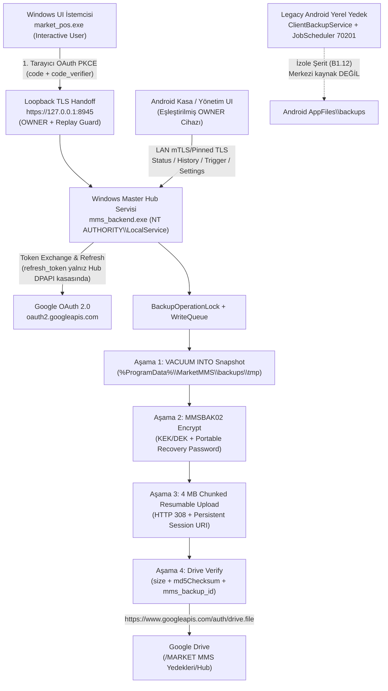

# Google Drive Backup Architecture v1.1 — MARKET MMS (Hub-Centric)

**Doküman Kodu:** `GOOGLE_DRIVE_BACKUP_ARCHITECTURE_V1_1.md`  
**Belge Sürümü:** v1.1 (Kanonik Uygulama Şartnamesi — Owner Kararları Donduruldu)  
**Tarih:** 22 Kasım 2026  
**Durum:** **CONFIRMED (v1.1)** — Owner **B1.1–B1.12** ve **`OV-01…OV-05`** kararları onaylandı  
**Ana Karar Kaydı:** [`ADR-023 — Hub-Centric Google Drive Backup & Restore`](../decisions/023-hub-centric-google-drive-backup-restore.md)  
**Eşlik Eden Belgeler:**  
- [`AUTOMATED_BACKUP_SCHEDULING_SPEC_V1_1.md`](./AUTOMATED_BACKUP_SCHEDULING_SPEC_V1_1.md)  
- [`BACKUP_RESTORE_ACCEPTANCE_TESTS_V1_1.md`](../testing/BACKUP_RESTORE_ACCEPTANCE_TESTS_V1_1.md)  
- Tarihsel v1.0 Belgesi *(korunur, sessizce ezilmez)*: [`BACKUP_RESTORE_PROTOCOL.md`](./BACKUP_RESTORE_PROTOCOL.md)

---

## 1. Amaç ve Kapsam

Bu şartname, **MARKET MANAGEMENT SYSTEM (MARKET MMS)** ürününün **Çalışma Hattı B — Google Drive Backup & Restore** kapsamında, mağazanın merkezi veritabanı olan **Windows Local Master Hub** SQLite veritabanının (`%ProgramData%\MarketMMS\data\market_master.db`) güvenli, katılımsız (*unattended*), şifreli, kaldığı yerden devam edebilir (*resumable*) ve başka bir Windows bilgisayara dahi taşınabilir (*portable recovery*) biçimde Google Drive'a yedeklenmesini ve geri yüklenmesini tanımlar.

### Kapsam Dahili
- Windows Local Master Hub (`MarketMMSService` / `mms_backend.exe`) merkezli şifreli yedek alma, `MMSBAK02` zarfı, Google Drive v3 API ile doğrudan chunked resumable upload ve remote doğrulama.
- Windows UI (`market_pos.exe`) üzerinden tarayıcı OAuth PKCE yetkilendirmesi ve yetkilendirme materyalinin yerel güvenli kanal üzerinden `NT AUTHORITY\LocalService` altında çalışan Windows Service'e güvenli devri.
- Android mobil ve Windows masaüstü uygulamalarından Hub yedekleme durumunu, geçmişini ve izin verilen zamanlama ayarlarını görüntüleme/yönetme arayüzü.
- Yeni veya arıza sonrası değiştirilmiş bir Windows bilgisayarda Portable Recovery Password ile tam Hub geri yükleme, zorunlu *Pre-Restore Safety Snapshot*, yeni `pepper.dpapi` nedeniyle cihaz re-pairing ve istemci Outbox/`client_seq` uzlaştırması.
- 30 günlük günlük + 12 aylık aylık saklama politikası ile son geçerli yedeğin korunması.

### Kapsam Dışı
- Android veya Windows istemci yerel SQLite veritabanlarının (`mms_client.db` / `client_local.db`) merkezi mağaza yedeği olarak kullanılması (**KESİNLİKLE KAPSAM DIŞI**).
- Google Drive'ın çoklu cihaz ortak veritabanı veya canlı yazma noktası gibi kullanılması (**KESİNLİKLE KAPSAM DIŞI**).
- Android'in mevcut eski yerel yedekleme akışının (`ClientBackupService` ve `MmsBackgroundBackupJobService`) silinmesi veya kullanıcı yedeklerinin otomatik temizlenmesi (**KAPSAM DIŞI** — geçiş kararı olmadan korunur).
- Banka POS terminali veya harici e-Arşiv/yazarkasa entegrasyonu (**KAPSAM DIŞI**).

---

## 2. Terimler ve Tanımlar

| Terim | Tanım |
|---|---|
| **Windows Master Hub (`MarketMMSService`)** | Mağaza içi merkezi katalog, stok ve satış otoritesini tutan, WinSW v2.12.0 altında `NT AUTHORITY\LocalService` hesabıyla çalışan Dart Shelf HTTPS arka plan servisi (`mms_backend.exe`). |
| **Merkezi Yedek Kaynağı (`market_master.db`)** | `%ProgramData%\MarketMMS\data\market_master.db` konumunda WAL modunda tek yazıcı (`WriteQueue`) ile yönetilen merkezi SQLite veritabanı. |
| **İstemci Yerel Veritabanı (`client_local.db` / `mms_client.db`)** | Uç cihazlarda offline-first çalışma için tutulan yerel SQLite DB. Merkezi yedek kaynağı değildir. |
| **Portable Recovery Password** | Makineye veya Windows DPAPI anahtarına (`pepper.dpapi`) bağlı olmayan, Owner tarafından belirlenip saklanan ve herhangi bir yeni Windows PC üzerinde yedeği açabilen kurtarma parolası. |
| **KEK (Key Encryption Key)** | Portable Recovery Password ve 32 bayt rastgele tuzdan `PBKDF2-HMAC-SHA256` (`600.000` iterasyon) ile türetilen anahtar şifreleme anahtarı. |
| **DEK (Data Encryption Key)** | Her yedek paketi için `Random.secure()` ile rastgele üretilen, AES-256-CBC şifreleme (`DEK_ENC`) ve HMAC-SHA256 doğrulama (`DEK_MAC`) alt anahtarlarını içeren 64 baytlık veri anahtarı. |
| **`MMSBAK01` / `MMSBAK02`** | `MMSBAK01`: mevcut doğrudan paroladan anahtar türeten S5A-4 yedek zarfı. `MMSBAK02`: `key_version`, `format_version`, `backup_id` ve DEK/KEK anahtar sarmalaması ekleyen v1.1 taşınabilir zarf biçimi. |
| **`backup_id`** | Yedekleme işinin başlangıcında üretilen 128-bit (32 hex) tekil kimlik; yerel paket, Drive `appProperties`, upload session ve crash recovery durumları arasında korelasyon anahtarıdır. |
| **Resumable Upload Session** | Google Drive v3 API'nin `uploadType=resumable` protokolünde döndürdüğü, kalıcı saklanan ve 4 MB parçalar halinde `Content-Range` + `HTTP 308` ile devam ettirilen yükleme oturumu. |
| **Pre-Restore Safety Snapshot** | Geri yükleme işlemi canlı veritabanını değiştirmeden önce mevcut canlı veritabanının `VACUUM INTO` ile alınıp şifrelenen zorunlu koruyucu güvenlik kopyası. |
| **Single-Flight Lock (`BackupOperationLock`)** | Aynı anda yalnızca tek bir yedekleme, geri yükleme veya saklama temizliği işleminin çalışmasını garanti eden dosya ve iş düzeyi kilit mekanizması. |
| **Re-pairing** | Hub geri yüklendikten sonra (özellikle yeni bilgisayarda yeni `pepper.dpapi` oluştuğunda) mevcut istemci cihaz token'larının geçersizleşmesi nedeniyle cihazların ECDSA P-256 eşleştirme protokolüyle yeniden yetkilendirilmesi. |
| **Outbox Reconciliation** | Geri yüklenen Hub veritabanında bulunmayan ancak uç cihazların yerel `outbox_operations` kuyruğunda bekleyen çevrimdışı satış/stok işlemlerinin FIFO ve `idempotency_key` korunarak güvenli aktarılması. |
| **Legacy Android Local Backup** | Mevcut kodda bulunan istemci yerel SQLite yedekleme/Drive akışı (`ClientBackupService`, `MmsBackgroundBackupJobService`); v1.1'de merkezi Hub yedeğinden ayrı şeritte korunur. |

---

## 3. Gereksinimler

### 3.1. Owner Tarafından Onaylanmış Sabit Mimari Kararlar (`B1.1–B1.12`)

| Karar ID | Sabit Mimari Karar | Durum |
|---|---|---|
| **B1.1** | Backup kaynağı **Windows Master Hub merkezi SQLite veritabanıdır** (`market_master.db`). | **`[CONFIRMED]`** |
| **B1.2** | Android yerel SQLite veritabanı merkezi backup kaynağı değildir. | **`[CONFIRMED]`** |
| **B1.3** | Windows Master Hub, Google Drive'a **doğrudan upload** yapacaktır. | **`[CONFIRMED]`** |
| **B1.4** | Google Drive ortak veritabanı değildir; yalnızca şifreli backup paketi saklar. | **`[CONFIRMED]`** |
| **B1.5** | Google hesabı **Windows Hub üzerinden** bağlanır. | **`[CONFIRMED]`** |
| **B1.6** | Android uygulaması Hub backup durumunu, geçmişini ve izin verilen ayarları yönetebilir. | **`[CONFIRMED]`** |
| **B1.7** | **Portable recovery password** yaklaşımı benimsenir (makineye bağımlı `pepper.dpapi` ile otomatik yedek şifrelenmez). | **`[CONFIRMED]`** |
| **B1.8** | Retention politikası: Son **30 günlük** günlük yedekler + son **12 aylık** aylık yedekler + **en az bir geçerli ve geri yüklenebilir yedek** korunmalıdır. | **`[CONFIRMED]`** |
| **B1.9** | İlk kez otomatik yedekleme etkinleştirildiğinde **hemen bir başlangıç yedeği** alınır. | **`[CONFIRMED]`** |
| **B1.10** | Sonraki günlük yedeklemeler **yerel saatle 00.00 hedefiyle** planlanır. | **`[CONFIRMED]`** |
| **B1.11** | 00.00 kesin çalışma garantisi değildir; işletim sistemi zamanlama toleransı ve catch-up davranışı açıkça tanımlanır. | **`[CONFIRMED]`** |
| **B1.12** | Android'in eski yerel backup akışı merkezi Hub backup akışından ayrı tutulur; mevcut eski yedekler geçiş kararı olmadan silinmez. | **`[CONFIRMED]`** |

### 3.2. Bağlayıcı İş Kuralları ve Kalite Gereksinimleri
- **`BR-BAK-01`..`BR-BAK-06` (`docs/requirements/BUSINESS_RULES_SPEC.md`):** Günlük saklama, satış başına yedek almama ilkesi (`non-blocking snapshot`), `drive.file` en dar OAuth kapsamı, geri yükleme öncesi zorunlu *Safety Snapshot* ve bekleyen yerel Outbox işlemlerinin korunması.
- **Mevcut Repository Açıklarının Kapatılması:** Mevcut Hub sunucusunda sıfır Drive upload entegrasyonu (`test_spikes/spike_01_backend/bin/server.dart:677-747`), `pepper.dpapi` ile şifreleme (`server.dart:698,3774`), `afterSuccess` hata yutma (`packages/mms_client_storage/lib/src/backup/scheduled_backup.dart:377-391`), tek-PARÇA RAM PUT yüklemesi (`packages/mms_client_storage/lib/src/backup/google_drive_backup.dart:347,479-527`), `403` kota yanlış sınıflandırması (`google_drive_backup.dart:544-548`), son geçerli yedek korumasız retention (`packages/mms_client_storage/lib/src/backup/backup_retention_policy.dart:35-85`) ve `OWNER`/`CASHIER` rol denetimsizliği (`test_spikes/spike_01_backend/lib/security/auth_middleware.dart:218`, `bin/server.dart`) tamamen giderilmelidir.

---

## 4. Mimari / Teknik Tasarım

### 4.1. Sistem Topolojisi ve Bileşen Sınırları

### 4.2. Windows UI OAuth PKCE & Windows Service (`LocalService`) Kimlik ve DPAPI Sınırı

#### Mevcut Repository Durumu (Sorun Kanıtı)
- Windows UI token deposu `WindowsDpapiTokenStore` (`lib/core/security/windows_dpapi_token_store.dart:62-116, 174-189`) `CryptProtectData` API'sini `localMachine` bayrağı olmadan (**DPAPI CurrentUser** kapsamında) ve `%LOCALAPPDATA%\MarketMMS\secure_tokens.dpapi.json` yolunda kullanır.
- Windows Master Hub servisi (`test_spikes/spike_01_backend/service_wrapper/MarketMMSService.xml:18-21`) **`NT AUTHORITY\LocalService`** hesabıyla çalışır.
- Hub'daki DPAPI sınıfı (`test_spikes/spike_01_backend/lib/security/dpapi.dart:61, 111`) ise `CRYPTPROTECT_LOCAL_MACHINE | CRYPTPROTECT_UI_FORBIDDEN` kapsamındadır.
- **Sonuç:** Etkileşimli kullanıcının tarayıcı PKCE ile aldığı ve `CurrentUser` DPAPI ile `%LOCALAPPDATA%` içine yazdığı `refresh_token`'a `LocalService` servisi dosya yolu ve DPAPI kimlik sınırı nedeniyle **ASLA erişemez**.

#### Hedef Mimari (`[PROPOSED / OPEN VERIFICATION]`)
1. **OAuth PKCE Başlatma (Windows UI):** Windows UI içindeki `GoogleOAuthDesktopFlow` (`google_drive_backup.dart:153-212`), loopback HTTP yakalayıcıyı (`http://127.0.0.1:<ephemeral_port>/`) açar ve yalnızca `https://www.googleapis.com/auth/drive.file` kapsamıyla PKCE yetkilendirmesini başlatır.
2. **Güvenli Devir (Authorization Code Handoff):** Windows UI, Google token takasını kendi tarafında **yapmaz** (veya UI diske `refresh_token` yazmaz). Aldığı `authorization_code`, `code_verifier`, `redirect_uri` ve `state` bilgilerini yalnızca yerel loopback TLS bağlantısı üzerinden (`POST https://127.0.0.1:8945/api/v1/backup/oauth/connect`, `OWNER` yetkisi + admin sırrı/device token + `X-MMS-Timestamp`/`X-MMS-Nonce` replay korumasıyla) Hub servisine iletir.
3. **Hub Tarafı Token Takası ve Saklama:** `MarketMMSService`, Google Token Endpoint (`https://oauth2.googleapis.com/token`) takasını doğrudan kendi sürecinde tamamlar. Alınan `refresh_token`, `%ProgramData%\MarketMMS\security\gdrive_oauth_token.dpapi` dosyasına atomik `.tmp + rename` yöntemiyle yazılır.
4. **DPAPI Scope Kararı ve ACL Koruması (`OV-01` — `CONFIRMED`):**
   - **Kesinleştirilen Tasarım (`LocalMachine` + `pOptionalEntropy` + Sıkı NTFS ACL):** Hub OAuth `refresh_token` kasası (`%ProgramData%\MarketMMS\security\backup_drive_oauth.dpapi`) mevcut `pepper.dpapi` ve `live_drive_sync_secret.dpapi` ile uyumlu biçimde `CRYPTPROTECT_LOCAL_MACHINE | CRYPTPROTECT_UI_FORBIDDEN` bayrakları, kasa-amaçlı (domain-separated) sabit **`pOptionalEntropy`** ve sıfır standart kullanıcı erişimli NTFS ACL ile şifrelenir.
   - **Gerçek kod değerleri (23 Kasım 2026 (2. tur) doğrulaması, `IMP-12`):** OAuth kasası `backup_drive_oauth.dpapi` → `MarketMMS:HubBackupDriveOAuth:v1` (`hub_backup_oauth_store.dart` `backupOAuthEntropy`); katılımsız kurtarma parolası kasası `backup_recovery_key.dpapi` → `MarketMMS:HubBackupRecoveryKey:v1` (`hub_recovery_key_store.dart` `recoveryKeyEntropy`). Bu belgenin önceki sürümündeki `MMS-HUB-BACKUP-OAUTH-V1|<tenant>|<store>` biçimi **uygulanmamış eski bir tasarım taslağıydı**; tenant/store değerleri entropy'ye katılmaz.
   - **Güvenlik değerlendirmesi:** `pOptionalEntropy` burada gizli bir anahtar değil, **amaç ayrımı** sağlar: aynı makinede `LocalMachine` DPAPI çağırabilen başka bir süreç, doğru entropy'yi vermeden blob'u çözemez ve iki kasa birbirinin yerine kullanılamaz. Entropy kaynak kodda açık olduğundan tenant/store eklemek gizlilik kazandırmaz; pilot tek-tenant/tek-store olduğu için ayrım kazancı da yoktur. Hub kimlik bağlaması ayrı olarak `BK-02.1` Hub kimlik mührüyle yapılır. Asıl koruma `LocalMachine` DPAPI + NTFS ACL'dir.
   - **Neden kod değiştirilmedi:** Entropy değiştirilirse mevcut `backup_drive_oauth.dpapi` ve `backup_recovery_key.dpapi` dosyaları çözülemez hale gelir (Owner'ın Drive'ı yeniden bağlaması ve kurtarma parolasını yeniden girmesi gerekir). Güvenlik kazancı olmayan bu değişiklik mevcut sırları riske atacağı için yapılmadı; doküman koda hizalandı.
   - Windows UI süreci Hub servisinin DPAPI sır dosyalarını hiçbir zaman doğrudan okuyamaz veya yazamaz; etkileşim yalnızca loopback HTTPS (`POST /api/v1/backup/oauth/connect`, `POST /api/v1/backup/oauth/disconnect`) üzerinden gerçekleşir. *(Not: Gerçek `NT AUTHORITY\LocalService` servis hesabı altında reboot kalıcılığı fiziksel kabul testinde doğrulanana kadar saha kanıtı `BLOCKED` kalır.)*
5. **Erişim Kontrol Listesi (NTFS ACL):** `%ProgramData%\MarketMMS\security\gdrive_oauth_token.dpapi`, `recovery_secret.dpapi` ve `upload_sessions\` dizinlerinde yalnızca `SYSTEM:F`, `Administrators:F` ve `NT SERVICE\MarketMMSService:M` (veya `:RW`) yetkileri bulunur; standart Windows `Users`, `Everyone` ve `Authenticated Users` gruplarına tüm erişimler yasaklanır.
6. **Yenileme ve İptal:** Hub `access_token` önbelleğini yalnızca RAM'de tutar ve tek-uçlu yenileme kilidiyle yeniler (`expires_in - 60s`). `POST /api/v1/backup/oauth/disconnect` çağrısında Hub önce `https://oauth2.googleapis.com/revoke` isteğini atar, ardından `.dpapi` dosyasını güvenli biçimde siler ve beklemedeki Drive oturumlarını iptal durumuna çeker (`audit_log`: `BACKUP_OAUTH_DISCONNECTED`).

### 4.3. Portable Recovery Password ve DEK/KEK Anahtar Yönetimi (`MMSBAK02`)

#### Mevcut P0 Hata Kanıtı
- Hub'da `createEncryptedHubBackup` (`test_spikes/spike_01_backend/bin/server.dart:698`) ve `/api/v1/admin/restore` (`server.dart:3774, 3868`) yedek parolası verilmediğinde `pepperManager.pepper` kullanır.
- `pepper.dpapi` makineye özel `LocalMachine` DPAPI sırrıdır ve kullanıcı tarafından bilinmez; bu durum **B1.7 Portable recovery password** kararını doğrudan ihlal eder ve yeni PC'de geri yüklemeyi imkânsız kılar.

#### Kesinleştirilen Anahtar ve Streaming AEAD Mimarisi (`MMSBAK02` — `CONFIRMED`)
1. **Portable Recovery Password Kurulumu (`OV-05`):** Owner, otomatik veya taşınabilir Hub yedeklemesini yapılandırırken en az **12 karakterli** (daha uzun parola cümlesi önerilir) yüksek entropili bir **Portable Recovery Password** belirler ve açık uyarıyı onaylar. Parola düz metin olarak ne Hub'da ne de Google Drive'da saklanır; kaybolursa yedek açılamaz.
2. **Güvenilir Kriptografi İlkeleri:** Kendi kripto algoritmamız yazılmaz; `package:cryptography` içindeki **`AES-256-GCM`** (AEAD) ve **`PBKDF2-HMAC-SHA256` (`600.000` tur)** implementasyonları kullanılır. Her yedek için rastgele 32 bayt **DEK** ve 16 bayt salt üretilir; paroladan türetilen 32 bayt **KEK** ile DEK `AES-256-GCM` (`wrapAad`) ile sarılır; büyük SQLite snapshot dosyaları bellek şişmeden (`O(1 MB)` akış) parçalı AEAD ile şifrelenir (her parçada sıralı nonce + tam başlık/parça-indeksi/final-bayrağı AAD koruması + kaynak SHA-256 doğrulaması).
3. **Katılımsız (*Unattended*) Kullanım Kasası:** Gece `00:00` otomatik yedekleri için yapılandırılmış kurtarma anahtarı **yalnızca Hub güvenlik kasasında** `%ProgramData%\MarketMMS\security\backup_recovery_key.dpapi` altında `LocalMachine` DPAPI + `pOptionalEntropy` + sıkı NTFS ACL ile saklanır (hiçbir `.mmsbak` dosyasına veya Google Drive'a yazılmaz). Yeni bir PC'ye kurtarmada eski PC DPAPI dosyası gerekmez; yalnızca **Portable Recovery Password** girilir.
4. **Geriye Dönük Uyumluluk (`MMSBAK01`):** Çözücü ilk 8 bayt sihirli başlığa bakar (`MMSBAK01` ise mevcut `BackupCryptoService` PBKDF2 + AES-256-CBC + HMAC-SHA256 yolu; `MMSBAK02` ise KEK → DEK unwrap → akışlı AES-256-GCM AEAD doğrulama yolu).

### 4.4. 12 Durumlu Backup State Machine (`CONFIRMED`)

`ScheduledBackupRunner._run` ve `backup_providers.dart` içindeki `afterSuccess` yanıltıcı başarı yolu kaldırılır; Hub orkestratörü aşağıdaki **12 kesin durumdan** oluşan atomik durum makinesini işletir:

| Durum (`HubBackupState`) | Tür | Tanım ve UI Anlamı |
|---|---|---|
| **`PENDING`** | Aktif | İş kuyruğa alındı (`INITIAL_ENABLE`, `SCHEDULED_DAILY`, `CATCH_UP`, `MANUAL`). |
| **`RUNNING_SNAPSHOT`** | Aktif | Disk ön kontrolü (`2.5 × (DB+WAL) + 64 MB`) ve `WriteQueue` + `VACUUM INTO` çalışıyor. |
| **`SNAPSHOT_READY`** | Ara Kalıcı | Geçici `.snap.db` oluştu ve salt-okunur `PRAGMA integrity_check = ok` geçti (`WriteQueue` serbest!). |
| **`RUNNING_ENCRYPT`** | Aktif | `WriteQueue` dışında akışlı `MMSBAK02` şifrelemesi yapılıyor. |
| **`ENCRYPTED_LOCAL_READY`** | Ara Kalıcı | `.mmsbak` atomik yazıldı, `.snap.db` sahiplik kontrolüyle silindi. *(Henüz Drive yüklemesi tamamlanmadı — bulut başarısı sayılmaz!)* |
| **`UPLOADING`** | Aktif (Ağ) | Google Drive'a `RandomAccessFile` ile **4 MB chunked resumable upload** (`HTTP 308`, kalıcı session URI + offset) sürüyor. |
| **`VERIFYING`** | Aktif (Doğrulama) | Son parça `200/201` döndü; uzak dosya `size` + SHA-256 / MD5 + metadata doğrulanıyor. |
| **`COMPLETED_UPLOADED`** | Nihai Başarı | **Tek nihai tam başarı durumu.** Drive doğrulandı; retention işletilebilir. |
| **`RETRY_PENDING`** | Bekleyen (Tekrar) | Geçici ağ/sunucu (`429/5xx`) veya kooperatif kapanış kesintisi; aynı `backup_id` + mevcut `.mmsbak`/session URI korunur; `5/10/20/40/80/160` dk backoff işlenir. |
| **`FAILED_AUTH`** | Müdahale Gerekli | OAuth bağlı değil/iptal (`401/403 Auth` / `invalid_grant`). Yerel `.mmsbak` korunur; kör retry durdurulur; Owner yeniden bağlanmalıdır. |
| **`FAILED_QUOTA`** | Müdahale Gerekli | Google Drive `403 storageQuotaExceeded` kotası dolu (`FAILED_AUTH`'tan ayrı!). Token silinmez; kör retry durdurulur; Owner kota uyarısı alır. |
| **`SUPERSEDED`** | Nihai Devir | Önceki günün tamamlanmamış işi, yeni günün Drive doğrulamalı (`COMPLETED_UPLOADED`) yedeği tarafından devralındı; doğrulama öncesi eski paket asla silinmez. |

### 4.5. Hub SQLite Consistent Snapshot, Aşamalı Boru Hattı ve Disk Alanı Denetimi
- **Consistent Snapshot:** Hub, `DatabaseBackupEngine.createBackup` içindeki tekil `WriteQueue` kuyruğu üzerinden `VACUUM INTO '<safe_snap_path>'` komutunu çalıştırır; ardından salt-okunur `PRAGMA integrity_check;` doğrulanır. Canlı POS veya Android senkronizasyon yazma trafiği uzun süre engellenmez.
- **Disk Alanı Ön Kontrolü (`Gap` Kapatma):** Snapshot başlatılmadan önce `%ProgramData%\MarketMMS\backups\` biriminin kullanılabilir disk alanı ölçülür. Gereken minimum boş alan: `2.5 × (size(market_master.db) + size(-wal)) + 64 MB` güvenlik marjı. Yetersizse **hiçbir geçici dosya oluşturmadan** `ERR_DISK_FULL` ile `FAILED` veya `RETRY_PENDING` durumuna düşer.
- **Şifresiz Geçici Dosya İzolasyonu:** Mevcut `DatabaseBackupEngine.createBackup` (`database_backup_engine.dart:91-92`) şifresiz `.snap.db` dosyasını sistem geneli `Directory.systemTemp` içinde açmaktadır. v1.1'de Hub geçici snapshot'ı yalnızca ACL ile kilitli `%ProgramData%\MarketMMS\backups\tmp\<backup_id>.snap.db` yolunda oluşturur; şifreli `.mmsbak` atomik yazılıp doğrulandıktan hemen sonra `.snap.db` diskten silinir.

### 4.6. Google Drive Resumable Chunked Upload (4 MB vs 8 MB Kararı)

#### Mevcut Kod Kusuru
`GoogleDriveBackupUploader._resumableUpload` (`packages/mms_client_storage/lib/src/backup/google_drive_backup.dart:347, 479-527`) `backupFile.readAsBytes()` ile tüm dosyayı RAM'e okuyup tek bir `httpClient.put(..., body: bytes)` çağrısıyla göndermektedir; `Content-Range`, parçalama, `HTTP 308` offset işleme ve oturum URI kalıcılığı **yoktur**.

#### 4 MB vs 8 MB Parça Boyutu Karşılaştırması

| Ölçüt | 4 MB (`4.194.304 B` = 16 × 256 KiB) | 8 MB (`8.388.608 B` = 32 × 256 KiB) |
|---|---|---|
| **Google Drive API 256 KiB Kuralı** | Tam 16 katı (uyumlu). | Tam 32 katı (uyumlu). |
| **Tek Parça Aktarım Süresi (5 Mbps mağaza ADSL uplink)** | ~6.7 saniye | ~13.4 saniye |
| **WinSW 15 sn Shutdown Bütçesi Uyumu** | Parça sonu bekleme veya anlık iptalde en fazla 4 MB kayıp ve hızlı kapanış. | 13.4 sn, 12–15 sn servis durdurma penceresini tek başına tüketme riski taşır. |
| **Kopma / Tekrar Deneme Maliyeti** | Ağ kopsa da en fazla 4 MB yeniden gönderilir. | Ağ kopsa 8 MB yeniden gönderilir. |
| **RAM Bellek İzi** | `4 MB` akış tamponu (Düşük). | `8 MB` akış tamponu. |
| **HTTP İstek Başlık Yükü (100 MB DB)** | 25 istek (`~25 × 50 ms = 1.25s` RTT). | 12–13 istek (`~0.6s` RTT). |

- **Mimari Seçim (`[PROPOSED]`): `4 MB` (`4.194.304` bayt)** seçilir. Gerekçe: KOBİ perakende marketlerdeki ADSL/VDSL yükleme bant genişliği (~3–10 Mbps) ve WinSW `<stoptimeout>15 sec</stoptimeout>` kapatma sınırı altında hem yüksek kesinti dayanıklılığı hem de düşük bellek ayak izi sağlar. Parça boyutu `hub_config.json` altında `backup_drive.chunk_size_mb` (izin verilen değerler: `4` veya `8`, varsayılan `4`) olarak parametrik tutulabilir.

#### Protokol Akışı
1. **Idempotency (Ön Kontrol + Tekilleştirme):** Hub önce yerel `drive_upload_sessions` / ledger durumuna, ardından Drive API'ye `appProperties has { key='mms_backup_id' and value='<backup_id>' } and trashed=false` sorgusu atar. Mevcut ve boyutu/MD5'i eşleşen uzak dosya varsa doğrudan `VERIFYING` → `COMPLETED_UPLOADED` geçer; asla mükerrer dosya üretmez.
2. **Session Açma & Kalıcılık:** `POST /upload/drive/v3/files?uploadType=resumable` çağrısından dönen `Location` session URI, `backup_id`, `local_file_path`, `total_bytes`, `sha256`, `md5` ve `uploaded_bytes = 0` bilgileri kalıcı state store'a atomik yazılır (session URI'ler DPAPI/ACL korumalı tutulur).
3. **Chunked PUT & HTTP 308 Offset:** Her parça `Content-Range: bytes <start>-<end>/<total>` başlığıyla `RandomAccessFile.openRead(start, end + 1)` üzerinden stream/okunarak gönderilir:
   - `HTTP 308 Resume Incomplete` + `Range: bytes=0-<ackEnd>` → `uploaded_bytes = ackEnd + 1` kalıcı diske yazılır ve sonraki parçaya geçilir.
   - `HTTP 200` veya `201` → Son parça onaylandı → durum **`VERIFYING`** aşamasına geçer (`meta.size`, `meta.md5Checksum` ve `appProperties.mms_backup_id` doğrulanır; uyuşmazlıkta bozuk uzak nesne silinir ve `RETRY_PENDING` yazılır).
   - `HTTP 404` veya `HTTP 410` (Session Süresi Dolmuş): Hub silinen/düşen oturumu hemen sıfırlamaz; önce Drive'da `mms_backup_id` arar (Drive dosyayı zaten tamamlamış olabilir). Yoksa eski `session_uri` temizlenip yeni resumable session başlatılır.

### 4.7. Local Retention vs Drive Retention ve Son Geçerli Yedeğin Korunması

#### Mevcut Kusur Kanıtı
`RetentionPolicyManager.planPruning` (`packages/mms_client_storage/lib/src/backup/backup_retention_policy.dart:35-85`):
- `monthlyCutoff` için takvim ayı yerine `monthlyRetentionMonths * 30` gün (`360` gün) yaklaşımı kullanır (`satır 41`).
- En kritik açık: **Tüm yedekler eşikten eskiyse bütün yedekleri `toPrune` listesine koyar** (`satır 63-78`); yani sistemde tek bir geçerli yedek dahi kalmayabilir.
- Drive tarafında herhangi bir retention / silme yönetimi hiç yoktur.

#### Hedef İkili Retention Tasarımı
1. **Google Drive Retention (Otorite):**
   - Yalnızca durumu **`COMPLETED_UPLOADED`** ve uzak doğrulamadan geçmiş Hub yedekleri (`appProperties.mms_database_type = 'central_master'`) değerlendirilir.
   - **Günlük Pencere:** Yerel saatle son **30 gün** içindeki her günün başarılı yedekleri korunur.
   - **Aylık Pencere:** 30 günden eski olup son **12 takvim ayı** içindeki her `YYYY-MM` takvim ayı için en az bir geçerli yedek (`is_monthly_archive = true` veya o ayın seçilen tek temsilci yedeği) korunur.
   - **Değişmez Güvenlik Kuralı (*Last-Valid-Backup Invariant*):** Hesaplanan temizlik listesi sonrasında Drive üzerinde **en az 1 adet geçerli ve doğrulanmış `COMPLETED_UPLOADED` yedek kalması zorunludur**. Eğer kalacak geçerli yedek sayısı `1`'in altına düşecekse, en yeni geçerli yedek otomatik olarak `pinned_protected` işaretlenip silme planından çıkarılır.
2. **Yerel Disk Önbellek Retention'ı (`%ProgramData%\MarketMMS\backups\`):**
   - Yerel disk Drive arşivinin kopyası değildir; son **7 günlük** (`config`: `local_cache_days`, varsayılan `7`) yerel `.mmsbak` paketleri + henüz **`COMPLETED_UPLOADED` olmamış tüm `LOCAL_ONLY_PENDING_UPLOAD` / `RETRY_PENDING` / `ENCRYPTED` paketleri** + **en az 1 adet son geçerli yerel `.mmsbak`** korunur.
   - Drive'a başarıyla `COMPLETED_UPLOADED` olmuş ve 7 günü aşmış yerel kopyalar yerel disk alanını korumak için temizlenir; ancak Drive üzerindeki 30g/12a saklaması bundan etkilenmez.

### 4.8. Geri Yükleme (Restore) Mimarisi — Yalnızca DB Değişimi Değildir

Mevcut `DatabaseBackupEngine.restoreBackup` (`packages/mms_client_storage/lib/src/backup/database_backup_engine.dart:369-710`) güçlü atomik DB swap, `.restore_journal` ve şifreli *Safety Snapshot* temeline sahiptir; ancak **yeni Windows PC restore**, **`pepper.dpapi` değişimi sonucu token geçersizleşmesi**, **istemci re-pairing** ve **Outbox reconciliation** adımlarını kapsamaz.

v1.1 Hub Restore 10 adımlı uçtan uca akışı:
1. **Yetki & Kilit:** Çağrı `OWNER` + replay korumalı olmalıdır; `BackupOperationLock(BackupOperationKind.restore)` alınır (aktif backup/restore varsa `409 ERR_BACKUP_OPERATION_BUSY` döner — `BK-030`).
2. **İndirme & Bütünlük (Canlı DB Açıkken):** Seçilen `.mmsbak` Drive'dan `.part` Range ile indirilir, boyut ve MD5/SHA-256 kontrol edilir.
3. **Ön Çözümleme ve Doğrulama (Canlı DB Açıkken):** Girilen **Portable Recovery Password** ile `MMSBAK02` (veya eski `MMSBAK01`) HMAC + AES çözümü ayrı isolate'te doğrulanır; `ERR_DECRYPTION_FAILED` durumunda canlı DB'ye hiç dokunulmaz. Çözülen SQLite üzerinde staging `PRAGMA integrity_check = ok`, `tenant_id`/`store_id` uyumu ve şema migrasyonu test edilir. *(Not: Cross-device / yeni PC Hub restore'unda `device_id` kontrolü `SERVER_HUB` sabitini doğrulamalı; başka mağaza/tenant reddedilmelidir).*
4. **Bakım Modu & Safety Snapshot:** `WriteQueue.pauseForMaintenance()` ve `AdmissionGate.pauseForMaintenance()` ile canlı trafik durdurulur; WAL `TRUNCATE` checkpoint ve `db.close()` yapılır. Ardından mevcut canlı `market_master.db` üzerinden zorunlu **Pre-Restore Safety Snapshot** alınır ve şifrelenir (`MMSBAK02`).
5. **Atomik DB Swap & Rollback:** `.restore_journal` yazılır; eski `-wal`/`-shm` temizlenir; staging DB canlı DB yerine atomik taşınır; `PRAGMA integrity_check = ok` doğrulanır; hata durumunda `.swap_bak` / Safety Snapshot'tan otomatik geri alınır.
6. **`restore_epoch` Artışı & Kontrollü Cihaz Token Geçersizleştirme (`OV-03`):** Yeni bir bilgisayara geri yükleme yapıldığında `pepper.dpapi` değişir; mevcut `devices.token_hash` kayıtları artık doğrulanamaz. Hub restore sonrasında `hub_metadata.restore_epoch` artırılır, eşleştirilmiş uzak cihazlar kontrollü biçimde geçersiz kılınır (`isConfirmed = false` ve geçersiz `tokenHash` rotasyonu — kalıcı `REVOKED` / `isActive = false` cihazlar bloke kalmaya devam eder!) ve `device_audit_logs`'a `POST_RESTORE_TOKEN_INVALIDATION` yazılır.
7. **Zorunlu Kontrollü Re-pairing:** Android ve harici Windows kasalar `401/403` veya `restore_epoch` değişimi aldığında kullanıcıya yeniden eşleştirme bildirimi sunar. Mevcut yerel `outbox_operations` (hem `PENDING` hem `SYNCED` satırları), `local_sales` ve `client_seq` **ASLA silinmez**.
8. **Outbox / Kayıp `SYNCED` Operasyon / `client_seq` Uzlaştırması (`OV-03` — `CONFIRMED`):**
   - Uzlaştırma yalnızca `PENDING` satırlarla sınırlı tutulmaz; geri yüklenen Hub veritabanında eksik olan **daha önce `SYNCED` olmuş ara `client_seq` operasyonları da** kapsanır.
   - İstemci senkronizasyon başında mevcut **`GET /api/v1/sync/device-state`** (içinde `restore_epoch`, `high_water_mark_seq`, `max_seen_client_seq`, `has_sequence_gaps`) ucunu sorgular.
   - `restore_epoch` değiştiyse veya `hub.high_water_mark_seq < local.lastSyncedSeq` ise istemci mevcut **`POST /api/v1/sync/receipts`** (`client_seqs` toplu sorgusu) ile Hub'da hangi `client_seq` kayıtlarının `NOT_FOUND` olduğunu tespit eder.
   - İstemci, yerel `outbox_operations` tablosunda tam içeriğiyle (`operation_id`, `device_id`, `client_seq`, `payload`, `payload_hash`) saklanan bu eksik `SYNCED` satırları özgün kimliklerini ve hash'lerini bozmadan atomik olarak `PENDING` durumuna geri alır, `lastSyncedSeq = hubHwm` ve `lastServerSaleSeq = 0` ayarlayıp idempotent biçimde yeniden gönderir.
   - Eğer Hub'da eksik olan bir operasyonun yerel yük/geçmiş kaydı cihazda bulunamıyorsa (`PostRestoreReconciliationException` / `ERR_POST_RESTORE_HISTORY_MISSING`), sistem **fail-closed** durur, yerel `restore_epoch` damgasını güncellemez ve **eksik mutabakatı asla sessizce başarılı göstermez**.
9. **Katalog & Satış Downlink Yenileme (Echo-Loop Engelli):** Uç cihaz `GET /api/v1/products` ve `GET /api/v1/sales?cursor=0` ile güncel Hub durumunu alır; indirilen kayıtlar tekrar Outbox'a yazılmaz.
10. **Audit Log ve Servis Devamı:** `BACKUP_RESTORE_COMPLETED` ve `restore_epoch` kaydı yazılır; `WriteQueue.resumeAfterMaintenance()` ve `AdmissionGate.resumeAfterMaintenance()` açılır.

### 4.9. Android Yönetim UI ve Hub Backup API Sözleşmesi

Mevcut UI kartları (`BackupManagementCard`, `BackupScheduleSection`, `ExternalBackupSection` — `lib/features/backup/presentation/widgets/*.dart`) yalnızca cihaz içi `ClientBackupService` ve yerel Google Drive bağlantısını yönetmektedir. v1.1'de iki ayrı sekme/bölüm sağlanır:

| Bileşen | Sorumluluk | Hedef API |
|---|---|---|
| **Merkezi Hub Yedekleme Paneli (Windows + Android)** | Hub yedekleme durumu (`12 state`), son başarılı Drive yedeği (`COMPLETED_UPLOADED`), sonraki 00:00 zamanı, son 30 iş geçmişi, kota/yetki uyarıları, manuel tetikleme (**Şimdi Yedekle**), izin verilen ayarlar (Otomatik 00:00 Aç/Kapat, saklama görünümü) ve yalnızca **`OWNER`** onaylı Hub Restore tetikleme. | `GET /api/v1/backup/status`, `GET /api/v1/backup/history`, `POST /api/v1/backup/trigger`, `PATCH /api/v1/backup/settings`, `POST /api/v1/backup/restore` |
| **Google Hesabı Bağlama Kartı (Yalnız Windows Hub UI)** | Google OAuth PKCE tarayıcı akışı yalnızca Windows Hub üzerinden açılır (`B1.5`); Android yönetim ekranında Google hesabı bağlama düğmesi yerine bağlı hesap özeti (e-posta / bağlı değil uyarısı) ve **"Google hesabını Windows Master Hub üzerinden bağlayın"** rehberi gösterilir. | `POST /api/v1/backup/oauth/connect`, `POST /api/v1/backup/oauth/disconnect` (Loopback TLS + `OWNER` + Admin) |
| **Legacy Cihaz Yerel Yedek Bölümü (İzole Alt Bölüm)** | Android veya Windows yerel `.mmsbak` dosyalarını salt-okunur listeleme ve mevcut USB/yerel yedek kurtarma akışını bozmadan koruma (`B1.12`); kullanıcı eski yerel yedeklerini kendi isteği dışında asla kaybetmez. | Yerel `ClientBackupService` |

### 4.10. Güvenlik Sınırı, `OWNER`/`CASHIER` Yetkilendirme, Replay Protection ve Audit Log

#### Mevcut Kritik Güvenlik Açığı Kanıtı
- `Devices` tablosunda (`test_spikes/spike_01_backend/lib/db/database.dart:161`) `role` sütunu `'CASHIER'` varsayılanıyla tanımlıdır, ancak `PairingManager.approveSession` (`pairing_manager.dart:305-314`) rol ataması yapmaz (`CASHIER` kalır).
- `auth_middleware.dart:218` `'authenticated_device_role'` değerini context'e ekler, ancak `test_spikes/spike_01_backend/bin/server.dart` içinde **sıfır route** bu rolü denetler.
- Mevcut `/api/v1/admin/backup*`, `/api/v1/admin/restore` ve `/api/v1/backup/snapshot` uçları (`server.dart:593-673`) yalnızca loopback + statik `x-admin-secret` kullanır; LAN üzerinden Android `OWNER` cihazından yönetilemez, **replay protection** (nonce/timestamp) içermez ve `device_audit_logs` kaydı düşmez.

#### Hedef Güvenlik Matrisi
1. **`OWNER` vs `CASHIER` Rol Ayrımı (RBAC):**
   - `PairingManager.approveSession` sırasında Owner'ın cihazı hangi rolde (`OWNER` yönetim yetkili cihaz veya `CASHIER` satış terminali) onayladığı `devices.role` sütununa yazılır (ilk kurulan yerel Windows Hub istemcisi varsayılan `OWNER`, ilave kasiyer terminalleri `CASHIER`).
   - Tüm Hub backup/restore/settings/OAuth uçlarında middleware + endpoint katmanı **`authenticated_device_role == 'OWNER'`** kontrolü yapar. `CASHIER` cihazı veya yetkisiz istek anında **`403 Forbidden` (`ERR_FORBIDDEN_ROLE`)** döner; **hiçbir veritabanı, dosya, durum makinesi veya ayar değişikliği (zero state mutation) yapılmaz (`BK-031`)**.
   - `/api/v1/backup/oauth/connect` ve `/api/v1/backup/oauth/disconnect` uçları hem `OWNER` cihaz rolünü hem Windows loopback / admin onay sınırını gerektirir.
2. **Replay Protection:**
   - Tüm yedekleme, ayar değiştirme, OAuth bağlama/kaldırma ve geri yükleme mutasyon istekleri zorunlu `X-MMS-Timestamp` (UTC ISO-8601 veya Unix epoch ms, Hub saatiyle ±60 saniye pencere) ve `X-MMS-Nonce` (UUID v4, en az 120 sn boyunca tek-kullanımlık sunucu nonce önbelleği / DB tablosu) başlıkları taşır *(opsiyonel/ek: cihaz ECDSA P-256 anahtarıyla istek imzası)*.
   - Zaman penceresi dışındaki veya tekrarlanan (`nonce` yeniden kullanımı) istekler **`403 Forbidden` (`ERR_REPLAY_DETECTED`)** döndürür; **sıfır state mutation** garantilenir (`BK-031`).
3. **Değiştirilemez Audit Log (`device_audit_logs`):**
   - Başarılı ve reddedilen (403 RBAC / 403 Replay / 401 Auth) her yedek/restore/OAuth çağrısı `device_audit_logs` tablosuna `device_id`, `role`, `action`, `backup_id`, `outcome` ve `timestamp` alanlarıyla yazılır; hiçbir parola, `refresh_token`, `access_token`, `admin_secret` veya `pepper` loglanmaz.

---

## 5. Hata Senaryoları

| Hata Kodu / HTTP | Tetikleyen Koşul | State Geçişi | Sistem Davranışı ve Kullanıcı Etkisi |
|---|---|---|---|
| `ERR_DISK_FULL` | Disk boş alanı `< 2.5 × (DB+WAL) + 64 MB` veya yazım `ENOSPC`/`112`. | `RUNNING`/`SNAPSHOT_CREATED` → `RETRY_PENDING` veya `FAILED` | Yarım dosya bırakılmaz; geçici `.snap.db` silinir; Android/Windows UI disk uyarısı gösterir. |
| `403 storageQuotaExceeded` | Google Drive depolama kotası dolu. | `UPLOADING` → `RETRY_PENDING` (veya kalıcı eşik sonrası `FAILED`) | **Auth hatası (`ERR_DRIVE_REAUTH_REQUIRED`) SAYILMAZ**; token silinmez; backoff + UI kota uyarısı üretilir. |
| `401` / `403 Auth` / `invalid_grant` | OAuth erişimi Google'dan iptal edildi veya refresh token düştü. | `UPLOADING` → `LOCAL_ONLY_PENDING_UPLOAD` + `auth_state=REAUTH_REQUIRED` | Yerel şifreli `.mmsbak` korunur; otomatik retry durdurulur; Owner'a **"Google Hesabını Yeniden Bağlayın"** uyarısı gösterilir. |
| `429` / `5xx` / `SocketException` | Ağ kesintisi veya Google Drive geçici sunucu hatası. | `UPLOADING` → `RETRY_PENDING` | 5→10→20→40→80→160 dk backoff (gün sonuna kadar 160 dk sabit); mevcut chunk offset ve session URI korunur. |
| `404` / `410` Resumable URI | Google resumable upload session URI süresi doldu (~1 hafta) veya düştü. | `UPLOADING` içi kurtarma → bulunursa `VERIFYING`, yoksa yeni session `UPLOADING` | Drive'da önce `mms_backup_id` aranır; dosya yoksa yeni resumable session açılır. |
| `ERR_DRIVE_VERIFY_FAILED` | Upload sonrası uzak `size` veya `md5Checksum` uyuşmuyor. | `VERIFYING` → bozuk uzak dosya silinir → `RETRY_PENDING` | Bozuk dosya asla `COMPLETED_UPLOADED` veya restore adayı gösterilmez. |
| `ERR_DECRYPTION_FAILED` | Yanlış Portable Recovery Password veya `MMSBAK02`/`MMSBAK01` HMAC uyuşmazlığı. | Restore aborted (ön doğrulama aşamasında) | Canlı `market_master.db` hiç durdurulmaz ve değiştirilmez; Safety Snapshot alınmasına gerek kalmaz. |
| `409 ERR_BACKUP_OPERATION_BUSY` | Backup veya restore sürerken ikinci backup/restore/prune isteği. | Mevcut iş etkilenmez | `BackupOperationLock` ikinci işi reddeder (`BK-030`). |
| `403 ERR_FORBIDDEN_ROLE` / `ERR_REPLAY_DETECTED` | `CASHIER` cihazı veya eski/tekrarlanmış `nonce`/`timestamp` ile mutasyon. | Değişiklik YOK (Zero State Mutation) | İstek reddedilir; `device_audit_logs` güvenlik olayı kaydedilir (`BK-031`). |

---

## 6. Güvenlik Gereksinimleri

1. **En Dar Yetki (`drive.file`):** Google Drive API kapsamı kesinlikle `https://www.googleapis.com/auth/drive.file` ile sınırlıdır (`ADR-011`); MMS kendi oluşturduğu `/MARKET MMS Yedekleri/` klasörü dışındaki hiçbir dosyayı göremez veya listeleyemez.
   - **Klasör ayrımı (S5, 23 Kasım 2026 (2. tur), `IMP-13`):** Merkezi Hub yedekleri (`ADR-023`) `/MARKET MMS Yedekleri/Hub/` alt klasörüne yüklenir ve `appProperties.mms_backup_source = HUB_CENTRAL` taşır. Eski istemci yedekleri (`ADR-016`, `GoogleDriveBackupUploader`) geriye dönük uyum için kök `/MARKET MMS Yedekleri/` klasöründe kalır; istemci geri yükleme listesi Hub yedeklerini (işaretli veya `hub_backup_` önekli dosyalar) göstermez. `ADR-021` LiveSync klasörü (`MARKET MMS LiveSync`) ve OAuth/kasa ayrımı değişmedi. Önceki taslaktaki `{tenant_store}` alt seviyesi uygulanmadı (pilot tek-tenant/tek-store; kimlik manifestte taşınır). Ayrıntı: `docs/operations/BACKUP_AND_RESTORE_GUIDE.md` §Drive klasörleri.
2. **Sırların İzolasyonu:** `refresh_token`, Portable Recovery Password kasası, `pepper.dpapi`, `admin_secret` ve `server.key` hiçbir zaman Git deposuna, `.mmsbak` manifestine, `/health` çıktısına, log dosyalarına veya istemci UI tanı dışa aktarımlarına yazılmaz.
3. **NTFS ACL Sertleştirme:** `%ProgramData%\MarketMMS\{security,data,backups,config}` dizinlerinde `NT SERVICE\MarketMMSService` ve `SYSTEM`/`Administrators` dışında hiçbir standart Windows kullanıcısı okuma/yazma yapamaz (`scripts/setup_service_acls.ps1` genişletilecektir).
4. **Düz Metin Sıfır Kalıcılık:** Canlı veritabanının şifresiz kopyası kalıcı depolanmaz; geçici `.snap.db` şifreleme tamamlanır tamamlanmaz silinir; pre-restore güvenlik kopyası anında `MMSBAK02` şifrelenir.
5. **TLS & Pinning:** Android → Hub Backup API trafiği de diğer tüm Hub uçları gibi sabitlenmiş Root CA (`B-2` / TLS 1.3 HTTPS) üzerinden taşınır; HTTP'ye düşüş yoktur.

---

## 7. Veri Tutarlılığı

- **Tekil Yazıcı & Atomik Snapshot:** Snapshot her zaman `WriteQueue` üzerinden alınır; aktif POS satışları ve SQLite WAL transaction'ları **asla zorla kesilmez**.
- **Atomik Durum Deposu:** İş durumu (`backup_jobs`), yükleme oturumu (`backup_upload_sessions`) ve son yedek bilgisi ya Hub SQLite içindeki özel tablolarda tek transaction ile ya da `tmp + flush + atomic rename` JSON mekanizmasıyla güncellenir.
- **Kuruş ve Outbox Korunması:** Geri yükleme öncesi/sonrası hiçbir finansal kayıt (`int` kuruş, Half-Up) ve hiçbir uç cihazdaki senkronize olmamış `outbox_operations` satırı silinmez; Drive'dan alınan veya Hub'dan indirilen veriler echo-loop oluşturmaz.
- **Tekilleştirme (`backup_id`):** Her yedek denemesinin değişmez `backup_id` anahtarı vardır; yeniden denemelerde veya ağ kesintisi sonrası aynı dosya Drive'da iki kez oluşturulmaz.

---

## 8. Geriye Dönük Uyumluluk

1. **`MMSBAK01` Okuma Garantisi:** v1.0 sürümünde `BackupCryptoService` (`MMSBAK01`) ile alınmış yerel veya Drive üzerindeki tüm mevcut `.mmsbak` dosyaları v1.1 restore motoru tarafından **parolasıyla eksiksiz çözülebilir ve geri yüklenebilir**.
2. **Eski Android Yerel Yedeklerin Korunması (`B1.12`):** Kullanıcıların önceki sürümlerde Android cihazlarında oluşturduğu yerel `.mmsbak` dosyaları ve `ClientBackupService` / `MmsBackgroundBackupJobService` geçmişi otomatik silinmez; kullanıcı isterse eski yedeklerinden manuel geri dönüş yapabilir.
3. **Mevcut Belgelerle Çelişki Envanteri ve Önerilen Uzlaştırma:**

| Mevcut Belge | Tespit Edilen Çelişki | Önerilen Uzlaştırma |
|---|---|---|
| [`BACKUP_RESTORE_PROTOCOL.md`](../architecture/BACKUP_RESTORE_PROTOCOL.md) (v1.0) & [`BACKUP_RESTORE_DECISIONS.md`](./BACKUP_RESTORE_DECISIONS.md) | Bölüm 2.1 diyagramı hem istemci local DB'yi hem Hub DB'yi doğrudan Google Drive'a yüklüyor gibi gösterir; SaaS/Supabase odak noktası Pilot Windows Hub ile karışmıştır; aylık arşiv saklaması `ADR-BAK-07`'de `12 ay` `[PROPOSED]`/`[OPEN]` olarak bırakılmıştır. | Tarihsel v1.0 belgesi korunur; Pilot için **v1.1 Hub-Centric** (`GOOGLE_DRIVE_BACKUP_ARCHITECTURE_V1_1.md` + `ADR-023`) birincil referans ilan edilir; **30 gün + 12 ay + min 1 yedek** `CONFIRMED` statüsüne alınır. |
| [`ADR-016`](../decisions/016-backup-reliability-restore-outbox-scheduled-usb-drive.md) | İstemci taraflı `afterSuccess` Drive upload ve istemci aralıklı (6/12/24s) zamanlamayı Drive yedek kaynağıyla birlikte ele alır. | `BackupOperationLock` ve `Safety Snapshot` kısımları aynen geçerlidir; Drive yükleme sorumluluğu ve 00:00 Hub zamanlaması `ADR-023` ile Hub'a taşınır. |
| [`ADR-020`](../decisions/020-android-background-backup-workmanager.md) & [`ADR-022`](../decisions/022-android-google-drive-oauth-design.md) | Android `JobScheduler` + `google_sign_in` v7+ akışının Android yerel DB'yi Google Drive'a yedeklemesi tasarlanmıştır (`backup_providers.dart:112-129`). | `ADR-020` Android acil yerel/Outbox koruması olarak ayrık şeritte tutulur (`B1.12`); Android doğrudan merkezi yedek olarak Drive'a upload yapmaz, Hub backup API'sini yönetir. `ADR-022` yalnızca **`ADR-021` Hibrit Canlı Senkronizasyon** ihtiyacı sürerse ayrı kapsamda değerlendirilir (`[OPEN DECISION]`). |
| [`BACKUP_AND_RESTORE_GUIDE.md`](../operations/BACKUP_AND_RESTORE_GUIDE.md) | §1 Hub'ı 24 saatlik rolling aralıklı yerel yedek ve `pepper.dpapi` şifrelemesiyle anlatır; §4 ise her kasa/telefonun son 3 yedeği Drive'a yüklemesini anlatır. | v1.1 uygulaması tamamlandığında operasyon kılavuzu v1.1'e güncellenir ve `pepper` tabanlı otomatik yedek ifadesi kaldırılır. |
| [`BUSINESS_RULES_SPEC.md`](../requirements/BUSINESS_RULES_SPEC.md) (`BR-SEC-02`) | Pilot sürümde tek kullanıcı (İşletme Sahibi) kuralı vardır; kasiyer rol matrisi MVP dışı gösterilmiştir. | Cihaz düzeyinde (`devices.role`: `OWNER` / `CASHIER`) backup/restore mutasyon sınırı **`ADR-023`** ile kritik veri koruma gereksinimi olarak tanımlanır (`B2.22`). |

---

## 9. Kabul Kriterleri

1. Hub merkezi veritabanı (`market_master.db`) Portable Recovery Password ile `MMSBAK02` zarfında şifrelenip Google Drive'a 4 MB chunked resumable upload ile yüklenir ve uzak doğrulamadan (`VERIFYING`) geçmeden `COMPLETED_UPLOADED` sayılmaz.
2. Yerel `.mmsbak` başarısı (`ENCRYPTED` / `LOCAL_ONLY_PENDING_UPLOAD`) ile bulut başarısı (`COMPLETED_UPLOADED`) hem API'de hem Android/Windows UI'da açıkça ayrılır (`afterSuccess` hatası yutulmaz).
3. Windows UI OAuth PKCE yetkilendirmesi `LocalService` altındaki Hub'a güvenli aktarılır ve makine yeniden başlatıldıktan sonra dahi insan etkileşimi olmadan `access_token` yenilenir.
4. `MMSBAK02` yedekleri başka/yeni bir Windows PC'de yalnızca Portable Recovery Password ile (eski `pepper.dpapi` olmadan) sorunsuz geri yüklenir; eski cihazlar güvenli re-pairing ve `Outbox` mutabakatıyla tek kuruş/satış kaybı olmadan devam eder.
5. `CASHIER` cihazından veya tekrarlanmış `nonce`/`timestamp` ile gelen her yedek/restore/ayar mutasyonu `403` ile reddedilir ve sıfır durum değişikliği yapar.
6. Retention temizliği hiçbir koşulda Drive veya yereldeki son geçerli `COMPLETED_UPLOADED` yedeği silmez.
7. `BK-001…BK-032` otomatik ve `BK-PAT-01…BK-PAT-18` fiziksel kabul testlerinin tüm kritik maddeleri **`PASS`** olmadan canlı market pilotu başlatılmaz.

---

## 10. Test Referansları

Tam test adımları ve kabul kriterleri [`BACKUP_RESTORE_ACCEPTANCE_TESTS_V1_1.md`](../testing/BACKUP_RESTORE_ACCEPTANCE_TESTS_V1_1.md) belgesinde tanımlanmıştır:
- **Otomatik Testler:** `BK-001`..`BK-007` (kripto, yanlış parola, portable, `MMSBAK01` uyumu, ayrık durum), `BK-012`..`BK-017` (4 MB chunk, `308`, `404/410` expiry, quota vs auth `403`, disk full, last-valid retention), `BK-023`..`BK-031` (yeni PC restore, re-pairing, Outbox reconciliation, Android management API, `BK-030` single-flight conflict, `BK-031` `OWNER`/`CASHIER` RBAC & replay protection).
- **Fiziksel Testler (`TEST_ONLY` / Gerçek Ortam):** `BK-PAT-01`, `BK-PAT-04`..`BK-PAT-06`, `BK-PAT-10`..`BK-PAT-17` (gerçek Windows UI PKCE → `LocalService` devri, gerçek Google Drive upload/download, kota ve yetki iptali, yeni PC restore + Android fiziksel re-pairing, eski Android yerel yedeklerin korunması).

---

## 11. Kesinleştirilen Kararlar (`OV-01…OV-05`) ve Açık Saha Maddeleri

| Madde | Kesinleşmiş Karar (`CONFIRMED`) | Kalan Saha Testi (`BLOCKED`) |
|---|---|---|
| **`OV-01` (DPAPI)** | **LocalMachine DPAPI + `pOptionalEntropy` + sıkı NTFS ACL** (`backup_drive_oauth.dpapi` & `backup_recovery_key.dpapi`); UI hiçbir servis sırrını doğrudan okumaz. | Gerçek `NT AUTHORITY\LocalService` reboot kalıcılığı (`BK-PAT-01`, `BK-PAT-18`) |
| **`OV-02` (LiveSync)** | `ADR-021` + `ADR-022` Hibrit Canlı Senkronizasyon (`.mmsenv`) ile Hub Yedekleme (`.mmsbak`) OAuth/klasör/token açısından **kesin olarak ayrık** korunur. | Gerçek Drive klasör izolasyonu (`BK-PAT-17`, `PAT-18`) |
| **`OV-03` (Restore Sync)** | Mevcut `/api/v1/sync/device-state` + `/api/v1/sync/receipts` uçlarına `restore_epoch` eklenir; kayıp `SYNCED` işlemler özgün `operation_id`/`client_seq` ile idempotent yeniden gönderilir; eksik geçmişte fail-closed durulur. | Fiziksel yeni PC + Android re-pair (`BK-PAT-14`) |
| **`OV-04` (`OWNER` Bootstrap)** | Windows Hub üzerinde tek seferlik, tekrar kullanılamaz `OWNER` bootstrap (`POST /api/v1/admin/owner/bootstrap`); ilk eşleştirilen Android otomatik `OWNER` **olmaz** (varsayılan `CASHIER`); rol atama `OWNER` gerektirir. | Fiziksel rol matrisi (`BK-PAT-15`) |
| **`OV-05` (Parola & Cache)** | Portable Recovery Password minimum **12 karakter** (düz metin saklanmaz, kaybolursa kurtarılamaz); yerel önbellek hedefi **7 gün** (Drive 30g/12a'dan bağımsız). | Gerçek kota/yetki/uzun süreli gece testi (`BK-PAT-02..11`) |

---

## 12. Owner Kararları

| Konu | Owner Kararı | Durum |
|---|---|---|
| Merkezi Backup Kaynağı (`market_master.db`) ve Doğrudan Hub Upload | **B1.1, B1.2, B1.3, B1.4, B1.5** | **`[CONFIRMED]`** |
| Android Backup Yönetim UI & Eski Yerel Yedeklerin Korunması | **B1.6, B1.12** | **`[CONFIRMED]`** |
| Portable Recovery Password (`12+` karakter) & 7g Yerel Önbellek | **B1.7**, **`OV-05`** | **`[CONFIRMED]`** |
| 30 Gün Günlük + 12 Takvim Ayı + En Az 1 Geçerli Yedek Retention | **B1.8** | **`[CONFIRMED]`** |
| İlk Etkinleştirmede `INITIAL_ENABLE` + 00.00 Hedefi + `CATCH_UP` | **B1.9, B1.10, B1.11** | **`[CONFIRMED]`** |
| `LocalMachine` DPAPI+Entropy+ACL, `ADR-021`/`022` Ayrımı, `OV-03` Tam Sync Mutabakatı, Tek Seferlik Hub `OWNER` Bootstrap | **`OV-01`..`OV-04` (`ADR-023`)** | **`[CONFIRMED]`** |
