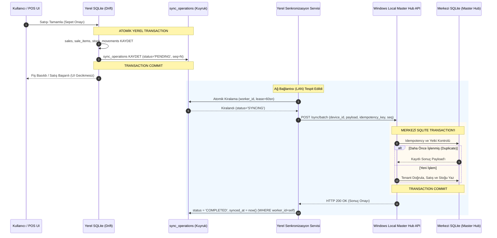
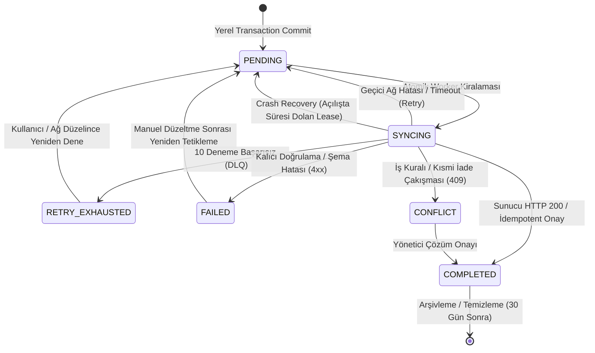
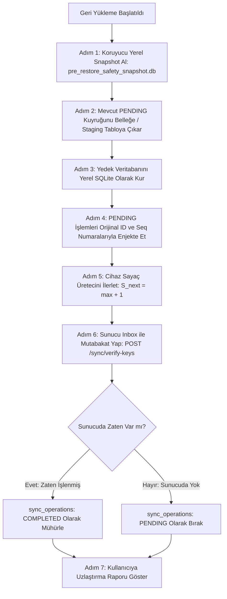

# Market Management System (MMS) — Offline Senkronizasyon ve Outbox Protokolü Şartnamesi (Offline Synchronization & Outbox Protocol Specification)

**Doküman Kodu:** `OFFLINE_SYNC_PROTOCOL.md`  
**Sürüm:** 1.1 (Teknik Denetim Sonrası Sertleştirilmiş Sürüm)  
**Tarih:** 31 Ekim 2026  
**Durum:** Faz 0 — Senkronizasyon ve Outbox Mimari Protokol Tasarımı (Teknik Doğrulama Tamamlandı)  
**Ana Referans Doküman:** `MARKET_POS_AI_STUDIO_BUILD_PLANI.md` (v1.2.2)  
**İlgili Tasarım Dokümanları:** `docs/architecture/DATA_MODEL.md` (v1.1 Sertleştirilmiş), `docs/architecture/DATA_MODEL_DECISIONS.md` (v1.1), `docs/architecture/OFFLINE_SYNC_DECISIONS.md` (v1.1)  
**Denetim Raporu:** `docs/architecture/OFFLINE_SYNC_TECHNICAL_VALIDATION.md` (v1.0)  
**Girdi Kuralları:** `docs/ai/rules/offline-first.md`, `docs/ai/rules/clean-architecture.md`, `docs/ai/rules/security.md`, `docs/ai/rules/testing.md`  
**Teknik Proje / Klasör Adı:** `market-pos`  
**Ürün Tanımı:** Market Management System (MMS) — Profesyonel Market Yönetim SaaS Uygulaması  

---

## 1. Mimari Genel Bakış ve Temel Prensipler

Bu şartname, **Market Management System (MMS)** projesinde internet kesintilerinde yerel iş sürekliliğini, çoklu cihaz (Windows PC, Android/iOS mobil) eşitliğini ve veri bütünlüğünü sağlayan **Offline-First Senkronizasyon ve Outbox Protokolü**nü tanımlar.

### 1.1 Temel Mimari İlkeler (Sertleştirilmiş)

1. **Yerel İş Sürekliliği (Local Continuity First):** Satış yapma, barkod okuma, sepet yönetimi, stok takibi ve fiş yazdırma işlemleri internet bağlantısından **%100 bağımsızdır**. İnternet yokken hiçbir POS işlevi kilitlenemez veya geciktirilemez.
2. **Atomik Yerel Transaction:** İş mantığı varlığı (satış, stok hareketi vb.) ile bu işlemin senkronizasyon kaydı (`sync_operations`), yerel SQLite/Drift veritabanında **aynı atomik transaction içinde** kaydedilir. Biri olmadan diğeri asla var olamaz.
3. **Deterministik Cihaz FIFO Sıralaması:** Her cihaz kendi monotonik artan sıra numarasına (`client_sequence_number`) sahiptir. Aynı cihazın işlemleri sunucuya kesinlikle oluşturulma sırasıyla (FIFO) teslim edilir (`NEW-02`).
4. **Çift Yönlü Idempotency:** Ağ kopmalarında veya yeniden denemelerde aynı işlem sunucuya defalarca ulaşsa dahi sunucu tarafında asla mükerrer işlem (mükerrer satış, çift stok düşümü vb.) oluşmaz; ilk işlemin sonucu idempotent olarak döndürülür.
5. **Geçmişin Korunması ve Satışların Silinemezliği:** Gerçekleşmiş satış fişleri ve append-only stok hareketleri hiçbir çakışma senaryosunda sessizce silinemez veya ezilemez (`BR-SYNC-06`). Çakışmalar denetim kayıtları (`audit_logs`) ile belgelenir.
6. **Meta-Veri ve Medya Şeridi Ayrımı (`FND-SYNC-02`):** Tüm ilişkisel işlemler (ürünler, fiyatlar, satışlar, stok hareketleri) tek bir sıralı **Meta-Veri Şeridi (Lane 1)** üzerinde nedensel bağımlılıklarıyla işlenir. Yalnızca ikili dosya yüklemeleri (ürün fotoğrafları) bağımsız **Medya Şeridi (Lane 2)** üzerinden asenkron aktarılır.
7. **Restore Sırasında İşlem Değişmezliği (`FND-SYNC-01`):** Eski bir yedek yüklense dahi yerel bekleyen işlemlerin kimlikleri ve sıra numaraları asla yeniden numaralandırılmaz (immutable); yalnızca gelecekteki işlemleri üreten sayaç üreteci güncellenir.
8. **Sunucu Tarafı Atomik İşlem Kaydı:** Sunucuya gelen işlem, iş mantığı tabloları (`sales`, `stock_balances`) ile merkezi SQLite transaction'ı içinde atomik yazılır.

---

### 1.2 Senkronizasyon Mimari Akış Diyagramı



---

## 2. Outbox State Machine (Kuyruk Durum Çizelgesi)

Uç cihaz yerel veritabanındaki her senkronizasyon kaydı (`sync_operations`), deterministik ve hataya dayanıklı bir durum makinesine tabidir:



---

### 2.1 Durum Tanımları ve Geçiş Koşulları

| Durum (`status`) | Tanım ve Açıklama | Geçiş Koşulu (Giriş) | İzin Verilen Sonraki Durumlar | Hata ve Yeniden Başlatma Davranışı | Kullanıcı Arayüzü Gösterimi |
|---|---|---|---|---|---|
| **`PENDING`** | İşlem yerelde atomik olarak kaydedildi; sunucuya gönderilmeyi bekliyor. | Yerel transaction commit edildiğinde varsayılan başlangıç durumu. | `SYNCING` | Uygulama açılışında doğrudan okunur; bekleyen sayaç artar. | Sarı / Beklemede ikonu ("Senkronizasyon bekliyor") |
| **`SYNCING`** | İşlem belirli bir worker tarafından kiralandı (`locked_by_worker_id`) ve ağ üzerinden sunucuya gönderildi. | Senkronizasyon worker'ı atomik `UPDATE` ile lease aldığında (`lease_expires_at = now() + 60sn`). | `COMPLETED`, `PENDING`, `RETRY_EXHAUSTED`, `FAILED`, `CONFLICT` | **Crash Güvencesi:** Uygulama bu durumdayken kapanırsa, açılışta `lease_expires_at < now()` olan kayıtlar `PENDING` yapılır. | Mavi / Dönen senkronizasyon ikonu |
| **`COMPLETED`** | Sunucu işlemi başarıyla işledi veya idempotent olarak onayladı. | Sunucudan `HTTP 200 OK` ve geçerli sunucu teyidi alındığında. | `[*]` (Arşiv) | Kalıcı nihai durumdur; tekrar gönderilmez. Drift `synced_at` mühürlenir. | Yeşil / Başarılı tık ikonu |
| **`RETRY_EXHAUSTED`** | Geçici hata (ağ, 5xx) nedeniyle 10 kez denendi; ancak tavan sınıra ulaştı (Dead-Letter Queue). | `retry_count >= 10` olduğunda. | `PENDING` (Bağlantı düzelince veya kullanıcı "Tekrar Dene" deyince) | Diğer bağımsız işlemlerin akışını tıkamaz; özel inceleme listesine düşer. | Turuncu / Uyarı ikonu ("Tekrar deneme sınırı aşıldı") |
| **`FAILED`** | İşlem kurtarılamaz bir istemci/doğrulama hatası aldı (Ör. HTTP 400 Bad Request, bozuk şema, tampering). | Sunucu isteği deterministik olarak reddettiğinde. | `PENDING` (Yazılım güncellemesi / veri düzeltmesiyle) | Kuyruğu tamamen durdurmaz; inceleme listesine düşer. | Kırmızı / Hata ikonu ("Veri hatası - İnceleme gerekli") |
| **`CONFLICT`** | İşlem sunucuda bir iş kuralı kısıtına takıldı (Ör. satılanı aşan çoklu kısmi iade). | Sunucudan `HTTP 409 Conflict` döndüğünde. | `COMPLETED` (Yönetici onaylayınca) | İşlem kaydı korunur; yönetici ekranında çakışma çözümü beklenir. | Mor / Çakışma ikonu ("Yönetici onayı bekliyor") |

---

### 2.2 Atomik Worker Kiralaması ve Çökme Kurtarma (`FND-SYNC-03`)

1. **Atomik Kiralama (Atomic Lease Acquisition):**  
   Birden fazla iş parçacığının (timer, network listener, UI) aynı işlemi almasını önlemek için yerel SQLite write lock altında atomik güncelleme yapılır:
   ```sql
   UPDATE sync_operations 
   SET status = 'SYNCING', 
       locked_by_worker_id = :worker_id, 
       lease_expires_at = datetime('now', '+60 seconds'),
       last_attempt_at = datetime('now')
   WHERE id = (
     SELECT id FROM sync_operations 
     WHERE status = 'PENDING' 
        OR (status = 'SYNCING' AND lease_expires_at < datetime('now'))
     ORDER BY client_sequence_number ASC LIMIT 1
   );
   ```
2. **Stale Worker (Geciken Yanıt) Koruması:**  
   Bir worker ağ gecikmesi veya donma nedeniyle 60 saniyeden sonra yanıt alırsa:
   ```sql
   UPDATE sync_operations 
   SET status = 'COMPLETED', synced_at = datetime('now')
   WHERE id = :id AND locked_by_worker_id = :my_worker_id;
   ```
   Eğer lease başka bir worker tarafından devralınmışsa `my_worker_id` eşleşmez, etkilenen satır 0 olur; bayat yanıt yerel veriyi bozmaz.
3. **Çökme Kurtarma (Crash Sweep):**  
   Uygulama açılışında `WHERE status = 'SYNCING' AND lease_expires_at < datetime('now')` sorgusuyla süresi dolan tüm kilitler `PENDING` durumuna geri alınır.

---

## 3. Deterministik FIFO ve Cihaz Sıralaması

### 3.1 `client_sequence_number` Çalışma Mekanizması

1. **Cihaz Bağımsızlığı:** Her kayıtlı donanım (`device_id`), yerel Drift veritabanında bağımsız bir sayaç tablosu (`device_sync_sequence`) ile kendi monotonik artan sıra numarasını üretir:
   $$S_{d, n+1} = S_{d, n} + 1$$
2. **Atomik Üretim:** Sıra numarası, ilgili satış/hareket kaydı ve `sync_operations` satırı ile aynı yerel transaction içinde alınır. Transaction iptal olursa numara tüketilmez (rollback edilir).
3. **Değişmezlik (Immutability on Retry):** Ağ hatası nedeniyle işlem 10 kez tekrar denense dahi, `idempotency_key`, `id` ve `client_sequence_number` **kesinlikle değiştirilemez**.
4. **Küresel Sıralama Ayrımı:** Farklı cihazlar arasında ($D_1$ ve $D_2$) sıra numaraları kıyaslanamaz. Sunucu her cihazın kuyruğunu kendi içinde sıralı kabul eder.

---

### 3.2 Kuyruk Blokajı ve Sıra Numarası Boşluğu (Gap) Kurtarma Kuralları

1. **Bağımlılık Tespiti:**  
   - Aynı varlığa ait ardışık işlemler (Örnek: `entity_id = sale-123` olan satış ve ardından gelen aynı fişin iadesi) **bağımlıdır**. Önceki tamamlanmadan sonraki gönderilemez.
   - Farklı varlıklar (Örnek: Kasa 1'deki ekmek satışı ile 10 dakika sonraki deterjan satışı) **bağımsızdır**.
2. **Kuyruk Boşluğu (Gap Recovery):**  
   - Sunucu tarafında $D_1$ cihazından gelen paket taranırken sıra numarası $N$'den $N+2$'ye atlamışsa (arada $N+1$ eksikse):
   - Sunucu isteği `HTTP 409 Conflict (CODE: SEQUENCE_GAP_DETECTED, EXPECTED: N+1, RECEIVED: N+2)` ile reddeder.
   - İstemci yerel kuyruğunu tarayarak $N+1$ numaralı işlemi tespit eder ve kuyruğu baştan senkronize eder.

---

## 4. Idempotency ve Sunucu Kabul Protokolü

Sunucu merkezi veritabanında tüm senkronizasyon isteklerini denetleyen kalıcı bir **Sunucu Inbox Defteri** (`processed_operations`) barındırır:

```text
processed_operations Tablosu (Sunucu Katmanı):
- id: UUID (PK)
- tenant_id: UUID (FK)
- device_id: UUID (FK)
- idempotency_key: TEXT (UNIQUE: tenant_id + idempotency_key)
- client_sequence_number: BIGINT
- request_hash: TEXT (Payload SHA-256 Hash'i)
- response_payload: JSONB (İstemciye dönülen orijinal sonuç)
- status: TEXT ('PROCESSED', 'REJECTED')
- processed_at: TIMESTAMPTZ
```

---

### 4.1 Altı Kritik Senaryonun Analizi ve Davranış Protokolü

---

#### Senaryo 1: İstek Sunucuya Ulaşmadan Bağlantı Kesildi
- **Durum:** İstemci isteği gönderir; ancak yerel ağ koptuğu için paket sunucuya hiç ulaşmaz.
- **Sunucu Durumu:** Sunucu işlemden tamamen habersizdir; veritabanında hiçbir iz oluşmaz.
- **İstemci Davranışı:** HTTP Client `SocketException` / `Timeout` yakalar. Yerel kayıt `PENDING` durumuna döner, `retry_count` 1 artırılır. Exponential backoff süresi sonunda aynı `idempotency_key` ve `client_sequence_number` ile tekrar denenir.

---

#### Senaryo 2: Sunucu İşlemi Uyguladı Ancak Yanıt İstemciye Ulaşmadı
- **Durum:** Sunucu satışı başarıyla `sales` ve `processed_operations` tablolarına yazar. Tam `HTTP 200` cevabı dönerken baz istasyonu kopar; istemci cevabı alamaz ve zaman aşımına uğrar.
- **İstemci Davranışı:** İstemci işlemin akıbetini bilmediği için bir sonraki denemede **aynı `idempotency_key` ile paketi tekrar post eder**.
- **Sunucu Davranışı:**  
  1. Sunucu `processed_operations` tablosunu kontrol eder.
  2. `(tenant_id, idempotency_key)` kaydının zaten mevcut olduğunu görür.
  3. İşlemi **ikinci kez veritabanına yazmaz**, stoğu mükerrer düşmez.
  4. Daha önce sakladığı `response_payload` sonucunu anında `HTTP 200 OK` olarak istemciye geri döner.
- **Sonuç:** Mükerrer satış sıfır riskle önlenir; istemci başarı teyidini alarak durumu `COMPLETED` yapar.

---

#### Senaryo 3: İstemci Aynı İşlemi Tekrar Gönderdi (Standart Retry)
- **Durum:** İstemci ağ bağlantısı sağlandığında kuyruktaki bekleyen işlemi sunucuya iletir.
- **Davranış:** Senaryo 2 ile aynı şekilde sunucu Inbox tablosu üzerinden idempotent onay döner.

---

#### Senaryo 4: Aynı Operation ID / Idempotency Key Farklı Payload ile Gönderildi
- **Durum:** Kötü niyetli bir müdahale veya istemci yazılımındaki ağır bir hata nedeniyle, daha önce kullanılan `idempotency_key` ile içeriği değiştirilmiş farklı bir satış/fiyat gönderilir.
- **Sunucu Koruması:**  
  1. Sunucu gelen payload'ın SHA-256 özetini alır: $H_{\text{new}} = \text{SHA256}(\text{payload})$.
  2. `processed_operations` tablosundaki orijinal $H_{\text{orig}}$ ile kıyaslar.
  3. Eğer $H_{\text{new}} \ne H_{\text{orig}}$ ise işlem derhal durdurulur.
  4. Sunucu `HTTP 422 Unprocessable Entity (CODE: IDEMPOTENCY_PAYLOAD_MISMATCH)` fırlatır.
  5. `audit_logs` tablosuna güvenlik alarmı yazılır; işlem `FAILED` durumuna çekilir.

---

#### Senaryo 5: Aynı Idempotency Key Farklı Operation ID ile Gönderildi
- **Durum:** İstemci aynı `idempotency_key` değerini yanlışlıkla başka bir yerel işlemde kullandı.
- **Sunucu Davranışı:** `processed_operations` tablosunda `(tenant_id, idempotency_key)` tekil anahtar kısıtı ihlali oluşur. Sunucu işlemi reddeder ve `HTTP 409 Conflict (CODE: DUPLICATE_IDEMPOTENCY_KEY)` döner.

---

#### Senaryo 6: İstemci Yanıtı Aldı Ancak Yerel Durumu Güncelleyemeden Kapandı
- **Durum:** Sunucu `HTTP 200 OK` döner. İstemci cevabı alır; ancak tam yerel SQLite veritabanında `status = 'COMPLETED'` yazacakken telefonun pili biter.
- **Kurtarma:**  
  1. Telefon açıldığında işlem yerelde hâlâ `SYNCING` veya `PENDING` görünür.
  2. İstemci açılışta işlemi sunucuya tekrar gönderir.
  3. Sunucu Senaryo 2 gereği idempotent olarak "Bu işlem zaten tamamlandı" yanıtını ve orijinal payload'ı döner.
  4. İstemci bu kez yerel veritabanında kaydı `COMPLETED` yapar. Sistem tam tutarlılığa ulaşır.

---

## 5. Retry ve Hata Sınıflandırması

| Hata Tipi | HTTP Kodu | Otomatik Retry? | Strateji ve Gecikme | Maks. Retry | Sonraki Durum | Bloke Eder mi? | Kullanıcı Müdahalesi |
|---|---|---|---|---|---|---|---|
| **Network Unavailable** | Yok / Client Ex | **EVET** | Ağ bağlantı dinleyicisi + Backoff | Sınırsız | `PENDING` | Bağımlı olanları | Hayır (Otomatik) |
| **Timeout / Socket Drop** | 408 / Client Ex | **EVET** | Full Jitter Exponential Backoff | 10 | `RETRY_EXHAUSTED` | Bağımlı olanları | 10 deneme sonra uyarı |
| **Server Error** | 500, 502, 503, 504 | **EVET** | Full Jitter Exponential Backoff | 10 | `RETRY_EXHAUSTED` | Bağımlı olanları | 10 deneme sonra uyarı |
| **Authentication Expired** | 401 Unauthorized | **EVET** (1 Kez) | Token Refresh ardından anında | 2 | `PENDING` | Tüm kuyruğu | Refresh başarısızsa (Giriş yap) |
| **Authorization Denied** | 403 Forbidden | **HAYIR** | İptal / Güvenlik reddi | 0 | `FAILED` | Tüm kuyruğu | Evet (Cihaz yetkisi iptal) |
| **Validation / Tampering** | 400 / 422 Unproc. | **HAYIR** | Manuel İnceleme (DLQ) | 0 | `FAILED` | Yalnızca ilgili kaydı | Evet (Hatalı veri incelemesi) |
| **Business Conflict** | 409 Conflict | **HAYIR** | Çakışma Yönetim Masası | 0 | `CONFLICT` | İlgili varlığı | Evet (Yönetici çakışma onayı) |
| **Duplicate Operation** | 200 (Inbox) | **HAYIR** | Idempotent olarak onaylandı | 0 | `COMPLETED` | Yok | Hayır (Otomatik kapanır) |

---

### 5.1 Full Jitter Exponential Backoff Algoritması

$$T_{\text{wait}} = \text{uniform}(0, \; \min(T_{\max}, \; T_{\text{base}} \times 2^{\text{retry\_count}}))$$

- **$T_{\text{base}}$:** 2 saniye
- **$T_{\max}$:** 60 saniye
- **Sayaç Artışı:** `retry_count` değeri, ağ isteği hata ile sonuçlandığı anda (catch bloğunda) artırılır; ardından bekleme süresi hesaplanır.

---

## 6. Conflict Resolution (Çakışma Çözüm) Matrisi

| Veri Türü | Çakışma Senaryosu | Çözüm Politikası | Last-Write-Wins (LWW)? | Kayıt Korunur mu? | Audit Kaydı? | Açıklama ve Kural |
|---|---|---|---|---|---|---|
| **Ürün Bilgileri** (Ad, Marka) | 2 cihazda farklı ad girildi | LWW (Sunucu Zamanı) | Evet | Evet | Hayır | En son güncellenen metin geçerli olur. |
| **Satış Fiyatı** | 2 cihazda çevrimdışıyken farklı fiyat girildi | **Çift Değer Koruma & Yönetici Onayı** | **HAYIR** | **EVET (İki fiyat da saklanır)** | **EVET** (`PRICE_CONFLICT`) | Kasada yerel fiyatla satış devam eder; yönetici dashboard'dan onaylar (`BR-SYNC-05`). |
| **Maliyet Fiyatı** | Fatura girişi çakışması | Son Tarihli Giriş | Evet | Evet | Evet | En güncel toptancı faturası esas alınır. |
| **Kategori** | İsim değişikliği / Sıralama | LWW | Evet | Evet | Hayır | En son durum uygulanır. |
| **Stok Hareketleri** | İki cihaz aynı ürünü sattı | **Append-Only (Toplama)** | **HAYIR** | **EVET (İki hareket de korunur)** | **EVET** | Her iki satışın stok düşümü de işlenir. Stok negatif bakiyeye düşebilir (`BR-STK-02`, `BR-SYNC-06`). |
| **Satış Kayıtları** | Çevrimdışı fişler | **Kesin Koruma** | **HAYIR** | **EVET** | Hayır | Tüm satışlar sunucuda ayrı kayıtlar olarak birleştirilir. Ciro kümülatif toplanır. |
| **Satış İptali** | İptal edilen fişe yeni işlem | Idempotent İptal | N/A | Evet | Evet | İptal geçerlidir; satış cirodan düşer, stoklar iade edilir (`BR-POS-08`). |
| **Kısmi İadeler** | Satılan miktarı aşan 2 cihaz iadesi | **İlk Gelen Kazanır (FCFS) + Conflict** | **HAYIR** | **EVET** | **EVET** (`REFUND_CONFLICT`) | Kalan miktarı aşan 2. iade sunucuda `CONFLICT` durumuna alınır; yöneticiye alarm verilir (`FND-04`). |
| **Stok Sayımları** | Sayım sürerken satış / mal kabul | **Ara Hareket Uzlaştırması** | **HAYIR** | **EVET** | Evet | $Counted - Sales + Entries$ matematiksel formülü işletilir (`BR-STK-09`). |
| **Açık Sepetler** | Aynı sepeti 2 cihaz düzenlemeye çalıştı | **Cihaz Kilit Sahipliği** | Hayır | Evet | Hayır | `locked_by_device_id` sahibi düzenler; diğer cihaz salt okunur görür (`BR-POS-06`). |
| **Kullanıcı / Cihaz** | Cihaz yetki iptali | Sunucu Yetkisi Önceliklidir | Hayır | Evet | Evet | İptal edilen cihazın senkronizasyon yetkisi anında düşürülür (`BR-SEC-04`). |
| **Ürün Görselleri** | Farklı görsel yükleme | LWW (Son yüklenen dosya) | Evet | Evet | Hayır | CDN dosya yolu son görsel ile güncellenir. |

---

## 7. Çoklu Cihaz Senaryoları ve Tehdit Modeli (Multi-Device Scenarios)

---

### Senaryo 1: PC ve Telefon Aynı Anda Çevrimiçi
- **Akış:** Windows Flutter arayüzünde yapılan satış, yerel loopback üzerinden Windows Service API'sine iletilir ve merkezi SQLite veritabanına yazma işlemini yalnızca Windows Service gerçekleştirir (Windows Flutter UI → Windows Service API → Merkezi SQLite; UI'nin SQLite dosyasına doğrudan erişimi veya yazımı yoktur). İşlem merkezi veritabanına kaydedildikten sonra yerel ağ (LAN) üzerinden mobil cihazlara aktarılır (Gelecek SaaS aşamasında Supabase Realtime desteklenecektir).
- **Sonuç:** Stoklar ve dashboard her iki cihazda eşzamanlı güncel kalır.

### Senaryo 2: Windows Service / PC Erişilemez, Telefon Operasyonel
- **Akış:** Windows Service kapalı veya Windows PC erişilemez olduğunda, mobil cihazlar (Android/iOS) kendi bağımsız yerel Drift + SQLite veritabanları ve Outbox kuyruğu üzerinden çevrimdışı satış yapmaya devam eder (`sync_operations.status = 'PENDING'`). Pilot mimarisinde Windows kapalıyken telefonların buluta senkronize olması söz konusu değildir (bulut senkronizasyonu Gelecek SaaS kapsamındadır).
- **Masaüstü Durumu (Açık Konu):** Windows Flutter UI, Windows Service API'si üzerinden çalıştığından; Windows Service erişilemezken masaüstü uygulamasının çevrimdışı satış yapıp yapamayacağı henüz kesinleşmemiş olup Aşama 6B-2 kapsamında karara bağlanacak açık bir teknik/tasarım konusudur (Windows Flutter UI'ye peşinen yerel bir Drift veritabanı ataması yapılmamıştır).
- **Sonuç:** Mobil cihazlar kesintisiz satış yapabilir; Windows Service tekrar erişilebilir olduğunda bekleyen Outbox işlemleri yerel ağ üzerinden Windows Service API'sine aktarılır.

### Senaryo 3: İki Cihaz da Çevrimdışı
- **Akış:** Her iki mobil cihaz da kendi yerel SQLite veritabanlarında satış yapar, eksi stoğa izin verir ve yerel Outbox kuyruklarını biriktirir.
- **Sonuç:** Sıfır veri kaybı, sıfır işlem engeli.

### Senaryo 4: Uzun Süre Çevrimdışı Kalan Cihazın Bağlanması (Catch-up Sync)
- **Akış:** Cihaz uzun süre sonra yerel ağ üzerinden Windows Local Master Hub'a bağlandığında:
  1. Önce bekleyen yerel Outbox kuyruğunu Windows Service API'sine deterministik FIFO sırasıyla aktarır.
  2. Ardından sunucudan `updated_at > son_senkronizasyon_zamani` olan güncel ürün, fiyat ve stok değişikliklerini çeker (delta sync).
- **Sonuç:** Uç cihazın yerel veri tabanı, merkezi veritabanındaki son durumla uyumlu hâle getirilir (ağ gecikmeleri ve diğer cihazlardan bekleyen işlemler nedeniyle anlık mutlak eşitlik garantisi verilmez).

### Senaryo 5: Aynı Ürün İki Cihazda Aynı Anda Güncellendi (Fiyat Çakışması)
- **Akış:** PC'de kola fiyatı 30 TL, telefonda 32 TL yapıldı.
- **Çözüm:** `BR-SYNC-05` devreye girer. Kasalarda yerel işlemler durmaz. Sunucu çakışmayı tespit eder; `price_history` tablosuna her iki teklifi de yazar; yönetici ekranına onay kartı düşer. Yönetici seçene kadar her kasa kendi yerel fiyatıyla satışa devam eder.

### Senaryo 6: İki Cihaz Aynı Stoktan Satış Yaptı (Stok Eksiye Düştü)
- **Akış:** Sistemde 1 adet kalan çikolatayı hem PC hem telefon çevrimdışıyken sattı.
- **Çözüm:** İki satış da gerçek fiziksel operasyondur; iptal edilmez. Bağlantı sağlandığında stok $1 - 1 - 1 = -1$ olur. Dashboard'da eksi stok listesinde görünür. Toptancı faturası girildiğinde stok artıya döner (`BR-STK-02`, `BR-SYNC-06`).

### Senaryo 7: İki Cihaz Aynı Satıştan Kısmi İade Yaptı
- **Akış:** 5 adet satılmış fişten PC'de 3 adet, telefonda 3 adet iade alındı ($3 + 3 = 6 > 5$).
- **Çözüm:** İlk ulaşan cihazın iadesi sunucuda onaylanır. İkinci cihaz sunucuya ulaştığında kısıt patlar. İşlem sunucuda `CONFLICT` durumuna düşer. Kasiyere "Bu fişte satılandan fazla iade tespit edildi, yönetici incelemesi bekleniyor" uyarısı verilir (`FND-04`).

### Senaryo 8: Bir Cihazda Satış İptal Edildi, Diğerinde Yeni Satış Oldu
- **Akış:** PC'de satış zaman sınırsız iptal edildi (`sales.status = 'CANCELLED'`), telefonda yeni satış yapıldı.
- **Çözüm:** PC iptal hareketini (`SATIS_IPTALI`) sunucuya göndererek stoğu geri artırır; telefonun satışı da stoktan düşer. İki hareket de `stock_movements` defterinde tarih sırasıyla yerini alır.

### Senaryo 9: Cihaz Kayboldu / Yetkisi İptal Edildi (Tehdit Modeli ve Gerçeklik Sınırları)
- **Fiziksel Sınır:** Cihaz çevrimdışıyken sunucudan uzaktan kilitlenemez.
- **Güvence 1 (TTL Sınırı):** Cihaz çevrimdışı kaldığı sürece en fazla 7 gün çalışabilir (`device_sessions.expires_at`). 7 gün dolduğunda yerel oturum kilitlenir (`BR-SEC-06`).
- **Güvence 2 (Ağ Temasında Yaptırım):** Cihaz yerel ağ üzerinden Master Hub API'sine bağlandığı anda istek `HTTP 403 Forbidden (CODE: DEVICE_REVOKED)` alır. Cihazın Master Hub API erişim yetkisi derhal düşürülür; ancak cihazın yerel veritabanı silinmez, Outbox kayıtları ve bekleyen satışları korunur (`BR-SEC-04`).
- **Arayüz Davranışı ve Satışların Kurtarılması (Açık Konular):** İptal edilen cihazın istemci kullanıcı arayüzü davranışı (satış ekranının durumu, uyarı banner'ı vb.) ve çevrimdışıyken yapılmış bekleyen meşru satışların yönetici tarafından nasıl kurtarılıp merkezi sisteme aktarılacağı henüz kesinleşmemiş açık kararlar olup Aşama 6B-2 kapsamında değerlendirilecektir.

### Senaryo 10: Cihaz Eski Verilerle Yeniden Bağlandı
- **Akış:** Bir cihaz 3 ay çekmecede kaldıktan sonra açıldı.
- **Çözüm:** 7 günlük çevrimdışı süresi dolduğu için oturum açma ekranına yönlendirilir. Giriş yapıldığında yerel katalog sıfırdan merkezi katalogla eşitlenir.

---

## 8. Yedek Geri Yükleme ve Outbox Uzlaştırması (`FND-SYNC-01` Sertleştirilmiş)



---

### 8.1 Güvenli Geri Yükleme Kuralları

1. **İşlem Değişmezliği Kuralı (Immutability):**  
   Henüz sunucuya gitmemiş yerel işlemlerin `id`, `idempotency_key`, `client_sequence_number` ve `payload` değerleri **KESİNLİKLE YENİDEN NUMARALANDIRILMAZ**. Orijinal değerler korunur.
2. **Sayaç Üreteci İlerletme Formülü:**  
   Yalnızca gelecekte oluşturulacak **YENİ** işlemlerin numara çakışmasını engellemek için sayaç tablosu (`device_sync_sequence`) güncellenir:
   $$S_{\text{next\_generator}} = \max(S_{\text{backup\_max}}, \; \max(S_{\text{staged\_pending\_seq}})) + 1$$
3. **Sunucu Inbox Mutabakatı (Deduplication):**  
   Cihaz `POST /sync/verify-keys` ile bekleyen anahtarları sunucuya sorar. Sunucu "Bu işlem bende zaten var" dediği anda yerel kayıt `COMPLETED` yapılır; mükerrer iş mantığı çalıştırılmaz.
4. **Çift Restore Güvenliği:** Restore işlemi arka arkaya kaç kez çalıştırılırsa çalıştırılsın, idempotency ve snapshot sayesinde hiçbir mükerrer kayıt oluşmaz, veri kaybı yaşanmaz.

---

## 9. Güvenlik ve Yetkilendirme Protokolü

1. **Cihaz Donanım Kimliği ve Oturum:**  
   - İstek başlıkları: `X-Device-Id`, `X-Device-Signature` (HMAC-SHA256), `Authorization: Bearer <JWT>`.
2. **Sunucu Tarafı Güvenlik ve Yetkilendirme:**  
   - İstemciden gelen `tenant_id` tek başına asla yetki sayılmaz; pilot aşamasında merkezi API iş mantığı seviyesinde doğrulanır; gelecek bulut SaaS aşamasında ise RLS politikalarıyla doğrulanır.
3. **Payload Temizliği:** Outbox kayıtlarında parola, Google Drive API anahtarı veya gizli oturum sırrı tutulamaz.

---

## 10. Ağ, Performans ve Şerit Ayrımı (`FND-SYNC-02` Sertleştirilmiş)

### 10.1 İki Şeritli (Dual-Lane) Kuyruk Mimarisi

```text
┌─────────────────────────────────────────────────────────────────────────────┐
│                       YEREL UÇ CİHAZ SENKRONİZASYONU                         │
├─────────────────────────────────────────────────────────────────────────────┤
│  LANE 1: META-VERİ ŞERİDİ (Yüksek Öncelik / Sıralı FIFO)                    │
│  - Kapsam: products, prices, sales, sale_items, refunds, stock_movements     │
│  - Kural: Tek ortak client_sequence_number ile kesin nedensel FIFO sırası.  │
│  - Boyut: Küçük JSON payload (1-10 KB). Anlık gönderilir.                   │
├─────────────────────────────────────────────────────────────────────────────┤
│  LANE 2: MEDYA ŞERİDİ (Düşük Öncelik / Asenkron Blob Depolama)              │
│  - Kapsam: product_images (JPEG / WebP fotoğrafları)                        │
│  - Kural: Sıralı değildir; arka planda parçalı yüklenir.                    │
│  - İzolasyon: Görsel yükleme hatası satış senkronizasyonunu ASLA engellemez.│
└─────────────────────────────────────────────────────────────────────────────┘
```

---

### 10.2 Batch Boyutlandırma ve Hız Sınırları
- **Batch Boyutu:** En fazla 20 işlem veya en fazla 1 MB payload.
- **Paralellik Sınırı:** Cihaz başına aynı anda **yalnızca 1 aktif Meta-veri yazma akışı (Single-Flight Write Stream)** çalıştırılır. FIFO sırası ağda bozulamaz.
- **Platform Adaptörleri:** Windows'ta sürekli Dart Isolate dinleyicisi; Android'de `WorkManager`, iOS'ta `BGTaskScheduler` adaptörleri.

---

## 11. Test Senaryoları ve Doğrulama Matrisi (14 Kritik Test)

| Test No | Senaryo | Başlangıç Koşulu | İşlem Adımları | Beklenen Sonuç |
|---|---|---|---|---|
| **T-01** | Aynı İşlemin 10 Kez Gönderilmesi | İstemci kuyruğunda $seq = 101$ satışı | İstek ardışık 10 kez post edilir | 1 kez yazılır; 9 istek Inbox'tan `HTTP 200` döner. Stok tek kez düşer. |
| **T-02** | İstek Ortasında Ağ Kesilmesi | Satış onaylandı, HTTP başladı | İstek gönderilirken Wi-Fi kapatılır | İstemci `SocketException` yakalar, durum `PENDING` kalır. Fiş yerelde basılmıştır. |
| **T-03** | Sunucu Yanıtının Kaybolması | İstemci satışı gönderdi | Sunucu yazar; ancak yanıt paketi ağda düşer | İstemci zaman aşımıyla tekrar gönderir. Sunucu idempotent onay döner. Mükerrer oluşmaz. |
| **T-04** | `SYNCING` Sırasında Uygulama Kapanması | İşlem `SYNCING` durumunda | Uygulama `SIGKILL` ile zorla kapatılır | Açılışta lease süresi (60 sn) dolan kayıt `PENDING` yapılır. Sıfır veri kaybı. |
| **T-05** | Cihazın 7 Gün Çevrimdışı Kalması | İnternetsiz 7 gün satış yapıldı | 7. gün internete bağlanır | Önce token yenilenir, ardından tüm satışlar FIFO ile sunucuya aktarılır. |
| **T-06** | Aynı Ürüne İki Cihazdan Fiyat Değişimi | PC 25 TL, mobil 28 TL yaptı | İki cihaz da bağlanır | Sunucu çakışmayı yakalar, `price_history`'ye yazar. Yönetici onaylayana dek yerel fiyat sürer (`BR-SYNC-05`). |
| **T-07** | Eşzamanlı Stok Satışları (Eksi Stok) | Rafta 1 adet süt var | PC ve mobil aynı anda 1'er adet satar | İki satış da kaydedilir; stok $-1$ olur. Fişler silinmez (`BR-STK-02`, `BR-SYNC-06`). |
| **T-08** | Eşzamanlı Kısmi İadeler | 5 adetlik fişten 3'er adet iade | İki cihaz bağlanır | İlk cihaz onaylanır; 2. cihaz `(refunded_qty + 3 <= 5)` kısıtıyla `CONFLICT` olur. |
| **T-09** | Restore Sonrası Outbox Uzlaştırması | 3 adet gönderilmemiş satış var; eski yedek açılır | Restore protokolü çalıştırılır | Snapshot alınır; 3 satış orijinal ID/seq ile korunur; sayaç ilerletilir; veri kaybı 0 olur. |
| **T-10** | Cihaz Yetkisinin İptal Edilmesi | Kayıp telefon çevrimdışı işlem yaptı | Yönetici iptal eder; telefon bağlanır | İstek `HTTP 403 DEVICE_REVOKED` alır; telefon yerel oturumu kilitler. |
| **T-11** | Bozuk Payload Gönderimi | Eksik JSON alanı olan bozuk işlem | Sunucuya post edilir | Sunucu `HTTP 400` döner; işlem `FAILED` (DLQ) olur; kuyruk kilitlenmez. |
| **T-12** | Sıra Numarası Boşluğu (Gap) | Sunucu $seq = 10$'da iken $seq = 12$ gelir | İstemci hatalı paket atar | Sunucu `HTTP 409 SEQUENCE_GAP` döner; istemci $seq = 11$'den itibaren sırayla yollar. |
| **T-13** | Aynı Op ID ile Farklı Payload (Tampering) | `idempotency_key = op-99` 100 TL onaylı | Aynı key ile 200 TL post edilir | SHA-256 hash uyuşmazlığı tespit edilir; `HTTP 422` fırlatılır; audit log atılır. |
| **T-14** | Tenant İzolasyonu İhlali Girişimi | Tenant A kullanıcısı payload'a Tenant B yazar | Paket sunucuya post edilir | Merkezi API güvenlik katmanı yakalar; `HTTP 403` ile engellenir. Veri sızmaz (Gelecek SaaS için RLS ile doğrulanır). |

---

## 12. Açık ve Öneri Kapsamındaki Teknik Kararlar Özeti

| Madde No | Konu | Durum | Planlanan Aşama / Açıklama |
|---|---|---|---|
| 1 | `sync_operations` arşivleme ve temizleme süresi (Önerilen: 30 gün) | `[PROPOSED]` | DDL ve Veritabanı Bakım Tasarımı |
| 2 | Mobil platformlarda arka plan senkronizasyon sıklığı (Pil optimizasyonu) | `[PROPOSED]` | Faz 1 Mobil Platform Entegrasyonu |
| 3 | Sunucu Inbox tablosu (`processed_operations`) partition ve temizlik politikası | `[PROPOSED]` | Gelecek SaaS / PostgreSQL Bakım Tasarımı (Merkezi SQLite için inbox/idempotency tasarımı Aşama 6B-2 açık konusudur) |
| 4 | Çoklu cihaz çevrimdışı sayım belirsizlik aralığı ($\pm 5$ dk) eşiği | `[PROPOSED]` | Saha ağ testleri |

---

## 13. Sonuç

Bu şartname ile:
- `sync_operations` tablosunun durum makinesi, worker kiralama ve kaza kurtarma kuralları netleştirilmiştir.
- Deterministik cihaz FIFO sıralaması, idempotency, retry stratejisi ve çoklu cihaz senaryoları tam bir matematiksel kesinliğe kavuşturulmuştur.
- Restore sırasında işlem kimliklerinin ve sıra numaralarının değişmezliği (`immutability`) güvence altına alınmıştır.
- İlişkisel işlemler (Meta-veri şeridi) ile görsel dosyaları (Medya şeridi) birbirinden ayrılarak kuyruk kilitlenmesi engellenmiştir.
- Doküman, Faz 0 mimari kurallarına ve bağlayıcı iş belgelerine %100 uyumludur.
