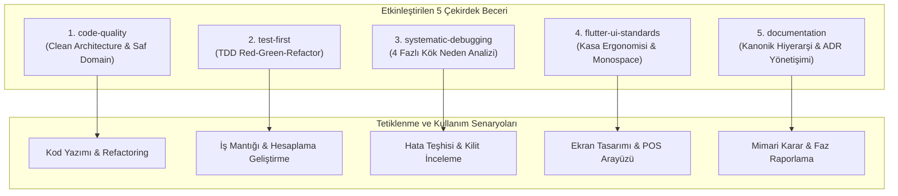

# MARKET MMS — DT-01.2 FINAL: Skill Activation & Integration Raporu

**Belge Kodu:** `DT_01_2_SKILLS_ACTIVATION_REPORT.md`  
**Tarih:** 6 Kasım 2026  
**Aşama:** Faz 1 — DT-01.2 Final Beceri Aktivasyonu ve Entegrasyonu  
**Durum:** Başarıyla Tamamlandı (Tüm 5 Beceri Etkinleştirildi)  
**Karar Yetkilisi:** Proje Sahibi (Açık Onay ve Kullanım Kararı Verildi)  
**İlgili Belgeler:** `.agents/registry/SKILL_REGISTRY.md`, `.agents/ATTRIBUTION.md`, `docs/compliance/DT_01_2_SKILLS_SECURITY_LICENSE_REVIEW.md`  

---

## 1. Yönetici Özeti ve Proje Sahibi Kararı

Proje sahibi; `.agents/skills/` dizini altında bulunan beş yapay zekâ becerisinin (`code-quality`, `test-first`, `systematic-debugging`, `flutter-ui-standards`, `documentation`) statik güvenlik ve lisans inceleme sonuçlarını değerlendirmiş; lisans kaynaklı belirsizlikleri bilerek kabul ederek **beş becerinin tamamının Market Management System (MMS) projesinde etkinleştirilmesini ve geliştirme süreçlerinde kullanılmasını onaylamıştır**.

Bu onay doğrultusunda:
1. Beş becerinin tamamı Google Antigravity Skill ekosisteminde resmi olarak etkinleştirilmiştir (`ACTIVE`).
2. Merkezi `.agents/registry/SKILL_REGISTRY.md` kayıt defteri güncellenmiştir.
3. Üçüncü taraf açık kaynak depoların (`obra/superpowers`, `ui-ux-pro-max-skill`) yasal haklarını korumak amacıyla ilgili dizinlere resmi `LICENSE` ve `NOTICE` dosyaları yerleştirilmiştir.
4. Kaynağı doğrudan doğrulanamayan iç derleme beceriler (`code-quality`, `documentation`) şeffafça işaretlenmiş; otomatik olarak tekil MMS mülkiyeti ilan edilmemiştir.
5. Becerilerin her istekte körlemesine yüklenmesini engelleyen **Kademeli Yükleme (Progressive Disclosure)** tetiklenme senaryoları tanımlanmıştır.
6. Hiçbir beceri dosyasının (`SKILL.md`) içeriği değiştirilmemiş, çekirdek metinler korunmuştur.

---

## 2. Etkinleştirilen Beş Beceri ve Kullanım Kapsamı

### 2.1. Beceri Detay Tablosu

| Beceri Adı | Birincil Sorumluluk | Uygulanan Standartlar | Antigravity Konumu | Durum |
| :--- | :--- | :--- | :--- | :---: |
| **`code-quality`** | Clean Architecture katman sınırları, saf Dart domain izolasyonu, immutability, kuruş tamsayı ve anti-overengineering. | `presentation -> domain <- data`, YAGNI, KISS, tek sorumluluk (SRP). | `.agents/skills/code-quality/SKILL.md` | **ACTIVE** |
| **`test-first`** | Test-Driven Development disiplini; para hesabı hassasiyeti, eksi stok ve transaction atomikliği testleri. | TDD 3 Kanunu, Red-Green-Refactor, `flutter test`. | `.agents/skills/test-first/SKILL.md` | **ACTIVE** |
| **`systematic-debugging`**| Kök neden analizi (RCA); rastgele kod düzenlemeyi engelleyen hipotez odaklı hata ayıklama. | 4 Fazlı RCA, SQLite WAL teşhisi (`busy_timeout >= 5000`), outbox lease analizi. | `.agents/skills/systematic-debugging/SKILL.md` | **ACTIVE** |
| **`flutter-ui-standards`**| Kasa satış ekranı dokunmatik ergonomisi, monospace para hizalama ve barkod odak yönetimi. | $\ge 48\text{ dp}$ dokunmatik hedef, Fitts Kanunu, tabular rakamlar, WCAG AAA kontrast, F1-F10 kısayolları. | `.agents/skills/flutter-ui-standards/SKILL.md` | **ACTIVE** |
| **`documentation`** | Mimari karar kayıtları (ADR), faz raporlaması ve dokümantasyon bütünlüğü. | Kanonik hiyerarşi (`AGENTS.md` -> `BUILD_PLANI` -> `PROJECT_STATUS`), ADR şablonları. | `.agents/skills/documentation/SKILL.md` | **ACTIVE** |

---

## 3. Registry Değişiklikleri ve Yönetim Kuralları

`.agents/registry/SKILL_REGISTRY.md` belgesinde gerçekleştirilen güncellemeler:
1. **Durum Güncellemesi:** Tüm becerilerin durumu `Verified` aşamasından **`ACTIVE`** aşamasına yükseltilmiştir.
2. **Kullanım Kapsamı Sütunu:** Her becerinin tam olarak hangi durumda devreye gireceğini tanımlayan "Tetiklenme Senaryosu" sütunu eklenmiştir.
3. **Kapsam Dışı Beceriler:** Kullanıcı tarafından elenen harici koleksiyonlar (`affaan-m/ECC`, `safe-edit`, `domain-modeling`, `pbakaus/impeccable`, web bileşenleri) açıkça dışlanmış olarak kayıt altında tutulmuştur.
4. **Bağlayıcı Sınırlar:** Hiçbir becerinin kök `AGENTS.md` ve mimari kuralları ezemeyeceği tescil edilmiştir.

---

## 4. Lisans ve Attribution Durumu

Proje sahibinin bilerek kabul ettiği hukuki çerçeve doğrultusunda, telif hakkı sahiplerinin haklarını koruyan belgeler hazırlanmış ve yerleştirilmiştir:

### 4.1. Oluşturulan Yasal Uyum Dosyaları

- **`.agents/ATTRIBUTION.md` (Yeni):** Tüm becerilerin kaynağını, upstream depolarını, yazarlarını ve proje sahibinin kullanım kararını özetleyen merkezi uyum belgesi.
- **`.agents/skills/test-first/LICENSE` & `NOTICE` (Yeni):** Jesse Vincent (`obra`) adına tam metin MIT lisansı ve MMS uyarlama bildirimi.
- **`.agents/skills/systematic-debugging/LICENSE` & `NOTICE` (Yeni):** Jesse Vincent (`obra`) adına tam metin MIT lisansı ve MMS uyarlama bildirimi.
- **`.agents/skills/flutter-ui-standards/LICENSE` & `NOTICE` (Yeni):** nextlevelbuilder adına tam metin MIT lisansı ve Flutter POS uyarlama bildirimi.
- **`.agents/skills/code-quality/NOTICE` (Yeni):** Matt Pocock tasarım prensiplerinden kavramsal olarak esinlenildiğini, doğrudan harici Dart upstream deposunun bulunamadığını, otomatik olarak tekil MMS mülkiyeti ilan edilmediğini ve proje sahibi onayıyla kullanıldığını belirten bildirim.
- **`.agents/skills/documentation/NOTICE` (Yeni):** Universal Project Template kavramsal uyarlaması olduğunu, harici doğrudan deposunun doğrulanmadığını ve proje sahibi onayıyla kullanıldığını belirten bildirim.

---

## 5. Güvenlik Kısıtları ve Kural Üstünlüğü

Beceri aktivasyonu model veya geliştirici için sınırsız bir özgürlük alanı yaratmaz. Aşağıdaki kurallar tüm becerilerden üstündür:

1. **Kullanıcı Onayı İlkesi:** Kullanıcı onayı olmadan mimari kararlar değiştirilemez, faz tamamlandı ilan edilemez, dosya silinemez veya commit/push yapılamaz.
2. **Git Bütünlüğü:** Force push (`--force`) ve commit geçmişini değiştirme (rebase/reset) kesinlikle yasaktır.
3. **Gizli Bilgi Yasağı:** `pepper.dpapi`, Windows DPAPI anahtarları, API secret'ları veya OAuth token'ları asla beceri metinlerine yazılamaz veya bu beceriler aracılığıyla dışarı sızdırılamaz.
4. **Komut Sınırları:** `test-first` tarafından önerilen `flutter test` veya `systematic-debugging` tarafından önerilen `PRAGMA` komutları yalnızca Antigravity'nin denetimli araçları (`run_command`) üzerinden yürütülebilir; denetimsiz arka plan betikleri çalıştırılamaz.
5. **Finansal Kesinlik:** `code-quality` ve `test-first` kuralları gereğince para değişkenlerinde `double` tipi KESİNLİKLE YASAKTIR; tüm tutarlar kuruş (`int`) tutulur.

---

## 6. Doğrulama Sonuçları

Aktivasyon ve entegrasyon sonrasında yapılan teknik doğrulamalar:

1. **Antigravity Sistem Tanıma:**
   - Antigravity IDE, `.agents/skills/<name>/SKILL.md` yapısını yerel olarak desteklemektedir.
   - Tüm 5 beceri sistem prompt'unda (`<skills>` bloğunda) tam yolları ve açıklamalarıyla otomatik olarak listelenmektedir.
2. **Dosya Bütünlüğü (Hash / Byte Doğrulaması):**
   - `code-quality/SKILL.md`: 3,356 bayt (Değişmedi, orijinal içerik korundu).
   - `documentation/SKILL.md`: 2,351 bayt (Değişmedi, orijinal içerik korundu).
   - `flutter-ui-standards/SKILL.md`: 2,834 bayt (Değişmedi, orijinal içerik korundu).
   - `systematic-debugging/SKILL.md`: 2,988 bayt (Değişmedi, orijinal içerik korundu).
   - `test-first/SKILL.md`: 2,880 bayt (Değişmedi, orijinal içerik korundu).
3. **Kademeli Yükleme (Progressive Disclosure):**
   - Model, becerilerin tam metinlerini yalnızca görev bağlamı gerektirdiğinde okuyacaktır; token şişmesi engellenmiştir.
4. **Git Durumu:**
   - Hiçbir dosya stage edilmemiştir (`git diff --cached` boştur).
   - Hiçbir kaynak kodu değiştirilmemiştir (`git diff` boştur).
   - Yalnızca `.agents/` altındaki yeni lisans/bildirim dosyaları ve bu rapor yer almaktadır.

---

## 7. Açık Kalan Konular ve Gelecek Adımlar

- **DT-01.3 Görevi:** Bu becerilerin genel geliştirme kurallarıyla uyumlu şekilde tetiklenmesi, kök `AGENTS.md` ve `GEMINI.md` belgelerine entegre edilecektir (kullanıcı talimatı gereği bu aşamada `AGENTS.md` değiştirilmemiştir).
- **Proje Kayıtlarının Senkronizasyonu:** Faz 1.2 (Kasa Satış Ekranı) çalışmaları başladığında, arayüz geliştirmede `flutter-ui-standards`, sepet matematiğinde `test-first` ve `code-quality` aktif olarak işletilecektir.

