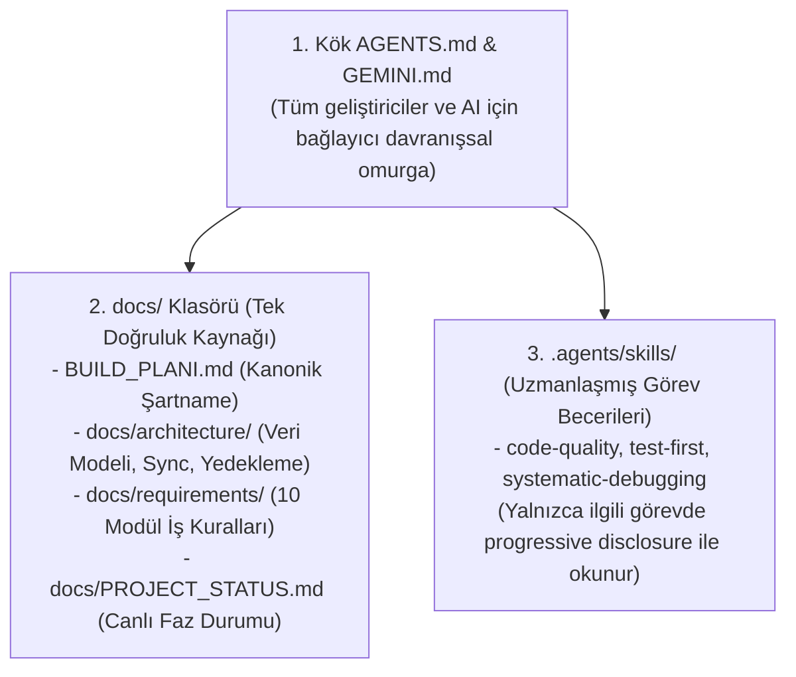
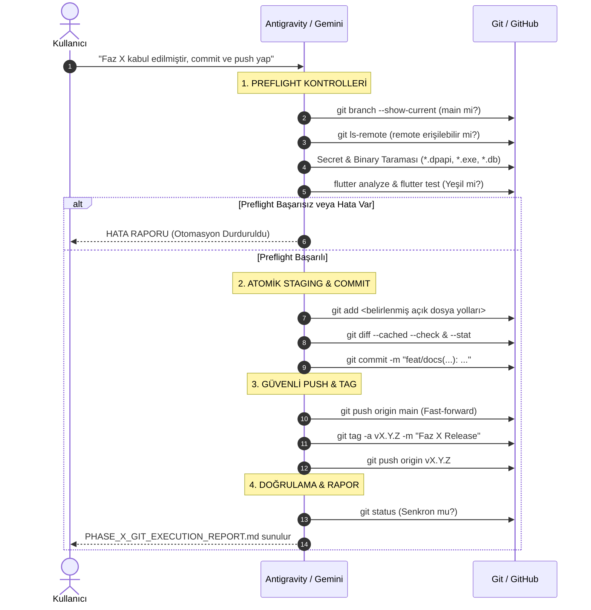

# DT-01.1: Project Instructions & Agent Governance Audit Raporu

**Belge Kodu:** `DT_01_1_AGENT_GOVERNANCE_AUDIT.md`  
**Tarih:** 6 Kasım 2026  
**Aşama:** Faz 1 — Mimari Yönetişim ve Talimat Standardizasyonu (DT-01.1)  
**Durum:** Analiz ve Tasarım Tamamlandı (Uygulama İçin Kullanıcı Onayı Bekleniyor)  
**Referans Doküman:** `MARKET_POS_AI_STUDIO_BUILD_PLANI.md` (v1.3)  
**İlgili Kayıtlar:** `AGENTS.md`, `GEMINI.md`, `docs/ARCHITECTURE.md`, `docs/PROJECT_STATUS.md`  

---

## 1. Mevcut Durum Özeti

Market Management System (MMS) projesinde **Faz 0 (Planlama ve Mimari Kararlar)** ve **Faz 1.1 (Windows Client Foundation)** başarıyla tamamlanmış; Drift SQLite depolama paketi (`packages/mms_client_storage`), bağımsız Shelf HTTPS backend sunucusu (`test_spikes/spike_01_backend`) ve Flutter Windows masaüstü arayüzü 4 atomik commit ile GitHub uzak deposuna push edilerek `v1.1.0-windows-client-foundation` sürüm tag'i oluşturulmuştur.

Ancak projenin kök dizinindeki yapay zekâ talimat dosyaları (`AGENTS.md`, `GEMINI.md`) ve alt kural belgeleri (`docs/ai/rules/*.md`), projenin ilk başladığı 30 Ekim 2026 tarihindeki Faz 0 taslak metinlerini taşımaktadır. Dokümantasyonda:
1. Onaylanmış **Windows Local Master Hub (Merkezi SQLite + LAN API)** mimarisi yerine eski "Bulut Supabase PostgreSQL" ifadeleri yer almakta,
2. Proje durumu Faz 1.1 kabul edilmiş olmasına rağmen "kod yazılmamıştır" çelişkisi bulunmakta,
3. Kuruş tamsayı kesinliği, kalıcı Git otomasyonu ve B2/B3 güvenlik backlog'una dair kurallar dağınık veya eksik kalmaktadır.

Bu denetim, projenin tek doğruluk kaynağını (Single Source of Truth) restore etmek, talimat hiyerarşisini netleştirmek ve 16 zorunlu başlığı içeren modern bir `AGENTS.md` mimarisi tasarlamak üzere gerçekleştirilmiştir.

---

## 2. Dokümantasyon Envanteri ve Ayrıntılı Denetim

Aşağıdaki tabloda projedeki tüm yönetim ve mimari belgeler analiz edilmiştir:

| Belge | Amacı | Güncellik Durumu | Tekrar Eden İçerik | Çelişen Kararlar / Hatalar | Korunması Gerekenler |
| :--- | :--- | :---: | :--- | :--- | :--- |
| **`README.md`** | Depo ana karşılama, mimari genel bakış ve modül haritası. | **GÜNCEL** (v1.3) | Teknoloji tablosu ve ASCII mimari diyagramı `ARCHITECTURE.md` ile aynıdır. | Çelişki yok. Sürüm tag'i rozeti eksik. | Master Hub ASCII şeması, kuruş standardı, MVP sınırları. |
| **`BUILD_PLANI.md`** | Projenin kanonik şartnamesi ve tek bağlayıcı ana sözleşmesi. | **KISMİ ESKİ** (v1.3 metni var ancak Faz 0 kapanış notları eksik) | Modül hedefleri ve 10 modül kapsamı `docs/REQUIREMENTS.md` ile tekrar ediyor. | Bölüm 10'da "Faz 0 kod yazılmaz" yazarken Faz 1.1 kodu repoda yer almaktadır. | 10 modül kapsamı, kuruş tamsayı, eksi stok serbestliği, offline kuralları. |
| **`docs/ARCHITECTURE.md`**| v1.3 teknik mimari özeti (Windows Hub, Single-Writer, LAN API). | **GÜNCEL / KISMİ EKSİK** | `README.md` mimari tablosu ile örtüşüyor. | Bölüm 7'de Spike 01 "henüz icra edilmemiştir" yazıyor (oysa 139 testle tamamlandı). | 3 katmanlı Clean Architecture, Single-Writer prensibi, LAN HTTPS akışı. |
| **`docs/PROJECT_STATUS.md`**| Canlı oturum ve faz durumu takip belgesi. | **CİDDİ ÇELİŞKİ VAR** | Proje vizyonu ve tablo tanımları diğer belgelerle tekrarlanıyor. | Bölüm 1'de "Faz 1.1 TAMAMLANDI" derken, Bölüm 2 satır 38'de "Henüz hiçbir kod yazılmamıştır" yazıyor! | Faz 1.2 kabul kriterleri, modül izlenebilirlik matrisi. |
| **`AGENTS.md` (Root)** | Tüm AI ve geliştiriciler için bağlayıcı kök kurallar. | **ESKİ** (30 Ekim 2026, 80 satır) | `docs/ai/rules/` altındaki kural özetlerini tekrarlıyor. | Merkezi DB olarak Supabase PostgreSQL'i gösteriyor; Faz 0 durumunda kalmış. | Clean Architecture sınırları, kuruş kuralı, kullanıcı onayı ilkesi. |
| **`GEMINI.md` (Root)** | Antigravity IDE ve Gemini modeli için çalışma protokolü. | **KISMİ ESKİ** | `AGENTS.md` dosyasındaki kural okuma sırasını tekrarlıyor. | Projeyi Faz 0 olarak kabul ediyor. | 5 adımlı çalışma protokolü (incele, analiz et, raporla, kullanıcı onayı). |
| **`docs/ai/rules/*.md`** (7 Dosya)| Mimari, test, güvenlik, offline ve Clean Code detay kuralları. | **KISMİ ESKİ** | `AGENTS.md` ile katman ve test tanımları örtüşüyor. | `clean-architecture.md` ve `offline-first.md` senkronizasyon hedefi olarak Supabase'i gösteriyor. | Monospace rakamlar, saf Dart domain kuralı, 4 fazlı RCA protokolü. |
| **`.agents/registry/SKILL_REGISTRY.md`**| Antigravity yapay zekâ becerileri envanteri. | **DEFER EDİLDİ** | Skill amaçları `SKILL.md` frontmatter'ları ile aynıdır. | Telif hakkı (copyright) ve MIT lisans dosyaları eksiktir. | 5 çekirdek becerinin yetki sınırları ve izin politikası. |
| **`.agents/skills/` (5 Beceri)**| Uzmanlaşmış çalışma kuralları (TDD, RCA, UI, Temiz Kod). | **DEFER EDİLDİ** | Proje kuralları ile büyük ölçüde uyumlu. | Yasal attribution/lisans dosyaları bulunmadığından repodan geçici olarak yalıtıldı. | Kasa ekranı ergonomisi ($\ge 48\text{ dp}$), TDD 3 kuralı, RCA teşhis adımları. |

---

## 3. Tespit Edilen Çelişkiler ve Eksiklikler

### 3.1. Mimari Çelişkiler (Merkez Veritabanı ve Senkronizasyon Hedefi)
- **Çelişki:** `AGENTS.md` (satır 37, 52, 61), `docs/ai/rules/clean-architecture.md` (satır 35, 48) ve `docs/ai/rules/offline-first.md` (satır 30) belgelerinde merkezi veritabanı olarak "Supabase PostgreSQL" ve veri izolasyonu için "Supabase RLS" yazmaktadır.
- **Onaylanmış Gerçek (v1.3):** Proje pilot aşamasında **Windows Local Master Hub** mimarisini kullanır. Merkez veritabanı Windows Service tarafından yönetilen **Merkezi SQLite (Single-Writer)**'dır. Mobil ve masaüstü istemciler yerel LAN üzerinden bu servisle senkronize olur. Supabase, gelecekteki çok mağazalı bulut SaaS fazının hedefidir.

### 3.2. Proje Fazı ve Kodlama Durumu Çelişkisi
- **Çelişki:** `docs/PROJECT_STATUS.md` belgesinin girişinde Faz 1.1'in tamamlandığı belirtilmesine karşın, devamında *"Henüz hiçbir Windows Service, Flutter/Dart veya C# uygulama kodu yazılmamıştır"* ve *"Henüz flutter create çalıştırılmamıştır"* ifadeleri yer almaktadır.
- **Onaylanmış Gerçek:** Kök Flutter projesi oluşturulmuş, `mms_client_storage` paketi ve `spike_01_backend` servisi kodlanmış, 221 test yeşile çekilmiş ve Git'e push edilmiştir.

### 3.3. Eksik Dokümante Edilmiş Kurallar
1. **İkili ve Sır Yalıtımı:** `pepper.dpapi`, WinSW `.exe` ve Flutter generated dosyalarının Git'e girmesini engelleyen katı kurallar `AGENTS.md` içinde yer almamaktadır.
2. **Kalıcı Git Otomasyonu:** Faz kabulü sonrasında işletilecek preflight, atomik commit, push, tag ve doğrulama protokolü kurallara işlenmemiştir.
3. **B2/B3 Güvenlik Backlog'u:** Yerel token'ların DPAPI ile şifrelenmesi (B-2) ve yerel ağda self-signed TLS sertifika pining mimarisi (B-3) kurallara dahil edilmemiştir.
4. **Gerçek SQLite Test Gereksinimleri:** SQLite WAL kilitlenmesi, `PRAGMA busy_timeout = 5000`, kaza kurtarma (crash recovery) ve concurrency testlerinde mock yerine gerçek FFI SQLite kullanılması kuralı netleştirilmemiştir.
5. **Yuvarlama Standardı:** Kuruş altı hesaplamalarda (gramajlı satışlar) perakende standardı olan "Half-Up" ($\ge 0.5$ yukarı yuvarlama) kuralı eksiktir.

---

## 4. Talimat Hiyerarşisi Tasarımı

Gereksiz iç içe dosya kalabalığını ve token israfını önlemek amacıyla 3 seviyeli yalın bir talimat hiyerarşisi benimsenmiştir:



### Hiyerarşi Prensipleri:
- **Kök `AGENTS.md`:** Tüm repo için geçerli tek ve kapsayıcı kurallar dizinidir. 16 zorunlu başlığı barındırır.
- **Modül Bazlı `AGENTS.md` Yaklaşımı:** `packages/mms_client_storage/` veya `test_spikes/` altına ayrı `AGENTS.md` dosyaları **oluşturulmayacaktır**. Tüm katmanlar kök `AGENTS.md` kurallarına tabidir; gereksiz dosya enflasyonundan kaçınılır.
- **`docs/` Dizini:** Ürün kararlarının, kabul kriterlerinin ve veri modellerinin değişmez doğruluk kaynağıdır. `AGENTS.md` doğrudan bu belgelere bağlantı verir.
- **`.agents/skills/`:** Yalnızca TDD işletilirken, hata ayıklanırken veya UI tasarlanırken devreye giren uzmanlık prosedürleridir; genel mimari kural koyamazlar.

---

## 5. Önerilen AGENTS.md Tasarımı (16 Zorunlu Başlık)

Aşağıdaki taslak, yürürlükteki tüm mimari kararları, Faz 1.1 kazanımlarını ve kalıcı Git otomasyonunu içeren yeni `AGENTS.md` içeriğidir:

```markdown
# AGENTS.md — Market Management System (MMS) Ortak Yapay Zekâ Geliştirme Kuralları

Bu belge, **Market Management System (MMS)** projesinde görev alan tüm yapay zekâ asistanları ve insan geliştiriciler için **araçtan bağımsız, birincil ve bağlayıcı ortak kurallar dizinidir**.

---

## 1. Project Overview
- **Ürün Tanımı:** Market Management System (MMS) — Küçük ve orta ölçekli perakende marketler için profesyonel market yönetim SaaS uygulaması.
- **Teknik Klasör / Repo Adı:** `market-pos` olarak korunmaktadır.
- **Kanonik Ana Referans:** `MARKET_POS_AI_STUDIO_BUILD_PLANI.md` (v1.3, 4 Kasım 2026).
- **Canlı Proje Durumu:** `docs/PROJECT_STATUS.md`.
- **Yol Haritası:** `docs/ROADMAP.md` (Faz 0–8).

## 2. Product Scope
- MMS, yalnızca kasada barkod okutan dar kapsamlı bir CRUD/POS değildir; ürün, stok, fiyat, satış, sepet, dashboard ve yedekleme süreçlerini yöneten entegre bir sistemdir.
- **Pilot Kapsamı:** Tek market, tek işletme sahibi (Owner), Windows bilgisayar ana kasa + Android/iOS telefonlar.
- **Kapsam Dışı (MVP):** Banka POS / Ingenico cihaz entegrasyonu, personel/kasiyer rolleri ve çok şubeli bulut yönetimi ilk sürümün dışındadır.

## 3. Technology Stack
- **İstemci Çerçevesi:** Flutter (Dart 3.x+ / Flutter 3.47.x+) — Windows Desktop, Android, iOS.
- **Uç (Client) Depolama:** Drift + SQLite (WAL Modu) — `packages/mms_client_storage`.
- **Merkezi Sunucu (Pilot):** Bağımsız Windows Service — Dart Shelf HTTPS API + Merkezi SQLite (WAL Modu).
- **Gelecek SaaS Sunucusu:** Supabase PostgreSQL + Supabase Auth.
- **Durum Yönetimi & DI:** Riverpod.
- **Navigasyon:** go_router.
- **Barkod Girişi:** Windows'ta USB HID klavye okuyucu; Mobilde kamera (`mobile_scanner`).
- **Harici Yedekleme:** SQLite `VACUUM INTO` + İstemci taraflı AES-256-GCM + Google Drive API.

## 4. Approved Architecture
- **Windows Local Master Hub:** Mağazada internet kopsa dahi kesintisiz çalışan yerel sunucu mimarisi esastır.
- **Single-Writer İlkesi:** Merkezi SQLite veritabanına tüm yazma işlemleri yalnızca Windows Service arka plan API'si (`http://127.0.0.1:<port>` veya yerel LAN) üzerinden tekil yazıcı kuyruğu ile yürütülür.
- **İstemci Eşitliği:** Windows Flutter masaüstü arayüzü de dahil olmak üzere tüm uç cihazlar birer istemcidir; doğrudan merkezi veritabanı dosyasına erişemezler.
- **Mimari Referans:** `docs/ARCHITECTURE.md`.

## 5. Architecture Dependency Rules
- **Mimari Model:** Feature-first + Clean Architecture.
- **Katman Bağımlılık Yönü:**
  $$\text{presentation (UI)} \longrightarrow \text{application (State/UseCases)} \longrightarrow \text{domain (Saf Dart)} \longleftarrow \text{data (Drift/API)}$$
- **Domain Katmanı:** Saf Dart ile yazılır. Kesinlikle `flutter/material.dart`, Drift, SQLite, HTTP veya platform kütüphanelerine bağımlı olamaz.
- **Data Katmanı:** Domain arayüzlerini somutlaştırır, Drift DAO ve DTO eşlemelerini yönetir.
- **Presentation Katmanı:** Yalnızca Application state'ini ve Domain modellerini tüketir; doğrudan SQL sorgusu veya raw API çağrısı yapamaz.

## 6. SOLID and Clean Code
- **SRP:** Her sınıf ve fonksiyon tek bir amaca hizmet eder. Sepet hesabı ile fiş basımı ayrı sınıflardadır.
- **OCP:** Yeni ödeme veya donanım tipleri mevcut kod değiştirilmeden arayüzler üzerinden eklenir.
- **DIP:** Yüksek seviyeli iş mantığı düşük seviyeli sürücülere değil, arayüzlere bağımlıdır.
- **YAGNI & KISS:** Erken optimizasyon, yapay mikroservisler ve kullanılmayan soyutlamalar kesinlikle yasaktır.
- **Açık İsimlendirme:** `p`, `btn` gibi anlamsız kısaltmalar yasaktır. Finansal alanlarda birim açıkça belirtilir (`priceInKurus`, `quantityInGrams`).

## 7. Database and Data Integrity
- **Kuruş Tamsayı Standardı:** Para değerleri için `double` KESİNLİKLE YASAKTIR. Tüm parasal alanlar `int` (kuruş) olarak saklanır (100.50 TL = `10050`).
- **Yuvarlama Standardı:** Kuruş altı hassasiyet hesaplamalarında perakende "Half-Up" kuralı işletilir.
- **Atomik Birimler:** Stoklar bölünemez en küçük birimde tutulur (Adet, Gram, Mililitre). Koli/paket dönüşümleri integer pay/payda ile yapılır.
- **Append-Only Defter:** Satışlar, stok hareketleri ve fiyat geçmişi sessizce silinemez veya güncellenemez; fiziksel işlemler korunur.
- **Yerel Transaction:** Satış başlığı, kalemleri, stok hareketi ve senkronizasyon kuyruğu tek bir atomik SQLite transaction'ında işlenir.

## 8. Offline-First and Synchronization
- **Kesintisiz Çalışma:** İnternet yokken LAN üzerinden; Windows kapalıyken mobil cihazlar yerel Drift SQLite üzerinde satış yapmaya devam eder.
- **Kalıcı Outbox:** Çevrimdışı yapılan her işlem `sync_operations` tablosuna yazılır; Windows açıldığında deterministik FIFO sırasıyla merkeze iletilir.
- **Idempotency:** Her işlem benzersiz bir UUID `idempotency_key` ve `client_sequence_number` taşır; tekrarlanan istekler mükerrer satış veya stok düşümü yaratmaz.
- **Eksi Stok Politikası:** Stokta olmayan ürünün satışı serbesttir (`allow`). Çakışma durumunda satışlar silinmez, eksi bakiye kaydedilir ve audit loguna uyuşmazlık yazılır.

## 9. Security Rules
- **Sır Yasağı:** API anahtarları, şifreler, OAuth token'ları ve `.env` dosyaları asla Git deposuna eklenemez.
- **Yerel Token Koruması:** Sunucu tarafında token imzalama pepper'ı Windows DPAPI (`CryptProtectData`) ile şifrelenir (`pepper.dpapi`). İstemci tarafında token'lar güvenli depolamada saklanır.
- **Yerel Ağda TLS:** LAN üzerindeki API iletişimi self-signed sertifika ve istemci parmak izi doğrulama (certificate pinning) ile şifrelenir.
- **Cihaz Eşleştirme:** Yeni cihazlar yalnızca Windows ekranında üretilen tek kullanımlık dinamik QR kodun kamera ile taranmasıyla yetkilendirilir.
- **Tenant İzolasyonu:** Tüm tablolarda `tenant_id` ve `store_id` alanları korunarak gelecekteki bulut SaaS izolasyonu garanti edilir.

## 10. Testing Strategy
- **Risk Temelli Test:** Öncelik finansal hesaplamalar, atomik transaction bütünlüğü, outbox senkronizasyonu ve kaza kurtarma senaryolarındadır.
- **Gerçek SQLite Zorunluluğu:** SQLite WAL eşzamanlılığı, `busy_timeout = 5000`, kaza kurtarma ve migration testlerinde mock kullanılamaz; geçici disk dosyası üzerinde gerçek FFI SQLite çalıştırılır.
- **Test-Driven Development (TDD):** Kritik iş mantığı ve hesaplamalarda Red-Green-Refactor döngüsü esastır; başarısız test yazılmadan üretim kodu yazılamaz.

## 11. Error Handling and Logging
- **Sessiz Yutma Yasağı:** `catch (e) {}` kesinlikle yasaktır; tüm hatalar loglanmalı veya tip güvenli hata nesnelerine dönüştürülmelidir.
- **Kullanıcı Dostu Hatalar:** Ham veritabanı hataları veya stack trace UI'a sızdırılamaz; Türkçe, anlaşılır kullanıcı mesajları gösterilir.
- **Hata Tipleri:** `core/errors/` altında `DomainException`, `StorageException`, `SyncException` gibi açık tipler kullanılır.

## 12. Documentation Rules
- **Kanonik Hiyerarşi:** `AGENTS.md` $\to$ `BUILD_PLANI.md` $\to$ `docs/PROJECT_STATUS.md` $\to$ `docs/architecture/` $\to$ `docs/requirements/`.
- **ADR Standardı:** Önemli mimari kararlar `docs/decisions/` altında şablona uygun olarak belgelenir.
- **Faz Raporlaması:** Her faz açılış ve kapanışında `docs/phases/` altında durum raporu oluşturulur.
- **Senkronizasyon:** Kodda yapılan her mimari değişiklik ilgili dokümana anında yansıtılır.

## 13. Development Workflow
1. **İncele:** `docs/PROJECT_STATUS.md` ve ilgili şartnameyi oku.
2. **Onay Al:** Faz kabulü veya mimari değişiklik öncesinde kullanıcıdan açık onay al.
3. **TDD:** Testi yaz, başarısız olduğunu gör, minimal kodu yaz, yeşile çek ve refactor et.
4. **Analiz:** `flutter analyze` ve `dart analyze` sıfır hata vermelidir.
5. **Raporla:** Yapılan işlemleri ve test sonuçlarını kullanıcıya şeffafça sun.

## 14. Git Commit, Push and Tag Automation
- **Faz Kabulü Sınırı:** Bir fazın teknik olarak tamamlanması kullanıcı kabulü anlamına gelmez. Fazı münhasıran **KULLANICI KABUL EDER**.
- **Otomatik Preflight:** Kullanıcı açık faz kabulü verdikten sonra Antigravity:
  1. `git branch --show-current` (main doğrulaması)
  2. `git remote -v` ve erişim testi
  3. `git status --short` ve unstaged diff kontrolü
  4. Gizli dosya (`*.dpapi`), ikili (`*.exe`), DB/WAL/SHM ve build çıktısı taraması yürütür.
- **Atomik Staging & Commit:** `git add .` yasaktır. Dosyalar modül ve katman bazında açık yollarla stage edilir ve Conventional Commits (`feat:`, `docs:`, `fix:`) formatında commit'lenir.
- **Push ve Tag:** Commit'ler `git push origin main` ile gönderilir. Kilometre taşı tamamlandığında annotated tag (`git tag -a vX.Y.Z -m ...`) basılır ve push edilir.
- **Yasaklar:** Force push (`--force`) ve commit geçmişini değiştirme (rebase/reset) KESİNLİKLE YASAKTIR.
- **Hata Durumu:** Test, analiz veya Git işleminde herhangi bir hata çıkarsa otomasyon derhal durur ve kullanıcıya rapor verir.
- **Yürütme Raporu:** Her fazın Git işlemi `docs/phase-X/PHASE_X_GIT_EXECUTION_REPORT.md` olarak belgelenir.

## 15. Forbidden Actions
1. Kullanıcı onayı olmadan mimari kararları değiştirmek veya faz atlamak.
2. Para hesaplarında `double` veya kayan noktalı sayı kullanmak.
3. Fiziksel satış fişlerini veya stok hareketlerini veritabanından silmek (Hard delete).
4. Domain katmanına Flutter UI, Drift veya HTTP kütüphaneleri import etmek.
5. İstemciden gelen `tenant_id`'yi doğrulamadan güvenli kabul etmek.
6. Git deposuna `.env`, `*.dpapi`, `*.exe`, `*.db` veya derleme çıktıları commit etmek.
7. Uzak depoya force push atmak.
8. Başarısız test veya analiz uyarısı varken görevi tamamlandı saymak.

## 16. Phase Acceptance Process
1. İlgili fazın tüm kabul kriterleri kod ve testlerle karşılanır.
2. Tüm testler (Birim, Entegrasyon, UI) %100 yeşil olmalıdır.
3. `flutter analyze` ve `flutter build windows --release` sıfır hatayla derlenmelidir.
4. Faz kapanış raporu hazırlanır ve kullanıcı incelemesine sunulur.
5. **Kullanıcının açık "Kabul Edildi" onayı alınmadan sonraki faza geçilemez ve otomatik Git push işletilemez.**
```

---

## 6. Kalıcı Git Otomasyon Kuralları Analizi

Faz 1.1 yürütülürken başarıyla uygulanan ve gelecekteki tüm fazlar (Faz 1.2, Faz 2, vb.) için standartlaştırılacak olan Git otomasyon algoritması:



---

## 7. Dosya Bazında Uygulama Eylem Listesi (Action Plan)

Aşağıdaki tabloda projedeki tüm yönetim ve kural belgeleri için önerilen aksiyonlar sınıflandırılmıştır:

| Dosya Yolu | Sınıflandırma | Gerekçe ve Yapılacak İşlem |
| :--- | :---: | :--- |
| `AGENTS.md` | **UPDATE** | 30 Ekim 2026 tarihli 80 satırlık eski içerik silinecek; yukarıda Bölüm 5'te tasarlanan 16 zorunlu başlıklı modern kural seti yazılacaktır. |
| `GEMINI.md` | **UPDATE** | Faz 0 referansı güncellenecek; Faz kabulü sonrası Git preflight protokolü eklenecektir. |
| `docs/PROJECT_STATUS.md` | **UPDATE** | Bölüm 2 ve 3'teki "henüz kod yazılmadı" çelişkisi giderilecek; Faz 1.1 tamamlanmışlığı, commit hash'leri ve Faz 1.2 hedefleri yazılacaktır. |
| `MARKET_POS_AI_STUDIO_BUILD_PLANI.md` | **UPDATE** | Faz 0 kapanış notları ve Faz 1.1'de kabul edilen B-6 lifecycle korumaları ilgili bölümlere işlenecektir. |
| `docs/ARCHITECTURE.md` | **UPDATE** | Bölüm 7'deki "Spike 01 icra edilmedi" ifadesi güncellenecek; tamamlanan Shelf HTTPS backend sonuçları eklenecektir. |
| `docs/ai/rules/clean-architecture.md` | **UPDATE** | Supabase referansı yerine Windows Local Master Hub API istemcisi eklenecektir. |
| `docs/ai/rules/offline-first.md` | **UPDATE** | Senkronizasyon hedefi olarak LAN Master Hub API'si tanımlanacaktır. |
| `docs/ai/rules/testing.md` | **UPDATE** | Gerçek FFI SQLite gerektiren 4 kritik test senaryosu ve Half-Up yuvarlama kuralı eklenecektir. |
| `docs/ai/rules/clean-code.md` | **KEEP** | Açık isimlendirme, fonksiyon sorumluluğu ve kuruş kuralları tam uyumludur; korunacaktır. |
| `docs/ai/rules/solid.md` | **KEEP** | SOLID ilkeleri ve aşırı mühendislik yasağı tam uyumludur; korunacaktır. |
| `docs/ai/rules/security.md` | **KEEP** | 5 Kasım'da güncellenmiş ve pilot Owner ayrımı yapılmıştır; korunacaktır. |
| `docs/ai/rules/project-principles.md` | **KEEP** | Ana planın bağlayıcılığı ve kullanıcı onayı ilkesi korunacaktır. |
| `README.md` | **KEEP** | v1.3 mimarisini ve kuruş standardını doğru yansıtmaktadır; korunacaktır. |
| `.agents/skills/**` (5 Beceri) | **DEFER** | Orijinal açık kaynak MIT copyright notice ve yasal `LICENSE` dosyaları hazırlanana kadar commit ertelenmiştir. |
| `.agents/registry/SKILL_REGISTRY.md`| **DEFER** | Becerilerle birlikte sonraki hukuki düzenleme turunda depoya dahil edilecektir. |
| `docs/development/DT_01_1_AGENT_GOVERNANCE_AUDIT.md`| **CREATE** | Bu denetim ve tasarım raporu olarak oluşturulmuştur. |

---

## 8. Sonuç ve Sonraki Adım

Bu denetim raporu ile:
1. Mevcut dokümantasyonun tüm çelişki ve eksiklikleri tespit edilmiştir.
2. 16 zorunlu başlığı eksiksiz içeren uygulanabilir ve doğrulanabilir `AGENTS.md` tasarımı tamamlanmıştır.
3. Yalın 3 seviyeli talimat hiyerarşisi belirlenmiştir.
4. Kalıcı Git preflight ve commit/push otomasyonu şartnameye bağlanmıştır.
5. Hiçbir kaynak koduna, mevcut `AGENTS.md` dosyasına veya depoya dokunulmamıştır.

**Kullanıcı Onayı Sonrası Adım (DT-01.2):**  
Kullanıcının bu raporu onaylamasının ardından, yukarıdaki eylem listesinde `UPDATE` olarak işaretlenen dosyalar (`AGENTS.md`, `GEMINI.md`, `PROJECT_STATUS.md` vb.) güncellenecek ve proje talimat altyapısı kalıcı olarak sabitlenecektir.

