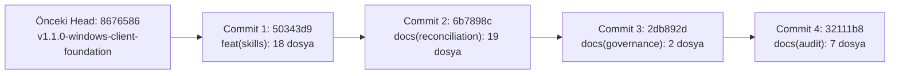

# MARKET MMS — Controlled Git Commit & Push Execution Report
# Developer Tooling & Engineering Standards (DT-01.1 .. DT-01.4)

**Belge Sürümü:** 1.0  
**Tarih:** 6 Kasım 2026  
**Aşama:** Faz 1 — Developer Tooling & Engineering Standards (DT-01) Git Yürütme Raporu  
**Referans Doküman:** `docs/development/PRE_COMMIT_FINAL_AUDIT_REPORT.md`  
**Yönetişim ve Yetki:** Proje Sahibi Onaylı Kontrollü Yürütme  
**Durum:** Başarıyla Tamamlandı (TAM DOĞRULANDI)  

---

## 1. Yürütme Özeti

Proje Sahibinin açık onayı doğrultusunda, `PRE_COMMIT_FINAL_AUDIT_REPORT.md` içinde tanımlanan dört atomik commit grubu hiçbir toplu staging (`git add .`) veya force push kullanılmadan, sırasıyla oluşturulmuş ve GitHub uzak deposuna (`origin/main`) push edilmiştir.

### Temel Doğrulama Parametreleri

- **GitHub Remote:** `https://github.com/halilkrkn/market-pos.git`
- **Aktif Branch:** `main`
- **Yerel ve Uzak Senkronizasyonu:** `Your branch is up to date with 'origin/main'`
- **Head Commit:** `32111b8` (`origin/main`, `origin/HEAD`)
- **Bekleyen Commit Sayısı:** 0 (`git rev-list --count origin/main..HEAD` -> 0)
- **Kullanılan Strateji:** Açık Dosya Bazlı Staging, Atomik Commit, Sıfır Force Push, Sıfır History Rewrite, Tam Sır ve İkili Yalıtımı.

---

## 2. Oluşturulan Dört Atomik Commit Detayı



### Commit 1 — Agent Skills & Compliance
- **Commit Hash:** `50343d9`
- **Commit Mesajı:** `feat(skills): integrate approved agent skills and licensing compliance records`
- **Dosya Sayısı:** 18 dosya (+1040 satır)
- **Kapsam:**
  - `.agents/ATTRIBUTION.md`
  - `.agents/registry/SKILL_REGISTRY.md`
  - `.agents/skills/code-quality/` (`NOTICE`, `SKILL.md`)
  - `.agents/skills/documentation/` (`NOTICE`, `SKILL.md`)
  - `.agents/skills/flutter-ui-standards/` (`LICENSE`, `NOTICE`, `SKILL.md`)
  - `.agents/skills/systematic-debugging/` (`LICENSE`, `NOTICE`, `SKILL.md`)
  - `.agents/skills/test-first/` (`LICENSE`, `NOTICE`, `SKILL.md`)
  - `docs/compliance/DT_01_2_FINAL_VERIFICATION_AUDIT.md`
  - `docs/compliance/DT_01_2_SKILLS_ACTIVATION_REPORT.md`
  - `docs/compliance/DT_01_2_SKILLS_SECURITY_LICENSE_REVIEW.md`
- **Doğrulama:** 18 dosya açıkça stage edilmiş, sıfır binary dosya dahil edilmiştir.

### Commit 2 — Project Documentation Reconciliation
- **Commit Hash:** `6b7898c`
- **Commit Mesajı:** `docs(reconciliation): align specifications with AES-256-CBC, central database paths and open decisions`
- **Dosya Sayısı:** 19 dosya (+320 satır, -249 satır)
- **Kapsam:**
  - `MARKET_POS_AI_STUDIO_BUILD_PLANI.md`
  - `README.md`
  - `docs/ARCHITECTURE.md`
  - `docs/DEVELOPMENT_GUIDE.md`
  - `docs/PROJECT_OVERVIEW.md`
  - `docs/PROJECT_STATUS.md`
  - `docs/REQUIREMENTS.md`
  - `docs/ROADMAP.md`
  - `docs/ai/rules/clean-architecture.md`
  - `docs/ai/rules/offline-first.md`
  - `docs/ai/rules/project-principles.md`
  - `docs/ai/rules/security.md`
  - `docs/ai/rules/testing.md`
  - `docs/architecture/BACKUP_RESTORE_DECISIONS.md`
  - `docs/architecture/BACKUP_RESTORE_PROTOCOL.md`
  - `docs/architecture/BACKUP_RESTORE_TECHNICAL_VALIDATION.md`
  - `docs/decisions/README.md`
  - `docs/requirements/BUSINESS_RULES_SPEC.md`
  - `docs/requirements/PHASE_0_BUSINESS_DISCOVERY.md`
- **Doğrulama:** AES-256-CBC, `%PROGRAMDATA%\MarketMMS\data\market_master.db` ve OPEN DECISION mutabakatları eşitlenmiştir.

### Commit 3 — Agent Governance Instructions
- **Commit Hash:** `2db892d`
- **Commit Mesajı:** `docs(governance): establish central AGENTS.md constitution and GEMINI.md instructions`
- **Dosya Sayısı:** 2 dosya (+271 satır, -74 satır)
- **Kapsam:**
  - `AGENTS.md` (Merkezi Anayasa, 231 satır, 15 madde)
  - `GEMINI.md` (Antigravity & Gemini Yönlendirme Rehberi, 87 satır, 5 bölüm)
- **Doğrulama:** Kural tekrarı yapılmamış; Clean Architecture, finansal kesinlik ve Git disiplini merkezi talimata bağlanmıştır.

### Commit 4 — Development & Governance Audit Reports
- **Commit Hash:** `32111b8`
- **Commit Mesajı:** `docs(audit): document DT-01 developer tooling audits and Phase 1.1 git execution`
- **Dosya Sayısı:** 7 dosya (+1418 satır)
- **Kapsam:**
  - `docs/development/DT_01_1_AGENT_GOVERNANCE_AUDIT.md`
  - `docs/development/DT_01_3_DOCUMENTATION_RECONCILIATION_REPORT.md`
  - `docs/development/DT_01_3_FINAL_REVIEW_REPORT.md`
  - `docs/development/DT_01_4_FINAL_GOVERNANCE_AUDIT.md`
  - `docs/development/DT_01_4_INSTRUCTION_INTEGRATION_REPORT.md`
  - `docs/development/PRE_COMMIT_FINAL_AUDIT_REPORT.md`
  - `docs/phase-1/PHASE_1_1_GIT_EXECUTION_REPORT.md`
- **Doğrulama:** Tüm audit, inceleme ve yürütme raporları kalıcı olarak kayıt altına alınmıştır.

---

## 3. Remote Push Sonucu

- **Komut:** `git push origin main`
- **Çıktı:**
  ```text
  To https://github.com/halilkrkn/market-pos.git
     8676586..32111b8  main -> main
  ```
- **Sonuç:** **BAŞARILI** (HTTP 200 / Fast-Forward Push).

---

## 4. Push Sonrası Doğrulama Komut Çıktıları

### 4.1. `git status`
```text
On branch main
Your branch is up to date with 'origin/main'.

nothing to commit, working tree clean
```

### 4.2. `git status --short`
*(Çıktı boştur — Çalışma ağacı ve staging alanı %100 temizdir).*

### 4.3. `git log -5 --oneline --decorate`
```text
32111b8 (HEAD -> main, origin/main, origin/HEAD) docs(audit): document DT-01 developer tooling audits and Phase 1.1 git execution
2db892d docs(governance): establish central AGENTS.md constitution and GEMINI.md instructions
6b7898c docs(reconciliation): align specifications with AES-256-CBC, central database paths and open decisions
50343d9 feat(skills): integrate approved agent skills and licensing compliance records
8676586 (tag: v1.1.0-windows-client-foundation) feat(client): implement Windows client foundation and local database service
```

### 4.4. `git diff --stat origin/main...HEAD`
*(Çıktı boştur — Yerel dal ile uzak dal arasında hiçbir fark yoktur).*

### 4.5. `git rev-list --count origin/main..HEAD`
```text
0
```

---

## 5. Güvenlik ve Repository Hijyeni Doğrulaması

- **Hassas Dosya İzolasyonu:**
  - `test_spikes/spike_01_backend/pepper.dpapi` -> Git dışında (Protected).
  - `test_spikes/**/service_wrapper/*.exe` -> Git dışında (Protected).
  - `test_spikes/**/build/*.exe` ve `market_pos.exe` -> Git dışında (Protected).
  - SQLite `.db`, `.db-wal`, `.db-shm` ve `.mmsbak` dosyaları -> Git dışında (Protected).
  - Sertifika ve anahtarlar (`server.key`, `server.crt`) -> Git dışında (Protected).
- **Kod Üretim Dosyaları:** `*.g.dart` dosyaları korunmuş; gereksiz veya kontrolsüz kod üretim dosyası stage edilmemiştir.
- **Toplu Staging Yasağı:** `git add .` veya `git add -A` kesinlikle kullanılmamış; 46 dosya tek tek açık komutlarla stage edilmiştir.
- **Tarihçe Bütünlüğü:** Force push veya rebase yapılmamış; temiz fast-forward geçmiş korunmuştur.

---

## 6. Nihai Sonuç

```
╔════════════════════════════════════════════════════════════════════════════╗
║                                                                            ║
║                 YÜRÜTME SONUCU: BAŞARIYLA TAMAMLANDI                       ║
║                                                                            ║
║   1. Dört atomik commit ayrı ayrı oluşturulmuştur (toplam 46 dosya).       ║
║   2. Tüm commit'ler origin/main dalına başarıyla push edilmiştir.          ║
║   3. Yerel dal ile uzak dal tam senkronizedir (0 bekleyen commit).         ║
║   4. Hiçbir hassas dosya veya binary ikili Git deposuna sızmamıştır.      ║
║   5. Çalışma ağacı tamamen temizdir (working tree clean).                  ║
║                                                                            ║
╚════════════════════════════════════════════════════════════════════════════╝
```

