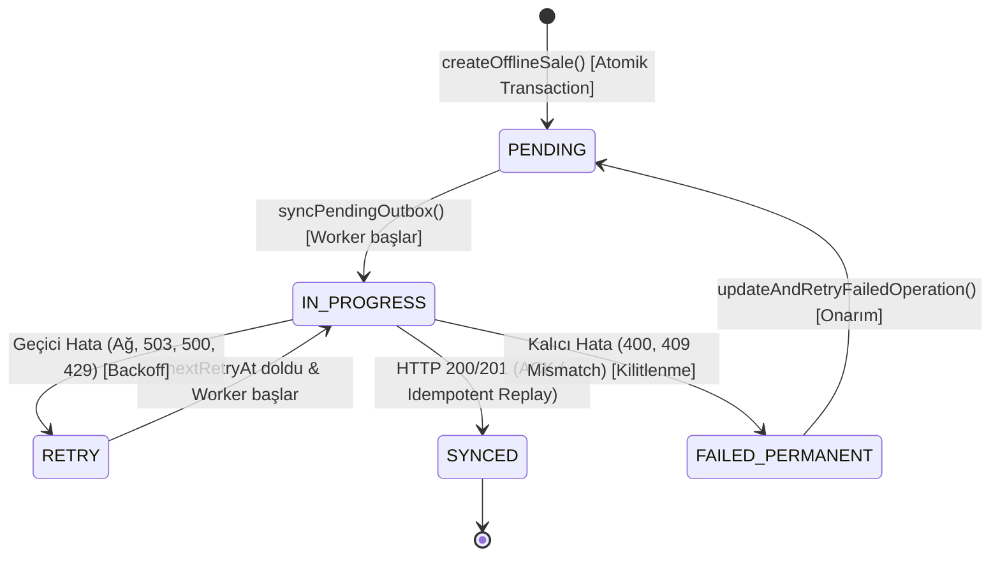

# PHASE 1.3.1 — SENKRONİZASYON TASARIM KARARLARI ÖNCESİ EK TEKNİK DOĞRULAMA RAPORU

**Belge Kimliği:** `PHASE_1_3_1_SYNC_DESIGN_DECISIONS_REVIEW.md`  
**Tarih:** 14 Kasım 2026  
**Aşama:** Faz 1.3.1 — Outbox ve Arka Plan Senkronizasyonu (Tasarım Kararları ve Mimari Netleştirme)  
**İnceleme Türü:** Tamamen Salt Okunur (Read-Only) Mimari ve Kod Analizi  
**Referans Doküman:** [`docs/development/PHASE_1_3_1_SYNC_TECHNICAL_ASSESSMENT.md`](file:///c:/Users/halil/Github/market-pos/docs/development/PHASE_1_3_1_SYNC_TECHNICAL_ASSESSMENT.md)  
**Temel Kurallar:** [`AGENTS.md`](file:///c:/Users/halil/Github/market-pos/AGENTS.md) ve [`GEMINI.md`](file:///c:/Users/halil/Github/market-pos/GEMINI.md)  

---

## 1. Yönetici Özeti

Bu belge, [`PHASE_1_3_1_SYNC_TECHNICAL_ASSESSMENT.md`](file:///c:/Users/halil/Github/market-pos/docs/development/PHASE_1_3_1_SYNC_TECHNICAL_ASSESSMENT.md) raporunda ortaya konan ilk bulguları derinleştirmek ve Faz 1.3.1 tasarım kararlarını vermeden önce sistemin 5 kritik mimari alanındaki durumunu kanıtlarıyla doğrulamak üzere hazırlanmıştır.

Yapılan detaylı statik incelemede şu 5 temel sonuca ulaşılmıştır:
1. **Token Eksikliği Kuyruğu Kilitler:** `MmsApiClient` içinde `deviceToken` şu an boştur (`null`). Token olmadan Hub'a istek atıldığında backend `401 Unauthorized` döner. [`ClientSyncService`](file:///c:/Users/halil/Github/market-pos/packages/mms_client_storage/lib/src/sync/client_sync_service.dart#L142) HTTP 401 yanıtını geçici hata değil **kalıcı hata (`FAILED_PERMANENT`)** kabul ettiği için, ilk senkronizasyon denemesinde **bütün Outbox kuyruğu kilitlenir (Head-of-Line Blocking)**.
2. **Sabit Token Backend'de Desteklenmez:** `test_spikes/spike_01_backend` içinde hardcoded token bypass'ı yoktur. Her token'ın Hub veritabanında (`devices`) SHA-256 + salt + pepper özetiyle kayıtlı olması zorunludur; aksi takdirde `401 DEVICE_NOT_FOUND` döner. Ayrıca kaynak koda sabit token yazmak `AGENTS.md` Kural 6'yı doğrudan ihlal eder.
3. **HTTP / HTTPS Çelişkisi:** İstemcide [`AppConstants.defaultBackendBaseUrl`](file:///c:/Users/halil/Github/market-pos/lib/core/constants/app_constants.dart#L9) `http://127.0.0.1:8080` (düz HTTP) olarak tanımlıdır; ancak `AGENTS.md` Kural 6 "Yerel ağda HTTPS iletişimi zorunludur" demektedir. Backend'de TLS desteği (`--enable-tls`) bulunmakla birlikte, istemcide Root CA sertifikası yükleme veya bağlama kodu henüz yer almamaktadır.
4. **`getPendingOutboxCount()` Semantik Uyuşmazlığı:** Kasa arayüzü ([`PosScreen`](file:///c:/Users/halil/Github/market-pos/lib/features/pos/presentation/screens/pos_screen.dart#L700)) ve testler, bekleyen outbox sayısını "henüz Hub'a ulaşmamış tüm satışlar" olarak beklemektedir. Ancak mevcut metot yalnızca `status == 'PENDING'` olanları saymakta; `RETRY` veya `FAILED_PERMANENT` durumundaki satışları saymayarak kasiyere "Bekleyen: 0" yanıltıcı bilgisini vermektedir.
5. **`ClientSyncService` Eşzamanlılık Korumasından Yoksundur:** `ClientSyncService.syncPendingOutbox()` kendi içinde hiçbir mutex, lock veya bayrak barındırmamaktadır. İki worker aynı anda çağrıldığında aynı satışı iki kez gönderebilmektedir. Dolayısıyla Application katmanında (`SyncCoordinator`) kuyruk koordinasyonu **zorunludur**.

---

## 2. Device Token ve Authentication Derin Analizi

### 2.1. `MmsApiClient` ve `deviceToken`'ın Mevcut Durumu
- [`lib/core/network/api_client.dart`](file:///c:/Users/halil/Github/market-pos/lib/core/network/api_client.dart#L16-L38):
  ```dart
  class MmsApiClient {
    final http.Client _client;
    final String baseUrl;
    final String? deviceToken;
    final String deviceId;
  ...
    Map<String, String> get _headers {
      final headers = <String, String>{
        'Content-Type': 'application/json',
        'Accept': 'application/json',
        'X-Device-Id': deviceId,
      };
      if (deviceToken != null && deviceToken!.isNotEmpty) {
        headers['Authorization'] = 'Bearer $deviceToken';
      }
      return headers;
    }
  ```
- [`lib/features/diagnostics/application/system_status_notifier.dart`](file:///c:/Users/halil/Github/market-pos/lib/features/diagnostics/application/system_status_notifier.dart#L9-L14):
  ```dart
  final apiClientProvider = Provider<MmsApiClient>((ref) {
    return MmsApiClient(
      baseUrl: AppConstants.defaultBackendBaseUrl,
      deviceId: AppConstants.defaultDeviceId,
    );
  });
  ```
- **Tespit:** `apiClientProvider` içinde `deviceToken` parametresi **hiç geçilmemektedir** (`null`). İstemci genelinde token oluşturan, saklayan veya okuyan tek bir satır kod dahi bulunmamaktadır.

### 2.2. Hub Tarafında `TokenManager` ve `PairingManager` Nasıl Çalışıyor?
- [`test_spikes/spike_01_backend/lib/security/token_manager.dart`](file:///c:/Users/halil/Github/market-pos/test_spikes/spike_01_backend/lib/security/token_manager.dart#L10-L62):
  - Token formatı: `mms_dt_` + 256-bit kriptografik rastgele Base64Url (43 karakter).
  - Cihaz başına 128-bit rastgele `salt` üretilir.
  - Saklama formülü: $\text{tokenHash} = \text{SHA-256}(\text{rawToken} + \text{':'} + \text{salt} + \text{':'} + \text{pepper})$.
  - Doğrulama: Sabit zamanlı (`constantTimeEquals`) karşılaştırma ile zamanlama saldırıları (timing attack) önlenir.
- [`test_spikes/spike_01_backend/lib/security/auth_middleware.dart`](file:///c:/Users/halil/Github/market-pos/test_spikes/spike_01_backend/lib/security/auth_middleware.dart#L51-L159):
  - Gelen `Authorization: Bearer <token>` başlığı ayıklanır.
  - Veritabanındaki (`db.devices`) tüm aktif cihazlar taranarak `TokenManager.verifyToken(...)` çalıştırılır.
  - Eşleşen cihaz bulunursa: `isActive == true`, `isConfirmed == true` ve `expiresAt` kontrolleri yapılır.
  - Başarılı olursa `authenticated_device_id` istek bağlamına (`context`) eklenir.
  - Eşleşme yoksa doğrudan **`HTTP 401 (DEVICE_NOT_FOUND)`** döner.

### 2.3. Windows İstemcisi İçin Token Edinme Mekanizması Var mı?
- **Tespit: HAYIR, MEVCUT DEĞİLDİR.**  
  Hub'daki [`PairingManager`](file:///c:/Users/halil/Github/market-pos/test_spikes/spike_01_backend/lib/security/pairing_manager.dart) tamamen mobil cihazların Wi-Fi üzerinden QR kod, ECDSA anahtar çifti ve meydan okuma (`/api/v1/pairing/*`) akışıyla eşleşmesi için tasarlanmıştır. Windows masaüstü istemcisi (`market-pos`) içinde pairing akışını tüketen hiçbir istemci kodu (`lib/`) yazılmamıştır.

### 2.4. Token Güvenli Biçimde Saklanabiliyor mu? (Açık Koşul B-3)
- **Tespit: HAYIR.**  
  `test_spikes/spike_01_backend/lib/security/dpapi.dart` altında sunucu tarafı için bir Windows DPAPI (`CryptProtectData` / `CryptUnprotectData`) sarmalayıcısı bulunmaktadır. Ancak bu yalnızca sunucu pepper dosyasını (`pepper.dpapi`) korumak içindir. Flutter istemci uygulamasında Windows DPAPI, Android Keystore veya iOS Keychain entegrasyonu bulunmamaktadır. Bu durum `AGENTS.md` Anayasası'nda **Açık Koşul B-3** olarak tescillidir.

### 2.5. Token Olmadan Satış Senkronizasyonunun Davranışı (Kritik Risk)
Eğer `ClientSyncService.syncPendingOutbox()` token olmadan (`token = ''` veya `token = null`) çağrılırsa:
1. `HttpSyncTransport.postSale`, `Authorization: Bearer ` veya başlıksız POST atar.
2. Hub `auth_middleware` isteği reddeder: **`HTTP 401 Unauthorized`**.
3. [`ClientSyncService.dart` Satır 120-149](file:///c:/Users/halil/Github/market-pos/packages/mms_client_storage/lib/src/sync/client_sync_service.dart#L120-L149):
   - `resp.isTransientError` kontrol edilir. [`sync_response.dart`](file:///c:/Users/halil/Github/market-pos/packages/mms_client_storage/lib/src/models/sync_response.dart#L20-L27) tanımına göre:
     `isTransientError = isNetworkError || [408, 429, 500, 502, 503, 504].contains(statusCode);`
   - **HTTP 401 bu listede YOKTUR!**
   - Kod doğrudan `else` bloğuna düşer:
     ```dart
     // Kalıcı hata (400 Bad Request veya 409 Mismatch)
     final errText = 'Kalıcı Hata [${resp.statusCode}]: ${resp.body}';
     await repository.markOutboxPermanentFail(op.operationId, error: errText);
     failed++;
     stopError = errText;
     break;
     ```
4. **Sonuç:** Token eksikliği nedeniyle işlem anında **`FAILED_PERMANENT`** olarak işaretlenir. Deterministik FIFO gereği kuyruk kilitlenir; sonraki hiçbir satış gönderilemez.

### 2.6. `pilot_win_token` Benzeri Sabit Token Kullanımı Mümkün mü? Güvenlik Etkisi Nedir?
- **Backend Uyumluluğu:**  
  Mevcut backend, `pilot_win_token` gibi keyfi bir metni doğrudan kabul edemez. Backend'in bu token'ı tanıması için `market_master.db` veritabanının `devices` tablosuna şu kaydın önceden eklenmiş (seed edilmiş) olması şarttır:
  - `device_id`: `'POS-WIN-01'`
  - `salt`: `16 bayt rastgele hex`
  - `token_hash`: `TokenManager.hashToken(rawToken: 'pilot_win_token', salt: salt, pepper: activePepper)`
  - `is_active`: `1`, `is_confirmed`: `1`
- **Güvenlik ve Anayasal Etki:**  
  1. `AGENTS.md` Kural 6 ve 14: *"API anahtarları, pepper.dpapi, veritabanı şifreleri, JWT secret'ları, sertifika özel anahtarları ve .env dosyaları ASLA kaynak koduna veya Git deposuna dahil edilemez."*  
  2. Kaynak kod içerisine hardcoded bir token yazılması bu anayasal kuralı ihlal eder.  
  3. **Önerilen Çözüm:** Token kaynak koda gömülmemeli; yerel kurulum/başlatma sırasında (`%LOCALAPPDATA%\MarketMMS\client_local.db` tablosunda `client_sync_states` veya yerel bir yapılandırma dosyasında) dinamik üretilmeli veya ilk açılışta yerel loopback API üzerinden doğrulanmalıdır.

---

## 3. HTTPS, Sertifika ve TLS Uyumu Analizi

### 3.1. Windows İstemcisinin Mevcut Hub URL Yapılandırması
[`lib/core/constants/app_constants.dart`](file:///c:/Users/halil/Github/market-pos/lib/core/constants/app_constants.dart#L7-L9):
```dart
  // Varsayılan Yerel Master Hub Bağlantı Bilgileri
  static const String defaultBackendHost = '127.0.0.1';
  static const int defaultBackendPort = 8080;
  static const String defaultBackendBaseUrl = 'http://127.0.0.1:8080';
```
- İstemci açıkça **`http://` (Düz, şifrelenmemiş HTTP)** protokolünü kullanmaktadır.

### 3.2. `HttpSyncTransport` Hangi Sertifika Doğrulamasını Yapıyor?
[`packages/mms_client_storage/lib/src/sync/sync_transport.dart`](file:///c:/Users/halil/Github/market-pos/packages/mms_client_storage/lib/src/sync/sync_transport.dart#L33-L54):
- **Varsayılan Kurucu (`HttpSyncTransport([http.Client? client])`):** Standart işletim sistemi güven köklerini (OS Trust Store) kullanır. Kendi kendine imzalı (self-signed) veya özel yerel Kök CA sertifikalarını reddeder.
- **Özel Kök CA Kurucusu (`HttpSyncTransport.withCustomRootCa({required List<int> rootCaBytes})`):** Güvenilen sertifika baytlarını `SecurityContext.setTrustedCertificatesBytes` ile yükler. Bu metot mevcuttur ancak Flutter istemcisinde hiçbir yerde çağrılmamaktadır.
- **Test Kurucusu (`HttpSyncTransport.insecureForTesting()`):** `badCertificateCallback = (...) => true` ile tüm sertifikaları körlemesine kabul eder.

### 3.3. Loopback Bağlantısında Gerçek Protokol Nedir?
- Hem Flutter istemcisinde (`AppConstants`) hem de `s5a3_live_hub_integration_test.dart` (satır 23) testinde loopback bağlantısı **`http://127.0.0.1:<port>`** üzerinden düz HTTP ile çalışmaktadır.

### 3.4. Root CA ve SAN Doğrulaması Nerede Uygulanıyor?
- [`test_spikes/spike_01_backend/lib/security/certificate_manager.dart`](file:///c:/Users/halil/Github/market-pos/test_spikes/spike_01_backend/lib/security/certificate_manager.dart):
  - OpenSSL tabanlı Kök CA (`ca.crt`, `ca.key`) ve Sunucu Sertifikası (`server.crt`, `server.key`) üretimi.
  - SAN (Subject Alternative Name) yapılandırması: `IP:127.0.0.1`, `DNS:localhost`.
  - TLS 1.3 zorunluluğu (`SecurityContext`).
- [`test_spikes/spike_01_backend/lib/security/tls_client_factory.dart`](file:///c:/Users/halil/Github/market-pos/test_spikes/spike_01_backend/lib/security/tls_client_factory.dart):
  - Kök CA parmak izi (SHA-256 fingerprint) doğrulaması.

### 3.5. Mevcut TLS Kararlarıyla Çelişen Noktalar ve Değerlendirme
- **Çelişki:** `AGENTS.md` Bölüm 6: *"Yerel HTTPS ve TLS: Yerel ağda HTTPS iletişimi zorunludur."*  
- **Fiili Durum:** Kod tabanında Windows istemcisi `http://127.0.0.1:8080` kullanmaktadır.
- **Teknik Değerlendirme (HTTP Fallback Önermeden):**  
  - Aynı makine içindeki inter-process iletişimde (`127.0.0.1` loopback), paketler fiziksel ağ kartına çıkmaz; işletim sistemi çekirdeği (kernel network stack) içinde kalır. Bu nedenle loopback seviyesinde paket dinleme (sniffing) riski yalnızca makinede yönetici (Administrator) yetkisine sahip bir zararlı varsa mümkündür.
  - Ancak mimari anayasa gereği **SaaS / Pilot aşamasında yerel ağda (Wi-Fi/LAN) HTTPS zorunludur**.
  - Backend `server.dart`'ta `--enable-tls` aktif edildiğinde, Flutter istemcisinin `HttpSyncTransport.withCustomRootCa` ile Hub'ın ürettiği `ca.crt` dosyasını yüklemesi zorunlu hale gelecektir.
  - Faz 1.3.1 kapsamında Windows masaüstü loopback geliştirme ortamında TLS sertifikası yükleme altyapısı hazırlanmalı, ancak geçici geliştirme sırasında sertifika dosyasının yolu parametrik tutulmalıdır.

---

## 4. Outbox Sayaçları ve Durum Yönetimi Analizi

### 4.1. `getPendingOutboxCount()` Metodunu Kullanan Yerler
Metot repository ve testler dahil toplam **6 farklı noktada** çağrılmaktadır:

| Çağrı Yeri | Dosya ve Satır | Çağrının Amacı ve Beklentisi |
|---|---|---|
| **Deklarasyon** | [`lib/core/storage/local_database_service.dart` L303](file:///c:/Users/halil/Github/market-pos/lib/core/storage/local_database_service.dart#L303) | `_db.outboxOperations.status.equals('PENDING')` filtresiyle tekil sayaç sorgular. |
| **Sistem Durumu** | [`lib/features/diagnostics/application/system_status_notifier.dart` L78](file:///c:/Users/halil/Github/market-pos/lib/features/diagnostics/application/system_status_notifier.dart#L78) | Kasa genel canlılık modeline (`SystemStatus.pendingOutboxCount`) aktarır. |
| **Kasa Ekranı** | [`lib/features/pos/presentation/screens/pos_screen.dart` L700](file:///c:/Users/halil/Github/market-pos/lib/features/pos/presentation/screens/pos_screen.dart#L700) | Kasiyere `'Bekleyen Outbox: $pendingOutboxCount'` metnini gösterir. |
| **DB Servis Testi**| [`test/core/storage/local_database_service_test.dart` L88, L155](file:///c:/Users/halil/Github/market-pos/test/core/storage/local_database_service_test.dart#L88) | Başlangıçta ve satış sonrasında sayacın doğruluğunu assert eder. |
| **Sözleşme Testi** | [`test/core/storage/payment_method_contract_test.dart` L83](file:///c:/Users/halil/Github/market-pos/test/core/storage/payment_method_contract_test.dart#L83) | CASH ve CARD satışlarında outbox kaydının eklendiğini doğrular. |
| **POS Repo & Screen Testleri** | [`test/features/pos/data/local_pos_repository_test.dart` L322](file:///c:/Users/halil/Github/market-pos/test/features/pos/data/local_pos_repository_test.dart#L322), [`pos_screen_test.dart` L346](file:///c:/Users/halil/Github/market-pos/test/features/pos/presentation/pos_screen_test.dart#L346) | Satış sonrasında bekleyen sayacının `1` olduğunu assert eder. |

### 4.2. Çağrı Noktalarının Anlamsal Beklentisi
- **Kasiyer ve UI Beklentisi:** "Henüz merkezi sunucuya (Hub) ulaşmamış, kuyrukta bekleyen kaç satışım var?" sorusunun cevabıdır.
- **Fiili Durum:** Bir satış yapıldığında `status = 'PENDING'` olur (sayaç: 1). Senkronizasyon servisi çalıştığında ve ağ hatası aldığında durum `RETRY` olur. Bu anda sayaç **`0`** değerine düşer! Kasiyer ekranda "Bekleyen Outbox: 0" görür ve satışın Hub'a ulaştığını zanneder. Bu durum operasyonel açıdan ciddi bir yanıltmadır.

### 4.3. Outbox Durumlarının Yaşam Döngüsü



### 4.4. Mimari Karar: Metodu Değiştirmek mi, `OutboxSummary` Modeli mi?
- **Seçenek 1 (Yalnızca Metodu Değiştirmek):** `getPendingOutboxCount()` sorgusunu `status != 'SYNCED'` yapmak.  
  - *Sakıncası:* Tek bir tamsayı dönmesi, arayüzün `RETRY` (ağ beklemesi) ile `FAILED_PERMANENT` (kuyruk kilitlenmesi) arasındaki farkı anlamasını engeller. Kasiyere veya yöneticiye hata durumu bildirilemez.
- **Seçenek 2 (Önerilen — `OutboxSummary` Değer Nesnesi):**  
  Clean Architecture ve Single Responsibility Principle (SRP) gereğince, veritabanı sorgusunu zenginleştiren bir model tanımlanmalıdır:
  ```dart
  class OutboxSummary {
    final int pendingCount;
    final int inProgressCount;
    final int retryCount;
    final int permanentFailedCount;
    final int totalUnsynced; // pending + inProgress + retry + permanentFailed

    const OutboxSummary({
      required this.pendingCount,
      required this.inProgressCount,
      required this.retryCount,
      required this.permanentFailedCount,
      required this.totalUnsynced,
    });

    bool get hasFailures => permanentFailedCount > 0;
    bool get isClean => totalUnsynced == 0;
  }
  ```
  - **Gerekçe:**  
    1. `LocalDatabaseService.getOutboxSummary()` tek bir `SELECT status, COUNT(*) GROUP BY status` sorgusuyla tüm metrikleri atomik çeker.  
    2. Geriye dönük uyumluluk için `getPendingOutboxCount()` metodu korunur ve `summary.totalUnsynced` (veya `summary.pendingCount`) değerine yönlendirilir; böylece mevcut 6 test kırılmaz.  
    3. UI rozeti (`SyncQueueBadge`), kuyrukta kalıcı hata (`hasFailures`) varsa anında kırmızı alarm durumuna geçebilir.

---

## 5. SyncCoordinator ve Yaşam Döngüsü Koordinasyonu

### 5.1. `ClientSyncService.syncPendingOutbox()` Eşzamanlılık Koruması Var mı?
- **Tespit: KESİNLİKLE YOKTUR.**  
  [`packages/mms_client_storage/lib/src/sync/client_sync_service.dart`](file:///c:/Users/halil/Github/market-pos/packages/mms_client_storage/lib/src/sync/client_sync_service.dart#L49-L150) satır satır incelendiğinde:
  - Sınıf içinde hiçbir `bool _isSyncing`, `Mutex` veya `Lock` bulunmamaktadır.
  - Satır 68'de en küçük `client_seq` kaydı okunmakta (`select`), satır 100'de ise `markOutboxInProgress` çağrılmaktadır.
  - Bu iki adım **aynı veritabanı transaction'ı içinde DEĞİLDİR**.
  - Eğer iki eşzamanlı asenkron çağrı gelirse, ikisi de aynı `oldestUnsynced` kaydını okur ve aynı anda sunucuya iletir.
  - Dahası, satır 59'da `recoverStuckInProgressOperations` çağrılmaktadır. İkinci worker başladığında, birinci worker'ın henüz ağda bekleyen `IN_PROGRESS` işlemini "çökmüş işlem" zannederek `RETRY` veya `PENDING`'e çekebilir!
  - **Bu durum ciddi bir veri yarışına (Race Condition) yol açar.**

### 5.2. Koordinasyon Seçeneklerinin Karşılaştırması

| Mekanizma | Nasıl Çalışır? | Avantajı | Dezavantajı / Risk | Karar |
|---|---|---|---|---|
| **Yalnızca `_isSyncing` Bayrağı** | `if (_isSyncing) return;` | Basit uygulama. | Senkronizasyon devam ederken yeni bir satış olursa, o satışın bildirimi düşer; sonraki periyoda kadar iletilmez. | **Yetersiz.** |
| **`_isSyncing` + `_hasPendingRequest` (Coalescing)** | Senkronizasyon bittiğinde `_hasPendingRequest` kontrol edilir; varsa hemen bir tur daha döner. | Hiçbir satış kaçırılmaz. Eşzamanlı çağrılar zarifçe birleştirilir (debounced / coalesced). | Küçük bir while döngüsü gerektirir. | **ÖNERİLEN.** |
| **`Future<SyncBatchResult>? _activeSyncFuture`** | Devam eden Future varsa yeni gelen çağrılar bu Future'a `await` eder. | Birden fazla tetikleyici aynı sonucu paylaşır. | İlk işlem bittiğinde aradaki yeni satışlar için ek tur dönülmesi gerekir. | İkincil destek. |

### 5.3. Yaşam Döngüsü (Timer, Riverpod Dispose ve Uygulama Kapanışı)
1. **Timer Yönetimi:**  
   `SyncCoordinatorNotifier` içinde çalışan `Timer.periodic` nesnesi, Riverpod'un `onDispose` yaşam döngüsünde **kesinlikle iptal edilmelidir (`_timer?.cancel()`)**.
2. **Pencere Kapanışı (Window Close):**  
   Windows masaüstünde kullanıcı çarpı butonuna bastığında veya `LocalDatabaseService.closeActive()` çağrıldığında:
   - Devam eden bir senkronizasyon HTTP isteği varsa, `LocalDatabaseService`'in mevcut `_TrackedClientStorageRepository` yapısı sayesinde veritabanı kapatma işlemi `drainTimeout` (2 saniye) boyunca bekler.
   - Ancak ağ isteğinin sonsuz kilitlenmemesi için `HttpSyncTransport` isteklerine konulan `requestTimeout` (10 saniye) emniyeti devrededir.

---

## 6. Backend Kapsamı ve Hazırlık Değerlendirmesi

### 6.1. `test_spikes/spike_01_backend` Rolü: Spike mı, Pilot Backend mi?
- [`AGENTS.md`](file:///c:/Users/halil/Github/market-pos/AGENTS.md) Bölüm 2 (Teknoloji Yığını):  
  *"Merkezi Sunucu API (Pilot): Dart Shelf HTTPS API — Bağımsız Dart backend çalıştırılabilir dosyası (`%PROGRAMDATA%\MarketMMS\bin\mms_backend.exe`, `test_spikes/spike_01_backend`)"*  
- **Tespit:** `spike_01_backend` projesi salt geçici bir prototip değil; **pilot aşaması için Windows Local Master Hub servisinin çekirdek implementasyonudur**. S5A serisi testlerle SQLite WAL tekil yazıcı eşzamanlılığı doğrulanmıştır.
- **Ancak Resmi Statü:** `PROJECT_STATUS.md` ve S5A-5 kabul raporunda belirtildiği üzere: **`KOŞULLU PİLOT HAZIRLIĞI (READY FOR PILOT WITH CONDITIONS)`** seviyesindedir.

### 6.2. Faz 1.3.1 Açısından Endpoint ve Veri Sözleşmesi Hazır mı?
- **`POST /api/v1/sales` Uç Noktası:**  
  [`test_spikes/spike_01_backend/bin/server.dart` L946-L1310](file:///c:/Users/halil/Github/market-pos/test_spikes/spike_01_backend/bin/server.dart#L946-L1310):
  - `client_seq`, `total_amount`, `payment_method` (`'CASH'`/`'CARD'`), `items` (`product_id`, `quantity`, `unit_price`, `total_price`, `price_version_id`) sözleşmesi **%100 hazırdır**.
  - `packages/mms_client_storage`'daki Outbox yükü ile birebir uyuşmaktadır.
- **`GET /health` Uç Noktası:**  
  [`server.dart` L224-L235](file:///c:/Users/halil/Github/market-pos/test_spikes/spike_01_backend/bin/server.dart#L224-L235):
  - Şifresiz public sağlık kontrolü hazır ve çalışmaktadır.

### 6.3. Spike Backend İle Üretim / Pilot Backend Arasındaki Eksikler

| Alan | `spike_01_backend` Mevcut Durumu | Üretim / Pilot Gereksinimi | Öncelik / Faz |
|---|---|---|---|
| **Paketleme / Dağıtım** | `dart bin/server.dart` olarak kaynak koddan çalışıyor. | `dart compile exe` ile `%PROGRAMDATA%\MarketMMS\bin\mms_backend.exe` derlenmesi ve WinSW servisi. | Faz 7 Pilot Öncesi |
| **Cihaz Başlatma (Bootstrap)** | Yalnızca mobil QR pairing rotaları mevcut. | Windows masaüstü istemcisi için ilk kurulumda yerel cihaz yetkilendirme mekanizması. | **Faz 1.3.1 İçin Gerekli** |
| **Günlükleme (Logging)** | `stdout` / `stderr` konsol çıktısı. | `%PROGRAMDATA%\MarketMMS\logs\mms_backend.log` döngüsel (rotating) dosya günlükleme. | Pilot Öncesi |
| **Erişim Kontrolü (ACL)** | Geliştirici kullanıcı yetkisiyle çalışıyor. | Standart Windows kullanıcısıyla `%PROGRAMDATA%\MarketMMS` ACL erişim kontrolü (Spike Koşulu). | Pilot Öncesi |
| **Hata İnceleme API** | Yok (Yalnızca veritabanı seviyesinde `updateAndRetryFailedOperation`). | Kalıcı hataları uzaktan veya arayüzden inceleme uç noktası. | Faz 1.3 / Faz 2 |

---

## 7. Tasarım Kararları Öneri Özeti (Karar Matrisi)

Faz 1.3.1 uygulama planı hazırlanırken aşağıdaki 5 mimari kararın uygulanması önerilmektedir:

```
+---------------------------------------------------------------------------------------------------+
| NO  | KONU                | MEVCUT DURUM                   | ÖNERİLEN TASARIM KARARI              |
+-----+---------------------+--------------------------------+--------------------------------------+
| D-1 | Cihaz Kimlikleme    | deviceToken null, Hub 401      | Windows masaüstü için ilk yerel      |
|     | (Authentication)    | döner ve kuyruk kilitlenir.    | cihaz seed mekanizması tasarlanmalı. |
+-----+---------------------+--------------------------------+--------------------------------------+
| D-2 | İletişim Protokolü  | AppConstants http://127.0.0.1  | Yerel loopback parametrik tutulmalı; |
|     | ve TLS              | düz HTTP kullanıyor.           | Root CA entegrasyonu hazırlanmalı.   |
+-----+---------------------+--------------------------------+--------------------------------------+
| D-3 | Outbox Sayaç        | Sadece status='PENDING'        | OutboxSummary modeli oluşturulmalı;  |
|     | Mimarisi            | sayılıyor (RETRY sayılmıyor).  | getPendingOutboxCount korunmalı.     |
+-----+---------------------+--------------------------------+--------------------------------------+
| D-4 | Senkronizasyon      | ClientSyncService içinde lock  | SyncCoordinatorNotifier katmanında   |
|     | Eşzamanlılık Kilidi | yok; race condition riski var. | _isSyncing + _hasPendingRequest.     |
+-----+---------------------+--------------------------------+--------------------------------------+
| D-5 | Arka Plan Periyodu  | Hiçbir otomatik worker yok.    | 30 saniyelik periyodik timer +       |
|     | ve Tetikleme        |                                | onSaleCommitted anında tetikleme.    |
+---------------------------------------------------------------------------------------------------+
```

---

## 8. Kısıtlama ve Doğrulama Teyidi

Bu inceleme sırasında:
- [x] Hiçbir Dart/Flutter kaynak kodu değiştirilmemiştir.
- [x] Hiçbir test dosyası değiştirilmemiştir.
- [x] Hiçbir bağımlılık veya paket eklenmemiştir.
- [x] Veritabanı şeması veya migration değiştirilmemiştir.
- [x] Önceki rapor ([`PHASE_1_3_1_SYNC_TECHNICAL_ASSESSMENT.md`](file:///c:/Users/halil/Github/market-pos/docs/development/PHASE_1_3_1_SYNC_TECHNICAL_ASSESSMENT.md)) korunmuştur.
- [x] `git add`, `git commit` veya `git push` çalıştırılmamıştır.
- [x] Yalnızca bu analiz raporu (`docs/development/PHASE_1_3_1_SYNC_DESIGN_DECISIONS_REVIEW.md`) oluşturulmuştur.

Rapor proje sahibinin incelemesine sunulmuş olup, Faz 1.3.1 tasarım kararlarının netleştirilmesi için yönlendirmeniz beklenmektedir.

