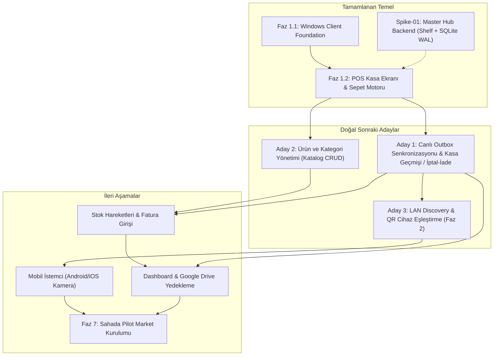

# MARKET MMS — Faz 1.3 Öncesi Kapsamlı Yol Haritası ve Proje Durumu İncelemesi

- **Tarih:** 2026-11-13
- **İnceleme Türü:** Stratejik Yol Haritası, Mimari Bağımlılık ve Faz Planlama Analizi
- **Mevcut Git Durumu:** `main` dalı, son commit [`e9e1df5`](file:///c:/Users/halil/Github/market-pos/docs/development/PHASE_1_2_STAGED_DIFF_REVIEW_REPORT.md) (`feat(pos): implement cashier sales screen, cart engine, and storage reliability`), `origin/main` ile %100 senkron (`ahead: 0, behind: 0`).
- **Bağlayıcı Referanslar:** `AGENTS.md`, `GEMINI.md`, `MARKET_POS_AI_STUDIO_BUILD_PLANI.md` (v1.4), `docs/ROADMAP.md`, `docs/PROJECT_STATUS.md`, `docs/REQUIREMENTS.md`, `docs/requirements/BUSINESS_RULES_SPEC.md` (v1.6), `docs/architecture/DATA_MODEL.md`.
- **Yürütme Sınırı:** Yalnızca analiz ve raporlama. Hiçbir kod veya kanonik doküman değiştirilmemiştir. Git stage/commit/push yürütülmemiştir.

---

## 1. Yönetici Özeti

MARKET MANAGEMENT SYSTEM (MARKET MMS) projesinde **Faz 0 (Planlama ve Mimari Kararlar)**, **Faz 1.1 (Windows Client Foundation)** ve **Faz 1.2 (Kasa Satış Ekranı & Sepet Yönetimi)** başarıyla tamamlanmış; tüm teslimatlar Proje Sahibi onayıyla Git geçmişine (`e9e1df5`) işlenmiştir. Kod tabanı 274 otomatik test (%100 yeşil), 0 statik analiz uyarısı ve çalışan bir Windows masaüstü uygulaması (`market_pos.exe`) seviyesindedir.

Bu rapor, Faz 1.2'nin tamamlanmasının ardından projenin bütünsel durumunu, henüz uygulanmamış modülleri, teknik ve mimari bağımlılıkları, pilot öncesi açık güvenlik koşullarını incelemekte ve **bir sonraki mantıksal geliştirme aşaması (Faz 1.3 ve sonrası)** için Proje Sahibine seçenekli bir karar matrisi sunmaktadır.

---

## 2. Tamamlanan Fazlar ve Teslimat Envanteri

| Faz / Kilometre Taşı | Commit / Tag | Tarih | Tamamlanan Çekirdek Kapsam | Test Durumu |
|---|:---:|:---:|---|:---:|
| **Faz 0 — Mimari & Spike-01** | `5eb34ed` | 2026-10-31 | 25 tabloluk veri modeli (`DATA_MODEL.md`), Dart Shelf HTTPS tekil yazıcı API'si, SQLite WAL eşzamanlılığı, AES-256-CBC + HMAC-SHA256 Encrypt-then-MAC yedekleme motoru. | 139 test |
| **Faz 1.1 — Windows Client Foundation** | `8676586` (`v1.1.0`) | 2026-11-06 | `packages/mms_client_storage` (Drift SQLite), `market_pos` masaüstü ana iskeleti (`MainShellScreen`), Sistem Tanılama (`DiagnosticsView`), sağlık kontrolü. | 221 test |
| **DT-01.1 .. DT-01.4 — Yönetişim & Beceriler** | `50343d9` .. `32111b8` | 2026-11-06 | `AGENTS.md` anayasası, `GEMINI.md`, 5 çekirdek Antigravity becerisi (`code-quality`, `test-first`, `systematic-debugging`, `flutter-ui-standards`, `documentation`). | Tamamlandı |
| **UI/UX Tasarım ve Prototipleme** | `9ad09fc` | 2026-11-12 | 32 dosyalık HTML/CSS/JS görsel prototipleri, Flutter Handoff şartnamesi, `OD-01..OD-04` kararları (`12.50 TL`, Half-Up, Parked Carts `OUT_OF_SCOPE`). | 32 prototip |
| **`PaymentMethod` Standardizasyonu & Outbox Recovery** | `b069d5b` | 2026-11-12 | Tüm katmanlarda yalnızca `'CASH'` ve `'CARD'` sözleşmesi; backend katı reddi; atomik `updateAndRetryFailedOperation()` ve canlı Master Hub kurtarma akışı. | 235 test |
| **Faz 1.2 — Kasa Satış Ekranı & Sepet Yönetimi** | `e9e1df5` | 2026-11-13 | POS kasa ekranı (`PosScreen`), sepet motoru (`CartNotifier`), klavye kısayolları (F1-F10, Esc), barkod arama, `PaymentDialog`, snapshot fiyat güvencesi (`PriceChangedException`), 64-bit taşma koruması, `_nextUniqueToken()` benzersizliği. | **274 test** |

---

## 3. Henüz Uygulanmamış Modüller ve Fonksiyonel Boşluklar

Mevcut sistemde kasa satış yapabilmekte, yerel satış kaydı oluşturmakta ve işlemi yerel `outbox_operations` tablosuna atomik olarak yazabilmektedir. Ancak uçtan uca perakende döngüsünde aşağıdaki kritik fonksiyonel boşluklar bulunmaktadır:

### 3.1. Canlı Outbox Senkronizasyonu (Windows Client $\leftrightarrow$ Master Hub)
- **Mevcut Durum:** `packages/mms_client_storage` içinde `ClientSyncService` ve `HttpSyncTransport` mevcuttur ve test edilmiştir. Ancak Flutter istemcisinde (`market_pos/lib/`) bu servisi arka planda reaktif veya periyodik tetikleyen bir Riverpod worker'ı **bulunmamaktadır**.
- **Eksiklik:** Kasa ekranında yapılan satışlar yerel veritabanında `outbox_operations` tablosunda `PENDING` olarak beklemekte; otomatik olarak Master Hub'a (`POST /api/v1/sales`) aktarılamamaktadır. Üst başlıktaki rozet (`StatusBadge`) yalnızca sunucunun açık olup olmadığını göstermekte, kuyruk derinliğini (ör. *"3 işlem beklemede"*) yansıtamamaktadır.

### 3.2. Kasa Geçmişi, Fiş Detayı ve İptal / İade Yönetimi (Main Shell Tab 2)
- **Mevcut Durum:** [`MainShellScreen`](file:///c:/Users/halil/Github/market-pos/lib/features/shell/presentation/screens/main_shell_screen.dart) içinde Tab 2 placeholder durumundadır.
- **Eksiklik:**
  - Kasiyer/işletme sahibi gün içinde yaptığı geçmiş satışları listeleyememektedir.
  - Satış fişi detayı (`sale_items`, nakit/kart ayrımı, para üstü) görüntülenememektedir.
  - `BR-POS-08` Tam Satış İptali (gerekçeli, audit log kayıtlı) uygulanamamaktadır.
  - `BR-POS-09` Kısmi Ürün İadesi (iade edilen ürünün hasarlı/satılabilir durumuna göre stoğa girmesi `BR-POS-10`) bulunmamaktadır.

### 3.3. Ürün ve Kategori Yönetimi — Katalog CRUD (Main Shell Tab 1)
- **Mevcut Durum:** [`MainShellScreen`](file:///c:/Users/halil/Github/market-pos/lib/features/shell/presentation/screens/main_shell_screen.dart) içinde Tab 1 placeholder durumundadır. Kasa ekranı yerel ürün kataloğunda arama yapabilmekte ancak yeni ürün ekleyememektedir.
- **Eksiklik:**
  - Yeni ürün tanımlama (`BR-PROD-01`): İsim, birim (adet, kg, L), KDV oranı, alış maliyeti, satış fiyatı.
  - Çoklu barkod yönetimi (`BR-PROD-02`, `BR-PROD-15`).
  - Fiyat güncelleme ve fiyat geçmişi (`price_history` / `BR-PROD-13`).
  - Kategori oluşturma ve hiyerarşik bağlama (`BR-PROD-14`).
  - Pasifleştirme ve ürün düzenleme.
  - *Not:* Şu anda POS ekranındaki ürünler veritabanına test tohumları (seed) ile girilmektedir; gerçek kullanıcının arayüzden ürün girebileceği bir ekran yoktur.

### 3.4. Stok Düzeltme ve Hareket İzleme (Inventory Operations)
- **Mevcut Durum:** Satış anında stok `SALE` hareketiyle otomatik düşmektedir (`BR-STK-01`).
- **Eksiklik:**
  - Mal kabul / fatura girişi (`PURCHASE` / `BR-STK-02`).
  - Zayiat, bozulma, fire çıkışı (`WASTE_FIRE` / `BR-STK-03`).
  - Manuel stok düzeltme (`ADJUSTMENT_IN`, `ADJUSTMENT_OUT`).
  - Stok hareketleri geçmişi listesi (`stock_movements` ekranı).
  - *Not:* Fiziksel kör stok sayımı (`BR-STK-04..10`) Proje Sahibi kararıyla MVP dışına (`[OUT_OF_SCOPE]`) alınmıştır.

### 3.5. Cihaz Eşleştirme ve Yerel Ağ Keşfi (Faz 2 / SPIKE-02)
- **Mevcut Durum:** Windows istemcisi sabit `LOCAL_PC_CLIENT` kimliğiyle çalışmaktadır.
- **Eksiklik:**
  - Yerel ağ mDNS servis yayını ve keşfi (`_marketmms._tcp`).
  - Dinamik QR Kod üretimi ve mobil cihazların kamerayla okuyarak eşleşmesi (Pairing).
  - Cihaz bazlı kalıcı `device_id` tahsisi ve token saklama.

### 3.6. Mobil İstemci Uygulaması (Android / iOS)
- **Mevcut Durum:** Kod tabanında `market_pos` Flutter masaüstü çalışmaktadır; mobil platformlar için henüz özel bir derleme veya kamera entegrasyonu (`mobile_scanner`) test edilmemiştir.
- **Eksiklik:** Mobil kamera ile barkod okuma, mobil responsive ekranlar, mobil yerel SQLite veritabanı.

### 3.7. Google Drive Şifreli Yedekleme ve Kurtarma (Faz 6)
- **Mevcut Durum:** `packages/mms_client_storage` altında S5A-4 şifreleme ve doğrulama motoru tamdır (63 test).
- **Eksiklik:** Google Drive API OAuth entegrasyonu, otomatik yedekleme zamanlayıcısı (cron/timer) ve masaüstü arayüzünden tek tıkla geri yükleme ekranı.

---

## 4. Mimari ve Teknik Bağımlılık Ağacı

Modüller arasındaki mantıksal ve teknik bağımlılık hiyerarşisi aşağıda modellenmiştir:



### Bağımlılık Analizi:
1. **POS Ekranı $\to$ Senkronizasyon Bağlantısı:** POS ekranı satış üretiyor, bu satışlar Outbox'ta birikiyor. Master Hub zaten canlı olarak çalışıyor. İstemcideki `ClientSyncService`'i bağlamak, yapılan satışların merkezi veritabanına anında akmasını sağlar.
2. **POS Ekranı $\to$ Ürün Kataloğu Bağlantısı:** POS ekranı arama ve barkod okuma yapıyor. Ancak gerçek market operasyonunda sepete ürün ekleyebilmek için yerel katalogda ürünlerin bulunması gerekir. Arayüzden ürün ekleme/fiyat değiştirme olmadan sistem bağımsız test edilemez.
3. **Kasa Satışı $\to$ Fiş Detayı ve İptal/İade:** Kasiyer yanlış işlem yaptığında fişi iptal edebilmeli veya müşterinin iadesini alabilmelidir. Bu özellik Kasa modülünün (POS) ayrılmaz bir parçasıdır.

---

## 5. İş Kuralları ve Açık Kararlar (Open Decisions) Durumu

### 5.1. Kesinleşmiş ve Kapatılmış Kararlar (CONFIRMED)
- **`OD-01` (Kuruş Standardı & Half-Up):** Parasal hesaplamalarda `double` yasaktır. Kuruş bazlı tamsayı (`int`), standart ticari Half-Up yuvarlama ve `12.50 TL` gösterim standardı uygulanmıştır (`CONFIRMED`).
- **`OD-02` (Parked Carts / Askıya Alınan Sepet):** MVP kapsamı dışına (`[OUT_OF_SCOPE]`) alınmıştır (`CONFIRMED`).
- **`OD-03` (Çevrimdışı Bilinmeyen Barkod):** Çevrimdışıyken yerel veritabanında olmayan barkod sepete eklenemez ve çevrimdışı ürün kartı açılamaz (`[CONFIRMED]`). Yeni ürün için Master Hub bağlantısı zorunludur.
- **`OD-04` (Sanal Dokunmatik Numpad):** POS ekranında opsiyoneldir; varsayılan olarak kapalıdır (`[CONFIRMED]`).
- **`PaymentMethod` Standardizasyonu:** Sözleşmede yalnızca `'CASH'` ve `'CARD'` değerleri geçerlidir; donanımsal banka POS entegrasyonu MVP dışıdır (`[CONFIRMED]`).
- **Fiziksel Stok Sayımı (`BR-STK-04..10`):** MVP kapsamı dışına (`[OUT_OF_SCOPE]`) alınmıştır (`CONFIRMED`).

### 5.2. Açık Kalan Kararlar (Open Decisions)
1. **`OD-SYNC-01` (Worker Kiralama ve Yeniden Deneme Parametreleri):**  
   `docs/architecture/OFFLINE_SYNC_PROTOCOL.md` ve `BUSINESS_RULES_SPEC.md` içinde yer alan `sync_worker_leases` kiralama süresi (30 sn), heartbeat aralığı (10 sn) ve üstel geri çekilme (exponential backoff: $2^n \times 1\text{ sn}$, maks 60 sn) parametreleri `OPEN DECISION` statüsündedir.
2. **`OD-ARCH-01` (`PaymentMethod` & Ortak Sözleşme Paketi):**  
   Mevcut fazda `PaymentMethod`, `package:mms_client_storage/payment_method.dart` üzerinden saf Dart olarak tüketilmektedir (NO ARCHITECTURE ISSUE). Çok şubeli / çok paketli SaaS aşamasına geçildiğinde `packages/mms_contracts` (veya `mms_domain`) adında bağımsız bir sözleşme paketi açılması mimari bir hedef olarak kayıtlıdır.

---

## 6. Pilot Öncesi Açık Teknik Koşullar (Mandatory Conditions)

Spike-01 değerlendirmesinde sistem **KOŞULLU PİLOT HAZIRLIĞI (READY FOR PILOT WITH CONDITIONS)** statüsünde kabul edilmiştir. Gerçek bir market ortamında pilota başlanabilmesi için aşağıdaki 6 açık teknik koşulun karşılanması zorunludur:

| No | Koşul Kodu | Tanım | Mevcut Durum | Hangi Fazda Çözülmeli? |
|:---:|:---:|---|---|:---:|
| 1 | **B-2** | Mobil istemcilerde (Android/iOS) Root CA sertifika sabitleme (Certificate Pinning) | Henüz uygulanmadı | Faz 2 / SPIKE-03 |
| 2 | **B-3** | Güvenli anahtarlık depolama (Windows DPAPI `pepper.dpapi`, Android Keystore, iOS Keychain) | Spike aşamasında DPAPI simüle edildi; gerçek OS entegrasyonu bekliyor | Faz 2 / Cihaz Kaydı |
| 3 | **SCM** | Gerçek Windows Service Control Manager servis kurulum, başlatma, otomatik kurtarma testleri | WinSW XML hazır; bağımsız test edildi, gerçek SCM test edilmedi | Faz 1.4 / Windows Servis |
| 4 | **ACL** | Standart (non-admin) Windows kullanıcısı yetki ve `%PROGRAMDATA%\MarketMMS` dizin erişim testleri | Tasarlandı, sahada doğrulanacak | Faz 7 Pilot Öncesi |
| 5 | **Mobil** | Fiziksel Android/iOS cihazlarla gerçek yerel Wi-Fi mDNS / Dinamik QR eşleştirme testleri | Tasarlandı; mobil istemci bekleniyor | Faz 2 / SPIKE-02 |
| 6 | **Pairing** | Cihaz eşleştirme rotalarına özel token kısıtlama doğrulaması (`route-specific pairing token`) | Backend'de tasarlandı | Faz 2 / Cihaz Kaydı |

---

## 7. Bir Sonraki Aşama İçin Alternatif Adaylar ve Değerlendirme

Mevcut duruma göre bir sonraki adım için **3 mantıksal alternatif** bulunmaktadır:

### Alternatif 1: Faz 1.3 — Kasa Arka Plan Senkronizasyonu & Satış Geçmişi / İptal-İade (TAVSİYE EDİLEN)
- **Kapsam:**
  1. `market_pos` masaüstü istemcisine reaktif arka plan outbox worker'ının entegre edilmesi (`ClientSyncService` $\to$ Master Hub).
  2. Başlık çubuğundaki `StatusBadge` üzerinde canlı Outbox kuyruk derinliğinin gösterilmesi (ör. *"Senkronize"* veya *"2 bekleyen fiş"*).
  3. Kasa Satış Geçmişi ve Fiş İnceleme ekranı (Main Shell Tab 2).
  4. Fiş İptali (`BR-POS-08`) ve Kısmi İade (`BR-POS-09`) akışlarının tamamlanması.
- **MVP Önceliği:** **Çok Yüksek.** (Kasiyerin yaptığı satışların sunucuya aktarılması ve kesilen fişin iptal edilebilmesi kasanın temel gereksinimidir).
- **Teknik Bağımlılık:** Faz 1.2 POS ekranının doğrudan devamıdır; yeni bir paket gerektirmez; `ClientSyncService` zaten mevcuttur.
- **Kullanıcı Değeri:** Kasa modülü yarım kalmaz, uçtan uca çalışır hâle gelir.

---

### Alternatif 2: Faz 1.3 (veya Faz 3) — Ürün ve Kategori Yönetimi (Katalog CRUD)
- **Kapsam:**
  1. Main Shell Tab 1 altındaki Ürün ve Kategori ekranının hayata geçirilmesi.
  2. Ürün ekleme, düzenleme, pasifleştirme (`BR-PROD-01`).
  3. Barkod ekleme/çıkarma (`BR-PROD-02`).
  4. Fiyat güncelleme (`price_history` / `BR-PROD-13`).
  5. Kategori ağacı ve KDV oranları yönetimi.
- **MVP Önceliği:** **Yüksek.** (Kullanıcının test seed'leri yerine kendi ürünlerini markete girmesini sağlar).
- **Teknik Bağımlılık:** Ürün modelleri veritabanında hazırdır; Drift DAO'ları mevcuttur. UI ekranları ve form doğrulamaları yazılacaktır.
- **Kullanıcı Değeri:** Market sahibi marketteki ürünleri arayüzden sisteme kaydedebilir.

---

### Alternatif 3: Faz 2 — Kimlik, Yerel Ağ Keşfi (mDNS) ve Cihaz Eşleştirme (QR Pairing)
- **Kapsam:**
  1. SPIKE-02: Yerel ağda mDNS servis anonsu ve keşfi.
  2. Dinamik QR kod üretimi ve Master Hub ile mobil cihaz eşleştirme protokolü.
  3. B-3 Güvenli token saklama (Windows DPAPI, Android Keystore).
  4. İşletme sahibi (Owner) PIN / şifre girişi.
- **MVP Önceliği:** **Orta.** (Yalnızca masaüstü kasa kullanılacaksa acil değildir; mobil cihazlar devreye gireceği zaman zorunludur).
- **Teknik Bağımlılık:** Bağımsız bir ağ ve güvenlik fazıdır.
- **Kullanıcı Değeri:** Telefonların kasaya bağlanmasını sağlar.

---

## 8. Önerilen Geliştirme Sırası ve Gerekçeli Yol Haritası

Mevcut mimari olgunluk, teknik riskler ve kullanıcıya sunulacak değer göz önüne alındığında aşağıdaki sıralama önerilmektedir:

```text
Adım 1: Faz 1 Dokümantasyon Uzlaştırması (PROJECT_STATUS.md & REQUIREMENTS.md güncellemesi)
   ↓
Adım 2: Faz 1.3 — Kasa Arka Plan Senkronizasyonu & Satış Geçmişi / İptal-İade
   ↓
Adım 3: Faz 1.4 (veya Faz 3) — Ürün ve Kategori Yönetimi (Katalog CRUD)
   ↓
Adım 4: Faz 2 — Cihaz Eşleştirme (QR Pairing & mDNS) ve Kimlik
   ↓
Adım 5: Mobil İstemci (Android/iOS Barkod Okuma & Rafta Fiyat Kontrolü)
   ↓
Adım 6: Google Drive Yedekleme & Dashboard (Faz 6)
   ↓
Adım 7: Saha Pilot Kurulumu (Faz 7)
```

### Sıralama Gerekçeleri:
1. **Önce Kasa Döngüsünü Kapatmak (Faz 1.3):**  
   Faz 1.2 ile satış ekranı yapıldı. Ancak bu satışlar yerel Outbox kuyruğunda bekliyor. Arka plan senkronizasyonu bağlanmadan ve iptal/iade yazılmadan Kasa modülü *"tamamlandı"* sayılamaz. Faz 1.3 ile Kasa (POS) modülü %100 kapanır.
2. **Ardından Ürün Girişi (Adım 3):**  
   Kasa tam çalışır hâle geldikten sonra, market sahibinin kendi ürünlerini sisteme girebilmesi için Ürün Yönetimi ekranı (Tab 1) tamamlanmalıdır.
3. **Sonra Çoklu Cihaz ve Mobil (Adım 4 & 5):**  
   Masaüstü kasa ve ürün yönetimi tek başına bir marketin kasasını çevirmeye yeterlidir. İkinci aşamada mobil telefonların bağlanması (Faz 2) ele alınmalıdır.

---

## 9. Proje Sahibinin Kararına Sunulan Eylem Planı

Faz 1.3 geliştirmesine geçmeden önce aşağıdaki iki kararın Proje Sahibi tarafından verilmesi gerekmektedir:

### Karar 1: Dokümantasyon Uzlaştırma Onayı
`docs/PROJECT_STATUS.md` ve `docs/REQUIREMENTS.md` dosyaları hâlen Faz 1.2'yi *"BAŞLAMADI"* olarak göstermektedir. Faz 1.2'nin tamamlandığını ve commit edildiğini (`e9e1df5`) yansıtacak küçük bir dokümantasyon güncellemesi yapılmalı mıdır?

### Karar 2: Bir Sonraki Faz Seçimi
Bir sonraki geliştirme oturumu için hangi kapsam tercih edilmektedir?
- **Seçenek 1 (Önerilen — Faz 1.3):** Kasa Arka Plan Senkronizasyonu (`ClientSyncService` entegrasyonu, Outbox rozeti) + Satış Geçmişi / Fiş İnceleme & İptal/İade Ekranı (Tab 2).
- **Seçenek 2 (Alternatif — Faz 1.3 / Faz 3):** Ürün ve Kategori Yönetimi Ekranı (Katalog CRUD, Barkod tanımlama, Fiyat güncelleme - Tab 1).
- **Seçenek 3:** Cihaz Eşleştirme ve Yerel Ağ Keşfi (Faz 2 / QR Pairing).

---

- **Rapor Durumu:** **TAMAMLANDI — PROJE SAHİBİ DEĞERLENDİRMESİ VE KARARI BEKLENİYOR**

