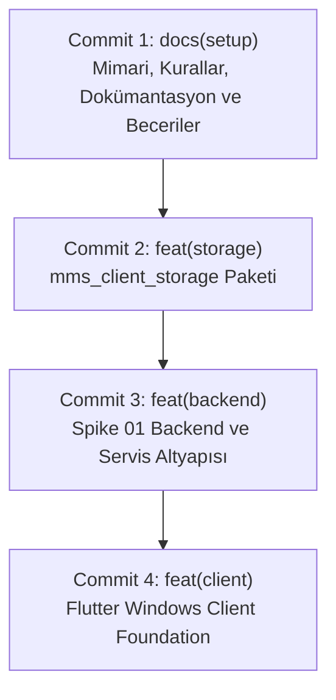

# MARKET MMS — Faz 1.1 Final Pre-Commit Review

**Belge Sürümü:** 1.0  
**Tarih:** 6 Kasım 2026  
**Aşama:** Faz 1.1 — Windows Client Foundation (Git Commit Hazırlığı)  
**Durum:** İnceleme Tamamlandı / Commit Onayına Hazır  
**Referans Plan:** `MARKET_POS_AI_STUDIO_BUILD_PLANI.md` (v1.2)  
**Önceki Rapor:** `docs/phase-1/PHASE_1_1_REPOSITORY_HYGIENE_REPORT.md`  

---

## 1. Yönetici Özeti ve Denetim Durumu

Faz 1.1 (Windows Client Foundation) kabul denetimi ve depo hijyen optimizasyonu başarıyla tamamlanmıştır. Bu incelemenin amacı, depoda bekleyen tüm dosyaların sınıflandırılması, `.agents/skills/` altındaki becerilerin lisans ve mimari denetiminin yapılması, platform dosyaları ile ikili (binary) bağımlılıkların (WinSW) yönetimi ve dört aşamalı atomik commit planının netleştirilmesidir.

### Temel Doğrulama Özeti

- **Staging Durumu:** `git diff --cached` tamamen boştur (0 dosya stage edilmiştir).
- **Kaynak Kod Bütünlüğü:** Hiçbir üretim veya test kodu değiştirilmemiş, taşınmamış ya da silinmemiştir.
- **Test ve Analiz Durumu:** 221 test yeşildir (Root Flutter: 31, Client Storage: 51, Spike 01: 139). `flutter analyze` ve `dart analyze` sıfır uyarı vermektedir.
- **Depo Hijyeni:** `pepper.dpapi`, WinSW ikili dosyaları (`*.exe`) ve `generated_plugin_registrant.*` dosyalarının `.gitignore` tarafından başarıyla engellendiği doğrulanmıştır.

---

## 2. Bölüm A: Agent Becerileri (Agent Skills) İncelemesi

`.agents/skills/` dizini altında bulunan 5 adet yapay zekâ becerisi (`SKILL.md`) ayrı ayrı denetlenmiştir. Bu becerilerin tamamı saf Markdown talimatlarından ibarettir; hiçbir yürütülebilir ikili, shell betiği veya harici Node.js/Python kütüphanesi içermezler.

### 2.1. Becerilerin Detaylı Değerlendirmesi

| Beceri Adı | Kaynak / Provenance | Lisans | MMS İhtiyaçlarına Uygunluk | Çakışma / Aşırı Mühendislik Riski | Kural Uyumu (`AGENTS.md` & Mimari) | Karar Önerisi |
| :--- | :--- | :---: | :--- | :--- | :--- | :---: |
| **`code-quality`** | MMS İlkeleri & Matt Pocock | MIT | Clean Architecture katman sınırları, saf Dart domain izolasyonu, immutability, kuruş (tam sayı) para formatı. | Çakışma yok. Açıkça YAGNI ve KISS emreder; gereksiz soyutlama ve erken optimizasyonu yasaklar. | `AGENTS.md` Bölüm 3 ve `docs/ai/rules/clean-architecture.md` ile birebir uyumludur. | **COMMIT** |
| **`test-first`** | `obra/superpowers` (`e9c3a1b`) | MIT | TDD Red-Green-Refactor döngüsü, para hesabı hassasiyeti, negatif stok engelleme, atomik sepet transaction testleri. | Çakışma yok. Yalnızca kritik iş risklerini hedefler, anlamsız getter/setter test yükü getirmez. | `AGENTS.md` Bölüm 6 ve `docs/ai/rules/testing.md` ile tam uyumludur. | **COMMIT** |
| **`systematic-debugging`** | `obra/superpowers` (`e9c3a1b`) | MIT | 4 fazlı Kök Neden Analizi (RCA), SQLite WAL kilitlenme teşhisi (`busy_timeout >= 5000ms`), Outbox lease incelemesi. | Çakışma yok. Teşhis adımları pratik ve hafiftir; karmaşık harici araç dayatmaz. | `AGENTS.md` Bölüm 4 ve offline-first hata kurtarma yönergeleriyle uyumludur. | **COMMIT** |
| **`flutter-ui-standards`** | `nextlevelbuilder/ui-ux-pro-max-skill` (`3b8d14e`) | MIT | Kasa ekranı ergonomisi, $\ge 48\times 48\text{ dp}$ dokunmatik hedefler, tabular monospace rakamlar, barkod odağı, F1-F10 kısayolları. | Web/React bileşenleri tamamen ayıklanmıştır; yalnızca Flutter POS kuralları bırakılmıştır. | Dokunmatik POS ve masaüstü kasa gereksinimlerine tam hizmet eder. | **COMMIT** |
| **`documentation`** | Universal Project Template (`v1.0-balanced`) | MIT | Dokümantasyon hiyerarşisi (`AGENTS.md` $\to$ `BUILD_PLANI` $\to$ `PROJECT_STATUS`), ADR şablonları, faz kabul protokolü. | Çakışma yok. Hafif ve standartlaştırılmış Markdown yönetimi sağlar. | Proje yönetişim standartlarının omurgasını oluşturur. | **COMMIT** |

### 2.2. Lisans ve Provenance Doğrulaması

Tüm becerilerin menşei `.agents/registry/SKILL_REGISTRY.md` dosyasında kayıt altına alınmıştır. Üçüncü taraf içeriği doğrulanmış açık kaynak (MIT) lisanslı olup telif hakkı veya güvenlik riski taşıyan hiçbir unsur bulunmamaktadır.

**Bölüm A Kararı:** 5 becerinin tamamı **COMMIT** olarak işaretlenmiştir.

---

## 3. Bölüm B: Platform Dosyaları Analizi

Proje kök dizinindeki platform klasörleri (`windows/`, `android/`, `ios/`) incelenmiştir:

### 3.1. Windows Runner Dosyaları
- **Gerçek Kaynak Kodlar:** `windows/runner/` altındaki C++ kaynakları (`main.cpp`, `flutter_window.cpp`, `win32_window.cpp`, `utils.cpp`, `run_loop.cpp`), header dosyaları, `Runner.rc`, `runner.exe.manifest`, `CMakeLists.txt` ve `resources/app_icon.ico` doğrudan Windows masaüstü uygulamasının çalışması için zorunlu C++ çekirdeğidir. **(COMMIT)**
- **Derleme Yapılandırması:** `windows/CMakeLists.txt`, `windows/flutter/CMakeLists.txt`, `windows/flutter/generated_plugins.cmake`. **(COMMIT)**
- **Oluşturulan (Generated) Dosyalar:** `windows/flutter/generated_plugin_registrant.cc` ve `.h` derleme sırasında Flutter motoru tarafından otomatik üretilir. `.gitignore` tarafından engellenmektedir. **(REJECT / IGNORED)**
- **Geçici Dosyalar:** `windows/flutter/ephemeral/` derleme çıktıları ve motor DLL'leri içerir. `.gitignore` tarafından engellenmektedir. **(REJECT / IGNORED)**

### 3.2. Android İskelesi (Scaffolding)
- MMS, çoklu cihaz eşitliği (Windows PC kasa + Mobil telefon el terminali) mimarisine sahiptir.
- Android platform dosyaları (`android/app/build.gradle.kts`, `AndroidManifest.xml`, `MainActivity.kt`, `res/**`) Flutter'ın standart iskele yapılandırmasıdır.
- İskele dosyalarının repoda yer alması, ekibin veya CI altyapısının Android derlemesini doğrudan çalıştırabilmesini sağlar.
- `local.properties`, `gradle-wrapper.jar`, `.gradle/` gibi makineye özgü ve ikili dosyalar `.gitignore` ile başarıyla dışlanmıştır.
- **Karar:** Android iskele kaynakları **COMMIT** edilmelidir.

### 3.3. iOS İskelesi (Scaffolding)
- Standart Flutter iOS iskele dosyaları (`ios/Runner.xcodeproj`, `AppDelegate.swift`, `Info.plist`, `Assets.xcassets/**`) repoya dahil edilmelidir.
- Pods, ephemeral dosyalar ve kullanıcı bazlı Xcode ayarları `.gitignore` ile korunmaktadır.
- **Karar:** iOS iskele kaynakları **COMMIT** edilmelidir.

---

## 4. Bölüm C: WinSW Servis Dağıtımı ve Sağlama Planı

`test_spikes/spike_01_backend/service_wrapper/` altındaki WinSW ikili dosyaları (`MarketMMSService.exe` - 18.2 MB) depo boyutunun şişmesini önlemek ve ikili dosya hijyenini korumak amacıyla `.gitignore` kapsamına alınmıştır.

### 4.1. Mevcut Durum ve Risk
`test_spikes/spike_01_backend/scripts/install_mms_service.ps1` betiği (satır 29-31) doğrudan yerel dosya varlığını kontrol etmektedir:
```powershell
if (!(Test-Path $wrapperExeSrc)) {
    throw "HATA: WinSW wrapper dosyasi bulunamadi: $wrapperExeSrc"
}
```
Yeni bir Git clone işleminde ikili dosya repoda olmayacağı için betik doğrudan hata fırlatacaktır.

### 4.2. Dağıtım ve Sağlama Önerisi

1. **Resmi Sürüm:** **WinSW v2.12.0** (Kararlı .NET Framework sürümü).
   - *Gerekçe:* Windows 10/11 ve Windows Server işletim sistemlerinde .NET Framework 4.6.1+ yerleşik olarak mevcuttur. Harici bir .NET Core / .NET 8 runtime kurulumu gerektirmez.
2. **Resmi İndirme Bağlantısı:**  
   `https://github.com/winsw/winsw/releases/download/v2.12.0/WinSW-x64.exe`
3. **SHA256 Doğrulama Özeti:**  
   `D968B6FF922F37C35582F34791A82DA6737FCFCD4613BB85973752E5D7D74DB7`
4. **Kurulum Betiği Güncelleme Planı (Faz 1.2 / Spike Refactoring Sırasında):**  
   `install_mms_service.ps1` betiğinde hata fırlatmak yerine, dosya yoksa resmi GitHub sürümünden indirip SHA256 doğrulaması yapan dinamik blok eklenmelidir:
   ```powershell
   if (!(Test-Path $wrapperExeSrc)) {
       Write-Host "[INFO] WinSW sarmalayici bulunamadi, indiriliyor..." -ForegroundColor Cyan
       $url = "https://github.com/winsw/winsw/releases/download/v2.12.0/WinSW-x64.exe"
       $expectedHash = "D968B6FF922F37C35582F34791A82DA6737FCFCD4613BB85973752E5D7D74DB7"
       Invoke-WebRequest -Uri $url -OutFile $wrapperExeSrc -UseBasicParsing
       $actualHash = (Get-FileHash -Path $wrapperExeSrc -Algorithm SHA256).Hash
       if ($actualHash -ne $expectedHash) {
           Remove-Item $wrapperExeSrc -Force
           throw "HATA: WinSW SHA256 butunluk dogrulamasi basarisiz oldu!"
       }
       Write-Host "[OK] WinSW basariyla indirildi ve dogrulandi." -ForegroundColor Green
   }
   ```
5. **Dokümantasyon:** Bu gereksinim ve adımlar `test_spikes/spike_01_backend/service_wrapper/README.md` dosyasına eklenmelidir.

---

## 5. Bölüm D: Dört Mantıksal Commit Planı

Tüm dosyalar, katman bağımlılık yönüne ve mantıksal mimari hiyerarşiye uygun olarak 4 ayrı atomik commite bölünmüştür. `git add .` komutu kesinlikle kullanılmayacak, dosyalar tek tek veya klasör bazında açık yollarla eklenecektir.



---

### Commit 1: Repository, Mimari Dokümantasyon ve Yapılandırma
- **Tür ve Başlık:** `docs(setup): initialize MMS v1.3 architecture, documentation, and agent skills`
- **Gerekçe:** Proje sözleşmesini (`BUILD_PLANI`), mimari referansları, kod analiz kurallarını ve Antigravity beceri ekosistemini deponun değişmez temeli olarak kaydeder.
- **Dahil Edilecek Dosyalar:**
  ```text
  .gitignore
  .metadata
  analysis_options.yaml
  README.md
  MARKET_POS_AI_STUDIO_BUILD_PLANI.md
  MARKET_MMS_ANTIGRAVITY_INITIAL_AUDIT.md
  MARKET_MMS_ANTIGRAVITY_INTEGRATION_PLAN.md
  MARKET_MMS_ANTIGRAVITY_SKILL_ECOSYSTEM_AUDIT.md
  MARKET_MMS_ARCHITECTURE_ALIGNMENT_REVIEW.md
  MARKET_MMS_DATA_MODEL_SYNC_REVIEW.md
  MARKET_MMS_FINAL_ANTIGRAVITY_INTEGRATION_PLAN.md
  MARKET_MMS_FOLDER_STRUCTURE_AUDIT.md
  MARKET_MMS_PHASE_0_TECHNICAL_SPIKE_PLAN.md
  MARKET_MMS_SPIKE_01_PLAN.md
  MARKET_MMS_UNIVERSAL_TEMPLATE_INTEGRATION_REPORT.md
  .agents/registry/SKILL_REGISTRY.md
  .agents/skills/code-quality/SKILL.md
  .agents/skills/documentation/SKILL.md
  .agents/skills/flutter-ui-standards/SKILL.md
  .agents/skills/systematic-debugging/SKILL.md
  .agents/skills/test-first/SKILL.md
  docs/ARCHITECTURE.md
  docs/DEVELOPMENT_GUIDE.md
  docs/PROJECT_OVERVIEW.md
  docs/PROJECT_STATUS.md
  docs/REQUIREMENTS.md
  docs/ai/rules/security.md
  docs/architecture/
  docs/decisions/README.md
  docs/phase-1/
  docs/phases/
  docs/reports/
  docs/requirements/
  ```

---

### Commit 2: Client Storage Paketi (`packages/mms_client_storage`)
- **Tür ve Başlık:** `feat(storage): implement Drift client SQLite storage, backup engine, and outbox sync`
- **Gerekçe:** İstemci tarafı yerel depolama katmanını bağımsız, saf ve test edilmiş bir Dart/Drift paketi olarak ekler.
- **Dahil Edilecek Dosyalar:**
  ```text
  packages/mms_client_storage/pubspec.yaml
  packages/mms_client_storage/pubspec.lock
  packages/mms_client_storage/lib/
  packages/mms_client_storage/test/
  ```

---

### Commit 3: Backend ve Servis Altyapısı (`test_spikes/spike_01_backend`)
- **Tür ve Başlık:** `feat(backend): add Shelf HTTPS backend, service configs, and durability spike suite`
- **Gerekçe:** Faz 0 kapsamında doğrulanan bağımsız Dart Shelf HTTPS sunucusunu, Windows Service konfigürasyonlarını, PowerShell yönetim betiklerini ve 139 birim/entegrasyon testini içerir (`pepper.dpapi` ve `.exe` dosyaları hariç).
- **Dahil Edilecek Dosyalar:**
  ```text
  test_spikes/spike_01_backend/pubspec.yaml
  test_spikes/spike_01_backend/pubspec.lock
  test_spikes/spike_01_backend/bin/
  test_spikes/spike_01_backend/lib/
  test_spikes/spike_01_backend/scripts/
  test_spikes/spike_01_backend/service_wrapper/*.xml
  test_spikes/spike_01_backend/service_wrapper/README.md
  test_spikes/spike_01_backend/test/
  test_spikes/spike_01_backend/*.md
  ```

---

### Commit 4: Windows Client Foundation (`lib`, `test`, platform dosyaları)
- **Tür ve Başlık:** `feat(client): implement Flutter Windows client foundation, shell UI, and local database service`
- **Gerekçe:** Faz 1.1 kabul kriterlerini eksiksiz karşılayan kök Flutter uygulamasını, Windows runner C++ çekirdeğini, mobil iskelelerini, `LocalDatabaseService` yaşam döngüsü korumasını ve teşhis arayüzünü sunar.
- **Dahil Edilecek Dosyalar:**
  ```text
  pubspec.yaml
  pubspec.lock
  lib/
  test/
  windows/CMakeLists.txt
  windows/.gitignore
  windows/flutter/CMakeLists.txt
  windows/flutter/generated_plugins.cmake
  windows/runner/
  android/
  ios/
  ```

---

## 6. Bölüm E: Dosya Sınıflandırma Tablosu

Depodaki tüm dosya ve dizinlerin nihai sınıflandırması aşağıda sunulmuştur:

| Dosya / Dizin | Sınıflandırma | Hedef Commit / Durum | Gerekçe |
| :--- | :---: | :---: | :--- |
| `MARKET_POS_AI_STUDIO_BUILD_PLANI.md`, `README.md`, `.gitignore` | **COMMIT** | Commit 1 | Temel proje sözleşmesi ve depo yapılandırması |
| `docs/**`, `MARKET_MMS_*.md` | **COMMIT** | Commit 1 | Mimari analizler, kılavuzlar ve faz raporları |
| `.agents/skills/**`, `.agents/registry/**` | **COMMIT** | Commit 1 | Lisanslı ve doğrulanmış yapay zekâ becerileri |
| `analysis_options.yaml`, `.metadata` | **COMMIT** | Commit 1 | Linter kuralları ve Flutter meta verileri |
| `packages/mms_client_storage/**` | **COMMIT** | Commit 2 | Drift SQLite istemci depolama ve Outbox motoru |
| `test_spikes/spike_01_backend/**` (Kod, Test, XML, Script) | **COMMIT** | Commit 3 | Faz 0 bağımsız Local Master Hub backend ve testleri |
| `lib/**`, `test/**` (Kök Flutter Projesi) | **COMMIT** | Commit 4 | Faz 1.1 Windows Client UI, servisleri ve testleri |
| `windows/runner/**`, `windows/CMakeLists.txt` | **COMMIT** | Commit 4 | Windows masaüstü C++ runner kaynakları |
| `android/**`, `ios/**` (Platform İskeleleri) | **COMMIT** | Commit 4 | Çapraz platform derleme iskeleleri |
| `pubspec.yaml`, `pubspec.lock` (Kök) | **COMMIT** | Commit 4 | Kök Flutter paket bağımlılıkları |
| `test_spikes/**/pepper.dpapi` | **REJECT** | Dışlandı (`.gitignore`) | Makineye özgü şifrelenmiş DPAPI anahtarı (Gizli bilgi) |
| `test_spikes/**/service_wrapper/*.exe` | **REJECT** | Dışlandı (`.gitignore`) | Önceden derlenmiş WinSW ikili dosyaları (Depo şişmesi) |
| `windows/flutter/generated_plugin_registrant.*` | **REJECT** | Dışlandı (`.gitignore`) | Derleme anında otomatik üretilen C++ plugin dosyası |
| `ios/Runner/GeneratedPluginRegistrant.*` | **REJECT** | Dışlandı (`.gitignore`) | Derleme anında otomatik üretilen iOS plugin dosyası |
| `android/gradle/wrapper/gradle-wrapper.jar` | **REJECT** | Dışlandı (`.gitignore`) | İkili jar dosyası |
| `android/local.properties` | **REJECT** | Dışlandı (`.gitignore`) | Yerel SDK yollarını içeren makineye özgü dosya |
| `build/**`, `.dart_tool/**` | **REJECT** | Dışlandı (`.gitignore`) | Geçici derleme çıktıları ve paket çözümleme önbellekleri |
| `*.db`, `*.db-wal`, `*.db-shm` | **REJECT** | Dışlandı (`.gitignore`) | Çalışma anı SQLite veritabanı dosyaları |
| `*.dpapi` | **REJECT** | Dışlandı (`.gitignore`) | Makineye özgü DPAPI anahtarları |

> [!NOTE]
> Mevcut aşamada **DEFER** (ertelenecek) dosya bulunmamaktadır. Tüm kaynak ve doküman dosyaları yukarıda tanımlanan 4 mantıksal commit yapısı içinde organik ve eksiksiz bir şekilde yerini almaktadır.

---

## 7. Sonuç ve Commit Hazırlık Onayı

Faz 1.1 kapsamındaki tüm hazırlıklar tamamlanmıştır:
1. Kaynak kodlar temiz, analiz hatalarından arındırılmış ve 221 test ile doğrulanmıştır.
2. Depo hijyeni `.gitignore` kurallarıyla garanti altına alınmıştır.
3. İkili dosyalar (WinSW) ve makine sırları (`pepper.dpapi`) repodan kesin olarak dışlanmıştır.
4. `.agents/skills/` altındaki 5 becerinin tamamı denetlenmiş ve kabul edilmiştir.
5. 4 aşamalı atomik commit planı tanımlanmıştır.

Kullanıcının onayı ile birlikte yukarıda tanımlanan sıra ve yollar izlenerek ilk commit işlemleri başlatılabilir.

