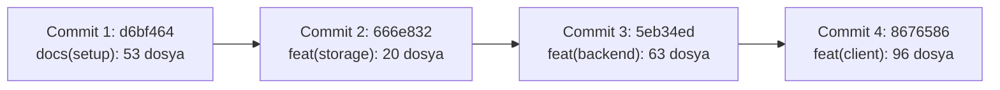

# MARKET MMS — Faz 1.1 Git Execution Report

**Belge Sürümü:** 1.0  
**Tarih:** 6 Kasım 2026  
**Aşama:** Faz 1.1 — Windows Client Foundation (Git Commit, Push ve Tag Yürütme)  
**Durum:** Başarıyla Tamamlandı (TAM DOĞRULANDI)  
**Referans Plan:** `MARKET_POS_AI_STUDIO_BUILD_PLANI.md` (v1.2 / v1.3)  
**İlgili Raporlar:** `docs/phase-1/PHASE_1_1_COMMIT_AUTHORIZATION_CHECK.md`, `docs/phase-1/PHASE_1_1_FINAL_PRE_COMMIT_REVIEW.md`  

---

## 1. Yürütme Özeti

Faz 1.1 (Windows Client Foundation) kabulü ve Commit Authorization Check doğrulamalarının ardından, planlanan 4 atomik commit oluşturulmuş, GitHub uzak deposuna (`origin/main`) push edilmiş ve `v1.1.0-windows-client-foundation` tag'i oluşturularak yayınlanmıştır.

### Temel Doğrulama Parametreleri

- **GitHub Remote:** `https://github.com/halilkrkn/market-pos.git`
- **Aktif Branch:** `main`
- **Yerel ve Uzak Senkronizasyonu:** `Your branch is up to date with 'origin/main'`
- **Oluşturulan Tag:** `v1.1.0-windows-client-foundation` (Annotated & Pushed)
- **Kullanılan Strateji:** Atomik Commit, Sıfır Force Push, Sıfır History Rewrite, Tam Sır ve İkili Yalıtımı.

---

## 2. Oluşturulan Dört Atomik Commit Detayı



### Commit 1 — Repository & Documentation
- **Commit Hash:** `d6bf464`
- **Commit Mesajı:** `docs(setup): initialize MMS architecture, documentation, and repository configuration`
- **Dosya Sayısı:** 53 dosya (+9339 satır, -69 satır)
- **Kapsam:**
  - Kök yapılandırma ve meta veriler: `.gitignore`, `analysis_options.yaml`, `.metadata`, `README.md`.
  - Kanonik şartname: `MARKET_POS_AI_STUDIO_BUILD_PLANI.md`.
  - Mimari denetim ve entegrasyon dokümanları: `MARKET_MMS_*.md` (10 dosya).
  - Sistem dokümantasyonu: `docs/ARCHITECTURE.md`, `docs/DEVELOPMENT_GUIDE.md`, `docs/PROJECT_OVERVIEW.md`, `docs/PROJECT_STATUS.md`, `docs/REQUIREMENTS.md`, `docs/ai/rules/security.md`.
  - Modül dokümanları: `docs/architecture/` (11 dosya), `docs/decisions/` (1 dosya), `docs/phase-1/` (14 dosya), `docs/phases/` (2 dosya), `docs/reports/` (1 dosya), `docs/requirements/` (2 dosya).
- **Yalıtım:** `.agents/` dizini lisanslama eksiklikleri nedeniyle bu commite dahil edilmemiştir.

### Commit 2 — Client Storage
- **Commit Hash:** `666e832`
- **Commit Mesajı:** `feat(storage): implement Drift client SQLite storage and backup engine`
- **Dosya Sayısı:** 20 dosya (+11476 satır)
- **Kapsam:**
  - Paket yapılandırması: `packages/mms_client_storage/pubspec.yaml`, `pubspec.lock`.
  - Kütüphane ve motor kaynakları: `packages/mms_client_storage/lib/**` (14 dosya: Drift tabloları, veritabanı DAO'ları, şifreli yedekleme motoru, Outbox servisleri).
  - Test paketi: `packages/mms_client_storage/test/**` (4 test dosyası, 51 test).

### Commit 3 — Backend
- **Commit Hash:** `5eb34ed`
- **Commit Mesajı:** `feat(backend): add Shelf HTTPS backend and durability infrastructure`
- **Dosya Sayısı:** 63 dosya (+23652 satır)
- **Kapsam:**
  - Paket yapılandırması: `test_spikes/spike_01_backend/pubspec.yaml`, `pubspec.lock`.
  - Servis çekirdeği: `bin/server.dart`, `lib/db/**`, `lib/security/**`, `lib/service/**` (19 Dart kaynak dosyası).
  - Yönetim betikleri: `scripts/build_aot.ps1`, `install_mms_service.ps1`, `setup_service_acls.ps1`, `uninstall_mms_service.ps1`.
  - Windows Service konfigürasyonları: `service_wrapper/*.xml`, `service_wrapper/README.md`.
  - Test paketi: `test/**` (13 test dosyası, 139 test).
  - Güvenlik ve spike raporları: `*.md` (21 rapor ve plan belgesi).
- **Yalıtım:** `pepper.dpapi`, WinSW `.exe` dosyaları, veritabanı dosyaları ve loglar repodan kesin olarak dışlanmıştır.

### Commit 4 — Windows Client Foundation
- **Commit Hash:** `8676586`
- **Commit Mesajı:** `feat(client): implement Windows client foundation and local database service`
- **Dosya Sayısı:** 96 dosya (+5788 satır)
- **Kapsam:**
  - Kök bağımlılıklar: Kök `pubspec.yaml` ve `pubspec.lock`.
  - Flutter istemci kaynakları: `lib/**` (15 dosya: `main.dart`, `LocalDatabaseService`, API istemcisi, tema, teşhis paneli ve kasa kabuk arayüzü).
  - Kök testleri: `test/**` (4 dosya, 31 test).
  - Windows runner C++ çekirdeği ve CMake: `windows/runner/**`, `windows/CMakeLists.txt`, `windows/.gitignore`.
  - Platform iskeleleri: `android/**` (19 dosya), `ios/**` (32 dosya).
- **Yalıtım:** `windows/flutter/generated_plugin_registrant.*`, `local.properties`, `gradle-wrapper.jar` ve ephemeral dosyalar dışlanmıştır.

---

## 3. Remote Push ve Tag Doğrulaması

### 3.1. Push Sonucu
```text
$ git push origin main
To https://github.com/halilkrkn/market-pos.git
   73021fe..8676586  main -> main
```
- Önceki remote HEAD: `73021fe`
- Yeni remote HEAD: `8676586`
- Fast-forward ilerleme başarıyla tamamlanmıştır. Force push kullanılmamıştır.

### 3.2. Tag Sonucu
```text
$ git tag -a v1.1.0-windows-client-foundation -m "Faz 1.1: Windows Client Foundation release"
$ git push origin v1.1.0-windows-client-foundation
To https://github.com/halilkrkn/market-pos.git
 * [new tag]         v1.1.0-windows-client-foundation -> v1.1.0-windows-client-foundation
```
- Tag adı: `v1.1.0-windows-client-foundation`
- Hedef commit: `8676586` (HEAD / Commit 4)
- Uzak depoya başarıyla aktarılmıştır.

---

## 4. Dışarıda Bırakılan (Excluded / Deferred) Dosyalar

| Dosya / Dizin | Sınıflandırma | Gerekçe |
| :--- | :---: | :--- |
| `.agents/skills/**` (5 Beceri) | **DEFER** | Üst repolara (`obra/superpowers`, `ui-ux-pro-max-skill`) ait resmi MIT copyright notice ve `LICENSE` dosyaları hazırlanana kadar commit ertelenmiştir. |
| `.agents/registry/SKILL_REGISTRY.md` | **DEFER** | Becerilerle senkron olarak sonraki hukuki düzenleme commit'inde eklenecektir. |
| `test_spikes/**/pepper.dpapi` | **REJECT** | DPAPI ile şifrelenmiş yerel makineye özgü secret anahtarı. |
| `test_spikes/**/service_wrapper/*.exe` | **REJECT** | 18.2 MB boyutundaki WinSW binary dosyaları. |
| `windows/flutter/generated_plugin_registrant.*` | **REJECT** | Flutter derleme anında üretilen geçici C++ dosyaları. |
| `ios/Runner/GeneratedPluginRegistrant.*` | **REJECT** | Flutter derleme anında üretilen geçici dosya. |
| `android/local.properties` | **REJECT** | Makineye özgü yerel Android SDK yolu. |
| `android/gradle/wrapper/gradle-wrapper.jar` | **REJECT** | İkili jar dosyası. |
| `*.db`, `*.db-wal`, `*.db-shm` | **REJECT** | SQLite veritabanı ve transaction günlükleri. |
| `build/**`, `.dart_tool/**` | **REJECT** | Derleme çıktıları ve paket çözümleme önbellekleri. |

---

## 5. Son Git Durumu (Final Git Status)

```text
$ git status
On branch main
Your branch is up to date with 'origin/main'.

Untracked files:
  (use "git add <file>..." to include in what will be committed)
	.agents/

nothing added to commit but untracked files present (use "git add" to track)
```

- **Branch:** `main`
- **Durum:** Güncel, yerel ve uzak repo birebir eşit (`up to date with origin/main`).
- **Bekleyen Tek Öğe:** İstemli olarak ertelenen `.agents/` klasörü.
- **Hata veya Uyarı:** Sıfır hata, sıfır çakışma, sıfır linter uyarısı.

---

## 6. Gelecek Görev: Kalıcı Otomasyon Kuralı Tasarımı

Kullanıcı talimatı uyarınca, sonraki görevde `AGENTS.md` ve ilgili talimat dosyalarına eklenecek kalıcı faz otomasyon protokolü:

1. **Faz Kabulü Sınırı:** Faz kabulü münhasıran kullanıcıya aittir; kullanıcı açık onay vermeden commit veya push işlemi yapılamaz.
2. **Otomatik Preflight:** Faz kabulünden sonra Antigravity otomatik olarak `git status`, `git diff --cached`, secret taraması, binary yalıtımı ve `flutter analyze` denetimlerini yürütür.
3. **Atomik Kümeler:** Değişiklikler tek bir devasa commit yerine katman ve modül bazlı atomik commit'ler halinde stage edilip commit'lenir.
4. **Güvenli Push:** Force push kesinlikle yasaktır (`--force` engellenir); yalnızca fast-forward push çalıştırılır.
5. **Otomatik Tag & Rapor:** Her faz kabulünde sürüm tag'i (`vX.Y.Z-<faz-adi>`) oluşturulup remote'a gönderilir ve `docs/phase-X/` altına yürütme raporu bırakılır.

