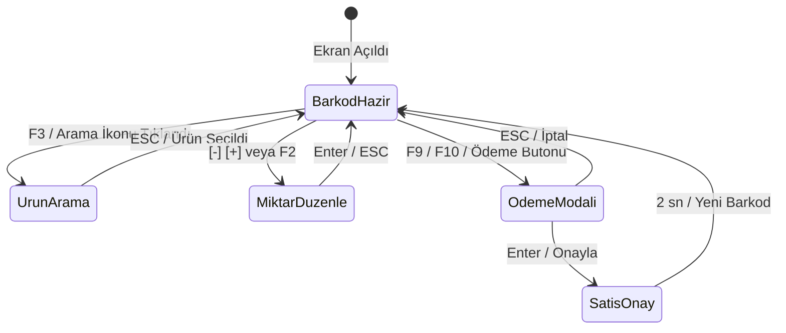

# DESIGN_DECISIONS.md — MARKET MMS TASARIM KARARLARI SİCİLİ
# Market Management System (Market MMS) — UI/UX Design Decisions & Trade-offs Registry

- **Doküman Versiyonu:** v1.4 (`PaymentMethod` Sözleşme Standardizasyonu — 11 Kasım 2026)
- **Revizyon Notu:** v1.1 sınıf düzeltmeleri ve v1.2 uzlaştırma kararları korunmuştur. v1.3 ile Proje Sahibi tarafından UI/UX teslimatı kabul edilmiş; `OD-01`..`OD-04` açık kararları mevcut karar ID'leri ve tarihçesi korunarak `[APPROVED PROJECT DECISION]` (ve `OD-02` için `[OUT_OF_SCOPE]`) statüsüne dönüştürülmüştür. v1.4 ile `INV-08` içine kanonik kod sözleşmesi (`'CASH'` / `'CARD'`, eski `'CREDIT_CARD'`/`'NAKIT'` *obsolete*) işlenmiştir.
- **Bağlayıcı Temel:** [`AGENTS.md`](../../AGENTS.md), [`MARKET_POS_AI_STUDIO_BUILD_PLANI.md`](../../MARKET_POS_AI_STUDIO_BUILD_PLANI.md) (v1.4)
- **Roller:** Antigravity / Gemini (Araştırma, Tasarım, Dokümantasyon), ChatGPT (Danışman), Proje Sahibi (Nihai Karar ve Onay Mercii).

---

## 1. Statü Etiketleri

| Etiket | Anlamı |
|---|---|
| `[APPROVED PROJECT DECISION]` | `AGENTS.md` ve ana plan tarafından kesinleştirilmiş, değiştirilemez mimari / iş kuralı. |
| `[UX PROPOSAL]` | Tasarım ekibinin ergonomi / verimlilik gerekçesiyle önerdiği, **proje sahibi onayı bekleyen** tasarım kararı. |
| `[APPROVED PROJECT DECISION]` | Proje Sahibi tarafından 11 Kasım 2026 tarihinde kesinleştirilen ürün/tasarım kararı (`OD-01`, `OD-03`, `OD-04`). |
| `[OPEN DECISION]` | *(Tarihsel etiket)* 11 Kasım 2026 kararıyla `OD-01`..`OD-04` maddelerinin tamamı karara bağlanmış olup aktif açık UX kararı kalmamıştır. |
| `[OUT_OF_SCOPE]` / `[FUTURE SCOPE]` | MVP kapsamı dışında bırakılan özellik (`Fiziksel Stok Sayımı`, `OD-02 / BR-POS-05 Parked Carts` vb.); gelecek sürümlerde yeniden değerlendirilebilir. |

---

## 2. Onaylanmış Mimari Değişmezler (Invariants)

Aşağıdaki kararlar projenin değişmez mimari anayasasından gelmektedir; UI/UX tasarımı bu kısıtlara mutlak uyum göstermek zorundadır.

| Kod | Konu | Onaylanmış Karar | Tasarıma Etkisi |
|---|---|---|---|
| **INV-01** | Para Birimi ve Matematik | `double` yasaktır. Kuruş tamsayı (`int`) veya `Money` VO esastır. | UI yalnızca domain katmanından dönen `int` kuruşu biçimlendirir; kendi içinde hesaplama yapmaz. Para sütunları sağa dayalı gösterilir. |
| **INV-02** | Ayrık Veritabanı Modeli | Windows Client doğrudan `market_master.db`'ye erişemez; loopback HTTPS API ve yerel `client_local.db` kullanır. | Arayüzde Hub Bağlantı Durumu göstergesi bulunmalıdır (Online / Local Offline / Hata). |
| **INV-03** | Satış Dokunulmazlığı | Fiziksel satış kayıtları asla silinemez. Çakışmada satış iptali yapılamaz. | Satış yerel DB'ye kaydedildiği an başarılı kabul edilir; ağ hatası satışı bloke edemez. |
| **INV-04** | Eksi Stok Politikası (`allow`) | Stok sıfır veya negatif olsa da satışa izin verilir. | Sepet engellenmez; uyarı rozeti (sarı/turuncu) gösterilir. |
| **INV-05** | Banka POS Sınırı | Harici banka POS cihazına otomatik tutar gönderimi MVP dışıdır. | "Kredi Kartı" seçiminde POS cihazına komut gönderilmez; tutar elle girildiği varsayılır. |
| **INV-06** | Windows Servis İzolasyonu | Master Hub bağımsız bir Windows Servisidir. | Masaüstü UI kapalıyken servis mobil istemcilere servis vermeye devam eder; UI servis durumunu gösterir. |
| **INV-07** | Outbox FIFO Kuyruğu | Satışlar `outbox_operations` tablosuna FIFO sırasıyla yazılır. | Bekleyen işlem adedi rozet olarak görünür; kullanıcı manuel eşitleme tetikleyebilir. |
| **INV-08** | Pilot Ödeme Yöntemleri | Pilot aşamada yalnızca **Nakit** (`'CASH'`) ve **Kart** (`'CARD'`) kanonik değerleri desteklenir (`PaymentMethod`; eski `'CREDIT_CARD'` ve `'NAKIT'` *obsolete*). | Split payment, çek, havale veya diğer ödeme yöntemleri UI'da ve API sözleşmesinde sunulmaz; Faz 1.2 katmanları yalnızca `PaymentMethod.cash` (`'CASH'`) ve `PaymentMethod.card` (`'CARD'`) kullanır. |
| **INV-09** | Tek Sahip (Owner) Hesabı | Pilot aşamada tek owner account modeli esastır. | Ayrı kasiyer / personel rol sistemi veya oturum açma ekranları MVP kapsamı dışıdır. |
| **INV-10** | Offline Satış Fiyatı | Hub erişilemediğinde son bilinen (cached) ürün fiyatıyla yerel satış yapılabilir. | Offline modda fiyat sorgusu Hub'a gönderilmez; yerel cache kullanılır. |

---

## 3. Onaylanmamış Tasarım Önerileri (UX Proposals)

Aşağıdaki maddeler önceki versiyonda hatalı biçimde "onaylanmış" olarak gösterilmiştir. Hepsi `[UX PROPOSAL]` statüsünde olup proje sahibi onayını beklemektedir.

### 3.1. `[UX PROPOSAL]` — Windows POS Ekranı Panel Dağılımı

- **Öneri:** Sol %60 Sepet Tablosu + Sağ %40 Hızlı Tuşlar / Numpad / Dev Toplam split-panel yerleşimi.
- **Gerekçe:** Yatay ekranda aynı anda sepet ve ödeme aksiyonlarını görmek, kasiyer göz hareketini azaltır.
- **Alternatifler:**
  - Tam genişlikte sepet + alt tutar çubuğu.
  - Üst menü çubuğu + ortada sepet + sağda kayan panel.
- **Nihai Karar:** Proje sahibi onayı beklenmektedir.

### 3.2. `[UX PROPOSAL]` — Hızlı Ürün Butonları (Quick Keys)

- **Öneri:** Barkodu olmayan ya da sık satılan ürünler (ekmek, su, poşet vb.) için sağ panelde yapılandırılabilir hızlı tuşlar.
- **Gerekçe:** Barkod okuyucu gerektirmeden tek dokunuşla ürün ekleme.
- **Nihai Karar:** Proje sahibi onayı beklenmektedir. Hangi ürünlerin hızlı tuş alacağı ve konfigürasyon yöntemi de açık kalmaktadır.

### 3.3. `[UX PROPOSAL]` — Klavye Kısayol Haritası (`main_shell_screen.dart` Uzlaştırması)

- **Tarihçe ve Uzlaştırma Notu (v1.2 — 11 Kasım 2026):** Önceki taslakta (`v1.1`) `F2: Ürün Arama`, `F3: Miktar`, `F11: Kredi Kartı`, `F12: Nakit` önerilmişti; ancak depodaki mevcut Flutter kodu [`lib/features/shell/presentation/screens/main_shell_screen.dart` (L205–209)](../../lib/features/shell/presentation/screens/main_shell_screen.dart#L205-L209) alt kısayol çubuğunda `F1 Yardım`, `F2 Miktar`, `F9 Kart`, `F10 Nakit`, `Esc İptal` tanımlarını içermektedir. Mevcut Flutter koduyla çakışmayı önlemek için aşağıdaki uzlaştırılmış harita esas alınır:
  - **Mevcut Uygulama Tabanı (`main_shell_screen.dart`):**
    - `F1`: Yardım / Kısayol Listesi
    - `F2`: Miktar Değiştir
    - `F9`: Kredi Kartı Ödemesi
    - `F10`: Nakit Ödemesi
    - `ESC`: Modal Kapat / İptal / Odaklanmaya Dön
  - **Ek UX Önerileri (`[UX PROPOSAL]` — Faz 1.2 Onayı Bekliyor):**
    - `F3`: Ürün Arama
    - `F8` / `Del`: Seçili Satırı Sil
  - **Kapsam Dışı Tutulan Kısayol:** `F4` (Askıya Alınmış Sepetler / Parked Carts) `OD-02` kararıyla MVP kapsamı dışına çıkarılmıştır (`OUT_OF_SCOPE`).
- **Nihai Karar:** Mevcut `main_shell_screen.dart` kısayolları (`F1/F2/F9/F10/Esc`) temel alınır; ek kısayollar (`F3`, `F8/Del`) için Faz 1.2'de proje sahibi onayı beklenmektedir.

### 3.4. `[UX PROPOSAL]` — Barkod Odak Yönetimi (Revised — v1.1)

**v1.0'daki "Always-On Barcode Focus Loop" yaklaşımı revize edilmiştir.** Her tıklamadan sonra zorla 100 ms içinde barkod alanına dönen yaklaşım kaldırılmıştır.

**Önerilen Context-Aware Focus Modeli:**

| POS Ekran Durumu | Odak Sahibi Bileşen |
|---|---|
| Boşta / Satışa Hazır | Barkod giriş alanı |
| Ürün Arama Modalı Açık | Arama metin alanı |
| Miktar Düzenleme Aktif | Miktar (sayısal) giriş alanı |
| Ödeme Modalı Açık | Nakit tutar giriş alanı |
| Modal Kapandı | Barkod giriş alanına dönüş |
| Ayarlar / Yönetim Ekranı | O ekranın doğal odak sırası |

**Barkod Okuyucu (HID) Notu:** USB HID barkod okuyucuların klavye taklidi yaptığı ve odak gerektirdiği bilinmektedir. Ancak odak zıplamanın kullanıcı deneyimi üzerindeki etkisi ve HID tarayıcısının gerçek davranışı pilot aşamada doğrulanmalıdır.

- **Nihai Karar:** Proje sahibi onayı beklenmektedir.

### 3.5. `[UX PROPOSAL]` — Monospace Tabular Tipografi Tercihi

- **Öneri:** Parasal tutarlar, barkodlar, miktarlar için Monospace Tabular Figures (`Roboto Mono` veya `FontFeature.tabularFigures()`).
- **Gerekçe:** Kuruş basamaklarının dikey hizasını korur; göz kaymasını önler.
- **Nihai Karar:** Proje sahibi onayı beklenmektedir.

### 3.6. `[UX PROPOSAL]` — Renk Paleti ve `AppTheme` Hizalaması

- **Öneri:** Slate-tabanlı nötr zemin + Emerald yeşil (Nakit) + Kobalt mavi (Kart) + Amber sarı (Uyarı) + Kırmızı (Hata/İptal) semantik renk sistemi.
- **Mevcut Uygulama & Kontrast Düzeltmesi (v1.2):** Mevcut [`lib/core/theme/app_theme.dart`](../../lib/core/theme/app_theme.dart) (`AppTheme`) uygulamadaki tek birincil tema kaynağıdır. Web görsel doğrulamalarında tespit edilen Light `--text-muted` (`#64748B` -> `#475569`, `AppTheme.textMutedLight` ile eşit) ve Dark semantik inline metin (`--success-text`, `--warning-text`, `--danger-text`) kontrast sorunları [`shared.css`](./visual-designs/shared.css) üzerinde düzeltilmiştir (`verify_wcag.js` renk kontrastı raporu).
- **Nihai Karar:** Dark tema ve ek semantic token'ların `AppTheme` yapısına entegrasyonu için proje sahibi onayı beklenmektedir.

### 3.7. `[UX PROPOSAL]` — Dokunmatik Hedef Boyutları (Ergonomi Standardı)

- **Öneri:** Minimum 48 × 48 dp dokunmatik hedef; birincil ödeme butonları için minimum 80 × 60 dp.
- **Not:** Bu bir WCAG erişilebilirlik zorunluluğu değil, MARKET MMS için önerilen kasa ergonomisi standardıdır.
- **Nihai Karar:** Proje sahibi onayı beklenmektedir.

---

## 4. Kesinleşen Proje Kararları (OD-01 .. OD-04 — Tarihsel ID'ler Korunmuştur)

> [!NOTE]
> Aşağıdaki dört madde v1.0–v1.2 sürümlerinde `[OPEN DECISION]` statüsünde takip edilmiş olup **11 Kasım 2026** tarihli Proje Sahibi kararıyla kesinleştirilmiştir. Önceki açık karar ID'leri (`OD-01`..`OD-04`) geriye dönük izlenebilirlik için korunmaktadır.

### OD-01: Alt Kuruş Yuvarlama Standardı `[APPROVED PROJECT DECISION]`
- **Kesinleşen Karar (11 Kasım 2026):** Tartılı / gramajlı ürün veya kesirli birim fiyat çarpımından doğan alt kuruşlar için **Half-Up yuvarlama** uygulanacaktır.
- **Teknik Kurallar:**
  - Para hesaplamalarında floating-point (`double` / `float`) aritmetik **KESİNLİKLE YASAKTIR**.
  - Hesaplamalar tamsayı/decimal tabanlı güvenli yöntemle (`((unitPrice * quantity) + 500) ~/ 1000` vb. integer kuruş aritmetiği) gerçekleştirilir.
  - İç parasal veri her katmanda tamsayı kuruş (`int` / `BIGINT`) olarak saklanır ve taşınır.
  - Kullanıcı arayüzü gösterim standardı **`12.50 TL`** olarak korunur; UI katmanı yuvarlama yapmaz, domain/storage katmanından dönen tamsayıyı formatlar.
- **Tarihçe:** v1.2'de `[OPEN DECISION]` -> v1.3'te Proje Sahibi tarafından onaylandı.

### OD-02: Sepeti Askıya Alma (Parked Carts / BR-POS-05) `[APPROVED PROJECT DECISION — OUT_OF_SCOPE (MVP Dışı)]`
- **Kesinleşen Karar (11 Kasım 2026):** Sepeti askıya alma (Parked Carts) özelliği **MVP kapsamı dışındadır** (`OUT_OF_SCOPE`).
- **Ürün ve UI Etkisi:**
  - MVP kasa ekranlarında (`W-01` / `win-02-pos.html`, Flutter `PosScreen`) Parked Carts butonu, aktif sepet bekletme listesi veya **`F4`** kısayolu bulunmayacaktır; onaylanmış MVP özelliği gibi sunulamaz.
  - Gelecek sürümlerde yeniden değerlendirilebilir (`FUTURE SCOPE`).
- **Tarihçe:** v1.2'de `F4` onayı bekleniyordu (`[OPEN DECISION]`) -> v1.3'te Proje Sahibi kararıyla MVP dışına çıkarıldı.

### OD-03: Hub Çevrimdışıyken Bilinmeyen Barkod (`BR-PROD-05`) `[APPROVED PROJECT DECISION]`
- **Kesinleşen Karar (11 Kasım 2026):**
  - Yerel veritabanında (`client_local.db` / `mms_client.db`) bulunmayan ürün **offline olarak oluşturulamaz**.
  - Bilinmeyen barkod **offline satış sepetine eklenemez** (geçici/muhtelif ürün olarak sepete atlama yasaktır; kullanıcıya ürün oluşturmak için Master Hub bağlantısı gerektiği açıkça bildirilir).
  - Yeni ürün oluşturma işlemi **Master Hub bağlantısı gerektirir**.
  - Yerel veritabanında kayıtlı bulunan ürünler **offline ortamda satılabilir** (`INV-10` korunur).
- **Tarihçe:** v1.2'de offline geçici ürün / blokaj alternatifleri açık karardı (`[OPEN DECISION]`) -> v1.3'te Proje Sahibi tarafından kesin davranış belirlendi.

### OD-04: Windows Masaüstünde Sanal Numpad `[APPROVED PROJECT DECISION]`
- **Kesinleşen Karar (11 Kasım 2026):** Windows masaüstü POS ekranında sanal numpad **opsiyonel bir özelliktir** ve **varsayılan olarak kapalıdır**.
- **Kullanım İlkeleri:**
  - Fiziksel klavye (`F1/F2/F9/F10/Esc`, Enter) ve USB HID barkod okuyucu temel kullanım yöntemidir.
  - İhtiyaç duyan dokunmatik ekranlı kasalar için Ayarlar / POS görünüm tercihi üzerinden opsiyonel olarak açılabilir.
  - Görsel prototip (`win-02-pos.html`) sanal tuş takımını yalnızca opsiyonel yerleşim referansı göstermek için açık örneklemede sergiler.
- **Tarihçe:** v1.2'de varsayılan durum açık karardı (`[OPEN DECISION]`) -> v1.3'te opsiyonel ve varsayılan kapalı olarak onaylandı.

### B-2 ve B-3 Hakkında Mimari Not (Açık Karar DEĞİLDİR)
- **`B-2` (Mobil Root CA Pinning)** ve **`B-3` (Secure Token Storage: Windows DPAPI / Android Keystore / iOS Keychain)** maddeleri `OPEN DECISION` statüsünde değildir (`OD-01`..`OD-04` ile karıştırılmamalıdır). Bunlar Spike-01 (`READY FOR PILOT WITH CONDITIONS`) ve `AGENTS.md` §6 ile mimari kararı kesinleşmiş, pilot öncesi uygulanmayı bekleyen teknik güvenlik uygulama backlog kalemleridir.

---

## 5. Pilot Kapsamı Dışındaki Özellikler

Aşağıdakiler MVP ve pilot aşamada yer almaz; mevcut belgelerde bu özellikler yanlışlıkla onaylanmış gibi sunulmamalıdır:

| Özellik | Neden Dışında |
|---|---|
| Fiziksel Stok Sayımı (`BR-STK-04` .. `BR-STK-10`) | `[OUT_OF_SCOPE]` / `[FUTURE SCOPE]`: MVP kapsamında sayım oturumları yoktur; yalnızca stok giriş/çıkış hareketleri, eksi stok (`allow`) ve manuel/fire hareketleri desteklenir. |
| Sepeti Askıya Alma / Parked Carts (`OD-02` / `BR-POS-05`) | `[OUT_OF_SCOPE]` / `[FUTURE SCOPE]` (**11 Kasım 2026 Proje Sahibi Kararı**): MVP kapsamı dışındadır; gelecek sürümlerde yeniden değerlendirilebilir. MVP ekranlarında onaylanmış özellik gibi sunulamaz. |
| Split Payment / Karma Ödeme | INV-08: Yalnızca Nakit ve Kart. |
| KDV Yönetimi (Ayrıştırma, Hesaplama) | Kesinleşmiş özellik değil; kapsamı ve davranışı belirlenmemiştir. |
| Alış / Maliyet Fiyatı | Opsiyoneldir; ana akış satış fiyatı üzerine kurulmuştur. |
| Ayrı Kasiyer / Personel Rol Sistemi | INV-09: Pilot tek owner account kullanır. |
| Gerçek Fiş Yazıcı Entegrasyonu | Onaylanmış bir entegrasyon değil; donanım bağımlısıdır. |
| Banka POS Cihazı Entegrasyonu | INV-05: MVP dışı. |
| Çok Şubeli / Zincir Yönetimi | FUTURE SCOPE (PostgreSQL/Supabase fazı). |
| Mobil cihazdan Ürün Ekleme / Düzenleme | Masaüstü/Hub yönetici sorumluluğudur (`OD-03`: Yeni ürün oluşturma Master Hub bağlantısı gerektirir; mobilde yalnız yerel katalog satışı vardır). |

> [!NOTE]
> `OD-01` (Half-Up yuvarlama + tamsayı kuruş), `OD-02` (Parked Carts MVP dışı), `OD-03` (Offline bilinmeyen barkod eklenemez/oluşturulamaz; Hub gerekir) ve `OD-04` (Sanal numpad opsiyonel, varsayılan kapalı) kararlarının tamamı **11 Kasım 2026** itibarıyla Proje Sahibi tarafından kesinleştirilmiştir (`[APPROVED PROJECT DECISION]`).

---

## 6. Reddedilen Tasarım Alternatifleri

1. **Kayan Noktalı (double/float) Para Gösterimi** — IEEE 754 hatası finansal kesinliği bozar.
2. **Masaüstü ve Mobilin Aynı Responsive Arayüzü Kullanması** — Farklı platform ergonomileri farklı tasarım gerektirir.
3. **Çok Kademeli Ödeme Wizard'ları** — Perakende kasa hızını düşürür.
4. **Web Tabanlı (Tarayıcı İçi) Kasa Arayüzü** — USB HID odak güvenilirliği ve offline garantisi yetersizdir.

---

> [!NOTE]
> Bu belge v1.0'daki sınıflandırma hatalarını düzeltmek amacıyla v1.1/v1.2'de yeniden yapılandırılmış; **v1.3 (11 Kasım 2026)** ile Proje Sahibi UI/UX kabulü ve `OD-01`..`OD-04` karar kapanışları, **v1.4 (11 Kasım 2026)** ile `INV-08` kanonik `'CASH'` / `'CARD'` (`PaymentMethod`, eski `'CREDIT_CARD'`/`'NAKIT'` *obsolete*) sözleşmesi işlenmiştir. Mevcut mimari teknik backlog kalemleri (`B-2`, `B-3`, SCM/ACL/mobil saha doğrulamaları) pilot öncesi uygulama takibinde korunmaktadır.
