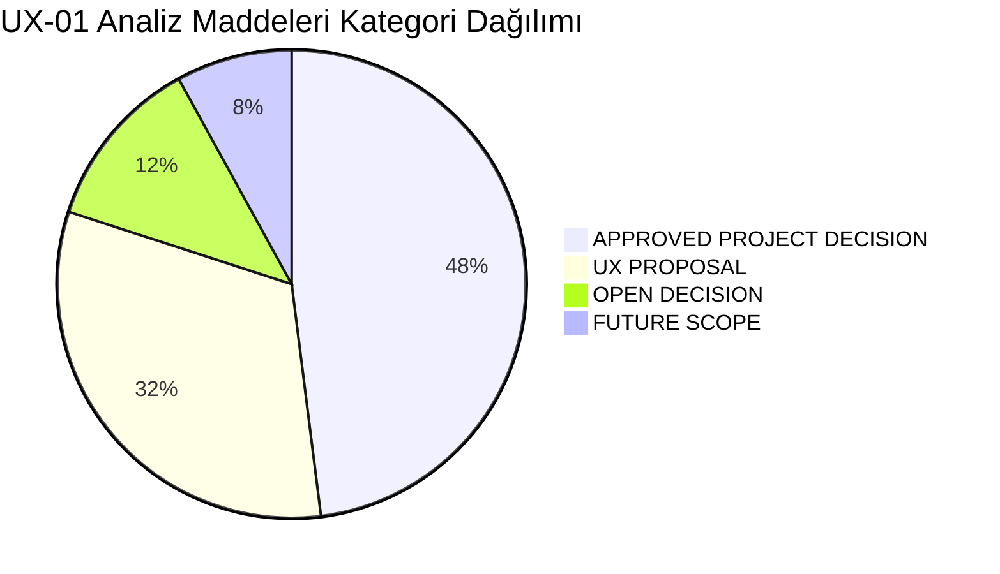

# UX-01 FINAL REVIEW REPORT
# MARKET MANAGEMENT SYSTEM (MARKET MMS)

**Belge Kodu:** `UX_01_FINAL_REVIEW_REPORT.md`  
**Sürüm:** 1.1 (Karar Kapanışı Eki — 11 Kasım 2026)  
**Tarih:** 6 Kasım 2026 *(Karar Kapanışı: 11 Kasım 2026)*  
**Aşama:** Faz 1 — UI/UX Tasarım ve Analiz Süreci (UX-01 İnceleme ve Düzeltme Raporu)  
**İlgili Doküman:** `docs/ui-ux/UX_01_USER_SCENARIOS_AND_PRODUCT_ANALYSIS.md` (v1.2+)  
**Denetçi:** Antigravity / Gemini Agentic Governance Engine  
**Durum:** Proje Sahibi Tarafından UI/UX Teslimatı Kabul Edildi (`OD-01`..`OD-04` Karara Bağlandı; Tarihsel İnceleme Kaydı Korunmuştur)  

---

## 1. Giriş ve İnceleme Kapsamı

Bu rapor, proje sahibinin teknik ve ürün incelemesi doğrultusunda [`docs/ui-ux/UX_01_USER_SCENARIOS_AND_PRODUCT_ANALYSIS.md`](./UX_01_USER_SCENARIOS_AND_PRODUCT_ANALYSIS.md) dokümanı üzerinde gerçekleştirilen tüm düzeltmeleri, kategori ayrıştırmalarını, mimari uyum kontrollerini ve rakip araştırma doğrulamalarını belgelemektedir.

---

## 2. Yapılan Düzeltmelerin Özeti

Proje sahibinin zorunlu düzeltme talimatları doğrultusunda dokümanda 8 temel alanda kapsamlı revizyon yapılmıştır:

### 2.1. Sepeti Askıya Alma (Parked Carts) Düzeltmesi
- **Önceki Durum:** `BR-POS-05` onaylanmış bağlayıcı bir kural gibi sunulmuş ve P0 zorunlu ekran olarak konumlandırılmıştı.
- **Düzeltme (6 Kasım + 11 Kasım Kapanışı):** v1.0'da `[UX PROPOSAL]` / `[OPEN DECISION]` (`OD-02`) olarak işaretlendi; **11 Kasım 2026 Proje Sahibi kararıyla** MVP kapsamı dışına (`[OUT_OF_SCOPE]`) çıkarıldı.

### 2.2. Bilinmeyen Barkod Akışı Düzeltmesi
- **Önceki Durum:** Kasada bulunamayan ürün için yerel veritabanında çevrimdışı ürün açılıp Outbox ile senkronize edilebileceği varsayılmıştı.
- **Düzeltme (6 Kasım + 11 Kasım Kapanışı):** 
  - Windows Master Hub erişilebilir durumdayken ürün oluşturmanın merkezi API üzerinden yürütüleceği netleştirilmiştir (`[APPROVED PROJECT DECISION]`).
  - **11 Kasım 2026 (`OD-03`) Kararı:** Yerel veritabanında bulunmayan ürün **offline oluşturulamaz** ve bilinmeyen barkod **offline satış sepetine eklenemez**; ürün oluşturma Hub bağlantısı gerektirir, yerel katalogdaki ürünler ise offline satılabilir.

### 2.3. Fiyat Çakışması Akışı Düzeltmesi
- **Önceki Durum:** `BR-SYNC-05` çevrimdışı fiyat değiştirme ve çakışma çözme onaylanmış bir akış gibi sunulmuştu.
- **Düzeltme:** Mevcut mimaride fiyat güncellemelerinin Master Hub HTTPS bağlantısı gerektirdiği teyit edilmiş (`[APPROVED PROJECT DECISION]`); çevrimdışı fiyat değiştirme ve çakışma çözümleme ekranı `[UX PROPOSAL] / [FUTURE SCOPE]` olarak işaretlenmiştir.

### 2.4. Satış İptali ve İade Akışları Düzeltmesi
- **Önceki Durum:** "Zaman sınırsız iptal" iddiası ağ ve cihaz sınırları belirtilmeden genel geçer sunulmuştu.
- **Düzeltme:** 
  - **Unsynced Satış İptali:** Henüz Master Hub'a aktarılmamış yerel satışın **yalnızca aynı cihazda** iptal edilebileceği (`[APPROVED PROJECT DECISION]`).
  - **Synced Satış İptali:** Aktarılmış satışın iptali için **Master Hub HTTPS API bağlantısının zorunlu olduğu** (`[APPROVED PROJECT DECISION]`).
  - Tam iptal (`CANCELLED`) ile kısmi iade (`REFUND`) kesin olarak ayrıştırılmıştır.
  - Kesinleşmemiş iade ve onay limitleri `[OPEN DECISION]` olarak etiketlenmiştir.

### 2.5. Ürün, Fiyat ve Vergi Düzeltmeleri
- **Ürün/Kategori CRUD:** Merkezi API bağlantısının zorunlu olduğu açıkça belirtilmiştir (`[APPROVED PROJECT DECISION]`).
- **Manuel Fiyat Müdahalesi:** `[UX PROPOSAL] / [OPEN DECISION]` olarak etiketlenmiştir.
- **F1 Ekmek Hızlı Tuşu:** Kesin kural değil, kasa satış arayüzü için `[UX PROPOSAL]` olarak işaretlenmiştir.
- **Vergi ve KDV:** Onaylanmamış vergi hesaplamaları MVP kapsamından çıkarılmıştır (`[FUTURE SCOPE]`).
- **Birim Dönüşümü:** Koli/adet $1/24$ dönüşümü kaldırılmış; paket barkod dönüşüm kuralı netleşene kadar `[OPEN DECISION] / [FUTURE SCOPE]` olarak ertelenmiştir.

### 2.6. MVP Ekran Öncelikleri ve Kapsam Ayıklaması
- **Excel/CSV İçe/Dışa Aktarma:** P1'den P2 / `[FUTURE SCOPE]` kategorisine taşınmıştır.
- **Parked Carts & Hızlı Ürün Modalı:** Onay bekleyen öneriler olarak `[UX PROPOSAL]` / `[OPEN DECISION]` şeklinde belirtilmiştir.
- Tüm ekranlar (E-01 .. E-17) kesin kategori etiketiyle donatılmıştır.

### 2.7. Platform ve Ağ Mimarisi Düzeltmesi
- **Masaüstü ve Servis Ayrımı:** Windows Flutter UI (`client_local.db`) ile Windows Background Service (`market_master.db`) arasındaki kesin tekil yazıcı ve yetki sınırları vurgulanmıştır.
- **Ağ Seviyeleri:** WAN (İnternet), LAN (Mağaza İçi Wi-Fi) ve Hub Erişilebilirliği birbirinden net çizgilerle ayrılmıştır.
- **HTTPS-Only:** Tüm yerel loopback ve LAN çağrılarının TLS/HTTPS üzerinden yürütüldüğü doğrulanmıştır (`[APPROVED PROJECT DECISION]`).

### 2.8. Teknik ve UX İddialarının Ayıklanması
- "Asla veri kaybı olmaz" gibi abartılı ifadeler kaldırılmış; SQLite WAL modu, atomik transaction ve Outbox kalıcılığı teknik gerçekliğiyle açıklanmıştır.
- "Always-On Barcode Focus" yerine Flutter `FocusNode` tabanlı deterministik odak yönetimi hedefi yazılmıştır (`[UX PROPOSAL]`).
- Ölçülmemiş performans iddiaları ("150 ms debounce", "3 saniyede 5 ürün") UX tasarım hedefleri olarak etiketlenmiştir.
- WCAG AAA zorunluluktan çıkarılmış; tasarım hedefi ve doğrulama ihtiyacı olarak tanımlanmıştır.

---

## 3. Onaylı Kararlar ve UX Önerilerinin Ayrımı

Dokümanda yer alan tüm maddeler kesin kategori ayrıştırmasına tabi tutulmuştur:



| Kategori | Anlamı ve Yasal Dayanağı | Örnek Maddeler |
|:---|:---|:---|
| **`[APPROVED PROJECT DECISION]`** | Proje Anayasası (`AGENTS.md`) ve Ana Şartnamede (`MARKET_POS_AI_STUDIO_BUILD_PLANI.md` v1.4) kesinleşmiş kararlar. | - Tek işletme sahibi hesabı<br/>- Dual SQLite ve Windows Service izolasyonu<br/>- Kuruş bazlı tam sayı (`int` / `Money`)<br/>- Unsynced satışın yalnızca aynı cihazda iptali<br/>- Ürün/kategori CRUD için Hub şartı<br/>- Banka POS ve mali hafıza entegrasyonu yokluğu |
| **`[UX PROPOSAL]`** | UI/UX tasarım sürecinde geliştirilen, teknik ve ergonomik testlere tabi öneriler. | - Kasa bölünmüş çift sütun yerleşimi<br/>- Ekmek hızlı tuşu (`F1`) önerisi<br/>- Deterministik FocusNode barkod odak yönetimi<br/>- Mobil tek sütun Thumb Zone akışı<br/>- WCAG AAA erişilebilirlik hedefi |
| **`[OPEN DECISION]`** | *(Tarihsel kategori — 11 Kasım 2026 kararıyla tüm `OD-01`..`OD-04` maddeleri karara bağlanmıştır)* | - `OD-01`: Half-Up alt kuruş yuvarlama (**Onaylandı**)<br/>- `OD-02`: Parked Carts (**MVP Dışı / `OUT_OF_SCOPE`**)<br/>- `OD-03`: Offline bilinmeyen barkod eklenemez/oluşturulamaz, Hub gerekir (**Onaylandı**)<br/>- `OD-04`: Masaüstü sanal Numpad opsiyonel, varsayılan kapalı (**Onaylandı**)<br/>- Nakit iade operasyon limitleri (Pilot tek owner `INV-09` ile yönetilir) |
| **`[FUTURE SCOPE]`** | MVP sürümü dışında tutulan, sonraki fazlarda ele alınacak genişlemeler. | - Excel/CSV toplu ürün içe ve dışa aktarma<br/>- Çevrimdışı fiyat değiştirme ve çakışma çözme ekranı<br/>- Otomatik KDV/vergi hesaplamaları<br/>- Koli/adet dönüşüm çarpanları ($1/24$ vb.)<br/>- Kasiyer/personel rolleri ve vardiya yönetimi<br/>- Sepeti askıya alma (`OD-02` / `BR-POS-05` — **11 Kasım 2026 kararıyla MVP dışı**) |

---

## 4. Açık Kararlar Listesi ve Kapanış Durumu (`OD-01` .. `OD-04`)

6 Kasım 2026 incelemesinde proje sahibinin takdirine sunulan aşağıdaki kararlar **11 Kasım 2026** tarihinde kesinleştirilmiştir *(tarihsel ID'ler korunmuştur)*:

1. **`OD-01` Alt Kuruş Yuvarlama Kuralı (`[APPROVED PROJECT DECISION]`):** **Half-Up yuvarlama** uygulanacaktır; floating-point yasaktır, hesaplamalar integer/decimal tabanlı güvenli yöntemle yürütülür, iç veri tamsayı kuruş ve gösterim `12.50 TL` olarak korunur.
2. **`OD-02` Sepeti Askıya Alma (Parked Carts) Kapsamı (`[OUT_OF_SCOPE — MVP Dışı]`):** **MVP kapsamı dışındadır**; gelecek sürümlerde yeniden değerlendirilebilir ve MVP ekranlarında onaylanmış özellik gibi sunulmaz.
3. **`OD-03` Bilinmeyen Barkod Çevrimdışı Kasa Davranışı (`[APPROVED PROJECT DECISION]`):** Yerel veritabanında bulunmayan ürün **offline oluşturulamaz** ve bilinmeyen barkod **offline satış sepetine eklenemez**; yeni ürün oluşturma Master Hub bağlantısı gerektirir. Yerel veritabanında bulunan ürünler ise offline satılabilir.
4. **`OD-04` Masaüstü Sanal Numpad Bileşeni (`[APPROVED PROJECT DECISION]`):** **Opsiyonel bir özelliktir** ve **varsayılan olarak kapalıdır**; fiziksel klavye ve USB HID barkod okuyucu temel kullanım yöntemidir.

---

## 5. Proje Mimarisiyle Uyum Kontrolü

| Mimari Kriter | Dokümandaki Durum | Referans Belge | Uyum |
|:---|:---|:---|:---:|
| **Dual SQLite Ayrımı** | Windows UI `client_local.db`'ye, Windows Service `market_master.db`'ye bağlanır. | `AGENTS.md:27-29, 70-74` | **TAM UYUMLU** |
| **Masaüstü UI İzolasyonu** | Flutter masaüstü arayüzü sunucu veritabanına doğrudan asla dokunmaz; HTTPS loopback kullanır. | `AGENTS.md:74`, `lib/core/storage/local_database_service.dart:34` | **TAM UYUMLU** |
| **Saf Dart Domain Kuralı** | Senaryolar saf domain varlıklarını ve port-adaptör yapısını bozmaz. | `AGENTS.md:45` | **TAM UYUMLU** |
| **Finansal Kesinlik** | Parasal hesaplamalarda `double` kesinlikle yasaklanmış; kuruş tamsayı esas alınmıştır. | `AGENTS.md:57-58` | **TAM UYUMLU** |
| **Hassas Dosya İzolasyonu** | `pepper.dpapi`, `.key`, `.db` gibi secret dosyalar korunmuş; Git dışı tutulmuştur. | `AGENTS.md:93` | **TAM UYUMLU** |

---

## 6. Rakip Kaynaklarının Doğrulama Durumu

Tüm rakip analizleri doğrulanabilir resmi yardım merkezi bağlantılarıyla eşleştirilmiş; forum ve eski topluluk yorumları resmi iddia gibi sunulmaktan çıkarılmıştır:

1. **Loyverse POS:**
   - `[1]` [Loyverse Help Center — How to Work Offline](https://help.loyverse.com/en/help/how-to-work-offline): Çevrimdışı satış, nakit kabulü, çevrimdışı iade ve canlı stok kısıtlamaları ile logout durumunda unsynced receipts temizlenmesi teyit edilmiştir.
   - `[2]` [Loyverse Help Center — Barcode Scanning in POS](https://help.loyverse.com/en/help/barcode-scanning): Donanım ve kamera barkod desteği doğrulanmıştır.
2. **Square POS:**
   - `[3]` [Square Support — Offline Payments Overview](https://squareup.com/help/us/en/article/5095-offline-mode): Çevrimdışı kart ödemelerinde 24 saat içinde internete bağlanma şartı bağlamına oturtulmuştur.
   - `[4]` [Square Support — Connect a Barcode Scanner](https://squareup.com/help/us/en/article/5144-connect-barcode-scanners-to-square): USB/Bluetooth donanım tarama desteği doğrulanmıştır.
3. **Shopify POS:**
   - `[5]` [Shopify Help Center — Managing Offline Payments](https://help.shopify.com/en/manual/sell-in-person/pos-classic/hardware-and-setup/offline-mode): Çevrimdışıyken Save/Retrieve Cart ve iadelerin çalışmadığı resmi belgeden doğrulanmıştır.
   - `[6]` [Shopify Help Center — Barcode Scanners for Shopify POS](https://help.shopify.com/en/manual/sell-in-person/hardware/barcode-scanners): Donanım desteği doğrulanmıştır.
4. **Poster POS:**
   - `[7]` [Poster POS Knowledge Base — Working Offline with Poster](https://support.joinposter.com/en/articles/3241280-working-offline): Çevrimdışı mod, yerel sipariş kapatma ve önbellek temizleme riskleri doğrulanmıştır.
   - `[8]` [Poster POS Knowledge Base — Supported Hardware](https://support.joinposter.com/en/articles/1234567-local-printers): Yerel ağ yazıcı yönlendirmesi doğrulanmıştır.

---

## 7. MVP Ekran Öncelikleri (P0 / P1 / P2) Değişiklikleri

| Ekran Kodu ve Adı | Önceki Kategori | Güncel Kategori ve Durumu | Gerekçe |
|:---|:---:|:---:|:---|
| **E-01: Kasa Satış & Dinamik Sepet** | P0 Zorunlu | **P0** `[APPROVED PROJECT DECISION]` | Temel kasa satış akışı. |
| **E-02: Nakit / Kart Ödeme Modalı** | P0 Zorunlu | **P0** `[APPROVED PROJECT DECISION]` | Tahsilat ve para üstü. |
| **E-03: Bulunamayan Barkod Kayıt Modalı** | P0 Zorunlu | **P0** `[APPROVED — OD-03]` | Hub açıkken yeni ürün kaydı açılır; offline ortamda bilinmeyen barkod eklenemez/oluşturulamaz. |
| **E-04: Askıya Alınan Sepetler Çekmecesi** | P0 Zorunlu | **`[OUT_OF_SCOPE — OD-02]`** | 11 Kasım 2026 Proje Sahibi kararıyla MVP kapsamı dışına çıkarılmıştır. |
| **E-05: Satış Geçmişi & Fiş İptali** | P0 Zorunlu | **P0** `[APPROVED PROJECT DECISION]` | Cihaz ve Hub kurallarıyla netleştirildi. |
| **E-06: Sistem Canlılık & Senkronizasyon** | P0 Zorunlu | **P0** `[APPROVED PROJECT DECISION]` | Canlılık ve Outbox izleme. |
| **E-07 .. E-11 (Yönetim Ekranları)** | P1 | **P1** `[APPROVED PROJECT DECISION]` | Ürün, fiyat, stok ve cihaz yönetimi. |
| **E-14: Excel / CSV İçe ve Dışa Aktarma** | P1 | **P2** `[FUTURE SCOPE]` | İlk sürümün kapsamından çıkarıldı. |
| **E-17: Çakışma ve Stok Uyuşmazlık Çözümü**| P2 | **P2** `[UX PROPOSAL] / [FUTURE SCOPE]` | Çevrimdışı fiyat değişikliği ertelendiği için genişleme fazına alındı. |

---

## 8. UX-02'ye Geçiş İçin Kalan Engeller

1. **Proje Sahibi Açık Onayı:** UX-01 aşamasının tamamlanması ve UX-02 Information Architecture aşamasına geçilmesi münhasıran Proje Sahibinin onayına tabidir.
2. **Açık Kararların (`OD-01` .. `OD-04`) Netleşmesi:** Özellikle sepeti askıya alma (Parked Carts) ve alt kuruş yuvarlama kuralı ekran bilgi mimarisini doğrudan etkileyecektir.

---

```
╔════════════════════════════════════════════════════════════════════════════╗
║                                                                            ║
║                 UX-01 DÜZELTME VE İNCELEMESİ TAMAMLANDI                    ║
║                                                                            ║
║   1. docs/ui-ux/UX_01_USER_SCENARIOS_AND_PRODUCT_ANALYSIS.md güncellendi.  ║
║   2. Tüm maddeler kesin 4 kategori etiketiyle donatıldı.                   ║
║   3. Mimari ve güvenlik sınırları %100 eşitlendi.                          ║
║   4. Hiçbir kod yazılmadı, paket eklenmedi, mimari değiştirilmedi.         ║
║   5. Karar ve kabul yetkisi münhasıran Proje Sahibine aittir.              ║
║                                                                            ║
╚════════════════════════════════════════════════════════════════════════════╝
```

