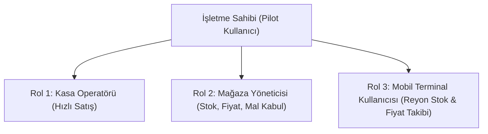
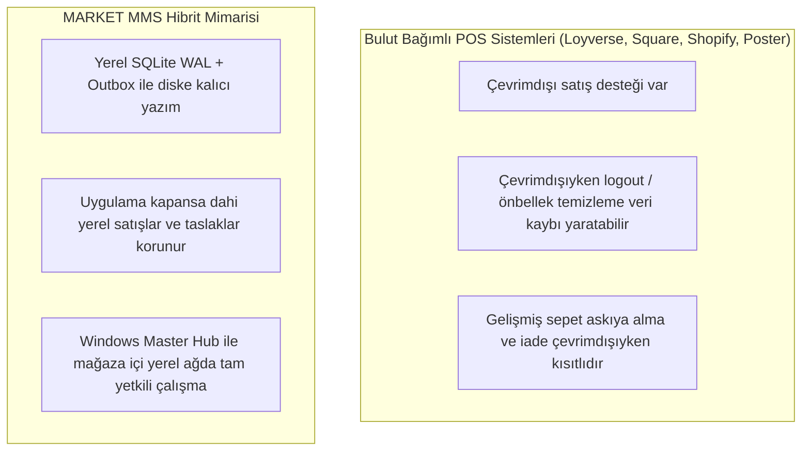

# UX-01: User Scenarios & Product Experience Analysis
# MARKET MANAGEMENT SYSTEM (MARKET MMS)

**Belge Kodu:** `UX_01_USER_SCENARIOS_AND_PRODUCT_ANALYSIS.md`  
**Sürüm:** 1.2 (Final Teknik Düzeltme ve Yönetişim Uyum Revizyonu)  
**Tarih:** 6 Kasım 2026  
**Aşama:** Faz 1 — UI/UX Tasarım ve Analiz Süreci (UX-01)  
**Hedef Doküman:** UX-02 Information Architecture & Navigation Temeli  
**İlgili Standartlar:** Clean Architecture, Offline-First, Dual SQLite, `.agents/skills/flutter-ui-standards/SKILL.md`, `AGENTS.md`  
**Durum:** Proje Sahibi İncelemesine Hazır  

---

## Yönetişim ve Kategori Etiketleri Standardı

Bu belgede yer alan tüm maddeler, iş kuralları, senaryolar ve mimari yaklaşımlar proje anayasasına uygunluk açısından aşağıdaki 4 kesin kategoriden biriyle açıkça etiketlenmiştir:

- `[APPROVED PROJECT DECISION]`: Proje sahibi tarafından onaylanmış, mimari ve şartnamede kesinleşmiş bağlayıcı karar.
- `[UX PROPOSAL]`: UI/UX tasarım sürecinde önerilen, teknik doğrulamaya ve kullanıcı testine tabi tasarım önerisi.
- `[OPEN DECISION]`: Henüz proje sahibi tarafından onaylanmamış, seçenekleri açık duran teknik veya iş kararı.
- `[FUTURE SCOPE]`: İlk pilot sürüm (MVP) kapsamı dışında tutulan, ileriki sürümlerde ele alınacak genişleme maddesi.

---

## 1. Ürün Deneyimi Hedefi (Product Experience Vision & Scope)

### 1.1. Ürün Konsepti ve Temel Misyon `[APPROVED PROJECT DECISION]`
**MARKET MANAGEMENT SYSTEM (MARKET MMS)**; küçük ve orta ölçekli perakende marketlerin günlük satış, dinamik sepet, ürün, fiyat, barkod, stok, kasa ve raporlama operasyonlarını kesintisiz, hızlı ve finansal kesinlikle yönetmek üzere tasarlanmış **profesyonel bir Market Yönetim SaaS Platformudur**.

Perakende market ortamı; yüksek işlem hacmi, yoğun müşteri kuyrukları, gürültülü çalışma ortamı ve saniyelerin kritik olduğu yüksek stresli bir operasyon alanıdır. MARKET MMS'in temel kullanıcı deneyimi hedefi:  
**"Kasiyeri/İşletmeciyi ekranda arama yapmaya zorlamayan, fareye dokundurmadan klavye ve barkod odaklı çalışan, yerel ağda Master Hub ile tam senkronize, internet kesintilerinde ise yerel SQLite üzerinde duraksamadan işleyen akıcı bir perakende deneyimi sunmaktır."** `[UX PROPOSAL]`

### 1.2. Donanımsal ve Mimari Sınırlar (MVP Boundaries) `[APPROVED PROJECT DECISION]`
Kullanıcı deneyiminin doğru kurgulanabilmesi için sistem sınırlarının net bilinmesi şarttır:
- **Banka POS Sınırı (Donanımsal İletişim Yoktur):** MARKET MMS bir banka POS cihazı değildir. Banka POS terminallerine (Ingenico, Beko vb.) kablo veya yerel ağ üzerinden otomatik tutar gönderme, mali donanım iletişimi ve banka entegrasyonları **MVP kapsamı dışındadır** (`[FUTURE SCOPE]`). Kredi kartı ile satış seçildiğinde, tutar harici banka POS terminaline gerekirse elle girilir; MARKET MMS üzerinde işlem "Kart İle Ödendi" olarak kaydedilir.
- **Yazar Kasa / Mali Hafıza Entegrasyonu Yoktur:** Mali mühür veya yazar kasa cihazı entegrasyonu MVP'de yer almaz (`[FUTURE SCOPE]`).
- **Vergi ve KDV Hesaplaması:** MVP sürümünde otomatik vergi/KDV beyanname hesaplamaları yer almaz; brüt tutar ve net tahsilat esastır (`[FUTURE SCOPE]`).
- **Ayrık Platform Mimarisi (Dual SQLite & Windows Service):**
  - **Windows Flutter Masaüstü Arayüzü (`market_pos.exe`):** Kullanıcı oturumunda çalışır, doğrudan merkezi veritabanına bağlanamaz. Yalnızca kendi yerel veritabanı olan `%LOCALAPPDATA%\MarketMMS\client_local.db` ile çalışır ve yerel loopback API (`https://127.0.0.1:<port>`) üzerinden haberleşir.
  - **Merkezi Windows Servisi (`MarketMMSService`):** Arka planda bağımsız bir Windows Servisi olarak çalışır (Dart Shelf HTTPS API) ve merkezi master veritabanını (`%PROGRAMDATA%\MarketMMS\data\market_master.db`) tekil yazıcı (Single-Writer) olarak yönetir.
  - **Mobil İstemciler (Android / iOS):** Kendi yerel uygulama dizinlerindeki SQLite veritabanları (`mms_client.db`) ile çalışır; mağaza içi yerel ağ üzerinden Master Hub HTTPS API'sine bağlanır.
  - **Ağ Seviyeleri Ayrımı:**
    - *WAN (Geniş Alan İnternet):* Open Food Facts sorguları ve bağımsız Google Drive yedeklemesi için gereklidir; kasa satış operasyonu için zorunlu DEĞİLDİR.
    - *LAN (Mağaza İçi Yerel Ağ / Wi-Fi):* Mobil istemcilerin Windows Master Hub ile konuşması için kullanılır; internet kopsa da LAN çalışır.
    - *Hub Erişilebilirliği:* Windows Service'in çalışır durumda olup olmaması durumudur. Hub kapalıyken tüm istemciler kendi yerel SQLite veritabanlarında satış yapmayı sürdürür.
  - **Güvenli İletişim:** Mağaza içi yerel ağda ve loopback üzerinde iletişim istisnasız **TLS / HTTPS** protokolüyle yürütülür (`[APPROVED PROJECT DECISION]`).

---

## 2. Kullanıcı Profilleri (User Personas)

Pilot aşamasında sistem **tek bir işletme (Tenant)** ve **tek bir şube (Store)** üzerinde çalışacaktır (`[APPROVED PROJECT DECISION]`). Pilot kapsamındaki tek yetkili kullanıcı hesabı **İşletme Sahibi (Owner)** hesabıdır. Gelecekteki kasiyer veya personel rolleri MVP kapsamına alınmamış; geleceğe dönük genişleme gereksinimi olarak not edilmiştir (`[FUTURE SCOPE]`).

### Profil 1: Market Sahibi / İşletmeci (Yönetici Rolü)
- **Kimdir:** Küçük veya orta boy mahalle marketinin sahibi. Sabah dükkânı açar, toptancıdan mal kabul eder, fiyatları günceller, faturaları kontrol eder ve akşam hasılatı inceler.
- **Hedefleri:** Gün sonunda ne kadar nakit, ne kadar kart cirosu yaptığını kuruşu kuruşuna görmek; hangi ürünün bittiğini ve kritik stoğa düştüğünü bir bakışta anlamak; toptancıdan gelen zamlı ürünlerin etiket fiyatını hızla güncellemek.
- **Günlük Görevleri:**
  - Günlük satış, brüt ve net ciro raporlarını incelemek.
  - Toptancıdan gelen malların stok girişini yapmak.
  - Fiyatı değişen ürünlerin satış fiyatını güncellemek.
  - Kritik stok uyarılarını denetlemek.
- **Yaşadığı Sorunlar:** Toptancı faturalarını girmeye vakit bulamadan ürünün raftan satılması; internet kesildiğinde sistemin durması veya yavaşlaması; karmaşık muhasebe yazılımlarının getirdiği ekran kalabalığı.
- **UX Beklentileri:** Sade, anlaşılır Türkçe terimler; gereksiz muhasebe jargonu içermeyen temiz göstergeler; tek tıkla Excel/PDF raporu alabilme (`[UX PROPOSAL]`).

### Profil 2: Kasa Başındaki Kullanıcı (Kasa Operatörü Rolü - Pilot İşletme Sahibi)
- **Kimdir:** Kasada fiilen duran, müşterilerin ürünlerini barkodla okutan ve ödemeyi alan kişi (pilot aşamada bizzat işletme sahibi).
- **Hedefleri:** Sıradaki müşteriyi bekletmeden hızlı ürün okutmak; ekmek gibi barkodsuz ürünleri tek dokunuşla eklemek; para üstünü kafadan hesaplamak zorunda kalmadan ekranda büyük ve net görmek.
- **Günlük Görevleri:**
  - Barkod okutarak sepet oluşturmak.
  - Hızlı satış butonlarını kullanmak.
  - Sepetteki ürünlerin miktarını değiştirmek veya satır silmek.
  - Nakit veya kart ödemesini kaydedip sıradaki müşteriye geçmek.
- **Yaşadığı Sorunlar:** Barkodu yıpranmış ürünün okunamaması; müşterinin son anda vazgeçtiği ürünü sepetten çıkarırken kasanın kilitlenmesi; nakit para üstünü yanlış hesaplama endişesi; fareye uzanmak zorunda kalmanın getirdiği zaman kaybı.
- **UX Beklentileri:** 
  - Fiziksel klavye ve barkod okuyucu odak yönetimine tam uyum.
  - Devasa, yüksek kontrastlı toplam tutar ve para üstü göstergesi.
  - Kazara satışı kapatmayı önleyen belirgin durum geri bildirimleri (`[UX PROPOSAL]`).

### Profil 3: Mobil Terminal Kullanıcısı (Reyonda İşlem Yapan Kullanıcı)
- **Kimdir:** Telefonu veya tabletiyle market reyonları arasında gezen işletme sahibi.
- **Hedefleri:** Rafta duran bir ürünün barkodunu telefon kamerasıyla okutup mevcut stok miktarını ve satış fiyatını anında görmek; kasada sıra varken reyonda stok kontrolü yapmak.
- **Günlük Görevleri:**
  - Reyonda fiyat ve etiket kontrolü yapmak.
  - Raftaki ürünlerin sistem stok durumunu ve son hareket geçmişini görüntülemek *(fiziksel stok sayımı MVP dışıdır)*.
  - Bozulmuş/kırılmış ürünlerin fire çıkış akışını incelemek / kayıt altına almak.
- **Yaşadığı Sorunlar:** Küçük ekranlarda butonlara basamama; mağaza arka köşesinde Wi-Fi sinyali zayıfladığında uygulamanın donması; telefon kamerasının barkodu zor algılaması.
- **UX Beklentileri:** Başparmak ergonomisine uygun geniş dokunmatik butonlar ($\ge 48\times 48\text{ dp}$); hızlı kamera tarama penceresi; offline durumda belirgin "Yerel Mod" rozeti (`[UX PROPOSAL]`).

---

## 3. Temel Kullanıcı İhtiyaçları ve Sürtünme Noktaları

| Kullanıcı İhtiyacı | Mevcut Sorun / Sürtünme Noktası | MMS UX Çözümü | Durum |
|---|---|---|:---:|
| **Sıfır Bekleme Satış** | Barkod okutulduğunda arayüzün API yanıtı beklemesi veya takılması. | **Offline-First Yerel SQLite:** Barkod yerel veritabanında taranır, UI yerel disk hızıyla güncellenir. | `[APPROVED PROJECT DECISION]` |
| **Klavye / Barkod Odak Sürekliliği** | Arayüzde bir yere tıklandığında barkod giriş odağının kaybolması, barkodun havaya okunması. | **Deterministik Odak Yönetimi:** Flutter `FocusNode` ve ham klavye dinleyicisi ile arayüz etkileşimleri sonrasında odağın otomatik olarak barkod buffer'ına dönmesi hedeflenir. | `[UX PROPOSAL]` |
| **Büyük ve Net Finansal Görünürlük** | Kasiyerin göz ucuyla tutarı seçememesi, küçük yazı tipleri. | **28sp - 36sp Tabular Monospace Tutar:** Cents (kuruş) haneleri alt alta mükemmel hizalanır; toplam tutar ekranın en belirgin öğesidir. | `[APPROVED PROJECT DECISION]` |
| **Hızlı Ekmek Satışı** | Günde yüzlerce kez satılan ekmeğin her seferinde aranması veya barkod aranması. | **Özel Ekmek Hızlı Tuşu (`F1` / Tek Dokunuş):** Fişe güncel fiyattan ekmek ekleyen hızlı erişim bileşeni. | `[UX PROPOSAL]` |
| **Eksi Stokta Satış Serbestliği** | Faturası henüz girilmemiş ürünün kasada "Stok Yok" hatası vererek satılamaması, müşterinin mağdur olması. | **Eksi Stok Serbestliği (`allow`):** Belirgin sarı uyarı rozeti verilir; ancak satış engellenmez. Uyuşmazlık denetim izine (`audit_logs`) yazılır. | `[APPROVED PROJECT DECISION]` |
| **Bilinmeyen Barkod Akışı** | Kasada okutulan ürün sistemde yoksa kasiyerin işlemi iptal edip müşteriyi geri çevirmesi. | **Merkezi API ile Hızlı Ürün Modalı (Hub Açıkken):** Open Food Facts önerisiyle ürün kaydedilir ve sepete eklenir. Hub kapalıyken yerel offline davranış öneri olarak kurgulanır. | `[UX PROPOSAL]` |
| **Ağ Kesintisinde Paniklememe** | İnternet gidince kasiyerin sistemin çöktüğünü sanması. | **Şeffaf Durum Rozetleri:** "İnternet Yok - Mağaza İçi Yerel Ağda Çalışıyor" veya "Yerel Mod (3 Satış Kuyrukta)" şeklinde güven verici Türkçe rozetler. | `[UX PROPOSAL]` |

---

## 4. Kullanıcı Senaryoları (Detaylı Akışlar, Hata Yönetimi ve Çıktılar)

### 4.1. Satış ve Kasa Akışları (BR-POS, BR-PAY)

#### Senaryo 4.1.1: Barkod Okutma ve Otomatik Satır Ekleme / Miktar Artırma `[APPROVED PROJECT DECISION]`
- **Kullanıcı Adımları:**
  1. Kasiyer ürünün barkodunu USB HID okuyucuya tutar (veya mobilde kameraya gösterir).
  2. Aynı üründen birden fazla varsa barkodu peş peşe okutur.
- **Sistem Geri Bildirimi:**
  - Barkod yerel SQLite tablosunda taranır.
  - Ürün sepet listesinde en üst satıra yerleşir (ad, snapshot birim fiyat, miktar, satır toplamı).
  - Aynı barkod tekrar okutulduğunda satır çoğaltılmaz; satırdaki miktar $1$ artar ($1 \rightarrow 2 \rightarrow 3$) ve toplam tutar anında tabular olarak güncellenir (`BR-POS-02`).
- **Olası Hata Durumları:**
  - *Barkod Okunamıyor (Hasarlı Etiket):* Kasiyer barkod numarasını klavyeden yazar veya isimle arar.
  - *Barkod Sistemde Yok:* Senaryo 4.2.3'teki "Bilinmeyen Barkod Akışı" tetiklenir.
- **Beklenen Sonuç:** Kasiyer fareye dokunmadan ürünleri hızlıca sepete ekler; toplam tutar hatasız güncellenir.

#### Senaryo 4.1.2: Ürün Arama (İsim / Barkod ile Tam veya Kısmi Arama) `[APPROVED PROJECT DECISION]`
- **Kullanıcı Adımları:**
  1. Kasiyer arama çubuğuna tıklar veya klavye kısayoluna basar.
  2. Ürün adının ilk harflerini yazar (ör. "süt").
  3. Açılan listeden istediği ürünü ok tuşlarıyla seçip `Enter`'a basar.
- **Sistem Geri Bildirimi:**
  - Debounce mekanizması sonrasında yerel SQLite indeksi üzerinden sonuç listesi gösterilir.
  - Ürünün güncel satış fiyatı ve mevcut stok miktarı listede belirgindir.
- **Olası Hata Durumları:**
  - *Arama Sonucu Boş:* "Eşleşen ürün bulunamadı" bilgisi verilir.
- **Beklenen Sonuç:** Barkodsuz veya etiketi yıpranmış ürün sepete aktarılır.

#### Senaryo 4.1.3: Ekmek Hızlı Satış Tuşu `[UX PROPOSAL]`
- **Kullanıcı Adımları:**
  1. Kasiyer ekrandaki "Ekmek" butonuna tıklar veya atanmış klavye kısayoluna basar (`F1` önerisi).
- **Sistem Geri Bildirimi:**
  - Sepetteki "Ekmek" satırı anında $+1$ artırılır.
  - Birim fiyat, ekmek ürün kartındaki güncel snapshot fiyattır.
- **Olası Hata Durumları:**
  - *Ekmek Tanımlı Değil:* Sistem "Ekmek ürünü henüz atanmamıştır. Ürün yönetiminden hızlı ekmek ataması yapınız" uyarısı verir.
- **Beklenen Sonuç:** Barkodsuz ekmek satışı tek dokunuşla sepet satırına eklenir.

#### Senaryo 4.1.4: Sepet İçi Miktar Değiştirme ve Satır Kaldırma `[APPROVED PROJECT DECISION]`
- **Kullanıcı Adımları:**
  1. Kasiyer sepetteki bir kalemin miktarını $+ / -$ butonlarıyla veya doğrudan sayı girerek değiştirir.
  2. Müşteri ürünü almaktan vazgeçtiğinde sil butonuna basar veya miktarı $0$ yapar.
- **Sistem Geri Bildirimi:**
  - Miktar $0$'a indiğinde satır sepetten kaldırılır (`BR-POS-02`).
  - Toplam tutar anında kuruş bazında tamsayı aritmetiğiyle (`int` / `Money`) yeniden hesaplanır.
- **Olası Hata Durumları:**
  - *Negatif Sayı Girişi:* Miktar alanına eksi sayı girilmesi engellenir; minimum değer $0$'dır.
- **Beklenen Sonuç:** Sepet esnek ve anında düzenlenebilir kalır.

#### Senaryo 4.1.5: Sepet Fiyatına Manuel Müdahale `[UX PROPOSAL]` / `[OPEN DECISION]`
- **Kullanıcı Adımları:**
  1. Kasiyer defolu bir ürün için sepet satırındaki birim fiyata tıklar.
  2. Yeni birim fiyatı girer ve zorunlu gerekçe yazar/seçer.
- **Sistem Geri Bildirimi:**
  - Sepet satırında "Özel Fiyat" rozeti belirir.
  - Ana ürün kartındaki fiyat DEĞİŞMEZ; indirim yalnızca o fiş snapshot'ı için geçerli olur.
  - İşlem `audit_logs` tablosuna gerekçesiyle kaydedilir.
- **Olası Hata Durumları:**
  - *Gerekçe Eksik:* Gerekçe girilmeden onay butonu aktifleşmez.
- **Beklenen Sonuç:** Fiyat müdahalesi denetlenebilir şekilde o sepete özel uygulanır.

#### Senaryo 4.1.6: `[KALDIRILDI — OUT_OF_SCOPE]` Sepeti Askıya Alma (Parked Carts) `[OD-02]`
- **Karar (11 Kasım 2026):** `BR-POS-05` / `OD-02` kapsamında Proje Sahibi kararıyla **MVP kapsamı dışına (`[OUT_OF_SCOPE]`) çıkarılmıştır**; gelecek sürümlerde yeniden değerlendirilebilir. MVP ekranlarında sepet askıya alma akışı uygulanmaz. *(Tarihsel senaryo başlığı izlenebilirlik amacıyla korunmuştur.)*

#### Senaryo 4.1.7: Ödeme Seçimi ve Para Üstü Hesabı `[APPROVED PROJECT DECISION]`
- **Kullanıcı Adımları:**
  - **Nakit Akışı:**
    1. Kasiyer "Nakit" seçeneğini seçer.
    2. Müşteriden alınan nakit tutarı girer.
    3. Sistem ekranda para üstünü büyük ve net gösterir ($\text{Para Üstü} = \text{Alınan} - \text{Toplam}$).
    4. Satışı onaylar.
  - **Kredi Kartı Akışı:**
    1. Kasiyer "Kredi Kartı" seçeneğini seçer.
    2. Tutar harici banka POS cihazından çekilir (tutar POS'a gerekirse elle girilir).
    3. Kasiyer "Kart İle Ödendi" butonuna basarak işlemi kapatır.
- **Sistem Geri Bildirimi:**
  - Alınan nakit tutar toplamdan az ise ($\text{Alınan} < \text{Toplam}$) tamamlama butonu kilitli kalır (`BR-PAY-03`).
- **Beklenen Sonuç:** Kasiyer para üstü hesaplama hatası yapmadan satışı kapatır.

#### Senaryo 4.1.8: Satış Tamamlama ve Atomik Kayıt `[APPROVED PROJECT DECISION]`
- **Kullanıcı Adımları:**
  1. Kasiyer satışı onaylar.
- **Sistem Geri Bildirimi:**
  - Yerel SQLite içinde tek bir atomik transaction işletilir: Satış fişi (`sales`), snapshot birim fiyatlı kalemler (`sale_items`), stok düşüş hareketi (`stock_movements`) ve senkronizasyon kuyruk kaydı (`sync_operations`) aynı anda yazılır.
  - Ekranda görsel başarı rozeti gösterilir: `✔ Satış Tamamlandı (Fiş #...)`.
  - Sepet anında yeni müşteri için sıfırlanır.
- **Beklenen Sonuç:** Satış verisi diske atomik yazılır; yarım veya tutarsız kayıt oluşmaz.

---

### 4.2. Ürün ve Kategori Yönetimi Akışları (BR-PROD)

#### Senaryo 4.2.1: Yeni Ürün Tanımlama (Merkezi API Bağlantısı Gerekir) `[APPROVED PROJECT DECISION]`
- **Kullanıcı Adımları:**
  1. İşletmeci "Yeni Ürün Ekle" formunu açar.
  2. Ürün Adı, Satış Fiyatı (kuruş bazlı tam sayı), Birim ve Kategori alanlarını doldurur.
  3. "Kaydet" butonuna basar.
- **Sistem Geri Bildirimi:**
  - Windows Master Hub HTTPS API'sine istek gönderilir ve ana deftere işlenir.
  - Satış fiyatı $> 0$ olmalıdır. Maliyet satış fiyatından yüksekse zararına satış uyarısı verilir (`BR-PROD-01`).
- **Olası Hata Durumları:**
  - *Hub Erişilemez:* "Merkezi sunucuya ulaşılamıyor. Ürün tanımlama işlemi için Master Hub bağlantısı gereklidir" mesajı verilir.
- **Beklenen Sonuç:** Ana ürün kataloğu tekil ve tutarlı şekilde güncellenir.

#### Senaryo 4.2.2: Çoklu Barkod Ekleme `[APPROVED PROJECT DECISION]`
- **Kullanıcı Adımları:**
  1. Ürünün alternatif ambalaj veya promosyon barkodu ürün kartına eklenir.
- **Sistem Geri Bildirimi:**
  - Yeni barkod `product_barcodes` ilişkisine eklenir (`BR-PROD-02`).
- **Olası Hata Durumları:**
  - *Mükerrer Barkod:* Barkod sistemdeki başka bir ürüne aitse işlem engellenir.
- **Beklenen Sonuç:** Farklı ambalaj barkodları aynı ürünü doğru şekilde tetikler.

#### Senaryo 4.2.3: Bilinmeyen Barkod Akışı ve Open Food Facts Önerisi `[UX PROPOSAL]`
- **Kullanıcı Adımları:**
  1. Kasada kayıtlı olmayan bir barkod okutulduğunda "Ürün Bulunamadı" modalı açılır.
  2. Master Hub ve WAN internet erişilebilir durumdaysa Open Food Facts API sorgulanır.
  3. API'den gelen ad ve kategori öneri olarak forma doldurulur; **Satış Fiyatı ve Başlangıç Stoğu işletmeci tarafından elle girilir** (`BR-PROD-06`).
  4. Kaydedildiğinde ürün sepete eklenir.
- **Çevrimdışı / Hub Kesik Durumu (`[APPROVED PROJECT DECISION — OD-03]`):**
  - **11 Kasım 2026 Kararı:** Yerel veritabanında bulunmayan ürün **offline olarak oluşturulamaz** ve bilinmeyen barkod **offline satış sepetine eklenemez** (geçici/tanımsız kalem ekleme yolu kapalıdır). Ürün oluşturma Master Hub bağlantısı gerektirir; yerel veritabanında kayıtlı ürünler ise offline satılabilir.
- **Beklenen Sonuç:** Hub açıkken ürün hızla kaydedilir; Open Food Facts önerisi elle doğrulanır.

#### Senaryo 4.2.4: Fiyat Güncelleme ve Fiyat Geçmişi `[APPROVED PROJECT DECISION]`
- **Kullanıcı Adımları:**
  1. İşletmeci ürün satış fiyatını günceller (Merkezi API üzerinden).
- **Sistem Geri Bildirimi:**
  - Eski fiyat `price_history` tablosuna arşivlenir.
  - Geçmiş satış fişlerindeki ve açık sepetlerdeki snapshot fiyatlar kesinlikle DEĞİŞMEZ.
- **Beklenen Sonuç:** Fiyat geçmişi izlenebilir kalır; geçmiş raporlar bozulmaz.

#### Senaryo 4.2.5: Ürün Pasifleştirme (Soft-Delete) `[APPROVED PROJECT DECISION]`
- **Kullanıcı Adımları:**
  1. Satışı durdurulan ürün için "Pasife Al" işlemi yapılır.
- **Sistem Geri Bildirimi:**
  - Ürün veritabanından silinmez (`is_active = false`).
  - Satış aramasında ve barkod okutmada görünmez; ancak geçmiş satış raporlarında verileri korunur (`BR-PROD-03`).
- **Beklenen Sonuç:** Geçmiş satış fişleri ve muhasebe denetim izi bozulmaz.

---

### 4.3. Stok Yönetimi Akışları (BR-STK)

#### Senaryo 4.3.1: Mevcut Stok ve Kritik Stok Takibi `[APPROVED PROJECT DECISION]`
- **Kullanıcı Adımları:**
  1. İşletmeci stok ekranını açar ve kritik stok filtresini uygular.
- **Sistem Geri Bildirimi:**
  - Kritik eşik altındaki ürünler sarı, eksiye düşenler kırmızı rozetle listelenir.
- **Beklenen Sonuç:** Sipariş verilmesi gereken ürünler net görülür.

#### Senaryo 4.3.2: Normal Mal Kabulü / Stok Girişi `[APPROVED PROJECT DECISION]`
- **Kullanıcı Adımları:**
  1. Toptancıdan gelen mallar için miktar girişi yapılır (`NORMAL_GIRIS`).
- **Sistem Geri Bildirimi:**
  - `stock_movements` tablosuna giriş hareketi yazılır; mevcut stok artar.
- **Beklenen Sonuç:** Stok girişi kayıt altına alınır.

#### Senaryo 4.3.3: Fire ve Kayıp Kaydı `[APPROVED PROJECT DECISION]`
- **Kullanıcı Adımları:**
  1. Kırılan/bozulan ürün için çıkış miktarı ve **zorunlu gerekçe** girilir (`FIRE_KAYIP`).
- **Sistem Geri Bildirimi:**
  - Gerekçe boş bırakılamaz; stok düşülür ve fire raporlarına yansıtılır.
- **Beklenen Sonuç:** Zayiatlar gerekçeleriyle denetim altına alınır.

#### Senaryo 4.3.4: Stok Hareketleri Geçmişi (9 Hareket Türü) `[APPROVED PROJECT DECISION]`
- **Kullanıcı Adımları:**
  1. Ürünün hareket geçmişi incelenir.
- **Sistem Geri Bildirimi:**
  - Aktif MVP hareket türleri (`BASLANGIC_STOK`, `NORMAL_GIRIS`, `NORMAL_CIKIS`, `SATIS`, `SATIS_IPTALI`, `MUSTERI_IADESI`, `FIRE_KAYIP`, `MANUEL_DUZELTME`) zaman damgası ve gerekçesiyle gösterilir *(not: `SAYIM_FARKI` Post-MVP fiziksel sayım modülüne ayrılmıştır)*.
- **Beklenen Sonuç:** Stok değişimleri geriye dönük tam denetlenebilir.

#### Senaryo 4.3.5: Eksi Stok Satış Uyarısı ve Uyuşmazlık Takibi `[APPROVED PROJECT DECISION]`
- **Kullanıcı Adımları:**
  1. Kasada stoğu $0$ olan ürün okutulur.
- **Sistem Geri Bildirimi:**
  - Belirgin sarı uyarı rozeti verilir; satış engellenmez (`BR-STK-02`, `03`).
  - Satış sonrası stok negatif olur; durum `audit_logs` tablosuna işlenir.
- **Beklenen Sonuç:** Rafta olan malın satışı durdurulmaz.

---

### 4.4. Satış Geçmişi, İptal ve İade Akışları (BR-POS-08, BR-POS-09)

#### Senaryo 4.4.1: Satış İptali Akışı ve Ağ Sınırları `[APPROVED PROJECT DECISION]`
- **Kural ve Sınırlar:**
  - **Senkronize Edilmemiş (Unsynced) Satış:** Henüz Master Hub'a aktarılmamış yerel bir satış, **yalnızca satışın yapıldığı AYNI cihaz üzerinden** iptal edilebilir.
  - **Senkronize Edilmiş (Synced) Satış:** Master Hub'a aktarılmış bir satışın iptali için **Master Hub HTTPS API bağlantısı zorunludur**.
  - **Zaman Kısıtı:** Fiş iptali için yapay bir dakika/saat kısıtı yoktur; ancak iptal gerekçesi girmek zorunludur (`BR-POS-08`).
- **Sistem Geri Bildirimi:**
  - Fiş durumu `CANCELLED` yapılır; ürünler stoğa `SATIS_IPTALI` hareketiyle iade edilir; cirodan düşülür.
- **Beklenen Sonuç:** İptal işlemi cihaz ve senkronizasyon durumuna göre güvenli şekilde yönetilir.

#### Senaryo 4.4.2: Kısmi Ürün İadesi ve Kondisyon Seçimi `[APPROVED PROJECT DECISION]`
- **Kullanıcı Adımları:**
  1. Müşteri fişteki belirli bir ürünü geri getirdiğinde kısmi iade akışı açılır (`BR-POS-09`).
  2. Ürün durumu seçilir: **Satılabilir** veya **Hasarlı / Bozuk** (`BR-POS-10`).
- **Sistem Geri Bildirimi:**
  - Satılabilir ise `MUSTERI_IADESI` ile normal stoğa eklenir.
  - Hasarlı ise satılabilir stoğa eklenmez; `FIRE_KAYIP` stoğuna yazılır.
  - İade bedeli snapshot satış fiyatından hesaplanarak cirodan düşülür.
- **Beklenen Sonuç:** Bozuk mal satılabilir stoka karışmaz.

#### Senaryo 4.4.3: İade ve İptal Açık Kararları `[OPEN DECISION]`
- Kasa nakdinden yapılacak fiziki nakit iadelerinde uygulanacak günlük limitler ve yetki onayları proje sahibi kararına bırakılmıştır.

---

### 4.5. Dashboard ve Raporlama Akışları (BR-REP)

#### Senaryo 4.5.1: Günlük Brüt Satış, İade ve Net Ciro `[APPROVED PROJECT DECISION]`
- **Göstergeler:**
  - $\text{Net Ciro} = \text{Brüt Satış} - \text{İadeler}$
  - İptal edilen satışlar ciroya kesinlikle dahil edilmez (`BR-REP-02`).
  - Tüm rakamlar tabular monospace yazı tipiyle kuruş bazında tamsayıdan formatlanarak gösterilir.
- **Beklenen Sonuç:** Gün sonu finansal dengesi net görülür.

#### Senaryo 4.5.2: Nakit ve Kart Hasılat Kırılımı `[APPROVED PROJECT DECISION]`
- **Göstergeler:**
  - Toplam hasılat Nakit ve Kredi Kartı kırılımında net ayrıştırılır (`BR-REP-03`).
  - İadeler ve ödeme yöntemi düzeltmeleri ilgili ödeme türü cirosuna yansıtılır.
- **Beklenen Sonuç:** Kasa çekmecesi ve banka POS slipleriyle tam mutabakat sağlanır.

#### Senaryo 4.5.3: Çevrimdışı Rapor Uyarısı `[APPROVED PROJECT DECISION]`
- **Sistem Geri Bildirimi:**
  - Cihaz Hub'dan yalıtılmış durumdayken alınan raporda uyarı bandı gösterilir: *"Bu rapor yalnızca bu cihazdaki yerel verileri içermektedir"* (`BR-REP-06`).
- **Beklenen Sonuç:** Eksik veriyle yanlış karar alınması önlenir.

---

### 4.6. Çevrimdışı Çalışma, Senkronizasyon ve Durum Bildirimleri (BR-SYNC)

#### Senaryo 4.6.1: Hub Kapalıyken Satış Yapma `[APPROVED PROJECT DECISION]`
- **Sistem Geri Bildirimi:**
  - Windows Service kapalı veya ulaşılamaz olduğunda masaüstü UI kendi `client_local.db`'sine yazar.
  - Satış yerel Outbox kuyruğuna eklenir. Rozet: `● Yerel Mod (Kuyrukta: 1)`.
- **Beklenen Sonuç:** Kasa durmaz; satışlar güvenle yerel diske kaydedilir.

#### Senaryo 4.6.2: WAN Kesik, LAN Aktif Durumu `[APPROVED PROJECT DECISION]`
- **Sistem Geri Bildirimi:**
  - Geniş alan interneti olmasa dahi mobil cihazlar mağaza içi Wi-Fi üzerinden Windows Master Hub API'sine erişir.
  - Rozet: `● Yerel Ağ Senkronize (İnternet Yok)`.
- **Beklenen Sonuç:** Mağaza içi çoklu cihaz operasyonu kesintisiz sürer.

#### Senaryo 4.6.3: Otomatik Arka Plan Senkronizasyonu `[APPROVED PROJECT DECISION]`
- **Sistem Geri Bildirimi:**
  - Ağ bağlantısı sağlandığında yerel Outbox worker'ı bekleyen işlemleri FIFO sırasıyla Master Hub'a aktarır (`BR-SYNC-02`).
  - Rozet: `⟳ Senkronize Ediliyor...` $\rightarrow$ `✔ Güncel`.
- **Beklenen Sonuç:** Kullanıcı müdahalesine gerek kalmadan veriler eşitlenir.

#### Senaryo 4.6.4: Çevrimdışı Fiyat Çakışması Önerisi `[UX PROPOSAL]` / `[FUTURE SCOPE]`
- Mevcut mimaride fiyat güncellemeleri Master Hub bağlantısı gerektirir (`[APPROVED PROJECT DECISION]`). Çevrimdışı fiyat değiştirme ve çakışma çözümleme ekranı gelecekteki genişleme fazı önerisi olarak değerlendirilmelidir (`[FUTURE SCOPE]`).

---

## 5. Platform Deneyimi Karşılaştırması (Windows vs Android vs iOS)

MARKET MMS, platformlar arası responsive bir Flutter uygulamasıdır. Ancak **masaüstü ekranının mobilde minyatürleştirilmesi kesinlikle yasaktır** (`[APPROVED PROJECT DECISION]`). Her platform kendi donanım avantajına ve ergonomisine göre optimize edilir:

| Boyut / Özellik | Windows Masaüstü (`market_pos.exe`) | Android Telefon / Tablet | iOS (iPhone / iPad) |
|:---|:---|:---|:---|
| **Birincil Rol** | **Ana Kasa & Local Master Hub UI** | **Mobil Kasa / Reyon El Terminali** | **Mobil Kasa / Reyon El Terminali** |
| **Form Faktörü** | Yatay (Landscape 16:9 / 16:10) | Dikey (Portrait) Telefonda; Yatay Tablette | Dikey (Portrait) iPhone'da; Yatay iPad'de |
| **Girdi Yöntemi** | USB HID Barkod Okuyucu + Klavye + Fare | Dokunmatik Ekran + Kamera Barkod Okuyucu | Dokunmatik Ekran + Kamera Barkod Okuyucu |
| **Klavye Kısayolları**| `F1` (Ekmek önerisi), `F8` (Park önerisi), `Enter` | Sanal Numpad & Dokunmatik Butonlar | Sanal Numpad & Dokunmatik Butonlar |
| **Ekran Düzeni** | **Bölünmüş Çift Panel:** Sol sepet listesi, sağ hızlı tuşlar ve toplam tutar kartı | **Tek Sütun / Akıllı Sekme:** Üstte tarama/arama, ortada ürün kartı, altta sepet barı | **Tek Sütun / Akıllı Sekme:** iOS tasarım diliyle alt sepet modalı / sheet |
| **Dokunmatik Hedef** | Minimum $48 \times 48\text{ dp}$ (Dokunmatik monitör uyumu) | Minimum $48 \times 48\text{ dp}$; ödeme butonları $\ge 56\text{ dp}$ | Minimum $48 \times 48\text{ dp}$; Apple HIG standartları |
| **Başparmak Erişimi**| Masaüstü ergonomisi (merkezi görüş alanı) | **Thumb Zone:** Kritik butonlar ekranın alt 1/3'lük kısmında | **Thumb Zone:** Kritik butonlar ekranın alt 1/3'lük kısmında |
| **Yerel Depolama** | `%LOCALAPPDATA%\MarketMMS\client_local.db` | Uygulama Döküman Dizini (`mms_client.db`) | Uygulama Döküman Dizini (`mms_client.db`) |
| **Ağ Protokolü** | Loopback HTTPS (`https://127.0.0.1:<port>`) | Yerel Wi-Fi HTTPS (`https://<hub-ip>:<port>`) | Yerel Wi-Fi HTTPS (`https://<hub-ip>:<port>`) |

---

## 6. Rakip ve Benzer Ürün UX Analizi

Küçük ve orta ölçekli perakende yönetim sistemlerinin resmi teknik dokümantasyonları taranarak analiz edilmiştir:

### 6.1. Loyverse POS
- **İncelenen Özellikler:** Tablet/telefon kasa arayüzü, yerel ürün önbelleği, çevrimdışı satış akışı (Kaynak: Loyverse Help Center [1], [2]).
- **Güçlü Yönleri:** Hızlı öğrenilebilen görsel ürün ızgarası; tablet ve telefonda akıcı sepet; açık bilet (open ticket) yönetimi; basit nakit/kart ayrımı [1].
- **Zayıf Yönleri:** 
  - Çevrimdışıyken iade (refund) butonu tamamen devre dışıdır [1].
  - Canlı stok takibi çevrimdışıyken gösterilmez [1].
  - Çevrimdışı receipts cihazda beklerken kullanıcı hesap çıkışı (logout) yaparsa bu kayıtlar yerel depodan temizlenir [1].
- **MMS İçin Çıkarım:** Mobilde dokunmatik akıcılığı alırken, SQLite WAL modeli ile yerel diske atomik yazım yapılmalı; Windows tarafında ise görsel ızgara yerine klavye odaklı hızlı liste kurgulanmalıdır `[UX PROPOSAL]`.

### 6.2. Square POS (Square for Retail)
- **İncelenen Özellikler:** Square Retail arayüzü, Offline Payments kuralları, barkod tarama donanım entegrasyonu (Kaynak: Square Support [3], [4]).
- **Güçlü Yönleri:** Minimalist ve modern SaaS görsel dili; yüksek kontrastlı tipografi; hatasız numpad ödeme akışı; donanım kitiyle kusursuz entegrasyon [3].
- **Zayıf Yönleri:** 
  - Çevrimdışı kredi kartı ödemeleri (Offline Payments) için 24 saat içinde internete bağlanarak ödemeyi yükleme şartı bulunur; aksi halde kart çekimleri geçersiz sayılabilir [3].
  - Yerel Master Hub mimarisi sunmaz; cloud merkezlidir.
- **MMS İçin Çıkarım:** Square'in temiz kart tasarımı ve büyük fontlu ödeme ekranı örnek alınmalı; ancak MMS'in yerel ağ Master Hub mimarisiyle WAN internet bağımlılığı olmadan yerel nakit ve harici kart kayıtları güvenle yönetilmelidir `[UX PROPOSAL]`.

### 6.3. Shopify POS (Shopify POS Pro)
- **İncelenen Özellikler:** Perakende sepet yönetimi, Save/Retrieve Cart özelliği, çevrimdışı sınırlamalar (Kaynak: Shopify Help Center [5], [6]).
- **Güçlü Yönleri:** Zengin ürün detayları; modern responsive arayüz; geniş perakende özellikleri [5].
- **Zayıf Yönleri:** 
  - **Kritik Kısıt:** Shopify POS çevrimdışıyken **Sepeti Askıya Alma (Save/Retrieve Cart) özelliği çalışmaz** [5].
  - İade ve değişim işlemleri çevrimdışıyken devre dışıdır [5].
- **MMS İçin Çıkarım:** MMS'te sepeti askıya alma (Parked Carts) özelliği onaylandığı takdirde, yerel SQLite üzerinde çevrimdışıyken de çalışabilmesi önemli bir kullanım kolaylığı sağlayacaktır `[UX PROPOSAL]`.

### 6.4. Poster POS
- **İncelenen Özellikler:** Tablet POS perakende modülü, offline sync kuralları (Kaynak: Poster POS Knowledge Base [7], [8]).
- **Güçlü Yönleri:** Dokunmatik hızlı butonlar; basit kasa arayüzü; yerel fiş yazıcı yönlendirmesi [7].
- **Zayıf Yönleri:** 
  - Çevrimdışıyken uygulama önbelleğinin temizlenmesi veya oturumun bozulması durumunda senkronize edilmemiş veriler riske girebilir [7].
  - Perakende market birim dönüşümleri ve derin denetim hareketleri kısıtlıdır.
- **MMS İçin Çıkarım:** Poster'in basit dokunmatik satış sadeliği korunmalı; ancak veri kalıcılığı geçici belleğe değil, ACID uyumlu kalıcı yerel SQLite tablolarına emanet edilmelidir `[APPROVED PROJECT DECISION]`.

---

## 7. MVP Ekran Öncelikleri (P0, P1, P2)

Ekranlar kullanıcı değeri ve mimari onay durumuna göre sınıflandırılmıştır:

### P0: İlk Sürümde Zorunlu (Kasa & Temel Satış Döngüsü)

| Ekran Kodu ve Adı | Kullanıcı Amacı | Temel İşlev | Platform | Öncelik ve Onay Durumu |
|:---|:---|:---|:---|:---:|
| **E-01: Kasa Satış & Dinamik Sepet** | Müşteri sepetini oluşturup satışı tamamlamak. | Deterministik barkod dinleyici, sepet listesi, miktar değiştirme, satır silme. | Windows (Öncelikli), Android, iOS | `[APPROVED PROJECT DECISION]` |
| **E-02: Nakit / Kart Ödeme Modalı** | Satış tutarını tahsil etmek ve para üstünü görmek. | Tek dokunuşla Nakit/Kart seçimi, alınan para girişi, büyük fontlu para üstü hesabı, atomik satış tamamlama. | Windows, Android, iOS | `[APPROVED PROJECT DECISION]` |
| **E-03: Bulunamayan Barkod Kayıt Modalı** | Kasada okutulan yeni ürünü Hub açıkken kaydetmek. | Hub açıkken Open Food Facts önerisiyle ad/fiyat/birim/kategori girişi, sepete ekleme *(offline ekleme/oluşturma yok — `OD-03`)*. | Windows, Android, iOS | `[APPROVED — OD-03]` |
| ~~**E-04: Askıya Alınan Sepetler Çekmecesi**~~ | Cüzdan unutan müşteriyi bekletmeden sıradakine geçmek. | *(11 Kasım 2026 Proje Sahibi kararıyla MVP dışına çıkarılmıştır — gelecek sürümlerde yeniden değerlendirilebilir)* | - | **`[OUT_OF_SCOPE — OD-02]`** |
| **E-05: Satış Geçmişi & Fiş İptali** | Satış fişini incelemek veya hatalı fişi iptal etmek. | Fiş listesi, snapshot kalemler, aynı cihazda unsynced iptal veya Hub üzerinden synced iptal (`CANCELLED`). | Windows, Android, iOS | `[APPROVED PROJECT DECISION]` |
| **E-06: Sistem Canlılık & Senkronizasyon Rozeti** | Kasanın ve ağın çalışma durumundan emin olmak. | Master Hub bağlantı durumu, Outbox bekleyen işlem sayacı, offline uyarı rozeti. | Windows, Android, iOS | `[APPROVED PROJECT DECISION]` |

### P1: İlk Sürümden Hemen Sonra (Temel Yönetim & Raporlama)

| Ekran Kodu ve Adı | Kullanıcı Amacı | Temel İşlev | Platform | Öncelik ve Onay Durumu |
|:---|:---|:---|:---|:---:|
| **E-07: Ürün & Kategori Yönetimi** | Mağaza kataloğunu yönetmek (Hub gerektirir). | Ürün CRUD, çoklu barkod bağlama, soft-delete pasifleştirme. | Windows, Android, iOS | `[APPROVED PROJECT DECISION]` |
| **E-08: Hızlı Fiyat Düzenleme** | Toptancı zammını rafa yansıtmak (Hub gerektirir). | Fiyat değiştirme, fiyat geçmişi (`price_history`), snapshot koruması. | Windows, Android, iOS | `[APPROVED PROJECT DECISION]` |
| **E-09: Stok Girişi & Fire Çıkışı** | Depoya gelen veya ziyan olan malları işlemek. | Normal mal kabul girişi (`NORMAL_GIRIS`), gerekçeli fire kaydı (`FIRE_KAYIP`). | Windows, Android, iOS | `[APPROVED PROJECT DECISION]` |
| **E-10: Basit Günlük Dashboard** | Günün finansal hasılatını görmek. | Brüt satış, iadeler, net ciro, nakit/kart dağılımı, kritik stok sayısı. | Windows, Android, iOS | `[APPROVED PROJECT DECISION]` |
| **E-11: Cihaz Eşleştirme & Yönetim** | Mağazadaki yeni telefonu sisteme tanıtmak. | Dinamik QR kod üretme, yerel ağ mDNS eşleştirme, cihaz yetki iptali. | Windows, Android, iOS | `[APPROVED PROJECT DECISION]` |

### P2: İleri Sürüm (Gelişmiş Operasyonlar & SaaS Hazırlığı)

| Ekran Kodu ve Adı | Kullanıcı Amacı | Temel İşlev | Platform | Öncelik ve Onay Durumu |
|:---|:---|:---|:---|:---:|
| **E-12: Kısmi Ürün İadesi Modalı** | Fişteki tek bir kalemi iade almak. | Kalem seçimi, hasarlı/satılabilir ayrımı, snapshot fiyattan iade. | Windows, Android, iOS | `[APPROVED PROJECT DECISION]` |
| **E-13: Stok Sayım Ekranı** | Raflardaki fiili malları saymak ve uzlaştırmak (`BR-STK-04`..`BR-STK-10`). | Taslak sayım (`DRAFT`), çoklu cihaz kilidi, sayım farkı uzlaştırması (`SAYIM_FARKI`). | Android/iOS, Windows | `[OUT_OF_SCOPE / FUTURE SCOPE]` |
| **E-14: Excel / CSV İçe ve Dışa Aktarma** | Toplu ürün listesi yüklemek veya dışa aktarmak. | XLSX doğrulama, toplu atomik yükleme, katalog dışa aktarma. | Windows (Öncelikli) | `[FUTURE SCOPE]` |
| **E-15: Gelişmiş Tarih Filtreli Raporlar** | Kâr/zarar ve çok satan analizi yapmak. | Haftalık/aylık filtreler, birim bazlı çok satanlar, PDF/XLSX dışa aktarım. | Windows, Android, iOS | `[FUTURE SCOPE]` |
| **E-16: Google Drive Yedekleme Paneli** | Veritabanını bulutta bağımsız yedeklemek. | AES-256-CBC şifreli yedek alma, Google Drive bağlantısı, koruyucu restore. | Windows | `[APPROVED PROJECT DECISION]` / `[FUTURE SCOPE]` |
| **E-17: Çakışma ve Stok Uyuşmazlık Çözümü**| Çevrimdışı çakışan fiyat ve stokları onaylamak. | İki cihazın farklı girdiği değerleri yan yana gösterip onaylatma. | Windows | `[UX PROPOSAL]` / `[FUTURE SCOPE]` |

---

## 8. UX ve Tasarım Prensipleri (Design System Baseline)

`.agents/skills/flutter-ui-standards/SKILL.md` yönergeleri doğrultusunda belirlenen çekirdek arayüz prensipleri:

1. **Modern SaaS ve Temiz Görsel Dil:**
   - Gereksiz renk cümbüşünden ve dikkat dağıtıcı animasyonlardan kaçınılır.
   - İşlevsellik, bilgi yoğunluğu ve hız ön plandadır `[UX PROPOSAL]`.
2. **Light ve Dark Tema Desteği:**
   - Aydınlık market ortamları için yüksek kontrastlı `Light Theme`.
   - Akşam veya loş ışıklı kasa köşeleri için gözü yormayan `Dark Theme` `[UX PROPOSAL]`.
3. **Erişilebilirlik ve Kontrast Hedefi:**
   - Standart gövde metinlerinde WCAG AA ($4.5:1$), büyük başlıklarda ve kritik butonlarda WCAG AAA ($7:1$) bir tasarım hedefi olarak benimsenir ve kontrast testleriyle doğrulanır `[UX PROPOSAL]`.
4. **Dokunmatik ve Ergonomi Standartları:**
   - Tüm dokunmatik butonlar en az **$48 \times 48\text{ dp}$** boyutundadır.
   - Kasa ödeme butonları en az **$56\text{ dp}$** (masaüstünde $64\text{ dp}$) yüksekliğe sahiptir `[UX PROPOSAL]`.
5. **Tabular Monospace Finansal Hizalama:**
   - Tüm parasal tutarlar `FontFeature.tabularFigures()` veya monospace yazı tipi ile kuruş haneleri sağa yaslı olarak alt alta hizalanır `[APPROVED PROJECT DECISION]`.
6. **Devasa Toplam Tutar:**
   - Ödenecek toplam tutar, ekranın en belirgin noktasına **28sp - 36sp** aralığında kalın (bold) yazı tipiyle yerleştirilir `[UX PROPOSAL]`.
7. **Deterministik Barkod Odak Yönetimi:**
   - Arayüzde fare tıklaması veya modal açılıp kapanması sonrasında barkod okuyucu odağının otomatik olarak sepet giriş buffer'ına dönmesi Flutter `FocusNode` mekanizması ile hedeflenir `[UX PROPOSAL]`.

---

## 9. Açık Kararlar ve UX Riskleri

Analiz sürecinde tespit edilen ve UX-02 Information Architecture öncesinde proje sahibinin dikkatine sunulan açık noktalar:

1. **Alt Kuruş Yuvarlama Kararı (`OD-01` — `[APPROVED PROJECT DECISION]`):**
   - **11 Kasım 2026 Kararı:** Tartılı veya kesirli ürün çarpmalarındaki alt kuruşlar için **Half-Up yuvarlama** onaylanmıştır. Para hesaplamalarında floating-point aritmetik yasaktır; integer/decimal tabanlı güvenli hesaplama, dahili integer kuruş ve `12.50 TL` gösterimi korunur.
2. **Sepeti Askıya Alma (Parked Carts) Onayı (`OD-02` — `[OUT_OF_SCOPE / MVP Dışı]`):**
   - **11 Kasım 2026 Kararı:** Parked carts özelliği (`BR-POS-05`) **MVP kapsamı dışındadır**; gelecek sürümlerde yeniden değerlendirilebilir ve MVP ekranlarında sunulmayacaktır.
3. **Bilinmeyen Barkod Offline Davranışı (`OD-03` — `[APPROVED PROJECT DECISION]`):**
   - **11 Kasım 2026 Kararı:** Yerel veritabanında bulunmayan ürün **offline oluşturulamaz** ve bilinmeyen barkod **offline satış sepetine eklenemez**. Ürün oluşturma Master Hub bağlantısı gerektirir; yerel veritabanında bulunan ürünler ise offline satılabilir.
4. **Sanal Numpad ve Dokunmatik Monitör Ergonomisi (`OD-04` — `[APPROVED PROJECT DECISION]`):**
   - **11 Kasım 2026 Kararı:** Sanal numpad masaüstü POS ekranında **opsiyonel bir özelliktir ve varsayılan olarak kapalıdır**; fiziksel klavye ve USB HID barkod okuyucu temel kullanım yöntemidir.
5. **Paket/Koli Dönüşüm Çarpanı (`FUTURE SCOPE`):**
   - Koli/adet dönüşüm çarpanları paket barkod ilişkileri netleşene kadar ilk sürüm kapsamı dışındadır.

---

## 10. UX-02 Information Architecture İçin Öneriler

Bu analizin ardından yürütülecek **UX-02 (Information Architecture)** aşaması için mimari öneriler:

1. **Navigasyon Yapısı:**
   - **Windows Masaüstü:** Sol tarafta daraltılabilir modern bir **Sidebar Navigasyonu** (Kasa Satış, Ürünler, Stok, Satış Geçmişi, Raporlar, Ayarlar). Kasa ekranında sidebar otomatik daralarak çalışma alanını maksimize etmelidir `[UX PROPOSAL]`.
   - **Mobil (Android/iOS):** Alt tarafta 4 sekmeli **Bottom Navigation Bar** (Kasa, Ürünler, Stok, Daha Fazla) `[UX PROPOSAL]`.
2. **Kasa Ekranı Yerleşim Modeli (Desktop Wireframe Temeli):**
   - **Sol Panel (%60 genişlik):** Canlı sepet listesi (Ürün adı, miktar artır/azalt, snapshot birim fiyat, satır toplamı, sil butonu) `[UX PROPOSAL]`.
   - **Sağ Panel (%40 genişlik):**
     - Üstte: Barkod arama çubuğu ve Hızlı Butonlar.
     - Ortada: Hızlı işlem butonları (İndirim/Fiyat Değiştir önerisi).
     - Altta: Devasa Toplam Tutar Kartı, Nakit ve Kart büyük ödeme butonları `[UX PROPOSAL]`.
3. **Tasarım Token'ları:**
   - Renk paleti, tipografi boyutları ve aralık (spacing) standartları Flutter temasıyla (`AppTheme`) doğrudan eşlenecek şekilde tokenlaştırılmalıdır `[UX PROPOSAL]`.

---

## 11. Araştırma ve Doğrulama Kaynakları (References & Citations)

Bu analizde yer alan mimari, kural ve rakip bilgileri aşağıdaki birincil kaynaklardan doğrulanmıştır:

### 11.1. Proje İçi Kanonik Şartnameler
- [`AGENTS.md`](../../AGENTS.md) — Merkezi Proje Anayasası ve Ortak Geliştirme Kuralları.
- [`docs/requirements/BUSINESS_RULES_SPEC.md`](../requirements/BUSINESS_RULES_SPEC.md) — 159 Bağlayıcı İş Kuralı Şartnamesi (v1.2).
- [`MARKET_POS_AI_STUDIO_BUILD_PLANI.md`](../../MARKET_POS_AI_STUDIO_BUILD_PLANI.md) — Ana Yapım Planı ve Yol Haritası (v1.4).
- [`docs/ARCHITECTURE.md`](../ARCHITECTURE.md) — Windows Local Master Hub & Dual SQLite Mimarisi.
- [`.agents/skills/flutter-ui-standards/SKILL.md`](../../.agents/skills/flutter-ui-standards/SKILL.md) — MMS Flutter UI ve Kasa Ergonomisi Standartları.

### 11.2. Rakip ve Pazar Araştırması Kaynakları
- **Loyverse POS:**
  - `[1]` [Loyverse Help Center — How to Work Offline](https://help.loyverse.com/en/help/how-to-work-offline) (Çevrimdışı satış, nakit kabulü, çevrimdışı iade ve canlı stok kısıtlamaları).
  - `[2]` [Loyverse Help Center — Barcode Scanning in POS](https://help.loyverse.com/en/help/barcode-scanning) (Donanım ve kamera barkod tarayıcı desteği).
- **Square POS (Square for Retail):**
  - `[3]` [Square Support — Offline Payments Overview](https://squareup.com/help/us/en/article/5095-offline-mode) (Çevrimdışı ödeme alma kuralları ve 24 saat içinde yükleme gereksinimi).
  - `[4]` [Square Support — Connect a Barcode Scanner](https://squareup.com/help/us/en/article/5144-connect-barcode-scanners-to-square) (USB ve Bluetooth barkod donanım entegrasyonu).
- **Shopify POS:**
  - `[5]` [Shopify Help Center — Managing Offline Payments](https://help.shopify.com/en/manual/sell-in-person/pos-classic/hardware-and-setup/offline-mode) (Çevrimdışı mod kısıtlamaları; çevrimdışıyken Save/Retrieve Cart ve iadelerin çalışmaması).
  - `[6]` [Shopify Help Center — Barcode Scanners for Shopify POS](https://help.shopify.com/en/manual/sell-in-person/hardware/barcode-scanners) (Perakende barkod donanımları).
- **Poster POS:**
  - `[7]` [Poster POS Knowledge Base — Working Offline with Poster](https://support.joinposter.com/en/articles/3241280-working-offline) (Çevrimdışı mod, yerel sipariş kapatma, önbellek temizleme riskleri).
  - `[8]` [Poster POS Knowledge Base — Supported Hardware](https://support.joinposter.com/en/articles/1234567-local-printers) (Yerel ağ fiş yazıcıları ve tablet donanım gereksinimleri).

---

> [!NOTE]
> **Aşama Durumu:** Bu doküman UX-01 aşamasının analitik temelidir. Kaynak kodu veya Flutter widget'ı üretilmemiştir. İnceleme ve kabul kararı münhasıran **Proje Sahibine** aittir.
