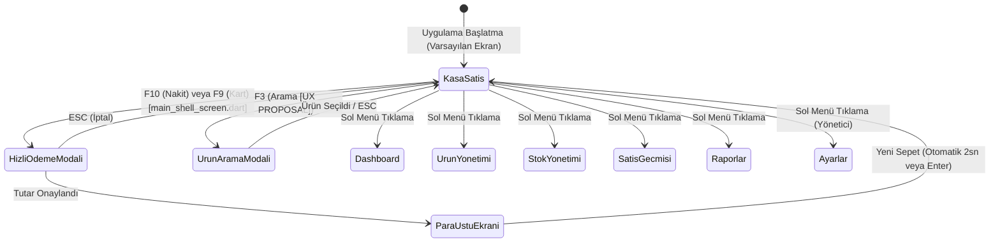

# UX_02_INFORMATION_ARCHITECTURE.md — MARKET MMS BİLGİ MİMARİSİ VE MENÜ HİYERARŞİSİ
# Market Management System (Market MMS) — Information Architecture, Site Map & Navigation Models

- **Doküman Versiyonu:** v1.1 (11 Kasım 2026 Uzlaştırması)
- **Tarih:** 11 Kasım 2026
- **Durum:** DRAFT / IN REVIEW BY PROJECT OWNER (MVP Kapsam & `main_shell_screen.dart` Uzlaştırmalı)
- **Bağlayıcı Temel:** [`AGENTS.md`](../../AGENTS.md), [`MARKET_POS_AI_STUDIO_BUILD_PLANI.md`](../../MARKET_POS_AI_STUDIO_BUILD_PLANI.md) (v1.4), [`docs/ARCHITECTURE.md`](../ARCHITECTURE.md), [`UX_01_USER_RESEARCH.md`](./UX_01_USER_RESEARCH.md)

---

## 1. Giriş ve Bilgi Mimarisi İlkeleri

MARKET MMS bilgi mimarisi; karmaşık kurumsal ERP sistemlerinin kafa karıştırıcı çok katmanlı menüleri yerine, **en sık yapılan işlemlerin (satış, stok, rapor) maksimum 1-2 dokunuşla başlatılabileceği sığ ve doğrudan bir hiyerarşi** üzerine kurulmuştur.

### Temel Mimari Prensipler:
1. **İşlem Odaklılık:** Kasa Satış ekranı sistemin kalbidir; uygulama açıldığında doğrudan Kasa ekranı hazır gelir.
2. **Platforma Özgü Navigasyon:**
   - **Windows Masaüstü:** Kalıcı Sol Kenar Çubuğu (Persistent Sidebar), Üst Durum Çubuğu (Top App Bar), Geniş Split Canvas.
   - **Mobil (Android/iOS):** 4 Sekmeli Alt Gezinme Çubuğu (Bottom Navigation Bar) ve modal alt sayfalar (Bottom Sheets).
3. **Rol Bazlı Görünürlük:** Pilot aşamasında tek sahip hesabı geçerlidir (`[INV-09]`). Gelecekte kasiyer rolü eklendiğinde sistem ayarları, yedekleme ve cihaz eşleştirme gibi hassas idari menüler rol tabanlı kısıtlanacaktır (`[FUTURE SCOPE]`).

---

## 2. Global Site Haritası ve 11 Temel Modül (Global Site Map)

Aşağıdaki Mermaid diyagramı, MARKET MMS içerisindeki tüm ekranların ve alt modüllerin hiyerarşik haritasını gösterir:

```mermaid
graph TD
    Root["MARKET MMS (Kök Dizin)"]

    Root --> M01["1. Kasa Satış (POS)<br/><code>/pos</code>"]
    Root --> M02["2. Dashboard (Özet)<br/><code>/dashboard</code>"]
    Root --> M03["3. Ürün Yönetimi<br/><code>/products</code>"]
    Root --> M04["4. Kategori Yönetimi<br/><code>/categories</code>"]
    Root --> M05["5. Stok ve Depo<br/><code>/stock</code>"]
    Root --> M06["6. Satış Geçmişi<br/><code>/sales</code>"]
    Root --> M07["7. Raporlar & Günlük Ciro<br/><code>/reports</code>"]
    Root --> M08["8. Cihazlar & Eşleştirme<br/><code>/devices</code>"]
    Root --> M09["9. Senkronizasyon (Outbox)<br/><code>/sync</code>"]
    Root --> M10["10. Yedekleme & Kurtarma<br/><code>/backup</code>"]
    Root --> M11["11. Sistem Ayarları<br/><code>/settings</code>"]

    %% Kasa Alt Akışları
    M01 --> M01_1["Hızlı Ödeme Modalı (Nakit / Kart) [INV-08]"]
    %% OD-02 (11 Kasım 2026): Askıya Alınmış Sepetler MVP kapsamı dışındadır (OUT_OF_SCOPE)
    M01 --> M01_3["Hızlı Ürün Arama / Fiyat Gör"]
    M01 --> M01_4["Para Üstü ve Satış Onay Ekranı"]

    %% Ürün Alt Akışları
    M03 --> M03_1["Yeni Ürün Ekle Formu<br/><code>/products/new</code>"]
    M03 --> M03_2["Ürün Düzenle / Fiyat Güncelle<br/><code>/products/:id/edit</code>"]
    M03 --> M03_3["Barkod / Etiket Önizleme [FUTURE SCOPE: Yazıcı]"]

    %% Stok Alt Akışları
    M05 --> M05_1["Stok Girişi (Toptancı Faturası)"]
    M05 --> M05_2["Manuel Düzeltme & Fire Kaydı [BR-STK-11]"]
    M05 --> M05_3["Eksi Stoktaki Ürünler Listesi"]
    M05 --> M05_4["Stok Hareket Geçmişi (Audit Trail)"]

    %% Satış Geçmişi Alt Akışları
    M06 --> M06_1["Fiş / Fatura Detay Görünümü"]
    M06 --> M06_2["Satış İptal ve İade İşlemi"]
    M06 --> M06_3["Fiş Tekrar İncele [FUTURE SCOPE: Yazıcı Entegrasyonu]"]

    %% Rapor Alt Akışları
    M07 --> M07_1["Günlük Ciro & Ödeme Dağılımı"]
    M07 --> M07_2["Dönemsel Satış Analizi"]
    M07 --> M07_3["En Çok Satan Ürünler Analizi"]

    %% Cihaz ve Senkronizasyon
    M08 --> M08_1["Yeni Mobil Cihaz Eşleştir (QR Kod)"]
    M08 --> M08_2["Bağlı Cihazlar ve İzin Listesi"]
    M09 --> M09_1["Outbox Kuyruk Durumu (Pending / Synced / Failed)"]
    M09 --> M09_2["Manuel Senkronizasyon Tetikleme"]

    %% Yedekleme Alt Akışları
    M10 --> M10_1["Yerel Şifreli Snapshot Al"]
    M10 --> M10_2["Google Drive'a Manuel / Otomatik Yedekle"]
    M10 --> M10_3["Yedekten Geri Yükle (Restore Wizard)"]
```



---

## 3. Windows Masaüstü Navigasyon Modeli (Desktop Navigation Model)

### 3.1. Ekran Çerçeve Mimarisi (Desktop Frame Anatomy)

Windows masaüstü arayüzü 3 ana yapısal bileşenden oluşur:

```
+----------------------------------------------------------------------------------------------------+
| [Logo: MARKET MMS] | Kasa: KASA-01 | Sahip: İşletmeci [INV-09] | Hub: ● ONLINE | Outbox: [0] |     <- TOP APP BAR (56dp)
+--------------+-------------------------------------------------------------------------------------+
| [1] Kasa     |                                                                                     |
| [2] Dashb.   |                                                                                     |
| [3] Ürünler  |                                                                                     |
| [4] Stok     |                                   ANA ÇALIŞMA ALANI                                 |
| [5] Satışlar |                                     (MAIN CANVAS)                                   |
| [..] Rapor   |                           (Seçili ekrana göre dinamik)                              |
| [..] Cihazlar|                                                                                     |
| [..] Outbox  |                                                                                     |
| [..] Yedek   |                                                                                     |
| [..] Ayarlar |                                                                                     |
|              |                                                                                     |
| [<] Daralt   |                                                                                     |
+--------------+-------------------------------------------------------------------------------------+
   SOL MENÜ
    (64/220dp)
```

1. **Top App Bar (Üst Durum Çubuğu - Sabit 56dp Yükseklik):**
   - Sol: Market Adı ve Aktif Terminal Kimliği (`KASA-01`).
   - Orta: Aktif Oturum Sahibi (**Mağaza Sahibi [INV-09]**) ve Şube Bilgisi.
   - Sağ:
     - **Hub Bağlantı Göstergesi (`[APPROVED PROJECT DECISION]`):**
       - Yeşil Daire (`● ONLINE`): Windows Master Hub'a bağlı, anlık senkronizasyon faal.
       - Sarı Daire (`● LOCAL OFFLINE`): Hub kapalı veya ağ yok, yerel `client_local.db` üzerinde satış sürüyor.
       - Kırmızı Daire (`● SERVICE ERROR`): Yerel servis çökmüş veya DB kilitli.
     - **Outbox Rozeti (`[APPROVED PROJECT DECISION]`):** Eşitlenmeyi bekleyen işlem adedi (örn. `[3 Bekliyor]`). Tıklandığında Outbox sayfasına gider.
     - Sistem Tarih ve Saati.

2. **Persistent Sol Kenar Çubuğu (Collapsible Sidebar):**
   - **Geniş Mod (220dp):** İkon + Metin Etiketi (`Kasa Satış`, `Dashboard` vb. — `F1..F10` tuşları kasa içi aksiyonlar için ayrılmıştır).
   - **Dar Mod (64dp):** Yalnızca İkonlar ve Tooltip'ler (Kasa ekranında maksimum çalışma alanı sağlamak için daraltılabilir).
   - **Yetkilendirme Notu (`[INV-09]`):** Pilot aşamasında tek sahip hesabı bulunduğundan tüm menüler Mağaza Sahibine açıktır; kasiyer rol bazlı menü kısıtlaması `[FUTURE SCOPE]` kapsamındadır.

3. **Ana Çalışma Alanı (Main Canvas):**
   - Seçili modülün ekranını barındırır. Kasa modunda doğrudan split-panel POS ekranı açılır.

---

### 3.2. Windows Durum Geçiş Akışı (State Diagram)



---

## 4. Mobil Navigasyon Modeli (Mobile Navigation Model - Android/iOS)

### 4.1. Ekran Çerçeve Mimarisi (Mobile Frame Anatomy)

Mobil cihazlarda ekran dikey olduğundan ve kullanıcı ayakta/hareket halindeyken tek elle işlem yaptığından, navigasyon **ekranın en altındaki 4 sekmeli çubuk (Bottom Navigation Bar)** ile yönetilir:

```
+------------------------------------------+
| MARKET MMS              ● ON  [0]  (Prof)|  <- MOBİL APP BAR (56dp)
+------------------------------------------+
|                                          |
|                                          |
|                                          |
|           SEÇİLİ SEKME İÇERİĞİ           |
|                                          |
|                                          |
|                                          |
+------------------------------------------+
| [ ] Satış | [ ] Ürünler | [ ] Stok | [...]|  <- BOTTOM NAV (64dp - Thumb Zone)
+------------------------------------------+
```

### 4.2. Mobil 4-Sekme Yapısı:

| Sekme No | Sekme Adı | İkon | Rota | Temel İşlev |
|---|---|---|---|---|
| **Sekme 1** | **Hızlı Satış** | `shopping_cart` | `/mobile/pos` | Kamera ve sepet; hızlı reyon satışı |
| **Sekme 2** | **Ürün & Fiyat** | `qr_code_scanner` | `/mobile/products` | Barkodla fiyat görme, ürün sorgulama ve etiket kontrolü |
| **Sekme 3** | **Stok & Hareketler** | `inventory_2` | `/mobile/stock` | Mevcut stok, eksi stok uyarıları ve stok hareket geçmişi *(fiziksel sayım MVP dışı)* |
| **Sekme 4** | **Yönetim** | `menu` / `more_horiz` | `/mobile/more` | Satış geçmişi, günlük özet, hub eşleştirme, ayarlar |

### 4.3. Mobil Modal Bottom Sheets (Alt Çekmece Akışları):
- **Sepet Özeti:** Satış sekmesinde sağ altta yüzen sepet butonu tıklandığında alttan yukarı doğru açılarak sepet detayını ve "Nakit / Kart Öde" butonlarını açar.
- **Stok & Hareket Detayı:** Rafta barkod okutulduğunda ürünün mevcut stoğu, son bilinen fiyatı ve hareket denetim izi (audit trail) görüntülenir *(mal kabul ve fire girişi Hub bağlantısı gerektirir; fiziksel sayım yoktur)*.
- **Kamera Barkod Vizörü:** İlgili sekmelerde ekranın üst yarısını kamera vizörü, alt yarısını ise veri kartı kaplar.

---

## 5. Modül Detayları ve Önerilen Rota Haritası (`go_router` — `[UX PROPOSAL]`)

> [!IMPORTANT]
> **`go_router` Bağımlılık Durumu:** `go_router` paketi mevcut `pubspec.yaml` dosyasında **henüz bulunmamaktadır**. Aşağıdaki rota tablosu Faz 1.2+ yönlendirme tasarımı için bir **`[UX PROPOSAL]` önerisidir**; eklenmesi için proje sahibi onayı gerekir. Yetki sütunu pilot aşamada Tek Sahip Hesabını (`[INV-09]`) esas alır.

| Modül No | Modül Adı | Önerilen Rota Yolu (`go_router`) | Parametreler | Pilot Yetkisi (`[INV-09]`) |
|---|---|---|---|---|
| **01** | Kasa Satış (POS) | `/pos` | - | Mağaza Sahibi |
| ~~**01.1**~~ | ~~Park Edilmiş Sepetler~~ *(KALDIRILDI)* | ~~`/pos/parked`~~ | - | **`[OUT_OF_SCOPE — OD-02]`** *(11 Kasım 2026 Proje Sahibi kararıyla MVP kapsamı dışına çıkarılmıştır)* |
| **02** | Dashboard | `/dashboard` | `?date=YYYY-MM-DD` | Mağaza Sahibi |
| **03** | Ürün Listesi | `/products` | `?query=&category=` | Mağaza Sahibi |
| **03.1**| Yeni Ürün | `/products/new` | `?barcode=` | Mağaza Sahibi |
| **03.2**| Ürün Düzenle | `/products/:id` | `:id` (UUID/Int) | Mağaza Sahibi |
| **04** | Kategori Yönetimi | `/categories` | - | Mağaza Sahibi |
| **05** | Stok & Hareketler | `/stock` | `?filter=low_stock` | Mağaza Sahibi |
| **05.1**| Stok Girişi / Mal Kabul | `/stock/inbound` | - | Mağaza Sahibi |
| **05.2**| Stok Hareket Geçmişi & Fire | `/stock/movements` | `?productId=` | Mağaza Sahibi *(Fiziksel sayım MVP dışı)* |
| **06** | Satış Geçmişi | `/sales` | `?date=&status=` | Mağaza Sahibi |
| **06.1**| Satış Detay | `/sales/:id` | `:id` | Mağaza Sahibi |
| **07** | Raporlar (Günlük Ciro) | `/reports` | `?type=daily` | Mağaza Sahibi *(Z/X Raporu OUT_OF_SCOPE)* |
| **08** | Cihaz Yönetimi | `/devices` | - | Mağaza Sahibi |
| **08.1**| Yeni Cihaz Eşleştir | `/devices/pair` | - | Mağaza Sahibi |
| **09** | Outbox Senkronizasyon| `/sync` | - | Mağaza Sahibi |
| **10** | Yedekleme & Kurtarma | `/backup` | - | Mağaza Sahibi |
| **11** | Sistem Ayarları | `/settings` | `?tab=theme` | Mağaza Sahibi |

---

## 6. Özet ve Sonraki Adım

Bu bilgi mimarisi, masaüstünde **sıfır navigasyon maliyetiyle** satış yapılmasını sağlarken, mobilde **tek parmakla tüm reyon operasyonlarının yönetilmesini** garanti eder.
Bir sonraki aşama olan [`UX_03_DESIGN_SYSTEM.md`](./UX_03_DESIGN_SYSTEM.md) belgesinde bu mimaride kullanılacak tüm renkler, tipografi, grid ve 21 çekirdek bileşenin detaylı tasarım spesifikasyonları tanımlanacaktır.
