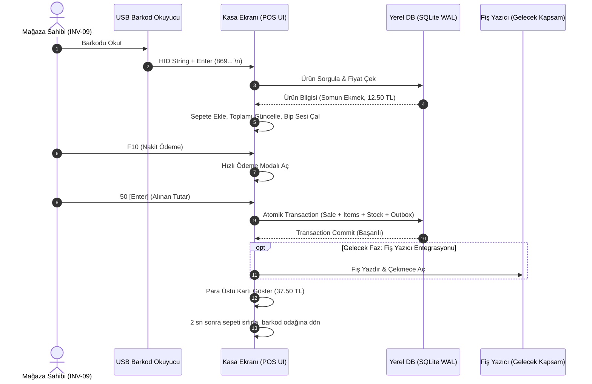

# UX_05_INTERACTIVE_PROTOTYPE.md — MARKET MMS İNTERAKTİF PROTOTİP VE KULLANICI AKIŞLARI
# Market Management System (Market MMS) — Interactive Prototype Architecture & Operational Flows

- **Doküman Versiyonu:** v1.1 (11 Kasım 2026 Uzlaştırması)
- **Tarih:** 11 Kasım 2026
- **Durum:** DRAFT / IN REVIEW BY PROJECT OWNER (Para Formatı, F-Tuşu ve MVP Kapsam Uzlaştırmalı)
- **Bağlayıcı Temel:** [`AGENTS.md`](../../AGENTS.md), [`MARKET_POS_AI_STUDIO_BUILD_PLANI.md`](../../MARKET_POS_AI_STUDIO_BUILD_PLANI.md) (v1.4), [`UX_03_DESIGN_SYSTEM.md`](./UX_03_DESIGN_SYSTEM.md), [`UX_04_SCREEN_DESIGNS.md`](./UX_04_SCREEN_DESIGNS.md)
- **Uzlaştırma Notu:** Tüm para gösterimleri `12.50 TL` biçimine eşitlenmiş (`₺` kaldırılmış), kullanıcı terminolojisi `Mağaza Sahibi (INV-09)` olarak güncellenmiş, kısayollar `main_shell_screen.dart` (`F1/F2/F9/F10/Esc`) ile hizalanmış, Akış 6 (Mobil Stok Sayımı) `[OUT_OF_SCOPE]` olarak işaretlenmiş ve Bölüm 3'teki `market_mms_prototype.html` `LEGACY / EXPERIMENTAL` statüsüne çekilmiştir.

---

## 1. Giriş ve Prototipleme Amacı

Bu belge, MARKET MMS'in Flutter kodlaması öncesinde kullanıcı etkileşimlerini, klavye kısayol zincirlerini, saniyelik zamanlama davranışlarını ve hata kurtarma mekanizmalarını test etmek amacıyla hazırlanan **6 Temel Operasyonel Akışı** ve bağımsız interaktif prototip mimarisini tanımlar.

---

## 2. 6 Temel Operasyonel Kullanıcı Akışı (Core Operational Flows)

---

### AKIŞ 1: Standart Barkodlu Satış ve Nakit Ödeme Akışı (Standard Barcode & Cash Checkout)
- **Hedef Süre:** $\le 3\text{ saniye}$ (1-2 ürün için tasarım hedefi).
- **Adım Adım Akış:**
  1. İşletme sahibi (`INV-09`) barkod tabancasıyla ürünün (örn. 8690504018241) barkodunu okutur.
  2. USB okuyucu HID klavye olarak `8690504018241\n` gönderir.
  3. Sistem `BarcodeInputField` bileşeni üzerinden girdiyi yakalar; yerel veritabanında arar (< 50ms hedefi).
  4. Ürün sepete 1 adet eklenir; kısa bir onay sesi (`bip.wav`) çalar.
  5. Genel toplam anında güncellenir (`12.50 TL`).
  6. İşletme sahibi klavyeden `F10` tuşuna basar (`main_shell_screen.dart` uyumlu); Hızlı Ödeme modalı açılır.
  7. Müşteri 50 TL uzatmıştır; `50` yazar ve `Enter`'a basar.
  8. Sistem saniyenin onda biri sürede:
     - `37.50 TL` para üstünü dev yeşil fontla ekrana yansıtır.
     - Satış satırlarını yerel transaction ile kaydeder (`INV-03`).
     - *(Fiş yazıcı ve otomatik çekmece entegrasyonu MVP dışıdır `[FUTURE SCOPE]`; pilotta satış ekranda onaylanır).*
  9. Yeni ürün okutulduğunda veya 2 saniye sonra ekran yeni boş sepete döner.

---

### AKIŞ 2: Barkodsuz Ürün ve Hızlı Tuş Satışı (Quick Keys & Non-Barcoded Items)
- **Kullanım:** Ekmek, maydanoz, poşet veya gramajlı ürün satışı.
- **Adım Adım Akış:**
  1. İşletme sahibi sağ üst paneldeki `[EKMEK 200g]` hızlı tuşuna (`[UX PROPOSAL]`) dokunur (veya tıklar).
  2. Ürün anında sepete 1 adet olarak eklenir.
  3. `[POŞET]` tuşuna dokunur; poşet sepete eklenir.
  4. Müşteri "3 ekmek almıştım" der; işletmeci ekmek satırındaki `[+]` butonuna 2 kez basar veya klavyeden `F2` (Miktar) basıp `3` girer.
  5. Sepet toplamı `3 x 12.50 + 0.50 = 38.00 TL` olarak hesaplanır.
  6. `F9` (Kredi Kartı — `main_shell_screen.dart` uyumlu) tuşuna basar.
  7. Sistem banka pos cihazına tutarın elle girilmesini bekler (`INV-05`); ekranda "Kredi Kartı ile 38.00 TL Tahsil Edildi mi? [Enter]" onayı çıkar.
  8. `Enter` ile satış yerel olarak tamamlanır (fiş basma donanım entegrasyonu `[FUTURE SCOPE]`).

---

### AKIŞ 3: Bilinmeyen Barkod Senaryosu (Unknown Barcode Handling) `[APPROVED PROJECT DECISION — OD-03]`
- **Durum:** Markete yeni gelmiş ve henüz sisteme girilmemiş bir barkod okutulduğunda.
- **Akış Durumu A (Master Hub Çevrimiçi):**
  1. Barkod okutulur; yerel DB'de bulunamaz.
  2. Ekranda "Ürün Bulunamadı: 8697777000123" modalı açılır.
  3. Mağaza sahibi "Hızlı Ekle" butonuna basar; `BR-PROD-05` gereği zorunlu alanlar (Ürün Adı, Satış Fiyatı, Birim ve Kategori) açılır ve Master Hub üzerinden oluşturulur. *(KDV MVP dışıdır.)*
  4. Kaydedilip sepete dahil edilir.
- **Akış Durumu B (Master Hub Çevrimdışı / Local Offline — `[APPROVED PROJECT DECISION — OD-03]`):**
  1. Yerel veritabanında bulunmayan bir ürün **offline olarak oluşturulamaz** ve bilinmeyen barkod **offline satış sepetine eklenemez**.
  2. Ekranda açık Türkçe uyarı gösterilir: *"Ürün yerel katalogda bulunamadı. Yeni ürün oluşturmak için Master Hub bağlantısı gereklidir; bilinmeyen ürün offline sepete eklenemez."*
  3. Yerel veritabanında zaten kayıtlı olan ürünler ise offline ortamda kesintisiz satılabilir (`INV-10`).

---

### AKIŞ 4: `[KALDIRILDI — OUT_OF_SCOPE]` Sepeti Askıya Alma ve Geri Yükleme (Parked Carts) `[OD-02]`
- **Durum:** **MVP Kapsam Dışı (`OUT_OF_SCOPE` — 11 Kasım 2026 Proje Sahibi Kararı).**
- *(Tarihsel Not: Önceki taslaklarda müşteri bekletme senaryosu `BR-POS-05` / `OD-02` kapsamında önerilmişti; ancak Proje Sahibi kararıyla MVP kapsamından çıkarılmıştır. MVP ekranlarında Parked Carts / `F4` özelliği sunulmayacak olup gelecek sürümlerde yeniden değerlendirilebilir.)*

---

### AKIŞ 5: Windows Hub Bağlantısı Koptuğunda Kesintisiz Çalışma (Offline Continuity)
- **Durum:** Mağazadaki yerel Wi-Fi yönlendirici kapandığında veya Windows Master Hub servisi yeniden başlatılırken.
- **Adım Adım Akış:**
  1. Heartbeat kontrolü başarısız olur; sağ üstteki yeşil daire anında kehribar rengine (`● LOCAL OFFLINE`) döner.
  2. İşletme sahibi hiçbir kesinti hissetmeden satış yapmaya devam eder.
  3. Tamamlanan her satış yerel `client_local.db`'ye kaydedilir ve `outbox_operations` tablosuna `PENDING` statüsüyle yazılır.
  4. Sağ üstteki Outbox rozeti `[Outbox: 1]`, `[Outbox: 2]` şeklinde monotonik artar.
  5. Hub servisi tekrar ayağa kalktığında rozet yeşile döner ve arka plan worker'ı FIFO sırasıyla tüm işlemleri Hub'a aktararak rozeti `[Outbox: 0]` yapar.

---

### AKIŞ 6: `[KALDIRILDI — OUT_OF_SCOPE]` Mobil Cihazla Fiziksel Stok Sayım Akışı (`BR-STK-04`..`BR-STK-10`)
- **Durum:** **MVP Kapsam Dışı (`OUT_OF_SCOPE` / Post-MVP).**
- **Gerekçe:** Fiziksel stok sayımı ve sayım farkı düzeltme akışları pilot/MVP kapsamından çıkarılmıştır. Mobilde stok modülü yalnızca **salt okunur stok seviyesi (`-14 Adet`, `allow`), son bilinen fiyat (`12.50 TL` `INV-10`) ve hareket denetim izi (`mob-04-stock-view.html`)** izleme akışını içerir.

---

## 3. Prototip Yapısı ve Legacy Tek-Dosya Demoları

- **Ana 10-Ekranlı Görsel Tasarım Vitrini:** Güncel standartları (`12.50 TL`, Light/Dark kontrast token'ları, `main_shell_screen.dart` kısayol uyumu, fiziksel sayım yokluğu) karşılayan canonical vitrin [`visual-designs/index.html`](./visual-designs/index.html) altındadır.
- **`market_mms_prototype.html` Statüsü (`LEGACY / EXPERIMENTAL`):** Tek dosyalık erken dönem deneysel HTML dosyası ana menüden çıkarılmış ve **`LEGACY / EXPERIMENTAL`** olarak etiketlenmiştir; güncel ürün davranışının veya Flutter kodunun kanıtı değildir *(legacy demo içinde yer alan `F11/F12` kısayolları ve sadeleştirilmiş JS simülasyonu yerine `visual-designs/` esas alınır)*.

---

## 4. Özet

Bu interaktif akışlar, işletme sahibinin (`INV-09`) masaüstünde ve mobilde karşılaşacağı çekirdek satış ve offline süreklilik senaryolarını dokümante etmektedir.
Bir sonraki aşama olan [`UX_06_USABILITY_VALIDATION.md`](./UX_06_USABILITY_VALIDATION.md) belgesinde bu akışların Nielsen Norman sezgisel kriterleri ve renk kontrast doğrulama matrisi sunulmaktadır.
