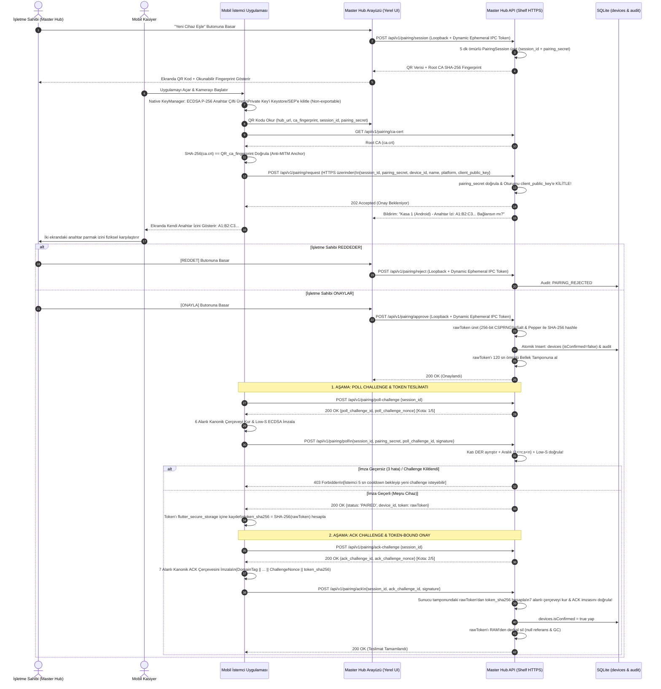
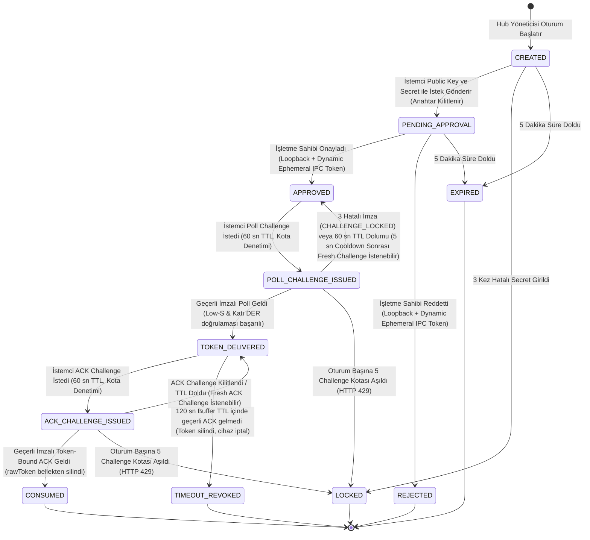

# MARKET MMS — SPIKE-01: Aşama S-4 (Secure Device Pairing) Uygulama ve Doğrulama Planı

**Tarih:** 5 Kasım 2026  
**Doküman Kodu:** `S4_DEVICE_PAIRING_PLAN.md`  
**Sürüm:** 1.6 (ACK Token Hash Bağlama, Windows CNG Tekil SHA-256 Doğrulaması ve Challenge Hız Sınırı Revizyonu)  
**Aşama:** Faz 0 / SPIKE-01 / Aşama S-4: Secure Device Pairing  
**Hedef Modül:** `test_spikes/spike_01_backend/`  
**Referans Dokümanlar:**
- [`MARKET_POS_AI_STUDIO_BUILD_PLANI.md`](../../MARKET_POS_AI_STUDIO_BUILD_PLANI.md) (v1.2)
- [`SECURITY_REMEDIATION_PLAN.md`](./SECURITY_REMEDIATION_PLAN.md) (Rev. 3)
- [`S2_FINAL_SECURITY_REVIEW.md`](./S2_FINAL_SECURITY_REVIEW.md)
- [`S3_FINAL_SECURITY_REVIEW.md`](./S3_FINAL_SECURITY_REVIEW.md)
**Uygulanan Standartlar:** Clean Architecture, `code-quality`, `test-first`, `systematic-debugging`, `documentation`

---

## 1. Amaç ve Kapsam

### 1.1 Amaç
Bu plan; MARKET MMS Windows Local Master Hub prototipinin yerel ağ (LAN) üzerinde mobil (Android, iOS) ve masaüstü (Windows) istemcilerle **yalnızca işletme sahibinin (market sahibinin) yerel ve fiziksel onayıyla**, optik güven çapası ve **Kriptografik Cihaz Bağlama (Cryptographic Device Binding)** protokolüyle donatılmış olarak güvenli eşleştirilmesini (Secure Device Pairing) belirler.

S-4 v1.6 revizyonu;
1. **ACK ve Token Hash Bağlama (Token-Bound Cryptographic ACK):**
   - Poll ve ACK kanonik çerçevelerini ayrıştırır: Poll çerçevesi 6 alanı kullanırken, ACK kanonik çerçevesine 7. alan olarak **32 baytlık ham `token_sha256`** eklenir.
   - İstemcinin token'ı güvenli depoya yazdıktan sonra bu hash üzerinden imza üretmesini, sunucunun ise bellek tamponundaki token'ın SHA-256 özetiyle eşleştirme yapmasını şart koşar.
   - **Kritik Güvenlik Sınırı:** ACK imzasının, token'ın istemci donanımının kalıcı (non-volatile) güvenli deposuna başarıyla yazıldığını matematiksel olarak kanıtlayamayacağını; yalnızca istemcinin süreç belleğinde token'a eriştiğini ve ilgili hash üzerinden imza verdiğini doğruladığını açıkça belgeler.
2. **Windows CNG Tekil SHA-256 ve İmza Formatı Doğrulaması:**
   - `NCryptSignHash` API'sinin ham veri yerine önceden özetlenmiş bayt dizisi beklediğini dikkate alarak kanonik ikili çerçevenin **kesinlikle yalnızca bir kez SHA-256 ile özetleneceğini**, ikinci bir hash işleminin (çifte hashleme) uygulanmayacağını kesinleştirir.
   - Windows KSP ECDSA P-256 çıktısının (IEEE P1363 64-byte `r || s`) peşinen evrensel bir veri kabul edilmeyip, teknik spike sırasında gerçek donanımsal TPM ve yazılımsal sağlayıcılarla **deneysel olarak doğrulanacak bir kabul kriteri** olduğunu tanımlar.
3. **Challenge Üretim Hızı ve Kota Sınırlandırması (Rate Limiting & Quota):**
   - 3 başarısız imza denemesi sınırını korurken, oturum başına **en fazla 5 challenge üretim kotası** (`MAX_CHALLENGES_PER_SESSION = 5`) getirir.
   - Challenge kilitlendiğinde veya yenilendiğinde **en az 5 saniyelik bekleme (cooldown)** şart koşar; aşım durumunda HTTP `429 Too Many Requests` ve `Retry-After: 5` protokolünü tanımlar.
   - Taze challenge üretiminin açık anahtar bağını ve Hub onayını kesinlikle değiştirmediğini garanti eder.
4. **Kriptografik İmza Doğrulama Standartları:**
   - iOS'un `.ecdsaSignatureMessageX962SHA256` ile ANSI X9.62 / ASN.1 DER ürettiği gerçeğini korur.
   - P-256 aralık kontrolünü ($1 \le r, s < n$), imza bükülebilirliğini (malleability) önleyen **Low-S kuralını** ($s \le (n-1)/2$) ve sondaki artık baytları (trailing bytes), negatif sayıları ve gereksiz sıfır öneklerini reddeden **Katı ASN.1 DER Ayrıştırma (Strict DER Parsing)** kurallarını şart koşar.

### 1.2 Kapsam Sınırları
- **Kapsam İçi:**
  - `test_spikes/spike_01_backend/` Shelf backend prototipi.
  - ECDSA P-256 asimetrik anahtar doğrulama, Low-S kontrolü, DER/P1363 dönüşümü ve SHA-256 parmak izi eşleştirmesi.
  - Poll (6 alan) ve ACK (7 alan, token_sha256 bağlı) kanonik ikili çerçeveleme motoru.
  - Challenge başına 3 hata sınırı, oturum başına 5 challenge kotası ve 5 sn cooldown rate-limit mekanizması.
  - 120 sn ömürlü bellek içi teslimat tamponu (`PairingDeliveryBuffer`) ve token-bound imzalı ACK.
  - Windows Local Hub için yerel IPC güvenliği ve DACL korumalı dinamik yetkilendirme modeli.
  - SQLite tekil yazıcı kuyruğunda (`WriteQueue`) atomik transaction ve `Startup Reconcile`.
  - Eski `POST /api/v1/devices/register` rotasının kesin tasfiyesi (404 Not Found).
  - 28 senaryodan oluşan TDD test süiti (`test/s4_device_pairing_test.dart`).
- **Kapsam Dışı:**
  - Aşama S-5 Windows Service `LocalService` hesabı geçişi ve `icacls` NTFS ACL izinleri.
  - Ana MMS üretim Flutter UI uygulaması (Spike-01 laboratuvar prototipidir).
  - Bulut kimlik doğrulama veya Supabase RLS.

---

## 2. Tehdit Modeli ve Yapılandırılmış Güvenlik Matrisi

Sistem güvenliği değerlendirilirken mutlak iddialardan kaçınılmış; her tehdit için mekanizma, varsayım ve kalan riskler ayrıntılandırılmıştır:

| Tehdit Senaryosu | Koruma Mekanizması | Güvenlik Varsayımları | Test Senaryosu | Kalan Riskler |
|---|---|---|---|---|
| **QR Kod Kopyalama & Dinleme** | Kriptografik Cihaz Bağlama (ECDSA P-256 imzalı challenge-response) | Saldırganın istemci cihazın donanımsal güvenli alanına (Keystore/SEP) sızamadığı varsayılır. | TC-20 | İşletme sahibi ekrandaki parmak izini kontrol etmeden onay verirse saldırgan kendi anahtarıyla oturumu ele geçirebilir. |
| **Cihaz / IP Spoofing** | Hub ekranında cihaz adı/IP yerine doğrudan açık anahtarın SHA-256 parmak izinin karşılaştırılması | İşletme sahibinin Hub ekranındaki parmak izini mobil ekranla fiziksel karşılaştırdığı varsayılır. | TC-18, TC-21 | Kullanıcı dikkatsizliği (insan faktörü). Parmak izi teyidi yapılmazsa IP/isim taklidi fark edilmeyebilir. |
| **Challenge Replay & Yarış Koşulu** | 32-byte CSPRNG tek kullanımlık `challenge_nonce`, 60 sn TTL ve tekil yazıcıda atomik tüketim | CSPRNG rastgele sayı üretecinin tahmin edilemez olduğu varsayılır. | TC-24, TC-26 | Bellek içi challenge haritası sunucu çökmesinde sıfırlanır (Fail-Closed). |
| **Challenge Flood / DoS & Brute-Force** | Challenge başına 3 hata sınırı, oturum başına 5 challenge kotası, 5 sn cooldown (HTTP 429) | Sunucu yerel saat ve bellek sayaçlarının tutarlı işlediği varsayılır. | TC-27 | Dağıtık ağdan eşzamanlı IP spamming (Aşama S-1 rate limiting ile dengelenir). |
| **İmza Bükülebilirliği (Signature Malleability)** | $s \le (n-1)/2$ (Low-S) şartı ve katı DER ayrıştırma (trailing byte / redundant zero engeli) | Backend'in kanonik olmayan imzaları derhal reddettiği varsayılır. | TC-21, TC-26 | İstemci kütüphanesinin High-S üretmesi durumunda istemcinin $s' = n - s$ dönüşümü yapması gerekir. |
| **Sahte ACK ile Cihaz Onaylatma** | ACK çerçevesine `token_sha256` alanının eklenmesi ve sunucu tamponundaki hash ile doğrulanması | İstemci private key'inin cihaz dışına sızmadığı varsayılır. | TC-23, TC-25 | ACK, token'ın donanım flash'ına kalıcı yazıldığını kanıtlamaz; yalnızca bellekte erişilip imzalandığını teyit eder. |
| **Onaylanan Anahtar Değiştirme (Key Substitution)** | Oturumun ilk request anında `client_public_key` değerine değiştirilemez biçimde kilitlenmesi | Oturum durum makinesinin paralel isteklerde kilit mekanizmasını doğru işlettiği varsayılır. | TC-22, TC-27 | Oturum başlatılmadan önceki yarış koşulları (ilk gelen anahtar oturumu bağlar). |
| **Yerel Süreçlerin Localhost API'ye Erişimi** | Loopback IP kontrolü + DACL korumalı dinamik Ephemeral IPC Token / Named Pipe | Windows OS çekirdeğinin (kernel) NTFS DACL ve Named Pipe güvenlik tanımlayıcılarını uyguladığı varsayılır. | TC-11, TC-28 | Makinede `SYSTEM` veya `Administrator` yetkisinde çalışan zararlı yazılımlar belleği veya IPC kanalını okuyabilir. |
| **RAM Üzerinden Token Sızıntısı** | Token'ın sunucu RAM'inde en fazla 120 sn tutulması, referansın ACK anında silinmesi | Yönetilen dillerde (Dart GC) bellek sayfalarının anında sıfırlanmadığı bilinir ve kabul edilir. | TC-09, TC-10 | Fiziksel RAM dökümü (memory dump) veya sayfalama dosyası (pagefile.sys) analizi ile token GC öncesi okunabilir. |

---

## 3. Kriptografik Algoritma ve İmza Şartnamesi (ECDSA P-256)

### 3.1 Neden Varsayılan Olarak ECDSA P-256?
Hedef platformların gerçek donanımsal kabiliyetleri doğrulanmış ve varsayılan algoritma olarak **ECDSA P-256 (secp256r1) + SHA-256** seçilmiştir:

1. **iOS Secure Enclave (Apple SEP):**
   - Apple Secure Enclave koprocessoru **yalnızca NIST P-256 (secp256r1)** eğrisini donanımsal olarak destekler (`kSecAttrKeyTypeECSECPrimeRandom`).
   - Secure Enclave üzerinde **Ed25519 donanımsal desteği YOKTUR**.
2. **Android Keystore (Google TEE / StrongBox):**
   - Android 6.0 (API 23) seviyesinden beri tüm donanım destekli Keystore çiplerinde `KeyProperties.KEY_ALGORITHM_EC` + `ECGenParameterSpec("secp256r1")` evrensel olarak zorunludur.
   - Ed25519 desteği Android'e ancak Android 13 (API 33) ile eklenmiştir ve StrongBox donanım çiplerinde standart değildir.
3. **Windows Platform Crypto Provider (TPM):**
   - Windows TPM 2.0 yongaları ve CNG API (`NCrypt`) yerel olarak `BCRYPT_ECDSA_P256_ALGORITHM` standardını destekler. TPM donanımında Ed25519 desteği standart değildir.
4. **Ed25519 Durumu:**
   - Ed25519, ancak gelecekte tüm hedef platformlarda donanımsal güvenlik modülü seviyesinde standartlaştığı takdirde alternatif olarak değerlendirilebilir. Spike-01 S-4 için bağlayıcı ana standart **ECDSA P-256**'dır.

### 3.2 Public Key Formatı ve Parmak İzi
- **Public Key Formatı:** Standart **ASN.1 SubjectPublicKeyInfo (SPKI) DER** formatında dışa aktarılır ve Base64 olarak iletilir (veya uncompressed ANSI X9.62 formatında `04 || X || Y`, 65 bayt).
- **Public Key Fingerprint:**
  $$\text{PublicKeyFingerprint} = \text{SHA-256}(\text{clientPublicKeyDerBytes})$$
  Format: `A1:B2:C3:D4:E5:F6:...:89` (32 bayt hex, iki nokta ayraçlı büyük harf).

---

### 3.3 Platform Bazında Gerçek İmza Çıktıları ve Doğrulama Matrisi

Platform API'lerinin imza çıktısı konusundaki varsayımlar terk edilmiş, native SDK davranışları tek tek doğrulanmıştır:

| Platform | Native İmza API'si | Gerçek Çıktı Formatı | Tipik Boyut | Backend Giriş Formatı | Gerekli Normalizasyon İşlemi |
|---|---|---|:---:|---|---|
| **Android** | `java.security.Signature` (`"SHA256withECDSA"`) | **ASN.1 DER** Sequence (`0x30...`) | 70–72 bayt | ASN.1 DER | Doğrudan DER formatındadır. Katı DER kontrolleri ve Low-S doğrulaması yapılır. |
| **iOS** | `SecKeyCreateSignature` (`.ecdsaSignatureMessageX962SHA256`) | **ANSI X9.62 / ASN.1 DER** Sequence (`0x30...`) | 70–72 bayt | ASN.1 DER | Doğrudan DER formatındadır (ANSI X9.62). Katı DER ve Low-S doğrulaması yapılır. |
| **Windows** | Windows CNG `NCryptSignHash` (`BCRYPT_ECDSA_P256_ALGORITHM`) | **IEEE P1363** (`r \|\| s`) *(Kabul Kriteri)* | Tam 64 bayt | ASN.1 DER | 64 baytlık ham $r$ ve $s$ tamsayıları ayrıştırılır; aralık/Low-S denetlenir ve standart ASN.1 DER formatına paketlenir. |
| **Backend** | OpenSSL / Dart `pointycastle` / `crypto` motoru | **ASN.1 DER** | 70–72 bayt | ASN.1 DER | Tüm platformlardan gelen imzalar tek tip katı ASN.1 DER doğrulamasına tabi tutulur. |

> [!IMPORTANT]
> **Windows CNG İmza Formatı Kabul Kriteri (v1.6):**  
> Windows CNG dokümantasyonunda `BCRYPT_ECDSA_P256_ALGORITHM` için `NCryptSignHash` çıktısının IEEE P1363 (64 bayt: 32 bayt $r$ + 32 bayt $s$) olduğu tanımlanmıştır. Ancak farklı CSP/KSP sağlayıcılarının olası format farklılıkları peşinen kesin kabul edilmeyip, Faz 0 teknik spike sırasında gerçek `MS_PLATFORM_CRYPTO_PROVIDER` (TPM) ve `MS_KEY_STORAGE_PROVIDER` üzerinde **deneysel olarak doğrulanacak bir kabul kriteri** olarak belirlenmiştir.

---

### 3.4 Windows CNG Tekil SHA-256 Hashing ve İmza Doğrulama Standartları

#### A. Tekil SHA-256 Hashing Kuralı (`NCryptSignHash`)
Windows CNG API'sinde imzalama iki aşamalı bir mimariye sahiptir:
1. `NCryptSignHash` fonksiyonu **ham mesaj verisini kabul etmez**; doğrudan önceden özetlenmiş (hashed) bayt dizisini (`pbHashValue`, `cbHashValue`) parametre olarak alır.
2. **Kural:** Kanonik İkili Çerçeve (`CanonicalPayload`), istemci tarafındaki sarmalayıcıda **kesinlikle yalnızca BİR KEZ SHA-256 ile özetlenir**:
   $$\text{PayloadDigest} = \text{SHA-256}(\text{CanonicalPayload}) \quad (\text{tam 32 bayt})$$
3. Bu 32 baytlık özet doğrudan `NCryptSignHash` fonksiyonuna verilir.
4. **Çifte Hashing Yasağı:** Gerek istemci sarmalayıcısı gerekse Windows KSP tarafından bu özet üzerine ikinci bir SHA-256 işlemi **asla uygulanmaz**. Çifte hashleme imzanın backend tarafında doğrulanamamasına yol açar.

#### B. Aralık Denetimi (Range Check)
NIST P-256 (secp256r1) eğrisinin taban nokta mertebesi ($n$):
$$n = \text{0xFFFFFFFF 00000000 FFFFFFFF FFFFFFFF BCE6FAAD A7179E84 F3B9CAC2 FC632551}$$
Onaltılık (Hex): `0xFFFFFFFF00000000FFFFFFFFFFFFFFFFBCE6FAADA7179E84F3B9CAC2FC632551`  
Yarım mertebe sınırı:
$$\text{half\_n} = \lfloor (n - 1) / 2 \rfloor = \text{0x7FFFFFFF800000007FFFFFFFFFFFFFFFDE737D56D38BCE4279DC65617E3192A8}$$

- **Aralık Kuralı:** İmzayı oluşturan her iki tamsayı ($r$ ve $s$) kesinlikle şu aralıkta olmalıdır:
  $$1 \le r < n \quad \text{ve} \quad 1 \le s < n$$
  $r = 0$, $s = 0$, $r \ge n$ veya $s \ge n$ olan imzalar kriptografik olarak geçersizdir ve derhal reddedilir.

#### C. Low-S Kanonikalizasyonu (Signature Malleability Koruması)
- **Kanonik Kural:** Malleability'yi kesin olarak önlemek için tüm imzaların $s$ değeri eğrinin alt yarısında olmalıdır:
  $$s \le \text{half\_n} \quad \left(s \le \frac{n - 1}{2}\right)$$
- **Normalizasyon ve Backend Tutumu:**
  - **İstemci Tarafı (Client Normalization):** İstemci platformunun kriptografik modülü eğer $s > \text{half\_n}$ (High-S) üretirse, istemci native katmanı imzayı iletmeden önce $s' = n - s$ dönüşümünü icra ederek kanonik Low-S formatına getirmelidir.
  - **Backend Tutumu (Strict Rejection):** Backend sunucusu, $s > \text{half\_n}$ olan hiçbir imzayı **asla arka planda sessizce dönüştürüp kabul etmez**. Bu tür imzalar tahrifat veya uyumsuzluk şüphesiyle derhal **`403 Forbidden (INVALID_SIGNATURE_NON_CANONICAL_HIGH_S)`** koduyla reddedilir.

#### D. Katı ASN.1 DER Ayrıştırma Kuralları (Strict DER Parsing)
Backend seviyesindeki `EcdsaSignatureValidator` bileşeni şu katı kuralları uygular:
1. **Tekil SEQUENCE Başlığı:** Veri tam olarak `0x30` baytı ile başlamalıdır.
2. **Kesin Uzunluk Eşleşmesi (No Trailing Bytes):** SEQUENCE uzunluk baytının belirttiği değer ile toplam imza bayt boyutu tam olarak uyuşmalıdır (`payload.length == 2 + sequence_length`). Sonda tek bir artık bayt (`trailing byte`) dahi bulunamaz.
3. **INTEGER Etiketleri:** $r$ ve $s$ bileşenlerinin her biri tam olarak `0x02` (INTEGER) etiketiyle başlamalıdır.
4. **Boyut Sınırları:** $r$ ve $s$ uzunlukları 1 ila 33 bayt arasında olmalıdır.
5. **İki Tümleyen ve Gereksiz Sıfır Yasağı (No Redundant Leading Zeros):**
   - Sayının en yüksek biti 1 ise (`ilk bayt >= 0x80`), sayının pozitif olduğunu belirtmek için başına zorunlu olarak tek bir `0x00` baytı eklenir (uzunluk 33 bayt olur).
   - Ancak sayının ilk baytı `0x80`'den küçükse, başında `0x00` bulunması **kesinlikle yasaktır** (`0x02 0x21 0x00 0x7F...` geçersizdir).
   - Arka arkaya iki sıfır (`0x00 0x00`) bulunması kesinlikle reddedilir.
6. **Negatif Sayı Yasağı:** En yüksek biti 1 olduğu halde başında `0x00` koruma baytı bulunmayan sayılar negatif kabul edilir ve derhal reddedilir.

---

## 4. Native Secure Key Management ve Donanımsal Anahtar Arayüzü

`flutter_secure_storage` paketi bir anahtar-değer (key-value) şifreleme aracıdır; tek başına **dışarı aktarılamayan donanımsal asimetrik imza yeteneği** sağlamaz. Bu nedenle istemci katmanı için ortak bir native arayüz tanımlanmıştır:

```dart
/// Flutter istemci katmanında donanım destekli anahtar yönetimini sağlayan ortak arayüz
abstract class NativeHardwareKeyManager {
  /// Donanımsal güvenli alanda anahtar çifti üretir veya mevcut olanı döndürür
  Future<String> getOrGenerateDeviceKey();

  /// Açık anahtarın SHA-256 parmak izini formatlı string olarak döner
  Future<String> computePublicKeyFingerprint();

  /// Kanonik çerçevelenmiş ikili veriyi donanımsal özel anahtarla imzalar
  /// Kural: canonicalPayload yalnızca BİR KEZ SHA-256 ile özetlenir, asla çifte hash uygulanmaz.
  /// Çıktı: Standart Low-S kanonik ASN.1 DER baytları
  Future<List<int>> signPayload(List<int> canonicalPayload);

  /// Anahtarın donanım destekli (TEE/SEP/TPM) olup olmadığını doğrular
  Future<bool> isHardwareBacked();
}
```

### 4.1 Platform Bazında Donanımsal Anahtar Yönetimi

#### A. Windows: CNG (Platform Crypto Provider vs Software KSP) ve DPAPI Ayrımı
1. **Microsoft Platform Crypto Provider (TPM tabanlı CNG KSP):**
   - Sağlayıcı Adı: `MS_PLATFORM_CRYPTO_PROVIDER`.
   - Anahtar malzemesi doğrudan anakarttaki **TPM 2.0 (Trusted Platform Module)** yongasında üretilir ve saklanır.
   - Özel anahtar hiçbir koşulda Windows işletim sistemi belleğine çıkarılamaz (`NCRYPT_EXPORT_POLICY_PROPERTY = 0`). İmzalama işlemi donanım yongası içinde icra edilir.
2. **Microsoft Software Key Storage Provider (Yazılımsal CNG KSP):**
   - Sağlayıcı Adı: `MS_KEY_STORAGE_PROVIDER`.
   - TPM bulunmadığında kullanılan standart yazılımsal CNG sağlayıcısıdır.
   - Asimetrik anahtarlar yazılımsal olarak üretilir; disk üzerinde kullanıcı profil dizininde (`%APPDATA%\Microsoft\Crypto\Keys`) DPAPI ile şifrelenmiş dosyalarda saklanır.
3. **Data Protection API (DPAPI):**
   - Ayrı bir simetrik veri şifreleme/çözme mekanizmasıdır (`CryptProtectData` / `CryptUnprotectData`).
   - Bir asimetrik anahtar sağlayıcısı **değildir**; CNG Software KSP arka planda özel anahtar dosyalarını diskte şifrelerken DPAPI'yi bir araç olarak kullanır.
4. **TPM Bulunmadığında Fallback Mekanizması ve Güvenlik Seviyesi:**
   - TPM 2.0 yongası bulunmayan veya devre dışı bırakılmış Windows sistemlerinde `MS_PLATFORM_CRYPTO_PROVIDER` başlatılamaz (`NTE_NOT_SUPPORTED`). Sistem otomatik olarak **Microsoft Software Key Storage Provider**'a düşer.
   - **Güvenlik Sınırı:** Software KSP, anahtarları diskte DPAPI ile korur; standart yetkisiz Windows kullanıcılarının erişimini engeller. Ancak imzalama anında özel anahtar geçici olarak süreç belleğine (process memory) açılır. Dolayısıyla makinede `SYSTEM` veya `Administrator` yetkisinde çalışan zararlı yazılımlar süreç belleğini döküm (dump) alarak anahtara erişebilir.

#### B. Android: StrongBox vs TEE Ayrımı ve Çalışma Zamanı Doğrulaması
1. **StrongBox Keymaster:** Android 9 (API 28)+ ile tanıtılmıştır. Ana CPU'dan bağımsız fiziksel donanım çipidir (Titan M / Knox Vault). `.setIsStrongBoxBacked(true)` ile yapılandırılır.
2. **Trusted Execution Environment (TEE):** Ana işlemcinin güvenli dünya (ARM TrustZone) çekirdeğidir. Standart modern Android cihazlarda mevcuttur.
3. **Software Keymaster:** Donanım çipi bulunmayan emülatör veya eski cihazlarda anahtarları yazılımsal olarak taklit eder.
4. **Çalışma Zamanı Doğrulaması:** İstemci `KeyInfo.getSecurityLevel()` değerini denetler (`STRONGBOX`, `TRUSTED_ENVIRONMENT`, `SOFTWARE`).

#### C. iOS: Apple Secure Enclave (SEP) ve Kısıtları
1. **Secure Enclave Processor (SEP):** Apple A7 ve üzeri işlemcilerde ayrı donanım koprocessordur. `kSecAttrTokenIDSecureEnclave` ve `kSecAttrKeyTypeECSECPrimeRandom` ile doğrudan donanım içinde P-256 üretilir ve imzalanır.
2. **Native Kısıtlar:** Simülatörde Secure Enclave yoktur (Keychain yazılımsal fallback). Jailbreak durumunda native Security Framework fonksiyonları hook'lanabilir.

---

## 5. Deterministik Kanonik Çerçeveleme ve Ayrık Challenge Protokolü

### 5.1 Kanonik İmzalanan Veri Formatı (Length-Prefixed Binary Framing)
Metin tabanlı ayraçların yol açtığı enjeksiyon açıklarını engellemek için imzalanacak veri **Deterministik Uzunluk Önekli Kanonik İkili Çerçeveleme (Length-Prefixed Binary Framing)** standardıyla yapılandırılmıştır.

Her alan $\text{Field}_i$:
$$\text{Field}_i = [\text{Length: 2 bytes Big-Endian (uint16)}] \parallel [\text{Data: Length bytes}]$$

#### A. Poll Challenge Kanonik Çerçevesi (6 Alan):
$$\text{CanonicalPayload}_{\text{POLL}} = \text{DomainTag} \parallel \text{Field}_1 \parallel \text{Field}_2 \parallel \text{Field}_3 \parallel \text{Field}_4 \parallel \text{Field}_5 \parallel \text{Field}_6$$

| Sıra | Alan Adı | Veri Tipi | Boyut | Açıklama ve Kapsam |
|:--:|---|:---:|:---:|---|
| **—** | `DomainTag` | Sabit ASCII | 16 bayt | `"MMS-AUTH-P256-V1"` (Domain Separation etiketi). |
| **1** | `ProtocolVersion` | ASCII string | 1 bayt | `"1"` (`0x00 0x01` + `"1"`). |
| **2** | `PairingSessionId` | ASCII string | Değişken | Eşleştirme oturum kimliği (`"sess_f8a91c2b4d8e"`). |
| **3** | `PublicKeyFingerprint` | Ham ikili | 32 bayt | İstemci SPKI DER açık anahtarının ham SHA-256 baytları. |
| **4** | `OperationType` | ASCII string | 4 bayt | Yalnızca `"POLL"`. |
| **5** | `ChallengeId` | ASCII string | Değişken | Sunucunun ürettiği meydan okuma kimliği (`"ch_poll_..."`). |
| **6** | `ChallengeNonce` | Ham ikili | 32 bayt | Sunucunun ürettiği 32-byte CSPRNG rastgele nonce baytları. |

#### B. ACK Challenge Kanonik Çerçevesi (7 Alan — Token-Bound):
$$\text{CanonicalPayload}_{\text{ACK}} = \text{DomainTag} \parallel \text{Field}_1 \parallel \text{Field}_2 \parallel \text{Field}_3 \parallel \text{Field}_4 \parallel \text{Field}_5 \parallel \text{Field}_6 \parallel \text{Field}_7$$

| Sıra | Alan Adı | Veri Tipi | Boyut | Açıklama ve Kapsam |
|:--:|---|:---:|:---:|---|
| **—** | `DomainTag` | Sabit ASCII | 16 bayt | `"MMS-AUTH-P256-V1"` (Domain Separation etiketi). |
| **1** | `ProtocolVersion` | ASCII string | 1 bayt | `"1"`. |
| **2** | `PairingSessionId` | ASCII string | Değişken | Eşleştirme oturum kimliği (`"sess_f8a91c2b4d8e"`). |
| **3** | `PublicKeyFingerprint` | Ham ikili | 32 bayt | İstemci SPKI DER açık anahtarının ham SHA-256 baytları. |
| **4** | `OperationType` | ASCII string | 3 bayt | Yalnızca `"ACK"`. |
| **5** | `ChallengeId` | ASCII string | Değişken | Sunucunun ürettiği meydan okuma kimliği (`"ch_ack_..."`). |
| **6** | `ChallengeNonce` | Ham ikili | 32 bayt | Sunucunun ürettiği 32-byte CSPRNG rastgele nonce baytları. |
| **7** | `TokenHash` (`token_sha256`) | Ham ikili | 32 bayt | İstemciye teslim edilen `rawToken`'ın ham SHA-256 özet baytları (`0x00 0x20` + 32 bayt hash). |

#### C. ACK Token Hash Bağlama Doğrulama Mekanizması ve Sınırları:
1. **Sunucu Hesaplaması:** Sunucu, `PairingDeliveryBuffer` içerisinde RAM'de tutulan `rawToken` üzerinden ham hash değerini hesaplar:
   $$\text{server\_token\_sha256} = \text{SHA-256}(\text{utf8.encode}(rawToken))$$
2. **Kanonik Çerçevenin Kurulması:** Sunucu, ACK imzasını doğrularken kendi hesapladığı $\text{server\_token\_sha256}$ değerini 7. alan olarak yerleştirerek kanonik çerçeveyi inşa eder.
3. **İmza Doğrulama:** İstemciden gelen imza bu çerçeve üzerinden `client_public_key` ile doğrulanır. İstemci farklı bir token hash ile imza üretmişse imza doğrulaması matematiksel olarak başarısız olur (`403 Forbidden`).
4. **Kritik Güvenlik Sınırı (Dokümantasyon Notu):**
   > [!IMPORTANT]
   > ACK imzası, token'ın mobil cihazın kalıcı donanımsal flash belleğine (`flutter_secure_storage`) başarıyla yazıldığını **matematiksel olarak kanıtlamaz**.  
   > Bu imza; yalnızca istemcinin `rawToken`'a süreç belleğinde erişebildiğini, doğru SHA-256 özetini ürettiğini ve onaylı açık anahtara karşılık gelen donanımsal özel anahtarla bu özeti imzaladığını kriptografik olarak kanıtlar. Donanımsal yazma hataları veya OS çökmeleri işletim sistemi katmanındadır.

---

### 5.2 Challenge Yaşam Döngüsü, Hız Sınırlandırması (Rate Limiting) ve Kurtarma

```
┌────────────────────────────────────────────────────────────────────────┐
│             AYRIK CHALLENGE YAŞAM DÖNGÜSÜ VE KURTARMA AKIŞI            │
│                                                                        │
│   İstemci                                      Master Hub Backend      │
│      │                                                 │               │
│      │ 1. POST /pairing/poll-challenge {session_id}    │               │
│      │────────────────────────────────────────────────>│ Nonce üret    │
│      │<────────────────────────────────────────────────│ 60 sn TTL     │
│      │    {poll_challenge_id, poll_challenge_nonce}    │ Kota: 1/5     │
│      │                                                 │               │
│      │ 2. Kanonik Çerçeveyi (6 Alan) Low-S İmzala      │               │
│      │                                                 │               │
│      │ 3. POST /pairing/poll {session_id, signature}   │               │
│      │────────────────────────────────────────────────>│ İmza Doğrula  │
│      │                                                 │               │
│      │   [İmza GEÇERSİZ ise: failed_attempts++]        │ Max 3 Deneme  │
│      │   3. hatada: CHALLENGE_LOCKED!                  │               │
│      │   (Oturum ve Onay ASLA İptal Edilmez!)          │               │
│      │                                                 │               │
│      │ 4. Meşru İstemci Cooldown Sonrası Challenge     │ HUB ONAYSIZ   │
│      │    POST /pairing/poll-challenge (Bekleme: 5 sn) │ TAZE CHALLENGE│
│      │────────────────────────────────────────────────>│ Cooldown OK   │
│      │<────────────────────────────────────────────────│ Kota: 2/5     │
│      │    {new_challenge_id, new_challenge_nonce}      │               │
│      │                                                 │               │
│      │ 5. Yeni Çerçeveyi İmzala & Tekrar Poll Et       │               │
│      │────────────────────────────────────────────────>│ İmza GEÇERLİ! │
│      │<────────────────────────────────────────────────│ Token Ver!    │
│      │    200 OK {status: 'PAIRED', token: rawToken}   │ (Tamponda)    │
│      │                                                 │               │
│      │ 6. Token'ı Güvenli Depoya Kaydet                │               │
│      │    token_sha256 = SHA256(rawToken)              │               │
│      │                                                 │               │
│      │ 7. POST /pairing/ack-challenge {session_id}     │               │
│      │────────────────────────────────────────────────>│ Ayrı Nonce    │
│      │<────────────────────────────────────────────────│ Kota: 3/5     │
│      │    {ack_challenge_id, ack_challenge_nonce}      │               │
│      │                                                 │               │
│      │ 8. Kanonik ACK Çerçevesini (7 Alan) İmzala      │               │
│      │                                                 │               │
│      │ 9. POST /pairing/ack {session_id, signature}    │               │
│      │────────────────────────────────────────────────>│ İmza Doğrula  │
│      │<────────────────────────────────────────────────│ Cihaz Onayla  │
│      │    200 OK (Teslimat Tamamlandı)                 │ RAM'i Temizle │
└────────────────────────────────────────────────────────────────────────┘
```

#### A. Hata Sınırları ve DoS Koruması
- **Challenge Başına 3 Deneme:** Aktif bir challenge için en fazla 3 başarısız imza denemesi yapılabilir. 3. hatalı denemede challenge kilitlenir (`CHALLENGE_LOCKED`).
- **Oturum Dokunulmazlığı:** Challenge'ın kilitlenmesi işletme sahibinin verdiği onayı (`APPROVED`) ve veritabanındaki `devices (isConfirmed: false)` kaydını **asla iptal etmez**.
- **Hub Onaysız Kurtarma:** Oturum meşru cihazın `client_public_key` değerine kilitli olduğundan, taze challenge üretiminde Hub yöneticisinden **ikinci bir onay istenmez**.

#### B. Challenge Üretim Hız Kısıtlaması (Rate Limiting) ve Oturum Kotası (v1.6)
Saldırganın peş peşe yüzlerce challenge ürettirerek sunucu kaynaklarını tüketmesini engellemek için iki katmanlı kısıtlama uygulanır:
1. **Oturum Başına Toplam Kota (`MAX_CHALLENGES_PER_SESSION = 5`):**
   - 5 dakikalık bir oturum boyunca istemci toplamda **en fazla 5 challenge** (poll + ack toplamı) talep edebilir.
   - Kota aşıldığında sunucu **`429 Too Many Requests`** veya **`403 Forbidden`** döner (`{"error": "SESSION_CHALLENGE_QUOTA_EXHAUSTED"}`). Oturum kilitlenir (`LOCKED`). Meşru cihaz eşleşememişse yeni bir QR oturumu başlatılmalıdır.
2. **Challenge Yenileme Bekleme Süresi (`CHALLENGE_COOLDOWN = 5 saniye`):**
   - Bir challenge kilitlendiğinde (`CHALLENGE_LOCKED`) veya süresi dolduğunda, istemci derhal ardışık yeni challenge talebinde bulunamaz.
   - İki challenge üretim isteği arasında **en az 5 saniyelik bekleme süresi** zorunludur.
   - 5 saniye dolmadan istek gelirse sunucu **`429 Too Many Requests`** döner:
     - Header: `Retry-After: 5`
     - Body: `{"error": "CHALLENGE_COOLDOWN_ACTIVE", "retry_after_seconds": 5}`
     - İstemci bu süreyi bekledikten sonra isteği tekrarlar.

#### C. Gerçek Zaman Aşımı Sınırları
Hub yöneticisinden **fiziksel yeni onay** yalnızca şu iki durumda zorunludur:
1. **Session TTL (5 dakika) Dolduğunda:** Oturum `EXPIRED` olur.
2. **Delivery Buffer TTL (120 saniye) Dolduğunda:** Onay verilmiş ancak 120 saniye içinde meşru cihazdan geçerli imzalı ACK tamamlanamamıştır (`PAIRING_DELIVERY_TIMEOUT`). Raw token RAM'den silinir, veritabanındaki cihaz iptal edilir.

---

## 6. Windows Local Hub Yetkilendirmesi ve Güven Sınırı

### 6.1 Loopback Kontrolünün Yetersizliği ve Yerel Tehdit Analizi
> [!IMPORTANT]
> `127.0.0.1` veya `::1` (Loopback) IP kontrolü tek başına güvenli bir kimlik doğrulama sınırı **değildir**. Arka planda çalışan zararlı bir kullanıcı süreci yerel porta kolaylıkla istek gönderebilir.

### 6.2 Çözüm: Güvenli Yerel IPC ve Dinamik Yetkilendirme Modeli
1. **Dinamik Ephemeral IPC Token Dosyası:**
   - Backend servisi her başladığında 256-bit CSPRNG dinamik bir `admin_ephemeral.token` üretir (`%PROGRAMDATA%\MarketMMS\ipc\`).
   - NTFS DACL izinleri `LocalService` ve `Administrators` hesaplarına kilitlenir; standart Windows kullanıcılarına okuma izni verilmez. Yalnızca yetkili market yöneticisi UI'yi açtığında bu dosyayı okuyabilir.
   - UI, backend isteklerinde bu dinamik sırrı `X-Admin-Secret` başlığı olarak iletir.
2. **Alternatif Güvenli IPC (Windows Named Pipe + DACL):**
   - Yerel yönetim çağrıları Windows Named Pipe (`\\.\pipe\MarketMMS_Admin_IPC`) üzerinden Win32 `SECURITY_DESCRIPTOR` ile kısıtlanabilir.

---

## 7. Bellek Güvenliği ve Katman Ayrımı Gerçeği

> [!IMPORTANT]
> **Bellek, Dosya ve Sayfalama Güvenliğinin Ayrıştırılması:**
> 1. **Diskteki Dosya Koruması (Disk File Security):** Aşama S-5 kapsamında NTFS DACL/ACL izinleriyle sağlanır. Canlı RAM'e etkisi yoktur.
> 2. **Disk Sayfalama Dosyası Koruması (Pagefile Protection):** Windows `fsutil behavior set EncryptPagingFile 1` ayarıyla swap dosyası (`pagefile.sys`) şifrelenir. Canlı RAM'deki Dart nesnelerini anında sıfırlamaz.
> 3. **Uygulama Süreç Belleği Güvenliği (Process RAM Security):** Dart String nesneleri GC çalışana kadar RAM'de kalır. Kod seviyesinde referans silinir (`_rawToken = null;`). Bu risk ham token'ın RAM'de kalış süresinin kesin olarak 120 saniye ile sınırlandırılmasıyla minimize edilmiştir.

### 7.1 Token Yaşam Döngüsü ve Kurtarma Mekanizması
1. İşletme sahibi onay verdiğinde:
   $$\text{rawToken} = \text{TokenManager.generateToken()} \quad (\text{256-bit CSPRNG})$$
   $$\text{salt} = \text{TokenManager.generateSalt()} \quad (\text{128-bit CSPRNG})$$
   $$\text{tokenHash} = \text{SHA-256}(\text{rawToken} + \text{':'} + \text{salt} + \text{':'} + \text{pepper})$$
2. `db.devices` tablosuna atomik transaction ile `isActive: true`, `isConfirmed: false` bayraklarıyla kaydedilir.
3. **Ham token asla veritabanına veya diske yazılmaz.**
4. Ham token, `PairingDeliveryBuffer` içinde **yalnızca RAM'de** ve en fazla **120 saniyelik Kurtarma TTL'i** ile tutulur.
5. İstemci yanıt alamadan ağ koparsa, 120 sn içinde yeni bir `poll_challenge` ile imzalı poll isteğini tekrarlar (Idempotent). Tampondan aynı token döner.
6. Geçerli imzalı `ack` alındığında cihaz `isConfirmed: true` yapılır; raw token RAM'den derhal silinir (`null` & GC).
7. 120 sn içinde geçerli imzalı ACK gelmezse tampon süresi dolar; raw token RAM'den silinir, veritabanındaki `isConfirmed: false` kayıt `isActive = false` yapılarak iptal edilir (`PAIRING_DELIVERY_TIMEOUT`).

---

## 8. Atomik İşlem Sınırları ve Çökme Kurtarma (Crash Recovery)

### 8.1 SQLite Transaction Sınırları
Cihaz kaydı `WriteQueue` içinde atomik transaction ile yürütülür:
```dart
await writeQueue.enqueue(() async {
  await db.transaction(() async {
    final existing = await (db.select(db.devices)..where((d) => d.deviceId.equals(deviceId))).getSingleOrNull();
    if (existing != null) {
      if (!existing.isActive) throw StateError('DEVICE_ALREADY_REVOKED');
      throw StateError('DEVICE_ALREADY_EXISTS');
    }
    
    await db.into(db.devices).insert(
      DevicesCompanion(
        deviceId: Value(deviceId),
        name: Value(name),
        tokenHash: Value(tokenHash),
        salt: Value(salt),
        isActive: const Value(true),
        isConfirmed: const Value(false),
      ),
    );
    
    await db.into(db.deviceAuditLogs).insert(
      DeviceAuditLogsCompanion(
        deviceId: Value(deviceId),
        action: const Value('PAIRING_APPROVED'),
        details: Value('Platform: $platform, PubKeyFingerprint: $keyFingerprint'),
      ),
    );
  });
});
```

### 8.2 Çökme ve Yeniden Başlatma Kurtarması (`Startup Reconcile`)
Sunucu süreci çöktüğünde bellek sıfırlanır. Sunucu açılışında (`SpikeServer.start()`):
- Veritabanında `isConfirmed: false` olan tüm yarım kalmış kayıtlar taranır.
- Bu kayıtlar `isActive = false` yapılarak iptal edilir ve audit günlüğüne `PAIRING_CRASH_UNCONFIRMED_CLEANUP` yazılır.

---

## 9. Uçtan Uca Cihaz Eşleştirme Akış Diyagramı (v1.6 Token-Bound ACK Akışı)



---

## 10. QR Kod Veri Modeli ve Optik Güven Çapası

```json
{
  "v": 1,
  "hub_url": "https://192.168.1.100:8085",
  "ca_fingerprint": "4F:A2:8B:91:C3:5E:7A:12:34:56:78:90:AB:CD:EF:12:34:56:78:90:AB:CD:EF:12:34:56:78:90:AB:CD:EF:12",
  "session_id": "sess_f8a91c2b4d8e",
  "pairing_secret": "sec_9a7b5c3d1e2f4a6b8c0d2e4f",
  "expires_at": 1793892700
}
```

- **Kalıcı Token & Admin Secret Bulunamaz.**
- **Tek Kullanımlık ve 5 Dakika Geçerlidir.**
- **Anti-Replay / Anti-Copy Garantisi:** QR kod çalınsa veya kopyalansa dahi, saldırgan cihazın donanımsal özel anahtarına sahip olamayacağı için ayrık challenge-response aşamasını geçemez ve token alamaz.

---

## 11. Pairing Session Durum Makinesi (State Machine)



---

## 12. REST API Endpoint Şartnamesi (S-4 v1.6)

Tüm uç noktalar **yalnızca HTTPS (TLS 1.3)** üzerinden çalışır:

1. `POST /api/v1/pairing/session`: Yalnızca **Loopback (127.0.0.1)** ve **Dinamik Ephemeral IPC Token**. Yeni oturum üretir.
2. `GET /api/v1/pairing/ca-cert`: Public. Root CA sertifikasını döner.
3. `POST /api/v1/pairing/request`: Public. Gövde: `session_id`, `pairing_secret`, `device_id`, `name`, `platform`, `client_public_key`, `key_algorithm: "ECDSA_P256"`. Oturumu bu public key'e kilitler.
4. `GET /api/v1/pairing/requests`: Yalnızca **Loopback** ve **Dinamik Ephemeral IPC Token**. Onay bekleyen talepleri ve anahtar parmak izlerini listeler.
5. `POST /api/v1/pairing/approve`: Yalnızca **Loopback** ve **Dinamik Ephemeral IPC Token**. Cihazı atomik olarak ekler, raw token'ı 120 sn tampona alır.
6. `POST /api/v1/pairing/reject`: Yalnızca **Loopback** ve **Dinamik Ephemeral IPC Token**. Oturumu reddeder.
7. `POST /api/v1/pairing/poll-challenge`: Public. Gövde: `session_id`. Tek kullanımlık `poll_challenge_id` ve 32-byte `poll_challenge_nonce` döner (60 sn TTL). Oturum başına en fazla 5 kota ve 5 sn cooldown denetimine tabidir.
8. `POST /api/v1/pairing/poll`: Public. Gövde: `session_id`, `pairing_secret`, `poll_challenge_id`, `signature`. 6 alanlı kanonik çerçeveyi katı DER ve Low-S kurallarıyla onaylı `client_public_key` üzerinden doğrular, raw token'ı döner.
9. `POST /api/v1/pairing/ack-challenge`: Public. Gövde: `session_id`. Tek kullanımlık `ack_challenge_id` ve `ack_challenge_nonce` döner (60 sn TTL). Oturum başına en fazla 5 kota ve 5 sn cooldown denetimine tabidir.
10. `POST /api/v1/pairing/ack`: Public. Gövde: `session_id`, `ack_challenge_id`, `signature`. Sunucu tamponundaki token üzerinden hesaplanan `token_sha256` ile 7 alanlı kanonik ACK imzasını katı DER kurallarıyla doğrular, cihazı `isConfirmed: true` yapar, raw token'ı RAM'den derhal siler.

---

## 13. Audit Defteri ve Log Hijyeni Standardı

Audit hareketleri:
- `PAIRING_SESSION_CREATED`
- `PAIRING_REQUEST_RECEIVED` (ayrıntılarda `client_key_fingerprint`)
- `PAIRING_APPROVED`
- `PAIRING_REJECTED`
- `PAIRING_POLL_CHALLENGE_ISSUED` (ayrıntılarda challenge_quota_used)
- `PAIRING_CHALLENGE_FAILED_ATTEMPT` (hatalı imza sayacı)
- `PAIRING_CHALLENGE_LOCKED` (3 başarısız deneme)
- `PAIRING_CHALLENGE_RATE_LIMITED` (5 sn cooldown aşımı)
- `PAIRING_TOKEN_DELIVERED`
- `PAIRING_ACK_CHALLENGE_ISSUED`
- `PAIRING_DELIVERY_CONFIRMED` (token-bound ACK doğrulandı)
- `PAIRING_DELIVERY_TIMEOUT`
- `PAIRING_CRASH_UNCONFIRMED_CLEANUP`
- `PAIRING_LOCKED`

**Log Hijyeni Kuralı:** Asla `rawToken`, `pairing_secret`, `adminSecret`, `ephemeral_token`, `pepper` veya istemci özel anahtarı loglara yazılamaz.

---

## 14. Test-First (TDD) Doğrulama Planı (`test/s4_device_pairing_test.dart`)

Uygulama öncesinde yazılacak ve Red-Green-Refactor döngüsüyle doğrulanacak **28 kritik test senaryosu**:

| No | Test Senaryosu | Beklenen Sonuç | Kapsam / İlke |
|:--:|---|---|---|
| **TC-01** | Geçerli QR / Pairing Session oluşturma | 201 Created döner; geçerli `session_id`, `pairing_secret` ve fingerprint üretilir. | Oturum Başlatma |
| **TC-02** | Süresi dolmuş (5 dk) session ile istek atma | 410 Gone / 400 döner; talep reddedilir. | Oturum TTL |
| **TC-03** | Aynı session ile ikinci kez eşleştirme denemesi | İlk cihaz bağlandıktan sonra ikinci istek 409 Conflict ile reddedilir. | Single-Use |
| **TC-04** | Yanlış pairing secret ile istek gönderme | 401 Unauthorized döner; hatalı deneme sayacı artar. | Secret Doğrulama |
| **TC-05** | Üç yanlış deneme sonrası session'ın kilitlenmesi | 3. yanlış denemeden sonra doğru secret girilse dahi `LOCKED` hatası döner. | Brute-Force Engeli |
| **TC-06** | Hub onayı olmadan token üretilmemesi | Onay verilmeden challenge/poll çağrıldığında 202 Pending döner; token verilmez. | Polling |
| **TC-07** | Hub onayıyla token üretilmesi ve teslimi | Hub `approve` dediğinde geçerli kanonik imzalı poll isteğine 200 OK + token döner. | Token Teslimatı |
| **TC-08** | Ağ kesintisi ve idempotent kurtarma testi | İstemci yanıt alamayıp yeni challenge ile poll isteğini tekrarladığında aynı token döner. | Kurtarma Mekanizması |
| **TC-09** | Teslimat onayı (ACK) sonrası token'ın bellekten silinmesi | Geçerli imzalı `POST /pairing/ack` sonrası poll yapıldığında token'a artık erişilemez. | ACK & Bellek Hijyeni |
| **TC-10** | Teslimat zaman aşımı (120 sn) testi | 120 sn ACK gelmezse token bellekten silinir ve cihaz unconfirmed iptal edilir. | Delivery Timeout |
| **TC-11** | LAN üzerinden onay çağrısı denemesi | `/api/v1/pairing/approve` rotasına loopback dışı LAN IP'sinden gelen istek 403 alır. | Loopback İzolasyonu |
| **TC-12** | Pairing secret ile onay denemesi | İstemci kendi pairing secret'ı ile `/approve` rotasını çağıramaz (403 Forbidden). | Yetki Ayrımı |
| **TC-13** | Normal cihaz token'ıyla onay denemesi | Normal bir kasiyer token'ı `/approve` çağrısı yapamaz (403 Forbidden). | Yetki Sınırı |
| **TC-14** | Eski `POST /api/v1/devices/register` rotasının kapatılması | İster başlıksız ister token ile çağrılsın 404 Not Found dönmelidir. | Regresyon & Tasfiye |
| **TC-15** | Mükerrer cihaz ID'si ile eşleştirme denemesi | Veritabanında aktif cihaz varken aynı ID ile talep 409 Conflict alır. | Idempotency |
| **TC-16** | Revoke edilmiş cihazın aynı ID ile tekrar eşleşememesi | İptal edilen cihazın eşleştirme talebi `DEVICE_ALREADY_REVOKED` ile reddedilir. | Güvenlik Kuralı |
| **TC-17** | Çökme sonrası unconfirmed cihaz temizliği | Yeniden başlama anında `isConfirmed: false` kayıtlar taranarak iptal edilir. | Crash Recovery |
| **TC-18** | Root CA parmak izi uyuşmazlığında bağlantının reddi | İstemci QR'daki fingerprint ile indirilen sertifika uyuşmadığında el sıkışmayı iptal eder. | Optik Trust Anchor |
| **TC-19** | Log ve audit hijyen testi | Audit tablosu ve konsol çıktısında raw token veya secret sızıntısı olmadığı taranır. | Log Hijyeni |
| **TC-20** | **QR kodunu kopyalayan ikinci cihazın token alamaması** | İkinci cihaz `pairing_secret` ve `session_id` bilse dahi özel anahtarı olmadığı için token alamaz. | **Cihaz Bağlama (Binding)** |
| **TC-21** | **Farklı / sahte private key ile poll isteğinin reddi** | Onaylanan public key dışındaki bir anahtarla atılan imza 403 Forbidden alır. | **İmza Doğrulama** |
| **TC-22** | **Onaylanan public key'in değiştirilememesi** | Session onaylandıktan sonra başka bir public key ile poll yapılması engellenir. | **Binding Immutability** |
| **TC-23** | **Farklı Token Hash ile İmzalanan Sahte ACK'nın Reddi** | İstemci farklı bir token hash içeren ACK çerçevesi imzalarsa 403 Forbidden alır. | **Token-Bound ACK** |
| **TC-24** | **Challenge nonce'ın tekrar kullanılamaması (Poll Replay)** | Aynı poll challenge nonce ile ikinci kez imza gönderildiğinde 409/403 ile reddedilir. | **Anti-Replay** |
| **TC-25** | **ACK challenge nonce'ın tekrar kullanılamaması (ACK Replay)** | Kullanılmış bir ACK nonce ile ikinci kez teyit gönderilemez. | **Anti-Replay** |
| **TC-26** | **High-S ve Non-Canonical İmzaların Reddi (Low-S & DER Check)** | $s > (n-1)/2$ veya fazlalık bayt içeren imzalar `403 Forbidden` ile reddedilir. | **Signature Malleability** |
| **TC-27** | **Challenge Rate Limit ve Kota Testi (5 sn Cooldown & Max 5)** | 5 sn dolmadan yeni challenge istenirse 429 döner; 5 hak bitince session kilitlenir. | **Rate Limit & Kota** |
| **TC-28** | Genel regresyon testi (S-1, S-2, S-3 ve Graceful Shutdown) | Mevcut tüm testler (62 test) ve yeni S-4 testleri (toplam 90 test) %100 yeşil olmalıdır. | Genel Regresyon |

---

## 15. Değiştirilecek ve Yeni Oluşturulacak Dosyalar

| Dosya Yolu | Durum | İşlev ve Yapılacak Değişiklik |
|---|:---:|---|
| [`lib/security/pairing_manager.dart`](file:///c:/Users/halil/Github/market-pos/test_spikes/spike_01_backend/lib/security/pairing_manager.dart) | **Yeni** | `PairingSession` modeli, ECDSA P-256 doğrulama, aralık ($1 \le r,s < n$), Low-S ($s \le (n-1)/2$), katı ASN.1 DER ayrıştırma, tekil SHA-256 hashing, 6 alanlı poll ve 7 alanlı token-bound ACK çerçeveleyicisi, 5 kota / 5 sn cooldown denetleyicisi, `PairingDeliveryBuffer` ve durum makinesi. |
| [`bin/server.dart`](file:///c:/Users/halil/Github/market-pos/test_spikes/spike_01_backend/bin/server.dart) | **Güncellenecek** | Eski `register` rotasının kaldırılması; `/api/v1/pairing/*` REST rotalarının eklenmesi; loopback IP ve dinamik IPC token kontrolleri; startup reconcile. |
| [`lib/security/auth_middleware.dart`](file:///c:/Users/halil/Github/market-pos/test_spikes/spike_01_backend/lib/security/auth_middleware.dart) | **Güncellenecek** | Public rotalara `/api/v1/pairing/ca-cert`, `/request`, `/poll-challenge`, `/poll`, `/ack-challenge` ve `/ack` eklenmesi. |
| [`test/s4_device_pairing_test.dart`](file:///c:/Users/halil/Github/market-pos/test_spikes/spike_01_backend/test/s4_device_pairing_test.dart) | **Yeni** | 28 zorunlu güvenlik ve entegrasyon senaryosunu (Token-bound ACK, Low-S, Strict DER, Rate Limit dahil) içeren TDD test süiti. |

---

## 16. Kalan Riskler ve Güvenlik Sınırları

1. **İşletme Sahibinin Parmak İzi Teyidi Dikkatsizliği (İnsan Faktörü):**
   - İşletme sahibi ekranda çıkan `PublicKeyFingerprint` değerini mobil cihaz ekranıyla karşılaştırmadan dikkatsizce onaylarsa sahte bir cihaz onaylanabilir. UI tasarımında fiziksel parmak izi onayı adımı zorunlu kılınacaktır.
2. **ACK'nın Kalıcı Donanım Depolamasını Matematiksel Olarak Kanıtlayamaması:**
   - ACK imzası, token'ın cihazın kalıcı flash depolamasına başarıyla yazıldığını kanıtlamaz; yalnızca istemcinin süreç belleğinde token'a erişip ilgili hash üzerinden geçerli imza verdiğini doğrular.
3. **Yönetilen Dillerde Bellek Sıfırlama Kısıtı (Dart Heap):**
   - Dart String nesneleri GC çalışana kadar RAM'de kalır. Kod seviyesinde referans silinir ancak fiziksel bellek anında sıfırlanmaz. S-5'te Windows işletim sistemi sayfalama dosyası (pagefile) şifrelemesi disk takasını korur; ancak canlı RAM'i koruyamaz.
4. **Donanım Seviyesi Eşitsizliği ve Windows KSP Format Doğrulaması:**
   - Android ve Windows cihazlarda TPM / StrongBox çipi bulunmadığında anahtarlar yazılımsal keystore/DPAPI içinde korunur. Windows CNG imza çıktısı formatı teknik spike testleriyle donanım üzerinde kesinleştirilecektir.
5. **Yerel Windows Yönetici Kötüye Kullanımı:**
   - Yerel makinede `SYSTEM` veya `Administrator` yetkisinde çalışan bir süreç, NTFS izinlerini aşarak veya RAM'i döküm alarak IPC token'ı ele geçirebilir. İşletim sistemi mimarisinde aynı makinedeki tam yetkili yöneticiden sunucu süreçleri tam olarak gizlenemez.

---

> [!IMPORTANT]
> **Durum:** Bu revize edilmiş belge Aşama S-4 için bağlayıcı teknik şartname ve uygulama planıdır (v1.6). Kaynak kodlara dokunulmamış, test veya implementasyon başlatılmamıştır. Kullanıcının açık onayı beklenmektedir.
