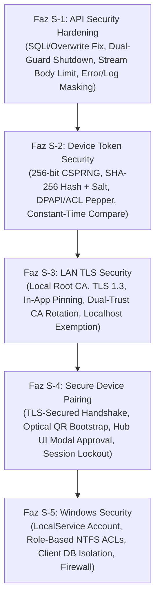
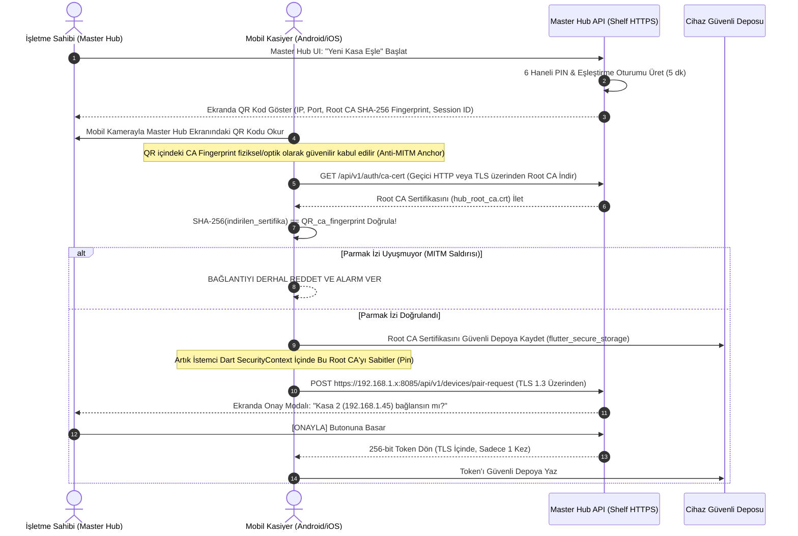

# MARKET MMS — SPIKE-01 Güvenlik İyileştirme Planı (Security Remediation Plan)

**Belge Türü:** Güvenlik Mimarisi Tasarım ve Düzeltme Planı (Revizyon 3)  
**Tarih:** 5 Kasım 2026  
**Hedef Sistem:** Windows Local Master Hub (Dart AOT + Shelf + SQLite Drift)  
**Referans Doküman:** [`test_spikes/spike_01_backend/SECURITY_AUDIT_REPORT.md`](./SECURITY_AUDIT_REPORT.md)  
**Durum:** Onay Bekliyor (Salt okunur planlama dokümanı; üretim koduna veya konfigürasyona dokunulmamıştır).

---

## 1. Yönetici Özeti ve Temel Mimari Sınırlar

Bu belge, `SECURITY_AUDIT_REPORT.md` teknik denetiminde tespit edilen 16 güvenlik bulgusunu ortadan kaldırmak için hazırlanan bağlayıcı mimari eylem planıdır.

### Korunan Temel Mimari İlkeler (0 Taviz)
1. **Windows Local Master Hub Merkeziyeti:** Windows masaüstü bilgisayar yerel hub olmaya devam eder; harici bulut sunucusu veya ters proxy (Nginx vb.) zorunluluğu getirilmez.
2. **Platform ve Cihaz Eşitliği:** Windows masaüstü, Android ve iOS mobil istemcileri aynı yetkili işlevleri (satış, stok, rapor) çalıştırır.
3. **Offline-First & Outbox Dokunulmazlığı:** Her terminal kendi yerel SQLite (Drift) veritabanına sahiptir. Ağ kopsa dahi satışlar yerelde tamamlanır, Outbox kuyruğuna yazılır ve ağ geldiğinde senkronize edilir. Güvenlik katmanı bu akışı asla engellemez.
4. **Tekil Yazıcı (Single-Writer):** Merkezi SQLite dosyasına yazma işlemleri yalnızca Windows Service içindeki `WriteQueue` üzerinden atomik olarak yürütülür.
5. **Yalın Mimari (KISS/YAGNI):** Ağır harici servisler (Redis, Docker) veya gereksiz üçüncü parti paketler sisteme eklenmez; Dart'ın yerleşik `dart:io`, `dart:crypto`, Shelf ve Windows yerel API'leri kullanılır.
6. **Banka POS Sınırı:** Banka POS cihazı entegrasyonu ilk sürümün kapsamı dışındadır.
7. **Google Drive Rolü:** Google Drive yalnızca periyodik veritabanı yedeğinin yüklendiği harici depolama alanıdır; canlı işlem veya kimlik doğrulama için kullanılmaz.

---

## 2. Revize Edilmiş Güvenlik İyileştirme Fazları (S-1'den S-5'e)

Ağ üzerinde kimlik bilgilerinin (PIN, OTP, Token) şifresiz iletilmesini engellemek amacıyla **LAN TLS Security (S-3)** fazı, **Secure Device Pairing (S-4)** fazından önceye alınmıştır.



---

## 3. Derinlemesine Teknik Güvenlik Değerlendirmeleri

### 3.1. Token Güvenliği, Salt vs. Pepper Rolleri ve DPAPI Değerlendirmesi

#### A. Neden bcrypt/Argon2 Değil de SHA-256?
1. **İnsan Parolası vs. Kriptografik Belirteç:**  
   İnsan parolaları düşük entropilidir ($20\text{--}40$ bit). Sözlük ve kaba kuvvet saldırılarını yavaşlatmak için bellek ve CPU tüketen yavaş KDF'ler (bcrypt, Argon2) zorunludur.  
   MMS cihaz belirteçleri ise Dart `Random.secure()` CSPRNG ile tam 256-bit entropiyle üretilir ($2^{256} \approx 1.157 \times 10^{77}$ anahtar uzayı). Bu anahtar uzayına karşı kaba kuvvet saldırısı matematiksel olarak olanaksızdır ($O(2^{256})$).
2. **Kasa Performansı ve CPU Koruması:**  
   bcrypt istek başına $\approx 100\text{--}300\text{ ms}$ CPU süresi tüketir. Giriş seviyesi bir market PC'sinde eşzamanlı fiş gönderen 3 terminal olması durumunda her API çağrısında bcrypt çalıştırmak CPU'yu %100'e kilitleyecek ve kasanın satış hızını düşürecektir. `SHA-256` ise $<0.01\text{ ms}$ tamamlanarak sıfır işlemci darboğazı sağlar.

#### B. Salt ve Pepper'ın Güvenlik Katkıları (Ayrı Ayrı):
- **Salt (Cihaz Başına Benzersiz):**  
  Her cihaz için `Random.secure()` ile 16 byte üretilir ve SQLite `Devices.salt` sütununda açık olarak saklanır.  
  *Katkısı:* Gökkuşağı tablolarını (rainbow tables) ve önceden hesaplanmış hash sözlüklerini tamamen etkisiz kılar. İki cihazın token'ı tesadüfen aynı olsa dahi veritabanındaki hash'leri farklı çıkar.
- **Pepper (Sistem Geneli Gizli Sır):**  
  256-bit uzunluğunda tekil bir sunucu sırrıdır. Kesinlikle SQLite veritabanı veya kaynak kod içinde tutulmaz.  
  *Katkısı:* SQLite veritabanı dosyası (`market_master.db`) bir yedekleme sızıntısı veya yetkisiz dosya kopyalama ile saldırganın eline geçse dahi, saldırgan pepper'a sahip olmadığı için ele geçirdiği hash'leri çevrimdışı (offline) olarak doğrulayamaz veya sahte token üretemez.

#### C. Windows DPAPI ve LocalService Değerlendirmesi:
- **Kapsam (Scope) Analizi:**  
  DPAPI iki kapsam sunar: `CurrentUser` ve `LocalMachine`.
  - `CurrentUser` Kapsamı: `NT AUTHORITY\LocalService` hesabı standart bir kullanıcı profili yüklemeden çalıştırıldığında kullanıcı anahtar deposu geçici veya erişilemez olabilir. Profil yükleme parametresi garanti edilmedikçe `CurrentUser` DPAPI çağrıları çalışma zamanında hata verebilir.
  - `LocalMachine` Kapsamı: Makine genelindeki sırları korur. Dosya başka bir bilgisayara taşındığında çözülemez. Ancak aynı makinede çalışan herhangi bir `Administrators` seviyesindeki süreç bunu çözebilir.
- **TPM/LSA Gerçekliği (Varsayım Yasağı):**  
  Piyasadaki market bilgisayarlarının çoğunda TPM 2.0 veya BitLocker aktif olmayabilir. Standart bir Windows kurulumunda DPAPI anahtarları donanımsal TPM yerine Windows LSA (Local Security Authority) kayıt defteri kovanlarında (`SYSTEM`) tutulur. Bu nedenle: **"TPM ile korunmaktadır" şeklinde kesin bir güvenlik iddiası yapılmayacak**, "Windows DPAPI makine seviyesinde zarf şifrelemesi (envelope encryption) sağlar" tespitiyle yetinilecektir.
- **Dosya ACL ile Çift Katmanlı Koruma:**  
  Pepper dosyası (`C:\ProgramData\MarketMMS\secrets\pepper.bin`) yalnızca DPAPI'ye emanet edilmeyecek; dosya sistemi seviyesinde **NTFS ACL** ile kilitlenecektir:
  - `BUILTIN\Administrators`: Tam Yetki (F)
  - `NT AUTHORITY\LocalService`: Salt Okunur (R)
  - Diğer tüm kullanıcılar (`Users`, `Authenticated Users`): **Tamamen Engelli (No Access)**.

#### D. Sabit Zamanlı Token Karşılaştırması (Timing Attack Koruması):
Standart string eşitliği (`a == b`) ilk uyuşmayan karakterde sonlanır (short-circuit). Bu durum saldırganın milisaniyenin altındaki yanıt gecikmelerini ölçerek token karakterlerini tek tek tahmin etmesine yol açabilir.
- **Kullanılacak Dart Yöntemi:**  
  Byte seviyesinde sabit zamanlı XOR akümülatörü kullanılır:
  ```dart
  bool constantTimeEquals(List<int> a, List<int> b) {
    if (a.length != b.length) return false;
    var result = 0;
    for (var i = 0; i < a.length; i++) {
      result |= a[i] ^ b[i];
    }
    return result == 0;
  }
  ```
- **Test Yöntemi:**  
  Unit testte doğru hash, ilk karakteri hatalı hash ve son karakteri hatalı hash verilerek fonksiyonun her durumda tüm diziyi dolaştığı ve doğrulama sonucunun değişmediği test edilir.

---

### 3.2. PIN Brute-Force Koruması ve Oturum Güvenliği

1. **PIN Parametreleri:** 6 haneli nümerik ($000000\text{--}999999$), ömrü kesin olarak 5 dakika (300 saniye), tek kullanımlık.
2. **3 Yanlış Denemede Oturum İptali:**  
   Aynı pairing session için 3 kez hatalı PIN girildiğinde, ilgili eşleştirme oturumu anında sunucu belleğinden silinir (`EXPIRED_OR_LOCKED`). PIN derhal geçersiz kalır.
3. **Yeni PIN Üretiminde Rate Limit:**  
   Master Hub ekranından kötü niyetli veya kontrolsüz şekilde art arda PIN üretilmesini engellemek için:
   - Yeni PIN üretme butonu tıklandıktan sonra en az 10 saniye boyunca yeni PIN üretilemez (UI cooldown).
   - 15 dakikalık bir pencerede en fazla 5 adet yeni PIN üretilebilir.
4. **LAN IP Ayrımı (Ortak IP Çakışmasını Önleme):**  
   Market yerel ağında bazı cihazlar Wi-Fi yönlendiricinin NAT veya bridge yapılandırması nedeniyle sunucuya aynı IP üzerinden gelebilir.
   - **Kural:** Kaba kuvvet engellemesi doğrudan IP'ye değil, **öncelikle `session_id`'ye bağlanır**. Oturum kilitlendiğinde diğer cihazların eşleşmesi etkilenmez.
   - **Ek IP Koruması:** IP bazlı kısıtlama yalnızca aşırı flooding saldırılarına karşı (örneğin aynı IP'den dakikada 30'dan fazla geçersiz istek gelirse) devreye girer.
5. **Log Hijyeni Kuralı:**  
   PIN değerleri, tek seferlik parolalar ve ham token metinleri log dosyalarına (`.out.log`, `.err.log`, console) **asla açık metin olarak yazılamaz**. Loglarda yalnızca `session_id` ve maskeli `deviceId` (`dev_***_4f`) tutulur.

---

### 3.3. TLS Bootstrap Süreci ve Güven Zinciri Mimarisi

Yerel ağdaki mobil cihazların Master Hub'a güvenli bağlanabilmesi için işletim sistemi sertifika depolarına bağımlı olmayan **Optik Tabanlı Güven Aktarımı (Optical Out-of-Band Trust Bootstrap)** mimarisi uygulanır.



#### A. QR Kod İçeriği:
QR kod yalnızca IP değil, güven çapasını (trust anchor) taşır:
```json
{
  "v": 1,
  "hub_ip": "192.168.1.100",
  "port": 8085,
  "ca_sha256": "4F:A2:8B:91:...:E3",
  "session_id": "pair_sess_8912",
  "expires_at": 1793892700
}
```

#### B. İlk Bağlantıda MITM Engelleme (Anti-MITM Anchor):
Saldırgan yerel ağda ARP poisoning veya DNS spoofing yapsa dahi, QR kod fiziksel olarak bilgisayar ekranından kamera ile doğrudan okunduğu için optik kanal manipüle edilemez. İstemci, indirdiği kök sertifikanın SHA-256 hash'ini QR'daki `ca_sha256` ile karşılaştırır. 1 bit bile farklıysa bağlantı anında koparılır.

#### C. CA Özel Anahtarının (Private Key) Korunması:
Root CA özel anahtarı (`hub_root_ca.key`), sunucuda `%ProgramData%\MarketMMS\secrets\ca.key` altında saklanır.
- Yalnızca `LocalService` okuma yetkisine, `Administrators` tam yetkiye sahiptir.
- Standart kullanıcıların erişimi NTFS ACL ile engellenir.
- Sunucu sertifikası üretildikten sonra `ca.key` dosyası isteğe bağlı olarak yerel şifreli bir parola ile korunur.

#### D. Root CA vs. Sunucu (Leaf) Sertifikası Yenilemesi:
- **Sunucu (Leaf) Sertifikası Yenilemesi:**  
  1 yıl geçerlidir. Mevcut Root CA altında her 11 ayda bir arka planda otomatik yenilenir. Mobil cihazlar Root CA'yı sabitlediği için **mobil terminallerde hiçbir kesinti veya yeniden eşleştirme gerekmez**.
- **Root CA Rotasyonu (10 Yıllık Döngü veya İhlal Durumu):**  
  Master Hub yeni bir Root CA v2 oluşturur. Geçiş penceresinde sunucu her iki CA zincirini (Dual-Trust Chain) sunar. Eşleşmiş terminaller periyodik arka plan senkronizasyonu sırasında Root CA v2'yi indirir ve güven deposuna ekler. Tüm cihazlar v2'ye geçtikten sonra v1 devre dışı bırakılır.

#### E. Android, iOS ve Windows Dart/Flutter Doğrulama Mekanizması:
- İşletim sistemi sertifika deposu yerine doğrudan Dart seviyesinde sabitleme uygulanır:
  ```dart
  final secContext = SecurityContext(withTrustedRoots: false);
  secContext.setTrustedCertificatesBytes(storedRootCaBytes);
  final httpClient = HttpClient(context: secContext);
  ```
- **Yasaklı Desen:** `badCertificateCallback` fonksiyonunun koşulsuz `true` dönmesi kesinlikle yasaktır.
- **Spike Testi Zorunluluğu:** Android (Network Security Config) ve iOS (ATS) ortamlarında Dart `SecurityContext` davranışının platform seviyesinde engellenmediği gerçek cihaz/emülatör spike testleriyle doğrulanacaktır.

---

### 3.4. Windows Klasör İzinleri ve LocalService / Windows UI Rol Ayrımı

Dosya izinleri kullanım amacına göre 5 ayrı bölgeye ayrılmıştır:

| Klasör / Dosya Yolu | İçerik | Erişim İhtiyacı | Uygulanacak NTFS ACL |
| :--- | :--- | :--- | :--- |
| **`C:\ProgramData\MarketMMS\data\`** | Merkezi SQLite (`market_master.db`), WAL, SHM | Yalnızca Backend Servisi | `Administrators: (F)`, `LocalService: (OI)(CI)(F)`. Standard Users: **YOK**. |
| **`C:\ProgramData\MarketMMS\logs\`** | WinSW ve Backend Logları (`.log`) | Servis yazar, Yönetici inceler | `Administrators: (F)`, `LocalService: (OI)(CI)(M)`. Standard Users: **YOK**. |
| **`C:\ProgramData\MarketMMS\backups\`** | Yerel veritabanı snapshot yedekleri | Servis oluşturur, Yedekleme aracı okur | `Administrators: (F)`, `LocalService: (OI)(CI)(F)`. Standard Users: **YOK**. |
| **`C:\ProgramData\MarketMMS\secrets\`** | Pepper, CA Private Key | Servis okur | `Administrators: (F)`, `LocalService: (OI)(CI)(R)`. Standard Users: **YOK**. |
| **`%LOCALAPPDATA%\MarketMMS\client\`** | **Windows UI Yerel Veritabanı** (Drift) | Windows Masaüstü Kasiyer Kullanıcısı | Kullanıcının kendi profil klasörüdür (`C:\Users\<Kullanici>\...`). Kullanıcı tam yetkilidir. `LocalService` buraya erişmez. |

> [!IMPORTANT]
> **Windows UI Yerel Veritabanı Kuralı:**  
> Windows masaüstü Flutter UI kendi yerel veritabanını (offline satış ve Outbox için) `%LOCALAPPDATA%\MarketMMS\client\` altında çalıştırır. `LocalService` izinleri yalnızca `%ProgramData%\MarketMMS\` dizinini kapsar; Windows UI'nin kendi yerel veritabanına erişimi asla kısıtlanamaz.

---

### 3.5. API Hardening Ek Güvenlik Kriterleri

1. **CORS Sınırının Belirtilmesi:**  
   CORS kısıtlamaları yalnızca web tarayıcılarını bağlar; cURL, mobil uygulamalar veya Python script'leri CORS başlıklarını dikkate almaz. CORS tek başına bir API güvenlik katmanı değildir; yalnızca web tabanlı tarayıcı saldırılarını (CSRF/XSS tabanlı çağrılar) önler.
2. **Stream Seviyesinde Request Body Sınırı (2 MB):**  
   Yalnızca `Content-Length` header kontrolü yetersizdir (chunked transfer ile sahte header gönderilebilir). Shelf middleware gelen stream'i (`request.read()`) byte sayacı ile tüketmeli; kümülatif boyut 2.097.152 byte'ı aştığı anda stream kesilmeli ve `413 Payload Too Large` fırlatılmalıdır.
3. **Shutdown Uç Noktasında Çift Korumalı Güvenlik (Dual-Guard):**  
   `/api/v1/admin/shutdown` uç noktası iki kilit ile korunur:
   - **Kilit 1 (Loopback Denetimi):** İstek IP'si kesinlikle `127.0.0.1`, `::1` veya `0:0:0:0:0:0:0:1` olmalıdır.
   - **Kilit 2 (Yetkilendirme):** İstek, servis başlarken bellekte/yerel sır dosyasında üretilen yerel admin yetkilendirme anahtarını (`Bearer <local_admin_secret>`) taşımak zorundadır.
4. **Backup Dosya Yolu Yalıtımı:**  
   İstemciden kesinlikle `target_path` veya dosya adı parametresi kabul edilmez. Yedekleme yolu tamamen sunucu tarafında oluşturulur (`C:\ProgramData\MarketMMS\backups\backup_YYYYMMDD_HHMMSS.db`).
5. **Ayrı Hata Maskeleme ve Log Güvenliği Kriterleri:**  
   - *İstemci Yanıtı:* İç detaylar gizlenmiş, standart generic JSON hata kodları (`{"error": "TRANSACTION_FAILED", "code": "ERR_INTERNAL"}`).
   - *Sunucu Logu:* Detaylı hata izi yerel log dosyasına yazılır, ancak hassas veriler (kart, token, PIN) filtrelenir.

---

## 4. Faz Bazında İyileştirme Detayları ve Kabul Kriterleri

---

### FAZ S-1: API Security Hardening (Uç Nokta Sıkılaştırma)

**İlgili Bulgular:** `SEC-02`, `SEC-04`, `SEC-07`, `SEC-08`, `SEC-09`, `SEC-12`

#### Kabul Kriterleri (Acceptance Criteria):
- [ ] `POST /api/v1/backup/snapshot` endpoint'i `target_path` parametresi almaz; yedek sunucuda sabit klasöre güvenli zaman damgasıyla yazılır.
- [ ] `/api/v1/admin/shutdown` uç noktası hem IPv4/IPv6 loopback (`127.0.0.1`, `::1`) kontrolü hem de yerel admin sırrı doğrulaması yapar.
- [ ] Gelen istek gövdesi stream okunurken 2 MB'ı geçtiği anda bağlantı kesilerek 413 döner.
- [ ] HTTP 500 yanıtlarında `e.toString()`, stack trace veya dosya yolu kesinlikle sızmaz.
- [ ] `/health` yanıtından SQLite sürüm ifşası kaldırılır (`{"status": "UP"}`).
- [ ] CORS wildcard (`*`) kaldırılır.

#### Etkilenen Dosyalar:
- `test_spikes/spike_01_backend/bin/server.dart`
- `test_spikes/spike_01_backend/lib/src/http/auth_middleware.dart`

#### Test-First Senaryoları (`test/s1_api_hardening_test.dart`):
1. *SQLi Testi:* Backup endpoint'ine enjeksiyon karakterleri gönderilse dahi güvenli yedek alındığı doğrulanır.
2. *Shutdown Testi:* Uzak IP'den veya yetkisiz loopback'ten gelen kapatma isteği 403 ile reddedilir.
3. *Stream Body Testi:* Chunked transfer ile parça parça gönderilen 2.5 MB veri stream ortasında kesilerek 413 alır.
4. *Hata Maskeleme Testi:* Veritabanı hatasında yanıtta yalnızca generic kod döner, loga güvenli stack trace düşer.

---

### FAZ S-2: Device Token Security (Kriptografik Token ve Hash Saklama)

**İlgili Bulgular:** `SEC-06`, `SEC-10`, `S-02`

#### Kabul Kriterleri (Acceptance Criteria):
- [ ] Belirteçler `Random.secure()` ile 256-bit CSPRNG kullanılarak üretilir (`mms_dt_<base64url>`).
- [ ] `Devices` tablosundaki `token` sütunu kaldırılır; `token_hash` (SHA-256) ve benzersiz `salt` sütunları eklenir.
- [ ] Pepper sırrı SQLite dışında `C:\ProgramData\MarketMMS\secrets\pepper.bin` içinde saklanır ve NTFS ACL ile kilitlenir.
- [ ] Token karşılaştırması byte seviyesinde sabit zamanlı fonksiyon ile yapılır.
- [ ] Master Hub üzerinden iptal edilen cihazın yetkisi anında sonlandırılır (bellek önbelleği ve veritabanı güncellenir).
- [ ] Ham token metinleri hiçbir loga yazılmaz.

#### Etkilenen Dosyalar:
- `test_spikes/spike_01_backend/lib/src/database/database.dart`
- `test_spikes/spike_01_backend/lib/src/http/auth_middleware.dart`
- `test_spikes/spike_01_backend/lib/src/security/crypto_utils.dart` (Yeni)

#### Test-First Senaryoları (`test/s2_token_security_test.dart`):
1. *Entropi Testi:* Üretilen token'ların 256-bit tahmin edilemezliği test edilir.
2. *Veritabanı İnceleme Testi:* Doğrudan SQLite dosyası okunduğunda açık token bulunmadığı kanıtlanır.
3. *Sabit Zaman Testi:* Karşılaştırma fonksiyonunun tüm byte'ları taradığı doğrulanır.
4. *Anında İptal Testi:* Pasif yapılan cihazın sonraki ilk isteğinde 401 aldığı doğrulanır.

---

### FAZ S-3: LAN TLS Security (Yerel Ağ Şifreleme ve Kök CA Mimarisi)

**İlgili Bulgular:** `SEC-03`, `S-01`, `S-07`

#### Kabul Kriterleri (Acceptance Criteria):
- [ ] Master Hub ilk kurulumda yerel Root CA ve bu CA imzalı 1 yıllık sunucu TLS sertifikası üretir.
- [ ] Shelf HTTP sunucusu HTTPS (`bindSecure`) TLS 1.3 desteğiyle başlar.
- [ ] İstemciler Root CA'yı sabitler (pin); sunucu sertifikası yenilendiğinde istemci bağlantısı kopmaz.
- [ ] Root CA özel anahtarı `secrets\` altında yalnızca `LocalService` ve `Administrators` erişimine açılır.
- [ ] Windows yerel masaüstü loopback trafiği için TLS yükü olmadan çalışma seçeneği korunur.

#### Etkilenen Dosyalar:
- `test_spikes/spike_01_backend/lib/src/security/tls_manager.dart` (Yeni)
- `test_spikes/spike_01_backend/bin/server.dart`

#### Test-First Senaryoları (`test/s3_tls_security_test.dart`):
1. *HTTPS Zorunluluğu:* Şifresiz HTTP isteklerinin reddedildiği doğrulanır.
2. *Pinning Testi:* Root CA'sı sabitlenen istemcinin başarıyla bağlandığı doğrulanır.
3. *Sahte CA / MITM Testi:* Farklı bir CA ile sunulan sertifikanın `HandshakeException` ile anında kesildiği test edilir.
4. *Sunucu Sertifikası Rotasyon Testi:* Sunucu sertifikası yenilendiğinde istemcinin kesinti yaşamadan istek attığı kanıtlanır.

---

### FAZ S-4: Secure Device Pairing (Güvenli Cihaz Eşleştirme ve Onay Protokolü)

**İlgili Bulgular:** `SEC-01`, `S-01`

#### Kabul Kriterleri (Acceptance Criteria):
- [ ] Açık `POST /api/v1/devices/register` endpoint'i tamamen kaldırılır.
- [ ] Eşleştirme trafiği kesinlikle Faz S-3 TLS kanalı üzerinden yürütülür.
- [ ] PIN 6 haneli, tek kullanımlık ve 5 dakika geçerlidir.
- [ ] 3 hatalı denemede eşleştirme oturumu derhal silinir.
- [ ] Yeni PIN üretimi 10 saniyelik arayüz cooldown'ı ve 15 dakikada en fazla 5 üretim ile sınırlandırılır.
- [ ] QR kod içinde Root CA SHA-256 fingerprint'i taşınır ve istemci tarafından doğrulanır.
- [ ] Master Hub ekranından fiziksel onay verilmeden hiçbir cihaza token teslim edilmez.
- [ ] Token yalnızca yanıt anında istemciye 1 kez verilir; bir daha sunucudan açık okunamaz.

#### Etkilenen Dosyalar:
- `test_spikes/spike_01_backend/lib/src/security/pairing_manager.dart` (Yeni)
- `test_spikes/spike_01_backend/bin/server.dart`
- `test_spikes/spike_01_backend/lib/src/http/auth_middleware.dart`

#### Test-First Senaryoları (`test/s4_device_pairing_test.dart`):
1. *Eski Uç Nokta İptali:* Eski register rotasının 404 döndüğü doğrulanır.
2. *Onaysız Token Engeli:* PIN doğru olsa dahi Master Hub onayı olmadan token alınamadığı test edilir.
3. *Oturum Kilitlenme Testi:* 3 kez yanlış PIN girildiğinde oturumun sonlandığı doğrulanır.
4. *Rate Limit Testi:* 10 saniye dolmadan yeni PIN üretme isteğinin reddedildiği kanıtlanır.
5. *Optik Trust Doğrulama Testi:* Parmak izi uyuşmayan sertifikayı istemcinin derhal reddettiği test edilir.

---

### FAZ S-5: Windows Security (Servis Hesabı, ACL ve İşletim Sistemi Güvenliği)

**İlgili Bulgular:** `SEC-05`, `SEC-11`, `S-04`

#### Kabul Kriterleri (Acceptance Criteria):
- [ ] WinSW servisi `LocalSystem` yerine `NT AUTHORITY\LocalService` ile çalıştırılır.
- [ ] `C:\ProgramData\MarketMMS\` dizini rol bazlı NTFS ACL'ler ile kilitlenir; standart Windows kullanıcılarının merkezi DB, log, backup ve secret dosyalarına erişimi engellenir.
- [ ] Windows Flutter UI'nin kendi yerel veritabanı (`%LOCALAPPDATA%\MarketMMS\client\`) etkilenmez ve erişilebilir kalır.
- [ ] Windows Güvenlik Duvarı'nda 8085 portu yalnızca `Private` profile için açılır.

#### Etkilenen Dosyalar:
- `test_spikes/spike_01_backend/service_wrapper/MarketMmsSpike01.xml`
- `test_spikes/spike_01_backend/scripts/setup_service_acls.ps1` (Yeni)

#### Test-First ve Gerçek Ortam Doğrulama Senaryoları (`test/s5_windows_security_test.dart`):
1. *Servis Hesabı Testi:* `sc qc MarketMmsSpike01` ile hesabın `LocalService` olduğu doğrulanır.
2. *ACL Engelleme Testi:* Standart kullanıcı bağlamında merkezi DB'ye erişim reddedilir (Access Denied).
3. *LocalService İşlem Testi:* Servisin `WriteQueue`, WAL ve backup işlemlerini hatasız tamamladığı doğrulanır.
4. *UI Yerel DB Testi:* Masaüstü kullanıcısının kendi yerel veritabanına sorunsuz yazdığı kanıtlanır.

---

## 5. Uygulama Sırası ve Bağımlılık Matrisi

```
[Faz S-1: API Sıkılaştırma] -> [Faz S-2: Token Güvenliği] -> [Faz S-3: LAN TLS] -> [Faz S-4: Güvenli Eşleştirme] -> [Faz S-5: Windows Güvenliği]
```

1. **Adım 1 (Faz S-1):** SQLi, loopback shutdown, stream body limit, error masking. (Bağımsız, hemen uygulanabilir).
2. **Adım 2 (Faz S-2):** 256-bit token, SHA-256 hash, salt, DPAPI/ACL pepper, sabit zamanlı kıyaslama.
3. **Adım 3 (Faz S-3):** Yerel Root CA, HTTPS Shelf dinleyicisi, sertifika sabitleme altyapısı.
4. **Adım 4 (Faz S-4):** TLS üzerinden çalışan, optik QR doğrulamalı ve Hub onaylı PIN/OTP eşleştirme protokolü.
5. **Adım 5 (Faz S-5):** WinSW `LocalService` hesabı, rol bazlı NTFS ACL'ler ve güvenlik duvarı kuralları.

---

## 6. Pilot Öncesi Zorunlu Güvenlik Kriterleri (Sign-off Checklist)

Pilot market mağazasında canlı kasalara kurulum yapılmadan önce aşağıdaki 8 kriterin **%100 karşılandığı** test raporlarıyla kanıtlanmalıdır:

- [ ] **Kriter 1 (Açık Kayıt Yok):** `/api/v1/devices/register` açık uç noktası tamamen silinmiş, eşleştirme yalnızca Master Hub UI onaylı ve TLS üzerinden yapılabilir olmalıdır.
- [ ] **Kriter 2 (SQLi ve Path Güvenliği):** `/api/v1/backup/snapshot` endpoint'i kesinlikle kullanıcıdan dosya yolu parametresi kabul etmemeli; yedekler sabit sunucu dizininde üretilmelidir.
- [ ] **Kriter 3 (Admin Koruması):** `/api/v1/admin/shutdown` uç noktasına LAN'dan erişim engellenmiş; hem IPv4/IPv6 loopback hem de yerel admin sırrı zorunlu olmalıdır.
- [ ] **Kriter 4 (Hash Saklama):** SQLite veritabanında açık token kalmamış; tüm token'lar 256-bit üretilip SHA-256 + Salt + Pepper ile saklanmalıdır.
- [ ] **Kriter 5 (Bilgi Sızıntısı Yok):** HTTP 500 yanıtlarında sistem hata izleri veya dosya yolları maskelenmiş; `/health` çıktısından sürüm ifşası kaldırılmış, token ve PIN'ler loglardan arındırılmış olmalıdır.
- [ ] **Kriter 6 (Stream Body Koruması):** İstek gövdesi stream okunurken en fazla 2 MB ile sınırlandırılmış olmalıdır.
- [ ] **Kriter 7 (Ağ Şifrelemesi):** Mobil terminaller ile Master Hub arasındaki tüm LAN iletişimi TLS 1.3 ve uygulama içi sertifika sabitleme ile şifrelenmiş olmalıdır.
- [ ] **Kriter 8 (İşletim Sistemi İzolasyonu):** WinSW servisi `LocalService` ile çalışmalı; veri klasörü standart kullanıcılara NTFS ACL ile kapatılırken, Windows UI yerel veritabanı erişimi korunmuş olmalıdır.

---

## 7. Açık Kalan Teknik Belirsizlikler ve Spike Test İhtiyaçları

1. **Android/iOS Dart `SecurityContext` Spike Testi:**  
   - *Belirsizlik:* Android Network Security Config veya iOS ATS'in, özel Root CA'yı sabitleyen Dart `HttpClient` isteklerini işletim sistemi seviyesinde bloklayıp bloklamadığı.  
   - *Gereksinim:* Mobil emülatör veya gerçek cihaz üzerinde çalışan minimal bir Dart TLS bağlantı spike testi yapılmalıdır.
2. **LocalService DPAPI Uyumluluğu:**  
   - *Belirsizlik:* `LocalService` hesabının profil yükleme yapılmadığı Windows sürümlerinde `CurrentUser` DPAPI anahtarına erişim kararlılığı.  
   - *Gereksinim:* Gerekirse `LocalMachine` kapsamı + sıkı NTFS ACL kombinasyonunun benimsenmesi veya Dart FFI ile doğrulanması.
3. **Master Hub IP Değişimi (DHCP):**  
   - *Belirsizlik:* Market içi router yeniden başladığında IP'nin değişmesi durumunda QR kodunun yenilenmesi.  
   - *Gereksinim:* Kurulum kılavuzunda Master Hub PC için router üzerinde statik DHCP IP rezervasyonu zorunlu tutulmalıdır.

---

## 8. Mevcut Mimari Kararlarla Uyumluluk Analizi (0 Çelişki)

| Mimari Konu | Onaylanmış Mimari Karar | Bu Güvenlik Planındaki Yaklaşım | Çelişki / Sapma |
| :--- | :--- | :--- | :---: |
| **Local Master Hub** | Windows PC merkezi veritabanı ve koordinatördür. | Windows PC merkezi kalır; harici bulut sunucusu veya ters proxy eklenmez. | **YOK (Tam Uyumlu)** |
| **Dart AOT + Shelf** | Hafif, tek parça binary backend. | Ekstra sunucu motoru (Nginx, IIS) eklenmez; Shelf HTTPS kullanılır. | **YOK (Tam Uyumlu)** |
| **Offline-First Satış** | Terminaller ağ kopsa dahi yerel satış yapabilmelidir. | Token doğrulama ve TLS yalnızca LAN senkronizasyonu içindir; yerel satış motoru etkilenmez. | **YOK (Tam Uyumlu)** |
| **Tekil Yazıcı (WriteQueue)**| Merkezi DB'ye sadece tek bir kuyruk yazar. | Güvenlik kontrolleri Shelf middleware katmanında yapılır; WriteQueue'ya dokunulmaz. | **YOK (Tam Uyumlu)** |
| **Windows UI Yerel DB** | Windows masaüstü kasiyeri kendi yerel Outbox DB'sine yazar. | Kullanıcı profilinde tutulur, LocalService ACL kısıtlamasından izole edilir. | **YOK (Tam Uyumlu)** |
| **Google Drive Rolü** | Yalnızca periyodik yedekleme hedefidir. | Canlı akışa sokulmaz; sadece güvenli yedek dosyası buraya yüklenir. | **YOK (Tam Uyumlu)** |
| **Banka POS Entegrasyonu** | Sürüm 1.0 kapsamı dışındadır. | Kapsam dışı tutulmaya devam edilmiştir. | **YOK (Tam Uyumlu)** |

---

## 9. Sonuç ve Sonraki Adım

Revizyon 3 ile:
- TLS bootstrap süreci optik QR çapa doğrulamasıyla MITM saldırılarına karşı tam tanımlanmış,
- LocalService ve Windows UI veritabanı ayrımı yapılmış,
- Sabit zamanlı karşılaştırma ve stream seviyesinde body limiti kuralları netleştirilmiş,
- Salt ve pepper rolleri birbirinden ayrıştırılarak DPAPI sınırları objektif olarak kayda geçirilmiştir.

**Kural Hatırlatması:** Bu aşamada hiçbir kod, konfigürasyon veya test dosyası değiştirilmemiştir. Faz S-1 için kullanıcı geliştirme onayı beklenmektedir.
